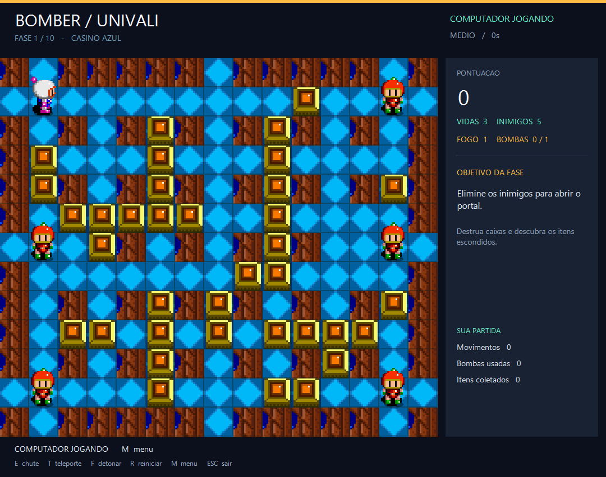
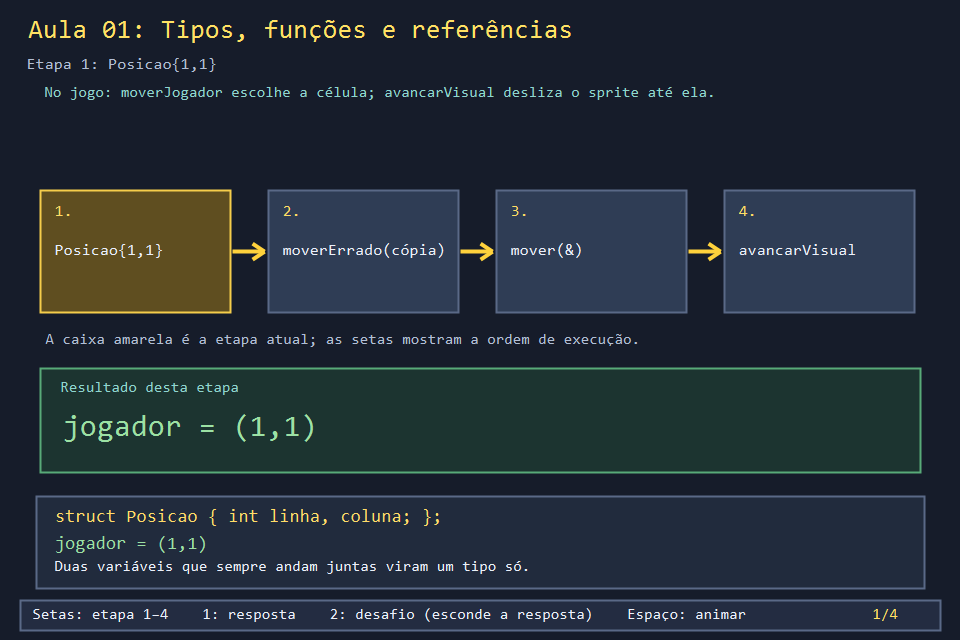
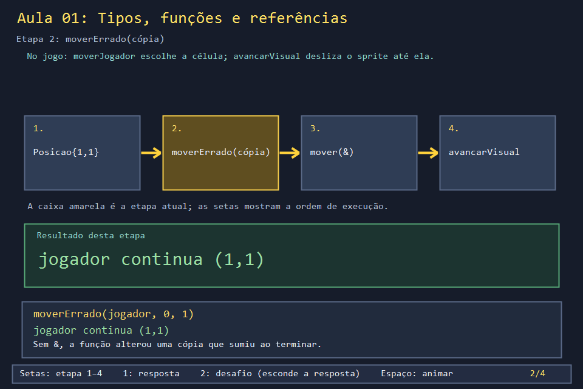
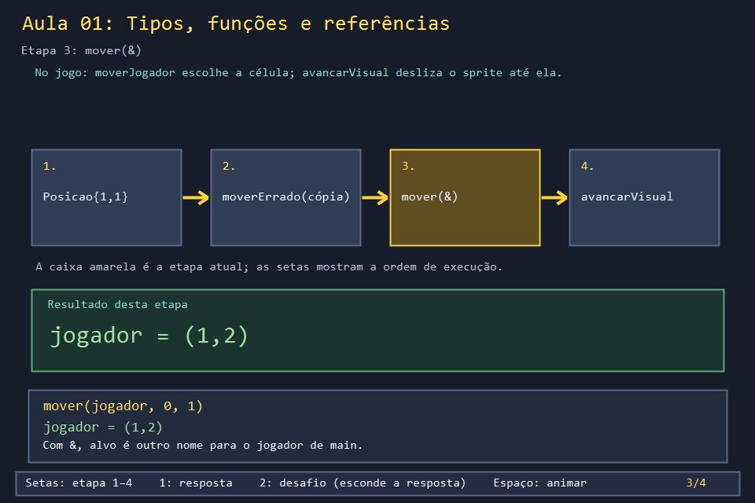
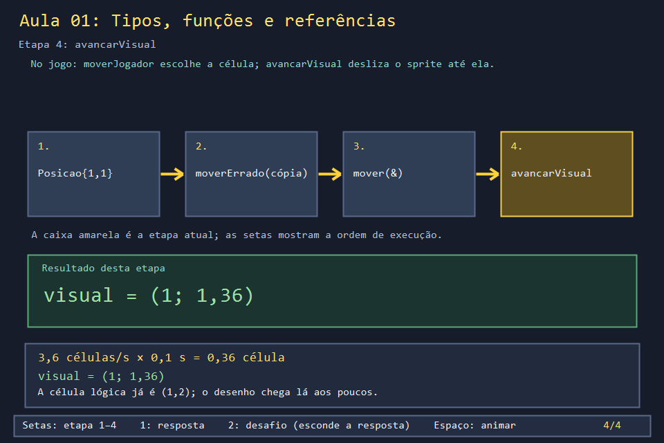

# Aula 01 — Tipos, funções e referências

| Trilha | Duração | Antes desta aula | Próxima na trilha |
| --- | --- | --- | --- |
| Fundamentos de C++ (01 → 02 → 29) | 45–60 min | lógica de programação | [Aula 02 — Matriz, enum e mapa](../Aula_02_matriz_enum_e_mapa/Aula_02_matriz_enum_e_mapa.md) |



Todo objeto do Bomberman ocupa uma **célula** da arena: o jogador, as bombas, os inimigos, os itens. Antes de qualquer janela ou sprite, o jogo precisa de um jeito de guardar "linha e coluna" e de funções que leiam ou alterem esse par. É isso que esta aula constrói, com as mesmas funções do jogo.

## O que você vai conseguir fazer

- Criar um tipo próprio com `struct` e explicar por que `Posicao` existe no jogo.
- Decidir entre passar um parâmetro **por valor** (cópia) ou **por referência** (`&`).
- Ler `avancarVisual`, uma função real que devolve resultados por duas referências.
- Prever a saída do programa antes de executá-lo.

## 1. A ideia

Uma `struct` junta variáveis que só fazem sentido juntas. `linha` e `coluna` soltas permitem misturar a linha do jogador com a coluna de um inimigo; dentro de `Posicao`, isso não acontece.

Uma função recebe parâmetros de dois jeitos:

| Forma | O que a função recebe | Quando usar no jogo |
| --- | --- | --- |
| `Posicao p` (valor) | uma **cópia** | só para ler (`iguais`) ou para calcular algo novo |
| `Posicao& p` (referência) | **a própria variável** de quem chamou, com outro nome | quando a função precisa alterar (`avancarVisual`) |

## 2. O código real

A definição é uma linha só, perto do início do arquivo:

<!-- trecho simbolo="Posicao" -->
```cpp
// projeto_final/bomberman.cpp, linha 108 (Posicao)
struct Posicao { int linha, coluna; };
```

`iguais` só lê as duas posições, então recebe cópias. Ela aparece em dezenas de lugares: colisão, coleta de itens, dano.

<!-- trecho simbolo="iguais" -->
```cpp
// projeto_final/bomberman.cpp, linhas 852–854 (iguais)
bool iguais(Posicao a, Posicao b) {
    return a.linha == b.linha && a.coluna == b.coluna;
}
```

`avancarVisual` é o motivo de o personagem deslizar em vez de pular de casa em casa. Ela precisa **alterar** `visualL` e `visualC`, por isso os dois parâmetros têm `&`. Já `alvo` é só lido: vem por valor.

<!-- trecho simbolo="avancarVisual" -->
```cpp
// projeto_final/bomberman.cpp, linhas 865–874 (avancarVisual)
float avancarVisual(float& visualL, float& visualC, Posicao alvo, int tempoMs) {
    float dl = static_cast<float>(alvo.linha) - visualL;
    float dc = static_cast<float>(alvo.coluna) - visualC;
    float distancia = sqrtf(dl * dl + dc * dc);
    if (distancia < 0.0001f) { visualL = static_cast<float>(alvo.linha); visualC = static_cast<float>(alvo.coluna); return 0; }
    float passo = min(distancia, VELOCIDADE_VISUAL_CELS_SEG * tempoMs / 1000.0f);
    visualL += dl / distancia * passo;
    visualC += dc / distancia * passo;
    return passo;
}
```

Repare no estilo de `moverJogador`: ela calcula um `destino` **novo** por valor e só copia para `jogador` depois de testar a colisão.

<!-- trecho simbolo="moverJogador" de="Posicao origem" ate="if (podeAndarPara" -->
```cpp
// projeto_final/bomberman.cpp, linhas 1375–1377 (moverJogador)
    Posicao origem = jogador;
    Posicao destino{jogador.linha + dl, jogador.coluna + dc};
    if (podeAndarPara(destino)) jogador = destino;
```

## 3. A versão desta aula

`Aula_01_tipos_funcões_e_referências.cpp` copia `Posicao`, `iguais` e `avancarVisual` e acrescenta duas funções de contraste: `moverErrado` (por valor) e `mover` (por referência). Antes de executar, escreva o que cada linha vai imprimir.

Saída esperada:

```text
moverErrado -> jogador=(1,1)
mover       -> jogador=(1,2)
iguais(jogador, destino)=1
apos 100 ms -> visual=(1,1.36) andou=0.36
```

A última linha é a conta do jogo: 3,6 células por segundo durante 0,1 s = 0,36 célula.

## 4. O que mudou em relação ao jogo e por quê

| No jogo | Nesta aula | Motivo |
| --- | --- | --- |
| `sqrtf` e `min` sem `std::` (o jogo usa `using namespace std`) | `std::sqrt`, `std::min` | deixar claro de onde cada função vem |
| `avancarVisual` é chamada a cada 8 ms pelo laço do jogo | uma chamada de 100 ms | ver o número de uma vez; o laço aparece na Aula 06 |
| não existe `moverErrado` | existe | mostrar o erro mais comum de quem começa |

## 5. Laboratório visual

O executável principal (`.\build\Aula_01.exe`) percorre o programa em quatro etapas. **Setas** avançam, **2** esconde a resposta para você prever, **1** revela.

| | |
| --- | --- |
|  |  |
|  |  |

```powershell
.\compilar_aula.ps1 -Numero 1     # compila o visual, o exemplo e gera as capturas
.\build\Aula_01.exe               # abre o laboratório visual
.\abrir_aula.ps1 -Numero 1 -Modo Exemplo   # roda o programa de console
```

## 6. Exercícios

1. **Previsão.** Troque `avancarVisual(visualL, visualC, jogador, 100)` por `250`. Qual será `visualC`? *(Resposta: 1,9 — 3,6 × 0,25 = 0,9.)* E com `400`? *(2 — `min` impede passar do destino; `andou` vira 1.)*
2. **Retorno por valor.** Escreva `Posicao somar(Posicao origem, int dl, int dc)` que devolve a célula vizinha sem alterar `origem`. Use-a como `moverJogador` usa `destino`: só aceite a nova posição se a célula for `'.'` no mapa `{"#####", "#..##", "#####"}`. Tente andar três vezes para a direita a partir de (1,1). *Solução: `solucoes/` — o jogador para em (1,2).*
3. **No jogo.** Leia o cabeçalho de `matarInimigo(Inimigo& inimigo, int& pontuacao, int dono)` em `projeto_final/bomberman.cpp`. Quais parâmetros ela altera e qual só lê? Por que `pontuacao` precisa de `&`? *(Resposta: altera `inimigo` — marca como morto — e `pontuacao`, que recebe os 100 pontos; `dono` é só lido. Sem `&`, os pontos seriam somados numa cópia e perdidos.)*

## 7. Erros comuns

- **Esquecer o `&` e achar que a função "não funciona".** O código roda, mas a alteração some. Sinal: o valor impresso depois da chamada é o mesmo de antes.
- **Pôr `&` em tudo "por garantia".** Uma referência deixa a função alterar o seu dado sem que isso esteja claro na chamada. O jogo usa `&` só onde a alteração é o objetivo.
- **Comparar structs com `==`.** `jogador == destino` não compila para `Posicao`; por isso o jogo escreveu `iguais`.

## 8. Antes de seguir

- [ ] Sei dizer por que `iguais` recebe por valor e `avancarVisual` por referência.
- [ ] Previ as quatro linhas da saída antes de rodar.
- [ ] Resolvi o exercício 2 sem olhar a solução.

## Referências

- [Referências em C++ (cppreference)](https://en.cppreference.com/w/cpp/language/reference)
- [Classes e structs (cppreference)](https://en.cppreference.com/w/cpp/language/class)
- Aula 29, seção "struct, valor e referência", para os mesmos conceitos aplicados ao resto do jogo.
