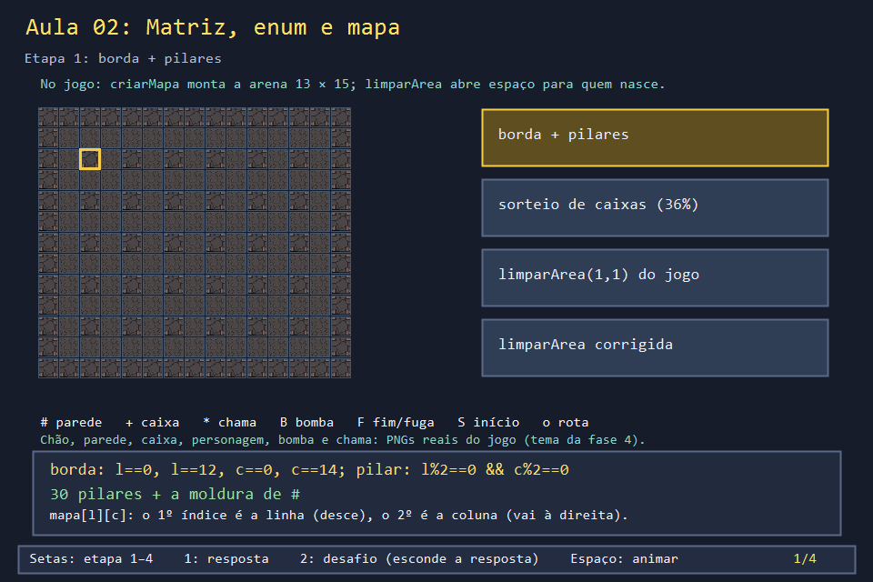
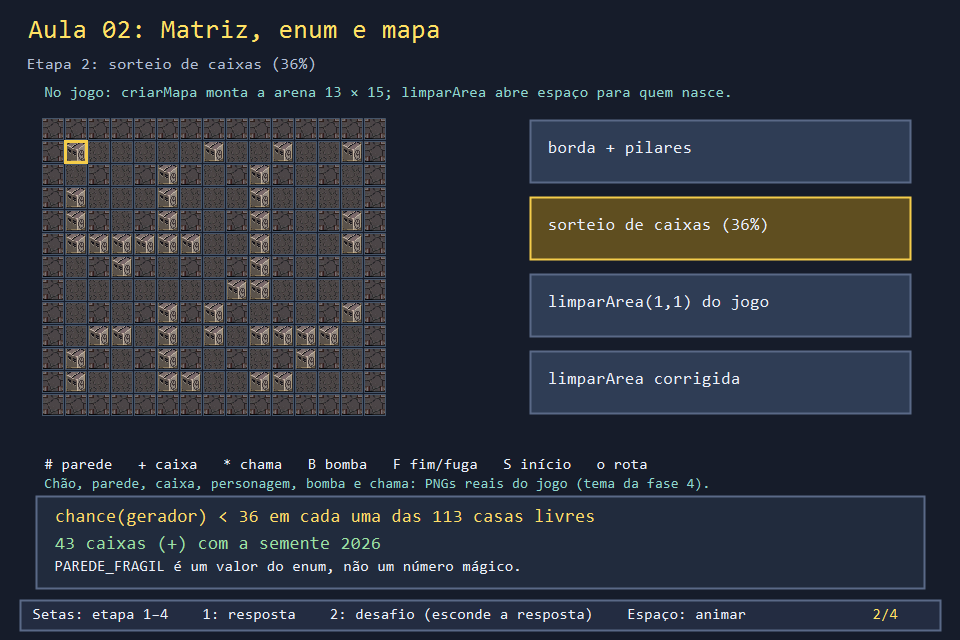
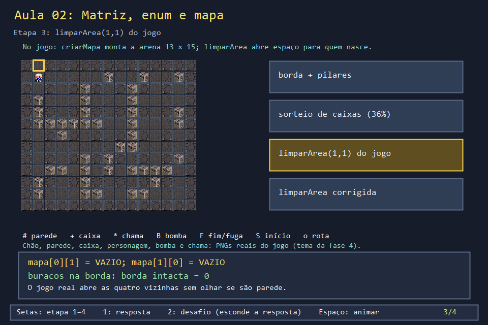
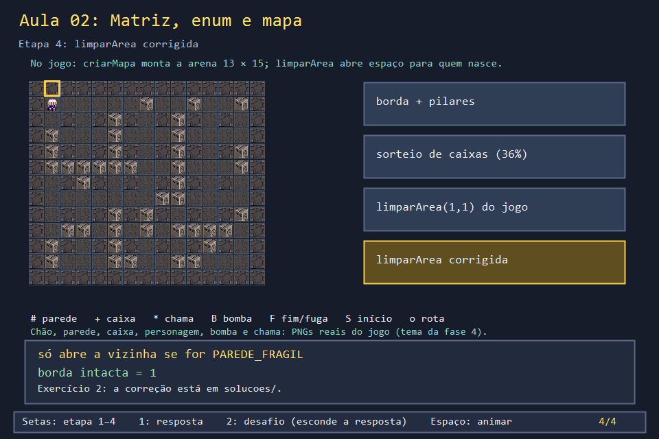

# Aula 02 — Matriz, enum e mapa

| Trilha | Duração | Antes desta aula | Próxima na trilha |
| --- | --- | --- | --- |
| Fundamentos de C++ (01 → 02 → 29) | 60–75 min | [Aula 01](../Aula_01_tipos_funcões_e_referências/Aula_01_tipos_funcões_e_referências.md) | [Aula 29 — O C++ que o jogo usa](../Aula_29_cpp_que_o_jogo_usa/Aula_29_cpp_que_o_jogo_usa.md) |


A arena do Bomberman é uma **matriz** de 13 linhas por 15 colunas. Cada casa guarda um valor de um **enum**: chão, parede, caixa, bloco com bônus ou portal. Tudo o que acontece no jogo (andar, explodir, coletar) consulta essa matriz. Nesta aula você monta a arena com as funções reais e, de quebra, encontra um bug de verdade no jogo.

## O que você vai conseguir fazer

- Declarar e percorrer uma matriz `mapa[LINHAS][COLUNAS]` sem trocar linha por coluna.
- Usar um `enum` para dar nome aos estados de uma célula.
- Ler `criarMapa` e explicar as regras de borda, pilar e caixa.
- Usar um teste (`bordaIntacta`) para achar e corrigir um bug.

## 1. A ideia

```text
            coluna 0 → 14
linha 0   ###############      # PAREDE_SOLIDA (borda e pilares)
   ↓      #.....+.......#      + PAREDE_FRAGIL (caixa que explode)
linha 12  ###############      . VAZIO
```

`mapa[l][c]`: o primeiro índice escolhe a **linha** (desce), o segundo a **coluna** (vai para a direita). Um pilar existe onde linha **e** coluna são pares. As outras casas internas viram caixa com 36% de chance.

Por que `enum` e não `int`? `mapa[l][c] = 2` não diz nada; `mapa[l][c] = PAREDE_FRAGIL` diz a regra. E o compilador avisa se um `switch` sobre o enum esquecer um caso.

## 2. O código real

<!-- trecho simbolo="TipoCelula" -->
```cpp
// projeto_final/bomberman.cpp, linha 96 (TipoCelula)
enum TipoCelula { VAZIO, PAREDE_SOLIDA, PAREDE_FRAGIL, PAREDE_BONUS, PORTAL };
```

`criarMapa` percorre a matriz com dois `for` aninhados: o de fora anda nas linhas, o de dentro nas colunas.

<!-- trecho simbolo="criarMapa" -->
```cpp
// projeto_final/bomberman.cpp, linhas 1093–1104 (criarMapa)
void criarMapa() {
    uniform_int_distribution<int> chance(0, 99);
    for (int l = 0; l < LINHAS; l++) {
        for (int c = 0; c < COLUNAS; c++) {
            bool borda = l == 0 || l == LINHAS - 1 || c == 0 || c == COLUNAS - 1;
            bool pilar = l % 2 == 0 && c % 2 == 0;
            if (borda || pilar) mapa[l][c] = PAREDE_SOLIDA;
            else if (chance(gerador) < 36) mapa[l][c] = PAREDE_FRAGIL;
            else mapa[l][c] = VAZIO;
        }
    }
}
```

Depois do sorteio, o jogo escolhe oito posições de nascimento (cantos e meio das bordas) e abre espaço em volta de cada uma:

<!-- trecho simbolo="limparArea" -->
```cpp
// projeto_final/bomberman.cpp, linhas 1085–1091 (limparArea)
void limparArea(int linha, int coluna) {
    mapa[linha][coluna] = VAZIO;
    if (linha > 0) mapa[linha - 1][coluna] = VAZIO;
    if (linha < LINHAS - 1) mapa[linha + 1][coluna] = VAZIO;
    if (coluna > 0) mapa[linha][coluna - 1] = VAZIO;
    if (coluna < COLUNAS - 1) mapa[linha][coluna + 1] = VAZIO;
}
```

<!-- trecho simbolo="sortearPosicoesIniciais" -->
```cpp
// projeto_final/bomberman.cpp, linhas 1130–1138 (sortearPosicoesIniciais)
void sortearPosicoesIniciais(vector<Posicao>& posicoes) {
    // Cantos do mapa mais os pontos medios das bordas: da para o jogador e
    // os inimigos comecarem em posicoes diferentes a cada partida.
    posicoes = {{1, 1}, {1, COLUNAS - 2}, {LINHAS - 2, 1}, {LINHAS - 2, COLUNAS - 2},
                {1, COLUNAS / 2}, {LINHAS - 2, COLUNAS / 2},
                {LINHAS / 2, 1}, {LINHAS / 2, COLUNAS - 2}};
    shuffle(posicoes.begin(), posicoes.end(), gerador);
    for (const Posicao& p : posicoes) limparArea(p.linha, p.coluna);
}
```

Os testes `linha > 0` e `linha < LINHAS - 1` evitam sair da matriz, mas **não** evitam apagar a parede da borda. Toda posição inicial encosta na borda, então `limparArea` abre buracos nela. Em (6,1) e (6,13), a vizinha (6,2) ou (6,12) é um pilar, e ele também some. Olhe a fileira de cima da captura no topo desta página: há chão no meio da parede externa.

## 3. A versão desta aula

`Aula_02_matriz_enum_e_mapa.cpp` copia `TipoCelula`, `criarMapa` e `limparArea`. A única mudança é a semente fixa, `mt19937 gerador(2026)`: assim o mapa é sempre o mesmo e você pode prever a saída. No jogo a semente vem de `random_device`, e cada partida é diferente.

O programa imprime o mapa, conta as caixas e chama `bordaIntacta()`, um teste que verifica a moldura:

```text
#.#############      ← buraco em (0,1)
.......+..+..+#      ← buraco em (1,0)
...
caixas=43 (esperado perto de 41)
borda intacta=0
```

São 143 casas internas, menos 30 pilares: 113 casas sorteadas. 36% de 113 dá cerca de 41. Saiu 43, um valor normal para um sorteio.

## 4. O que mudou em relação ao jogo e por quê

| No jogo | Nesta aula | Motivo |
| --- | --- | --- |
| semente de `random_device` (muda sempre) | semente fixa 2026 | saída reproduzível para conferir a previsão |
| oito nascimentos, embaralhados | só `limparArea(1,1)` no exemplo; os oito na solução | começar com um caso e generalizar depois |
| `PAREDE_BONUS` e `PORTAL` são colocados depois (Aula 27) | não aparecem no mapa | foco em matriz e enum |
| não há `bordaIntacta` | há | um teste pequeno revela um bug que ninguém viu jogando |

## 5. Laboratório visual

Quatro estados reais do mapa da semente 2026: moldura e pilares, sorteio das caixas, o buraco criado pelo `limparArea` do jogo e a versão corrigida.

| | |
| --- | --- |
|  |  |
|  |  |

```powershell
.\compilar_aula.ps1 -Numero 2
.\build\Aula_02_matriz_enum_e_mapa.exe            # laboratório visual
.\abrir_aula.ps1 -Numero 2 -Modo Exemplo          # mapa no console
```

## 6. Exercícios

1. **Contas.** Sem executar, quantos pilares tem uma arena 11 × 13? *(Linhas pares internas: 2, 4, 6, 8 = 4; colunas pares internas: 2 a 10 = 5; total 20.)* Mude `LINHAS` e `COLUNAS` e confira contando os `#` internos.
2. **Corrija o bug.** Reescreva `limparArea` para abrir só as vizinhas que forem caixa (`PAREDE_FRAGIL`). Aplique-a nas oito posições de `sortearPosicoesIniciais` e escreva `pilaresIntactos()`. *Solução: `solucoes/` — imprime `borda intacta=1 pilares intactos=1`.*
3. **Densidade.** Troque `36` por `60`. Quantas caixas você espera? *(Cerca de 68.)* O que isso faria com o jogo? *(Mais pontos por caixa, mais bombas para abrir caminho, inimigos presos.)*
4. **switch e enum.** Apague o `case PORTAL` de `simbolo` e compile com `-Wall`. Que aviso aparece? *(Nenhum, porque há um `default`. Tire também o `default` e o g++ avisa `enumeration value 'PORTAL' not handled`.)*

## 7. Erros comuns

- **Trocar linha por coluna.** `mapa[c][l]` compila e "funciona" numa matriz quadrada; na 13 × 15 lê fora da memória. Use sempre os nomes `l`/`linha` e `c`/`coluna`.
- **Laço até `<=`.** `for (l = 0; l <= LINHAS; ...)` acessa a linha 13, que não existe. O compilador não avisa.
- **Proteger o índice e achar que protegeu a regra.** `if (linha > 0)` impede sair da matriz, mas não impede apagar a parede. São dois cuidados diferentes, como mostra o bug desta aula.

## 8. Antes de seguir

- [ ] Sei explicar por que um pilar fica onde linha e coluna são pares.
- [ ] Entendi por que a semente fixa ajuda a testar.
- [ ] Corrigi `limparArea` e provei a correção com `bordaIntacta` e `pilaresIntactos`.

## Referências

- [Arrays multidimensionais (cppreference)](https://en.cppreference.com/w/cpp/language/array#Multidimensional_arrays)
- [Enumerações (cppreference)](https://en.cppreference.com/w/cpp/language/enum)
- [`std::mt19937` e distribuições (cppreference)](https://en.cppreference.com/w/cpp/numeric/random)
- Aula 27: o resto da montagem da fase (bônus, portal e temas de arena).
