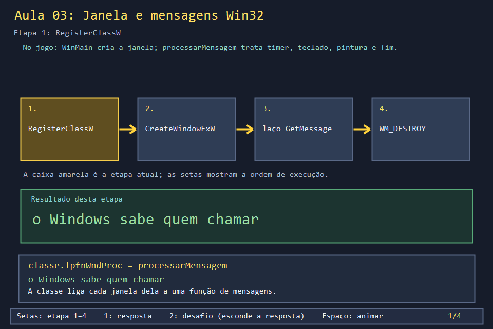
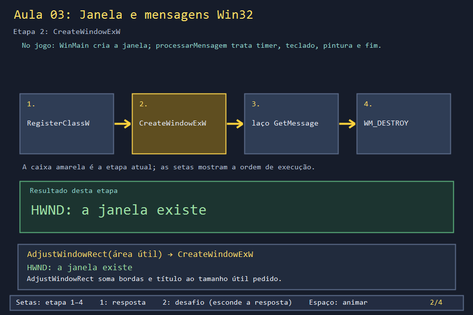
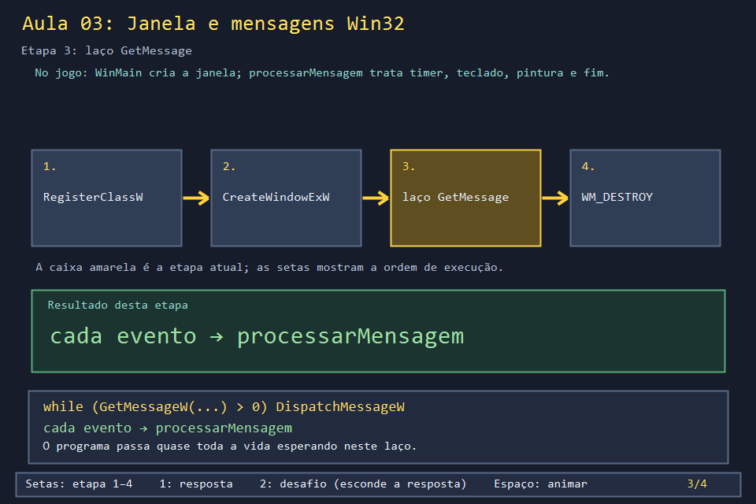
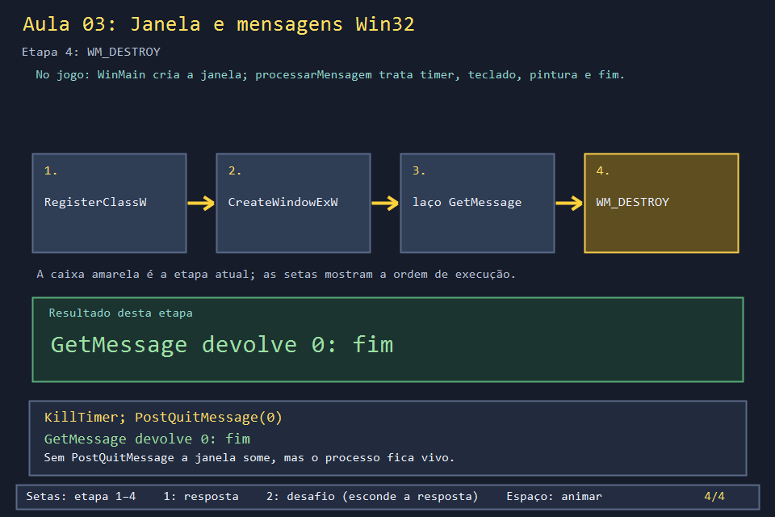

# Aula 03 — Janela e mensagens Win32

| Trilha | Duração | Antes desta aula | Próxima na trilha |
| --- | --- | --- | --- |
| Janela e desenho (03 → 04 → 05 → 24) | 60–90 min | [Aula 02](../Aula_02_matriz_enum_e_mapa/Aula_02_matriz_enum_e_mapa.md) | [Aula 04 — Formas, cores e GDI+](../Aula_04_formas_cores_e_gdiplus/Aula_04_formas_cores_e_gdiplus.md) |


Um programa de console começa em `main`, roda de cima para baixo e termina. Um jogo com janela funciona ao contrário: ele **espera**. O Windows avisa quando o tempo passou, quando uma tecla desceu, quando é preciso pintar ou quando o usuário fechou a janela. Cada aviso é uma **mensagem**, e o jogo inteiro é organizado em torno delas.

## O que você vai conseguir fazer

- Criar uma janela com `RegisterClassW`, `CreateWindowExW` e o laço de mensagens.
- Explicar quem chama `processarMensagem` e quando.
- Tratar `WM_CREATE`, `WM_TIMER`, `WM_KEYDOWN` e `WM_DESTROY` num `switch`, como o jogo faz.
- Encerrar o programa corretamente com `PostQuitMessage`.

## 1. A ideia

```text
WinMain
  ├─ RegisterClassW   "janelas desta classe falam com processarMensagem"
  ├─ CreateWindowExW  cria a janela
  └─ laço: GetMessageW → TranslateMessage → DispatchMessageW ─┐
                                                             ▼
                       processarMensagem(janela, mensagem, wParam, lParam)
                         switch (mensagem) { case WM_TIMER: ... case WM_KEYDOWN: ... }
```

Você nunca chama `processarMensagem` diretamente: quem chama é `DispatchMessageW`. O laço só termina quando `GetMessageW` devolve 0, e isso só acontece depois de `PostQuitMessage`.

## 2. O código real

O `WinMain` do jogo, no fim do arquivo. Ele faz exatamente os passos do diagrama. Antes deles vêm o ajuste de DPI (Aula 24) e o GDI+ (Aula 04):

<!-- trecho simbolo="WinMain" -->
```cpp
// projeto_final/bomberman.cpp, linhas 4414–4450 (WinMain)
int WINAPI WinMain(HINSTANCE instancia, HINSTANCE, LPSTR, int exibir) {
    tornarAplicacaoDpiAware();
    atualizarEscalaDpi(nullptr);
    Gdiplus::GdiplusStartupInput entradaGdiPlus;
    if (Gdiplus::GdiplusStartup(&tokenGdiPlus, &entradaGdiPlus, nullptr) != Gdiplus::Ok) return 1;

    const wchar_t CLASSE[] = L"BombermanUnivali";
    const wchar_t TITULO[] = L"Bomberman - Algoritmos e Programacao II";
    WNDCLASSW classe{};
    classe.lpfnWndProc = processarMensagem;
    classe.hInstance = instancia;
    classe.lpszClassName = CLASSE;
    classe.hCursor = LoadCursor(nullptr, IDC_ARROW);
    classe.hbrBackground = reinterpret_cast<HBRUSH>(COLOR_WINDOW + 1);
    RegisterClassW(&classe);

    RECT area{0, 0, px(LARGURA_JOGO), px(ALTURA_JOGO)};
    AdjustWindowRect(&area, WS_OVERLAPPEDWINDOW, FALSE);
    HWND janela = CreateWindowExW(0, CLASSE, TITULO,
        WS_OVERLAPPEDWINDOW,
        CW_USEDEFAULT, CW_USEDEFAULT, area.right - area.left, area.bottom - area.top,
        nullptr, nullptr, instancia, nullptr);
    if (!janela) {
        Gdiplus::GdiplusShutdown(tokenGdiPlus);
        return 1;
    }
    ShowWindow(janela, exibir);
    UpdateWindow(janela);

    MSG mensagem;
    while (GetMessageW(&mensagem, nullptr, 0, 0) > 0) {
        TranslateMessage(&mensagem);
        DispatchMessageW(&mensagem);
    }
    Gdiplus::GdiplusShutdown(tokenGdiPlus);
    return 0;
}
```

O começo de `processarMensagem`: um `switch` com um `case` por mensagem. `WM_CREATE` prepara tudo e liga o timer de 16 ms:

<!-- trecho simbolo="processarMensagem" ate="SetTimer(janela, 1, PASSO_LOGICA_MS, nullptr);" -->
```cpp
// projeto_final/bomberman.cpp, linhas 4260–4269 (processarMensagem)
LRESULT CALLBACK processarMensagem(HWND janela, UINT mensagem, WPARAM wParam, LPARAM lParam) {
    static auto ultimoInstante = chrono::steady_clock::now();
    switch (mensagem) {
    case WM_CREATE:
        janelaPrincipal = janela;
        atualizarEscalaDpi(janela);
        carregarAssets();
        iniciarMusica();
        atualizarEstadoControle(janela);
        SetTimer(janela, 1, PASSO_LOGICA_MS, nullptr);
```

Teclado: `WM_KEYDOWN` marca a tecla como apertada e repassa para `lerTeclado` (menus e ações, Aula 30). `WM_KEYUP` desmarca.

<!-- trecho simbolo="processarMensagem" de="case WM_KEYDOWN:" ate="case WM_LBUTTONUP:" -->
```cpp
// projeto_final/bomberman.cpp, linhas 4295–4306 (processarMensagem)
    case WM_KEYDOWN:
        if (wParam < 256) {
            if(!teclaPressionada[wParam]) ordemTecla[wParam]=++proximaOrdemTecla;
            teclaPressionada[wParam] = true;
        }
        lerTeclado(wParam, lParam);
        InvalidateRect(janela, nullptr, FALSE);
        return 0;
    case WM_KEYUP:
        if (wParam < 256) teclaPressionada[wParam] = false;
        return 0;
    case WM_LBUTTONUP: {
```

O fim: perder o foco limpa as teclas. Fechar a janela libera tudo na ordem certa e pede o fim do laço.

<!-- trecho simbolo="processarMensagem" de="case WM_KILLFOCUS:" ate="return DefWindowProcW" -->
```cpp
// projeto_final/bomberman.cpp, linhas 4394–4407 (processarMensagem)
    case WM_KILLFOCUS:
        fill(begin(teclaPressionada), end(teclaPressionada), false);
        return 0;
    case WM_DESTROY:
        if(processoInsano) { CloseHandle(processoInsano); processoInsano=nullptr; }
        executando = false;
        KillTimer(janela, 1);
        pararMusica();
        encerrarControle();
        liberarAssets();
        PostQuitMessage(0);
        return 0;
    }
    return DefWindowProcW(janela, mensagem, wParam, lParam);
```

## 3. A versão desta aula

`Aula_03_janela_e_mensagens_win32.cpp` tem a mesma estrutura em 80 linhas: `WinMain` com `AdjustWindowRect`, e `processarMensagem` com `WM_CREATE` (liga o timer de 16 ms), `WM_TIMER` (conta os ticks), `WM_KEYDOWN` (mostra a tecla no título; Esc fecha) e `WM_DESTROY`.

Rode e observe o título. O programa pede um `WM_TIMER` a cada 16 ms, o que daria 62 por segundo. O título mostra quantos chegam de fato. Na máquina onde o curso foi testado, chegaram cerca de **40 por segundo**. O relógio que dispara os timers anda em passos (normalmente de ~15,6 ms), e o intervalo pedido é arredondado para esses passos. Programas abertos, como navegadores e players de vídeo, podem mudar a precisão do relógio. Por isso o número varia de um computador para outro.

Essa é a lição mais importante da aula para o jogo: **não dá para confiar que um tick dura o que você pediu.** Por isso `WM_TIMER`, no jogo, mede o tempo real que passou e avança a simulação em passos fixos de 8 ms (Aula 06).

## 4. O que mudou em relação ao jogo e por quê

| No jogo | Nesta aula | Motivo |
| --- | --- | --- |
| `WM_TIMER` mede o tempo e chama `atualizar` em passos de 8 ms | só conta ticks | o passo fixo é o assunto da Aula 06 |
| `WM_PAINT`, `WM_SIZE`, `WM_DPICHANGED`, `WM_ERASEBKGND` | ausentes (o padrão cuida) | desenho e DPI ficam para as Aulas 04 e 24 |
| GDI+ iniciado antes da janela e encerrado depois do laço | sem GDI+ | uma biblioteca por vez |
| `WM_DESTROY` para música, controle e imagens | só `KillTimer` | os mesmos passos, sem os recursos que ainda não existem |

## 5. Laboratório visual

| | |
| --- | --- |
|  |  |
|  |  |

```powershell
.\compilar_aula.ps1 -Numero 3
.\build\Aula_03_janela_e_mensagens_win32.exe        # diagrama em quatro etapas
.\abrir_aula.ps1 -Numero 3 -Modo Exemplo            # a janela do exemplo, com o título vivo
```

## 6. Exercícios

1. **Previsão.** Comente a linha `PostQuitMessage(0);` e feche a janela. O que acontece com o processo? *(A janela some, mas `GetMessageW` continua esperando: o processo fica aberto no Gerenciador de Tarefas. Restaure a linha.)*
2. **Teclas seguradas.** Acrescente `bool teclaPressionada[256]`, marque em `WM_KEYDOWN`, desmarque em `WM_KEYUP` e limpe tudo em `WM_KILLFOCUS`, como o jogo. Mostre no título quantas teclas estão seguradas. Segure a seta direita, troque de janela com Alt+Tab e volte: a contagem deve zerar. *Solução: `solucoes/`.*
3. **Leitura.** No `WM_DESTROY` real, por que `liberarAssets()` vem antes de `PostQuitMessage(0)` e `GdiplusShutdown` só vem depois do laço, em `WinMain`? *(As imagens são objetos GDI+; precisam ser destruídas enquanto a biblioteca ainda está ativa.)*

## 7. Erros comuns

- **Compilar como console e estranhar a janela preta junto.** Programas de janela usam `-mwindows`; o script `compilar_aula.ps1` já passa essa opção.
- **Desenhar ou atualizar dentro do laço de mensagens.** O laço só distribui eventos; o trabalho vai em `processarMensagem`.
- **Esquecer `DefWindowProcW`.** Sem ele, a janela não move, não redimensiona e não fecha, porque essas mensagens deixam de ser tratadas.
- **Programa fecha sem mensagem nenhuma ao abrir.** Pode ser outra `libstdc++-6.dll` no PATH, por exemplo a do Git, sendo carregada no lugar da do MSYS2. Compile com `-static` ou ponha `C:\msys64\ucrt64\bin` antes no PATH.

## 8. Antes de seguir

- [ ] Sei dizer quem chama `processarMensagem`.
- [ ] Medi quantos `WM_TIMER` chegam por segundo na minha máquina e sei por que não são 62.
- [ ] Resolvi o exercício 2 e testei o Alt+Tab.

## Referências

- [Visão geral de janelas e mensagens (Microsoft Learn)](https://learn.microsoft.com/pt-br/windows/win32/learnwin32/window-messages)
- [Criando uma janela (Microsoft Learn)](https://learn.microsoft.com/pt-br/windows/win32/learnwin32/creating-a-window)
- [`WM_KEYDOWN` (Microsoft Learn)](https://learn.microsoft.com/en-us/windows/win32/inputdev/wm-keydown)
- [Timers (Microsoft Learn)](https://learn.microsoft.com/en-us/windows/win32/winmsg/about-timers)
