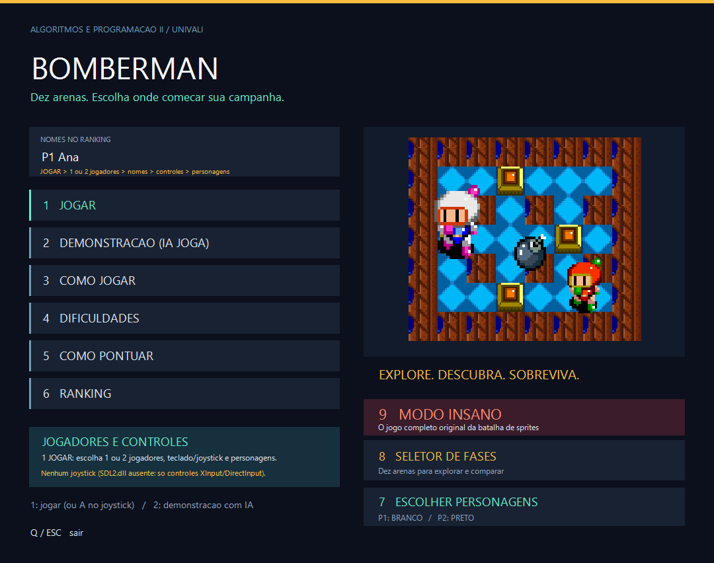
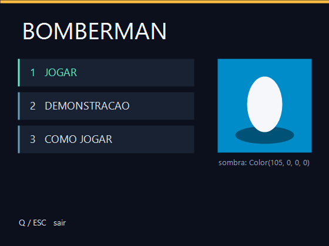
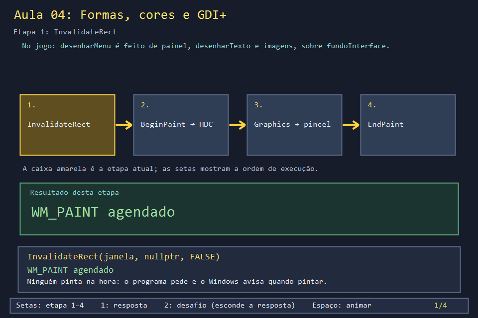
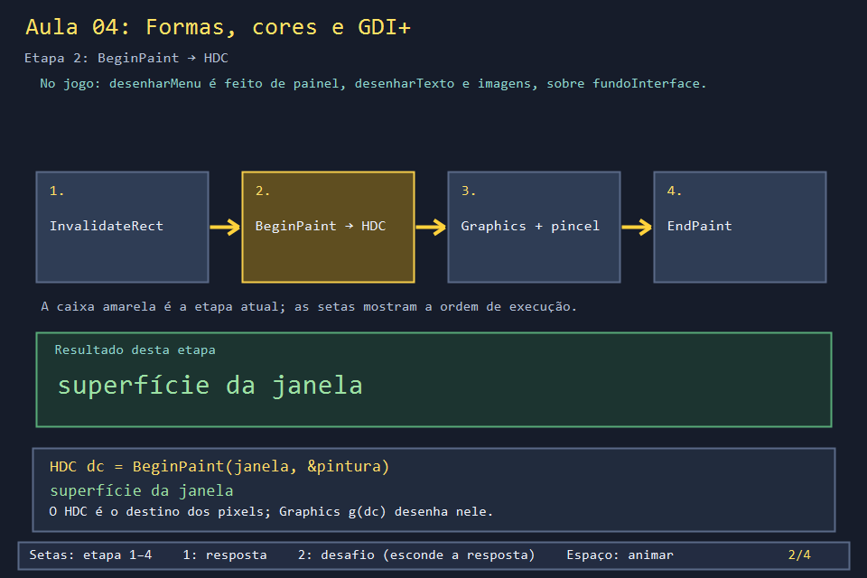
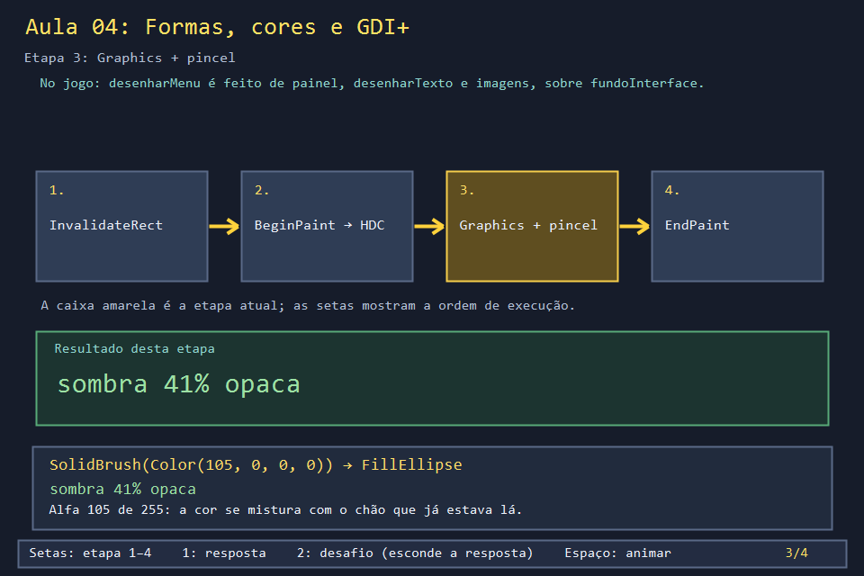
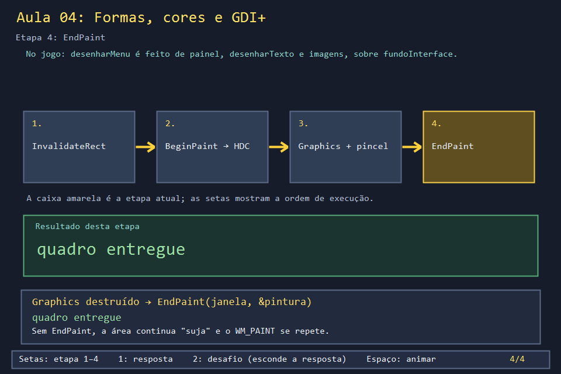

# Aula 04 — Formas, cores e GDI+

| Trilha | Duração | Antes desta aula | Próxima na trilha |
| --- | --- | --- | --- |
| Janela e desenho (03 → 04 → 05 → 24) | 60–75 min | [Aula 03](../Aula_03_janela_e_mensagens_win32/Aula_03_janela_e_mensagens_win32.md) | [Aula 05 — Recorte de sprite sheet](../Aula_05_recorte_de_sprite_sheet/Aula_05_recorte_de_sprite_sheet.md) |

| O menu do jogo real | O que você desenha nesta aula |
| --- | --- |
|  |  |

Antes dos sprites, todo o visual do jogo é feito de três coisas: **retângulos cheios**, **texto** e **transparência**. O menu, os cartões de escolha, o painel de pontuação e até a sombra embaixo dos personagens saem de duas funções pequenas, `painel` e `desenharTexto`. Nesta aula você as escreve e desenha um pedaço do menu real.

## O que você vai conseguir fazer

- Iniciar e encerrar o GDI+ na ordem certa.
- Desenhar retângulos, elipses e texto dentro de `WM_PAINT`.
- Explicar o canal **alfa** de `Color(a, r, g, b)` e usá-lo para fazer sombra.
- Separar "quem muda o estado" de "quem desenha", e pedir um redesenho com `InvalidateRect`.

## 1. A ideia

```text
algo mudou ──► InvalidateRect ──► (Windows) WM_PAINT ──► BeginPaint → Graphics g(dc)
                                                          g.Clear / FillRectangle / DrawString
                                                          EndPaint
```

`Gdiplus::Color(a, r, g, b)` tem quatro números de 0 a 255. `r`, `g` e `b` dão a cor, e `a` (alfa) dá a opacidade: 255 cobre tudo, 0 é invisível. A sombra do jogo usa `Color(105, 0, 0, 0)`: preto com 41% de opacidade, que escurece o chão sem escondê-lo.

## 2. O código real

As três funções que montam todas as telas do jogo:

<!-- trecho simbolo="painel" -->
```cpp
// projeto_final/bomberman.cpp, linhas 2850–2854 (painel)
void painel(Gdiplus::Graphics& g, int x, int y, int largura, int altura,
            Gdiplus::Color cor = Gdiplus::Color(255, 25, 34, 50)) {
    Gdiplus::SolidBrush pincel(cor);
    g.FillRectangle(&pincel, px(x), px(y), px(largura), px(altura));
}
```

<!-- trecho simbolo="desenharTexto" -->
```cpp
// projeto_final/bomberman.cpp, linhas 2839–2848 (desenharTexto)
void desenharTexto(Gdiplus::Graphics& g, const wstring& texto, float x, float y,
                   float tamanho, Gdiplus::Color cor = Gdiplus::Color(255,220,230,240), bool centralizado = false) {
    Gdiplus::Font* fonte = obterFonte(px(static_cast<int>(tamanho)));
    Gdiplus::SolidBrush pincel(cor);
    Gdiplus::StringFormat formato;
    if (centralizado) formato.SetAlignment(Gdiplus::StringAlignmentCenter);
    Gdiplus::RectF area(px(static_cast<int>(x)), px(static_cast<int>(y)),
                        px(LARGURA_JOGO - static_cast<int>(x) - (centralizado ? static_cast<int>(x) : 12)), px(50));
    g.DrawString(texto.c_str(), -1, fonte, area, &formato, &pincel);
}
```

<!-- trecho simbolo="fundoInterface" -->
```cpp
// projeto_final/bomberman.cpp, linhas 2866–2869 (fundoInterface)
void fundoInterface(Gdiplus::Graphics& g) {
    g.Clear(Gdiplus::Color(255, 11, 16, 28));
    painel(g, 0, 0, LARGURA_JOGO, 5, Gdiplus::Color(255, 252, 187, 65));
}
```

Os cartões do menu principal são um laço sobre essas funções. Cada cartão é um `painel` de corpo, um `painel` de 3 px como tarja e um texto. O primeiro fica verde:

<!-- trecho simbolo="desenharMenu" de="const wchar_t* titulos[]" ate="    }" -->
```cpp
// projeto_final/bomberman.cpp, linhas 3618–3624 (desenharMenu)
    const wchar_t* titulos[] = {L"1   JOGAR", L"2   DEMONSTRACAO (IA JOGA)", L"3   COMO JOGAR", L"4   DIFICULDADES", L"5   COMO PONTUAR", L"6   RANKING"};
    for (int i=0; i<6; ++i) {
        int y=287+i*57;
        painel(g, 44, y, 470, 47);
        painel(g, 44, y, 3, 47, i==0 ? Gdiplus::Color(255,98,235,199) : Gdiplus::Color(255,110,157,186));
        desenharTexto(g, titulos[i], 62, y+10, 18, i==0 ? Gdiplus::Color(255,98,235,199) : Gdiplus::Color(255,220,230,240));
    }
```

E a sombra dos personagens, em `desenharQuadroNaCelula`:

<!-- trecho simbolo="desenharQuadroNaCelula" de="Gdiplus::SolidBrush sombra" ate="g.FillEllipse(&sombra" -->
```cpp
// projeto_final/bomberman.cpp, linhas 2941–2942 (desenharQuadroNaCelula)
    Gdiplus::SolidBrush sombra(Gdiplus::Color(105,0,0,0));
    g.FillEllipse(&sombra,xCelula+px(9),yCelula+px(41),px(34),px(11));
```

Repare em `px(...)` em volta de cada medida. O jogo foi desenhado para 1080 × 852 e `px` converte para o tamanho real da janela e do monitor (Aula 24). Também repare em `obterFonte`: criar uma fonte custa caro, então o jogo guarda cada tamanho num cache.

## 3. A versão desta aula

`Aula_04_formas_cores_e_gdiplus.cpp` tem `painel`, `desenharTexto` e `fundoInterface` com o mesmo corpo do jogo, sem `px`. `desenharCena` usa essas funções para montar três cartões do menu e um "personagem" com sombra translúcida. Todo o desenho acontece em `WM_PAINT`, entre `BeginPaint` e `EndPaint`.

A imagem no topo da página é a saída real deste programa, gerada por `ferramentas/fotografar_exemplos.ps1`.

## 4. O que mudou em relação ao jogo e por quê

| No jogo | Nesta aula | Motivo |
| --- | --- | --- |
| cada medida passa por `px()` | medidas diretas | escala e DPI são o assunto da Aula 24 |
| fontes guardadas em `cacheFontes` | uma `Font` por chamada | mais simples; o custo só aparece com muitas chamadas por quadro |
| desenha num backbuffer e copia com `BitBlt` | desenha direto na janela | pode piscar ao redimensionar; a correção é a Aula 24 |
| `desenharTexto` usa um retângulo e alinhamento | usa um ponto | o retângulo só importa para texto centralizado |

## 5. Laboratório visual

| | |
| --- | --- |
|  |  |
|  |  |

```powershell
.\compilar_aula.ps1 -Numero 4
.\build\Aula_04_formas_cores_e_gdiplus.exe      # diagrama do ciclo de pintura
.\abrir_aula.ps1 -Numero 4 -Modo Exemplo        # a janela com o menu
```

## 6. Exercícios

1. **Alfa.** Troque a sombra para `Color(255, 0, 0, 0)` e depois para `Color(30, 0, 0, 0)`. Descreva o que muda. Qual valor o jogo escolheu e por quê? *(105: escuro o bastante para "assentar" o personagem no chão, mas o desenho do chão continua visível.)*
2. **Destaque que se move.** Crie `int selecionado`. As setas ↑/↓ mudam o valor (circular: depois do último volta ao primeiro) e chamam `InvalidateRect`. O cartão selecionado fica verde. *Solução: `solucoes/` e `imagens/solucao.png`.* Note que `desenharCena` continua sem alterar nada: ela só lê `selecionado`.
3. **Ordem de pintura.** Mova o `FillEllipse` da sombra para depois do corpo. O que acontece? *(A sombra passa a cobrir o personagem. GDI+ pinta na ordem das chamadas: o que vem depois fica por cima.)*
4. **Leitura.** Em `desenharMenu`, encontre o painel do "MODO INSANO" e diga sua cor de fundo e a cor do texto. *(Fundo `Color(255,59,28,42)`, vinho; texto `Color(255,255,135,105)`, salmão.)*

## 7. Erros comuns

- **Desenhar fora de `WM_PAINT`.** O desenho some na próxima vez que o Windows repintar a janela. Mude o estado e chame `InvalidateRect`.
- **Esquecer `EndPaint`.** O Windows acha que a área continua para pintar e manda `WM_PAINT` sem parar; o processador vai a 100%.
- **Destruir o `Graphics` depois de `EndPaint`.** Por isso o exemplo cria `Graphics g(dc)` dentro de um bloco `{ }`.
- **`GdiplusShutdown` antes de liberar imagens e fontes.** O programa trava ao fechar. Libere tudo, e só então desligue.

## 8. Antes de seguir

- [ ] Sei o que cada um dos quatro números de `Color` faz.
- [ ] Expliquei por que a sombra vem antes do corpo.
- [ ] Fiz o destaque andar com as setas sem desenhar fora de `WM_PAINT`.

## Referências

- [Introdução ao GDI+ (Microsoft Learn)](https://learn.microsoft.com/en-us/windows/win32/gdiplus/-gdiplus-getting-started-use)
- [Desenhando com pincéis e preenchimentos (Microsoft Learn)](https://learn.microsoft.com/en-us/windows/win32/gdiplus/-gdiplus-using-a-brush-to-fill-shapes-use)
- [Mistura alfa em GDI+ (Microsoft Learn)](https://learn.microsoft.com/en-us/windows/win32/gdiplus/-gdiplus-alpha-blending-lines-and-fills-use)
- [`WM_PAINT` (Microsoft Learn)](https://learn.microsoft.com/en-us/windows/win32/gdi/wm-paint)
