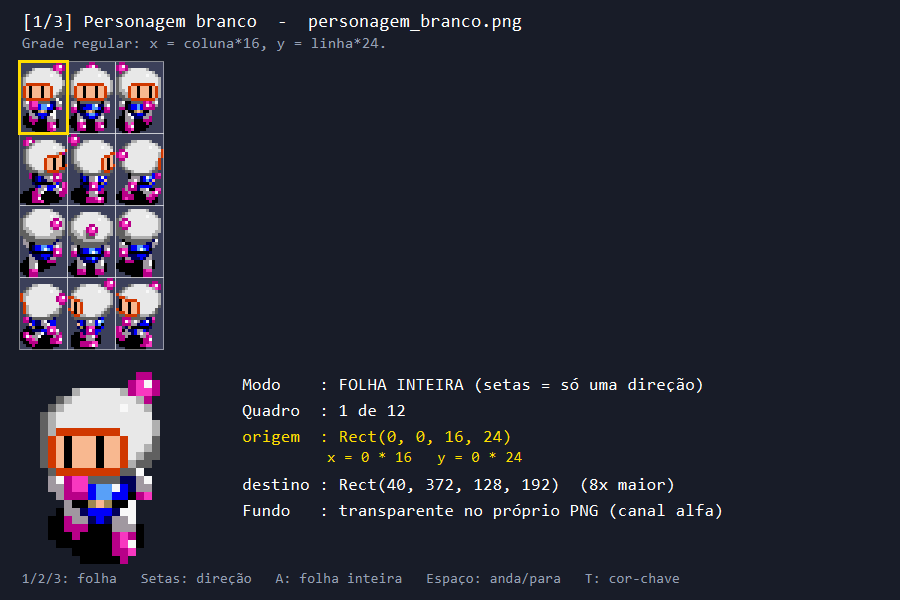
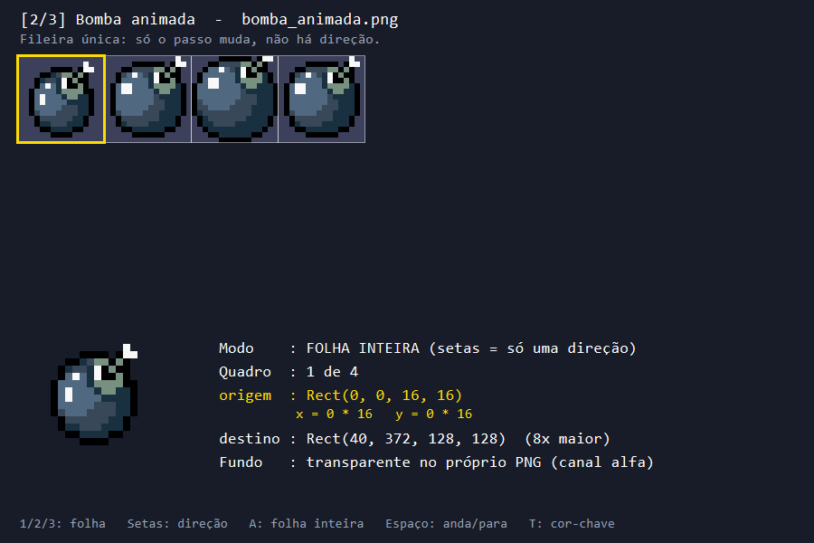
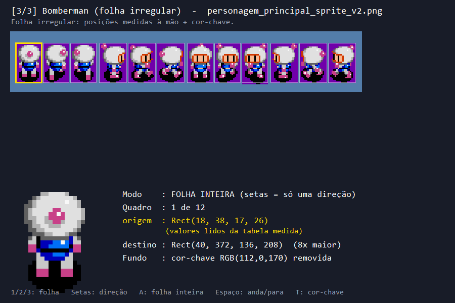
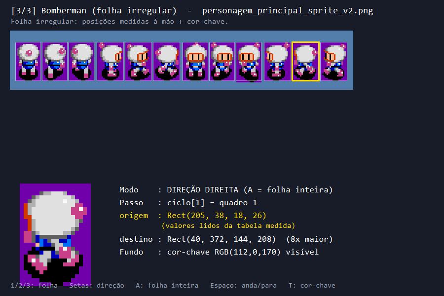

# Aula 05 — O recorte que vira animação

| Trilha | Duração | Antes desta aula | Próxima na trilha |
| --- | --- | --- | --- |
| Janela e desenho (03 → 04 → 05 → 24) | 2 horas | [Aula 04](../Aula_04_formas_cores_e_gdiplus/Aula_04_formas_cores_e_gdiplus.md); revise também as aulas 01–03 | [Aula 24 — Backbuffer, escala e DPI](../Aula_24_backbuffer_dpi_recursos/Aula_24_backbuffer_dpi_recursos.md) |

## O que você vai construir

O programa mostra a folha original no painel superior. Um contorno amarelo acompanha o **quadro de origem**; o painel inferior mostra esse mesmo recorte oito vezes maior e escreve na tela os números de origem e destino. Um timer troca o quadro a cada 150 ms. Você controla folha, direção, pausa e remoção do fundo.



A imagem acima foi exportada da função `desenharCena` desta aula. A aula usa três recursos reais de `projeto_final/assets/`:

| Tecla | Folha | O que ensina | Frames |
| --- | --- | --- | --- |
| 1 | `personagem_branco.png` | Grade regular; origem calculada por multiplicação | 3 por direção × 4 direções |
| 2 | `bomba_animada.png` | Objeto com animação e sem direção | 4 em uma linha |
| 3 | `personagem_principal_sprite_v2.png` | Recortes irregulares medidos em tabela e fundo removido por cor chave | 3 por direção × 4 direções |




## Primeiro entenda origem e destino

```text
PNG da folha                         Janela
┌──────────┬──────────┬──────────┐    ┌─────────────────────┐
│ quadro 0 │ quadro 1 │ quadro 2 │    │  recorte ampliado   │
└──────────┴──────────┴──────────┘    └─────────────────────┘
    ORIGEM = (x, y, largura, altura)   DESTINO = (x, y, largura, altura)
```

`Graphics::DrawImage` lê apenas o retângulo de origem e o desenha no destino. Na folha regular de 16 × 24 pixels:

```cpp
x = passo * 16;
y = linhaDaDirecao[direcao] * 24;
origem = Rect(x, y, 16, 24);
destino = Rect(40, 372, 16 * 8, 24 * 8);
```

Se `passo=2` e a direção estiver na linha 3, a origem será `Rect(32,72,16,24)`. O destino terá 128 × 192 pixels. **Origem muda a pose; destino muda lugar e escala.** Trocar apenas a origem produz caminhada no lugar; mover apenas o destino produz deslizamento.

## Construção em seis passos

1. **Descreva a folha.** Leia `FolhaDeSprites`: cada entrada de `quadros[direcao][passo]` é um `Rect`. Identifique `passos`, `direcoes`, `ciclo`, `quadroParado` e `imagem`.
2. **Monte uma grade.** Em `montarGrade`, localize as multiplicações por largura e altura. Compare `criarPersonagemBranco` com `criarBomba`: o segundo usa uma só direção, então não precisa trocar a linha.
3. **Monte uma tabela irregular.** Em `criarPersonagemFolhaIrregular`, os valores `x[d][p]` e `largura[d]` foram medidos no PNG. Abra a folha e localize o primeiro frame em `Rect(18,38,17,26)`. Uma fórmula com largura constante cortaria parte de alguns quadros.
4. **Carregue e ordene.** `criarFolhas` abre os PNGs a partir de `projeto_final/assets/`. `emOrdemDeLeitura` ordena quadros por Y e depois X para o modo folha inteira.
5. **Recorte e desenhe.** Em `desenharCena`, encontre `origem`, o contorno amarelo `naTela(origem)`, `destino` e a chamada de `desenharRecorte`. O painel mostra os mesmos números usados no `DrawImage`.
6. **Anime pelo timer.** `WM_TIMER` avança `passoDoCiclo` e `indiceNaFolha`; `InvalidateRect` solicita `WM_PAINT`. O timer troca poses; não desloca o personagem.

## Compile e execute

Abra PowerShell **na raiz do curso**:

```powershell
.\compilar_aula.ps1 -Numero 5
.\build\Aula_05_recorte_de_sprite_sheet.exe
```

O script usa `g++ -std=c++17 -O2 -Wall -Wextra -pedantic` e faz link com `gdiplus`. O código procura assets na raiz do curso, em `build/` ou na pasta da aula. Se nenhum caminho existir, a janela escreve o diagnóstico em vermelho.

## Experimentos que você deve observar

| Ação | Previsão antes de apertar | O que conferir na janela |
| --- | --- | --- |
| Iniciar | Folha 1, modo folha inteira | Contorno amarelo percorre 12 quadros; o número de origem muda |
| Apertar seta para direita | Modo direção direita | Apenas três quadros daquela linha se repetem; destino continua no mesmo lugar |
| Apertar Espaço | Pausa | Contorno e recorte param; o modo direção usa `quadroParado` |
| Apertar 2 | Bomba | Quatro poses pulsam sem mudança de direção |
| Apertar 3 | Folha irregular | Os valores de X deixam de seguir passo × 16 |
| Apertar T na folha 3 | Cor chave desliga/liga | O retângulo roxo aparece/desaparece no recorte ampliado |
| Apertar A | Folha inteira | O contorno volta a percorrer todos os quadros |



`ImageAttributes::SetColorKey` remove exatamente RGB(112,0,170) na terceira folha. Nas outras duas, transparência vem do canal alfa do PNG. A cor chave remove o fundo do **recorte ampliado**, enquanto o painel superior mantém a folha crua para inspeção.

## Relação com o Bomberman e o estudo de sprites

No jogo final, `linhaDaFolhaParaDirecao` e `desenharQuadroNaCelula` escolhem quadro e direção; `quadroCaminhada` usa deslocamento visual. A aula separa essas decisões em uma tabela de quadros e um timer simples. O documento [Como o projeto anima sprites em C++](../../referencias/EXPLICACAO_SPRITES_CPP.md), copiado do estudo acessível, explica animação por distância, posição lógica/visual, buffer e cache.

O jogo tem vistas discretas para baixo, direita, cima e esquerda. Uma folha com quatro linhas **não** contém vistas para todos os ângulos. Oito direções ou movimento angular exigiriam mais poses ou uma regra explícita de espelhamento/rotação.

## Erros comuns

- **Janela vazia ou aviso vermelho:** execute da raiz; confira os três PNGs em `projeto_final/assets/`.
- **Quadro cortado:** compare X, Y, largura e altura do contorno com o PNG; a folha irregular não usa tamanho único.
- **Sprite borrado:** confira `InterpolationModeNearestNeighbor` e `PixelOffsetModeHalf`.
- **Roxo não desaparece:** confira a folha 3, tecla T e RGB(112,0,170). Uma cor chave errada remove pouco ou remove pixels do personagem.
- **Animação rápida demais:** `INTERVALO_MS` controla a troca de poses; não é a velocidade de movimento do corpo no mapa.

## Exercícios e solução

1. **Compreensão:** calcule a origem do terceiro quadro da linha de esquerda da folha regular. Confirme na tela.
2. **Alteração:** mude `INTERVALO_MS` de 150 para 250. A animação deve trocar quatro quadros por segundo; a solução comentada mostra essa variação.
3. **Aplicação:** acrescente um quarto PNG regular à lista `criarFolhas` e explique o mapeamento de linhas.
4. **Desafio:** troque o avanço por timer por avanço baseado em distância percorrida, mantendo o quadro parado quando não houver movimento. Compare com `quadroCaminhada` no jogo final.

A solução está em `solucoes/Aula_05_recorte_de_sprite_sheet_solucao.cpp`. Antes de seguir, você deve conseguir explicar de onde vêm `origem.X`, `origem.Y`, `destino.Width`, a pose atual e o fundo transparente, sem consultar o código.

## Referências

- [Microsoft Learn: recorte e escala com GDI+](https://learn.microsoft.com/en-us/windows/win32/gdiplus/-gdiplus-cropping-and-scaling-images-about).
- [Microsoft Learn: temporizadores Win32](https://learn.microsoft.com/en-us/windows/win32/winmsg/about-timers).
- `projeto_final/bomberman.cpp`, `projeto_final/assets/` e [Como o projeto anima sprites em C++](../../referencias/EXPLICACAO_SPRITES_CPP.md).
