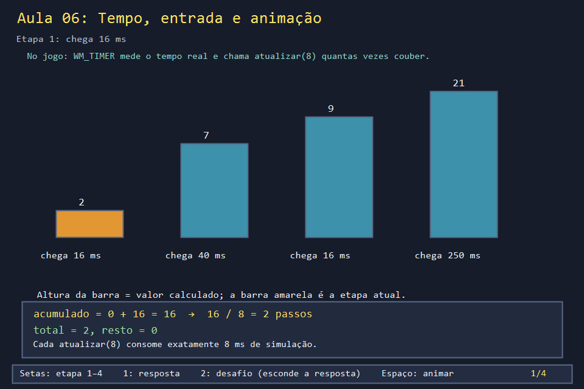
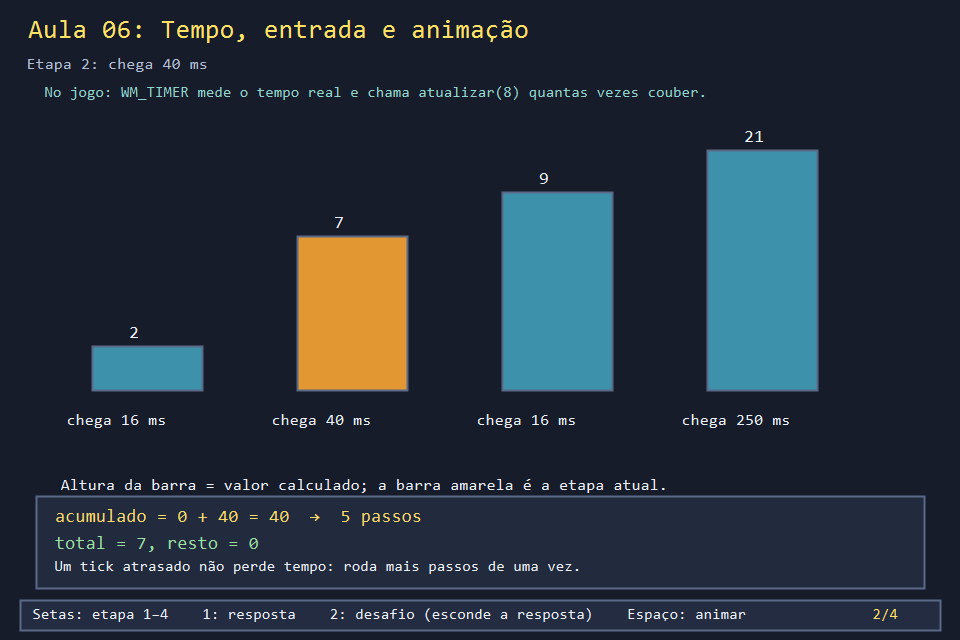
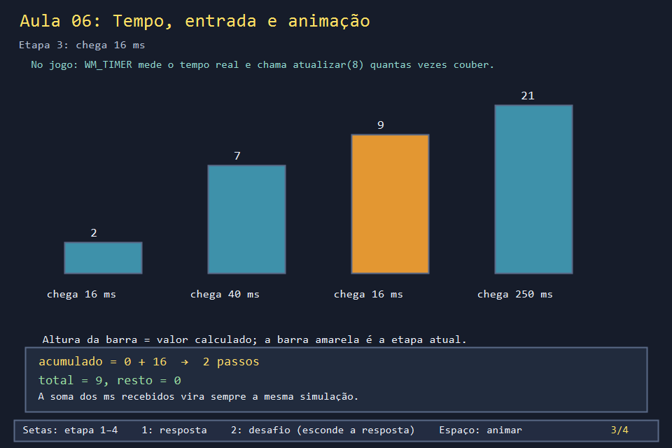
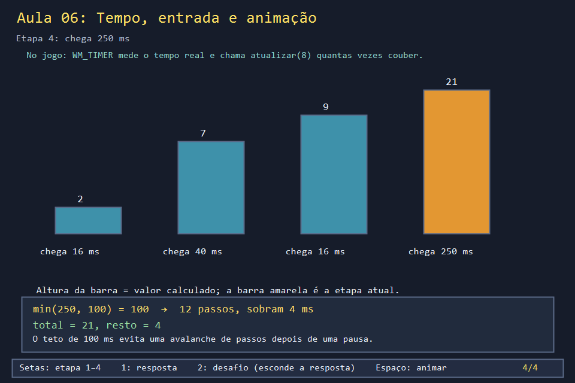

# Aula 06 — Tempo, entrada e animação

| Trilha | Duração | Antes desta aula | Próxima na trilha |
| --- | --- | --- | --- |
| Tempo, movimento e animação (06 → 07 → 18) | 75–90 min | [Aula 03](../Aula_03_janela_e_mensagens_win32/Aula_03_janela_e_mensagens_win32.md) (mensagens e `teclaPressionada`) | [Aula 07 — Movimento e colisão](../Aula_07_movimento_e_colisao/Aula_07_movimento_e_colisao.md) |


Na Aula 03 você mediu: o `WM_TIMER` não chega no ritmo pedido. Mesmo assim, no jogo, a bomba explode sempre depois de 2,2 s, o personagem atravessa uma casa no mesmo tempo em qualquer computador, e segurar W e depois D faz o personagem virar para a direita. Esta aula mostra as três peças que garantem isso.

## O que você vai conseguir fazer

- Explicar o **passo fixo**: medir o tempo real e simular em fatias de 8 ms.
- Justificar o teto de 100 ms depois de uma pausa.
- Escolher a direção pela tecla apertada por último, como o jogo faz.
- Calcular qual pose de caminhada aparece depois de o personagem andar uma distância.

## 1. A ideia

```text
WM_TIMER chega (16? 31? 40 ms? não importa)
   decorrido = agora - ultimoInstante          ← tempo REAL, medido
   acumulado += min(decorrido, 100)
   while (acumulado >= 8) { atualizar(8); acumulado -= 8; }
   InvalidateRect                              ← um desenho por evento
```

`atualizar(8)` sempre avança o mundo exatamente 8 ms. Se chegaram 40 ms, ela roda 5 vezes; se chegaram 16 ms, 2 vezes. O fusível de 2200 ms termina sempre na 275ª atualização, por mais irregular que seja o timer.

## 2. O código real

O `case WM_TIMER` do jogo. A parte do processo do Modo Insano (no começo) é assunto da Aula 17. Repare em `steady_clock`, `min(decorrido, 100)` e no `while`:

<!-- trecho simbolo="processarMensagem" de="case WM_TIMER: {" ate="InvalidateRect(janela, nullptr, FALSE);" -->
```cpp
// projeto_final/bomberman.cpp, linhas 4271–4292 (processarMensagem)
    case WM_TIMER: {
        if(processoInsano) {
            if(WaitForSingleObject(processoInsano,0)==WAIT_OBJECT_0) {
                CloseHandle(processoInsano); processoInsano=nullptr;
                ShowWindow(janela,SW_SHOW);
                iniciarMusica();
                ultimoInstante=chrono::steady_clock::now();
            } else return 0;
        }
        auto agora = chrono::steady_clock::now();
        atualizarEstadoControle(janela);
        processarControleNoMenu();
        int decorrido = static_cast<int>(chrono::duration_cast<chrono::milliseconds>(agora - ultimoInstante).count());
        ultimoInstante = agora;
        // Passos fixos pequenos: uma pausa de desenho nao muda a velocidade.
        static int acumuladoMs = 0;
        acumuladoMs += min(decorrido, 100);
        while (acumuladoMs >= 8) {
            atualizar(8);
            acumuladoMs -= 8;
        }
        InvalidateRect(janela, nullptr, FALSE);
```

O começo de `atualizar`: todos os relógios do jogo recebem os mesmos `tempoMs` (8). Nenhum deles lê o relógio do Windows diretamente.

<!-- trecho simbolo="atualizar" ate="atualizarMario(tempoMs);" -->
```cpp
// projeto_final/bomberman.cpp, linhas 2437–2459 (atualizar)
void atualizar(int tempoMs) {
    relogioAnimacaoMs += tempoMs;
    if (modo == MENU) return;
    for (int i = 0; i < 2; i++) if (jogadorCaido[i]) tempoQuedaMs[i] += tempoMs;
    if (estado != JOGANDO) {
        tempoFimMs += tempoMs;
        if (modo == AUTOMATICO && tempoFimMs >= 1400) {
            if (estado == DERROTA) reiniciarFase();
            else if (estado == FIM_DE_JOGO) novaPartida(AUTOMATICO, dificuldade);
        }
        return;
    }
    tempoPartidaMs += tempoMs;
    tempoMovimentoMs = max(0, tempoMovimentoMs - tempoMs);
    if (doisJogadores) tempoMovimentoMs2 = max(0, tempoMovimentoMs2 - tempoMs);
    atualizarVidasJogadores(tempoMs);
    processarMovimentoContinuo();
    if (modo == AUTOMATICO) atualizarBot();
    atualizarBombas(tempoMs);
    moverInimigos(tempoMs);
    soltarBombasInimigos(tempoMs);
    atualizarBoss(tempoMs);
    atualizarMario(tempoMs);
```

O teclado é lido **a cada passo**, e não a cada `WM_KEYDOWN`. A repetição automática do Windows tem um atraso de ~0,5 s e travaria o movimento. Quando há mais de uma direção apertada, vence a de maior `ordemTecla`, ou seja, a mais recente:

<!-- trecho simbolo="processarMovimentoContinuo" de="auto moverPorTeclas" ate="    };" -->
```cpp
// projeto_final/bomberman.cpp, linhas 2404–2418 (processarMovimentoContinuo)
    auto moverPorTeclas=[&](bool p2) {
        struct Entrada { int tecla,dl,dc; };
        vector<Entrada> entradas;
        const Entrada letras[]={{'W',-1,0},{'S',1,0},{'A',0,-1},{'D',0,1}};
        const Entrada setas[]={{VK_UP,-1,0},{VK_DOWN,1,0},{VK_LEFT,0,-1},{VK_RIGHT,0,1}};
        int dono=teclaDoJogador(p2);
        if(dono&TECLAS_WASD) for(auto e:letras) if(teclaPressionada[e.tecla]) entradas.push_back(e);
        if(dono&TECLAS_SETAS) for(auto e:setas) if(teclaPressionada[e.tecla]) entradas.push_back(e);
        stable_sort(entradas.begin(),entradas.end(),[](const Entrada& a,const Entrada& b){return ordemTecla[a.tecla]>ordemTecla[b.tecla];});
        for(auto e:entradas) {
            Posicao antes=p2 ? jogador2 : jogador;
            if(p2) moverJogador2(e.dl,e.dc); else moverJogador(e.dl,e.dc);
            if(!iguais(antes,p2 ? jogador2 : jogador) || estado!=JOGANDO) break;
        }
    };
```

A pose da caminhada vem da distância percorrida, e não do tempo. Parado, o personagem usa o quadro 1:

<!-- trecho simbolo="quadroCaminhada" -->
```cpp
// projeto_final/bomberman.cpp, linhas 877–880 (quadroCaminhada)
int quadroCaminhada(float distancia, bool andando) {
    const int ciclo[] = {0, 1, 0, 2};
    return andando ? ciclo[static_cast<int>(distancia * 2.5f) % 4] : 1;
}
```

## 3. A versão desta aula

`Aula_06_tempo_entrada_e_animacao.cpp` tem as três peças com o mesmo código. Só o tempo real vem de uma lista em vez de `steady_clock`. Saída:

```text
-- 1. passo fixo de 8 ms --
evento=16ms -> atualizar(8) x2  total=2 resto=0
evento=40ms -> atualizar(8) x5  total=7 resto=0
evento=16ms -> atualizar(8) x2  total=9 resto=0
evento=250ms -> atualizar(8) x12  total=21 resto=4
-- 2. tecla mais recente --
segura W        -> anda W
segura W e D    -> anda D
solta D         -> anda W
-- 3. pose a cada 0,2 celula --
0 0 1 1 0 0 2 2 0 0 1  (parado: 1)
```

Leia a última linha assim: `distância × 2,5` dá o índice no ciclo `{0, 1, 0, 2}`, e a pose troca a cada 0,4 célula. Um passo de casa (1 célula) mostra 0 → 1 → 0, e o próximo continua de onde parou.

## 4. O que mudou em relação ao jogo e por quê

| No jogo | Nesta aula | Motivo |
| --- | --- | --- |
| `decorrido` medido com `chrono::steady_clock` | lista fixa de valores | saída previsível para conferir |
| `atualizar(8)` move bombas, inimigos, chefes, Mario... | só conta | o padrão é o mesmo para todos |
| teclas WASD **e** setas, divididas entre P1 e P2 | só WASD | divisão de teclado entre jogadores é assunto da Aula 31 |
| `ordemTecla` gravada em `WM_KEYDOWN` | gravada em `aoApertar` | mesma regra: só no primeiro aperto, não na repetição |

## 5. Laboratório visual

As barras mostram o total de `atualizar(8)` depois de cada evento. A última etapa mostra o teto em ação.

| | |
| --- | --- |
|  |  |
|  |  |

```powershell
.\compilar_aula.ps1 -Numero 6
.\build\Aula_06_tempo_entrada_e_animacao.exe
.\abrir_aula.ps1 -Numero 6 -Modo Exemplo
```

## 6. Exercícios

1. **Previsão.** Com eventos de 7, 9 e 31 ms, quantas atualizações acontecem em cada um, e qual é o resto? *(7 → 0, resto 7; 9 → 2 (7+9=16), resto 0; 31 → 3, resto 7.)* Nenhum milissegundo se perde: ele fica no resto.
2. **Fusível justo.** Simule uma bomba de `TEMPO_BOMBA_MS = 2200` com três ritmos de timer: 16 ms regular; 7/31/16/9 repetido; 16/16/16/400 repetido. Em qual atualização ela explode em cada caso? Quanto tempo real passou? *Solução: `solucoes/`. Sempre na 275ª atualização; o tempo real só muda no caso com pausa (6720 ms), porque o teto descarta parte da pausa.*
3. **Teto.** Por que o jogo prefere "congelar" durante uma pausa a recuperar o tempo perdido? *(Sem o teto, uma pausa de 3 s viraria 375 atualizações instantâneas: a bomba explodiria e os inimigos andariam várias casas antes de você ver a tela.)*
4. **Pose.** Em `quadroCaminhada`, troque `2.5f` por `5.0f`. A cada quanto a pose troca agora? *(0,2 célula: a animação fica duas vezes mais rápida que os pés.)*

## 7. Erros comuns

- **Mover o personagem em `WM_KEYDOWN`.** O primeiro passo sai na hora, mas os seguintes esperam a repetição automática do Windows. O jogo lê `teclaPressionada` a cada passo.
- **Usar `decorrido` direto como passo** (`atualizar(decorrido)`). Funciona até um evento de 120 ms deixar uma bomba atravessar duas casas de uma vez. Passo fixo evita casos especiais.
- **Gravar `ordemTecla` em toda `WM_KEYDOWN`.** A repetição automática renovaria a ordem de W o tempo todo, e D nunca venceria. Por isso o jogo só grava quando `!teclaPressionada[tecla]`.

## 8. Antes de seguir

- [ ] Sei explicar por que `atualizar` recebe sempre 8.
- [ ] Previ os totais 2, 7, 9 e 21 antes de rodar.
- [ ] Resolvi o exercício 2 e entendi o tempo real de 6720 ms.

## Referências

- [Fix Your Timestep! — Glenn Fiedler](https://gafferongames.com/post/fix_your_timestep/) (o artigo clássico sobre passo fixo)
- [`std::chrono::steady_clock` (cppreference)](https://en.cppreference.com/w/cpp/chrono/steady_clock)
- [`std::stable_sort` (cppreference)](https://en.cppreference.com/w/cpp/algorithm/stable_sort)
- Aula 18: a pose da caminhada aplicada à folha de sprites real.
