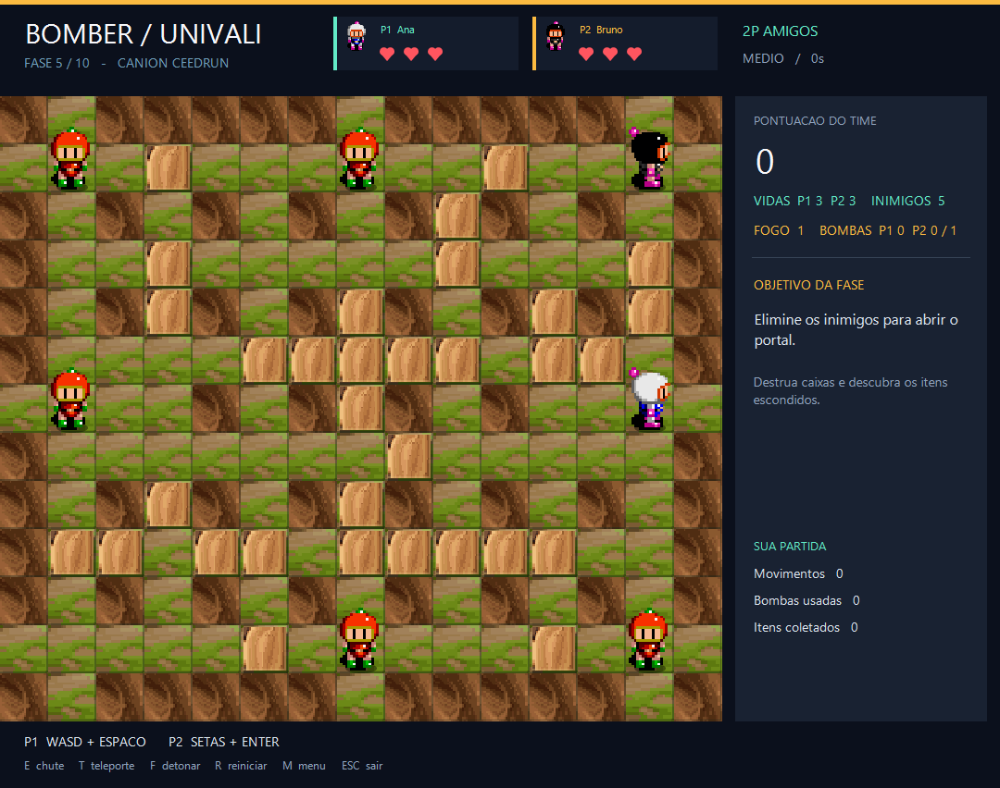
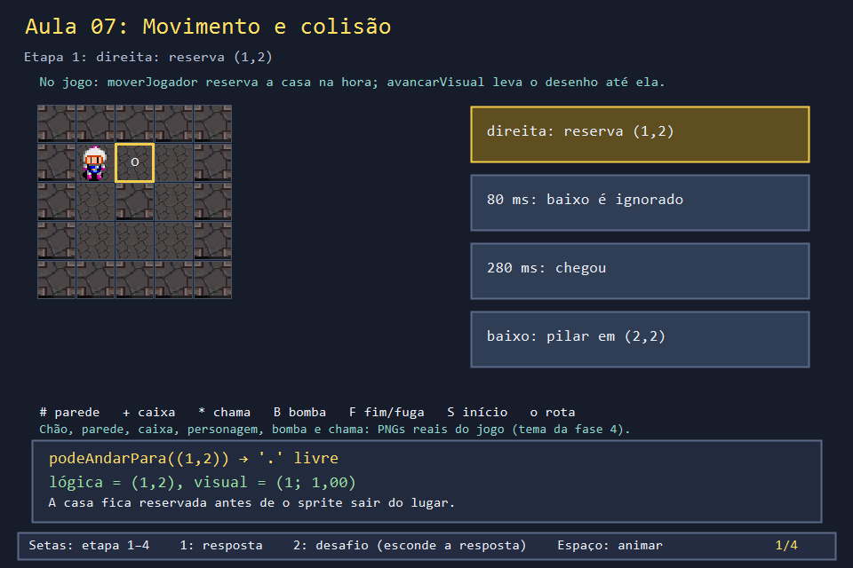
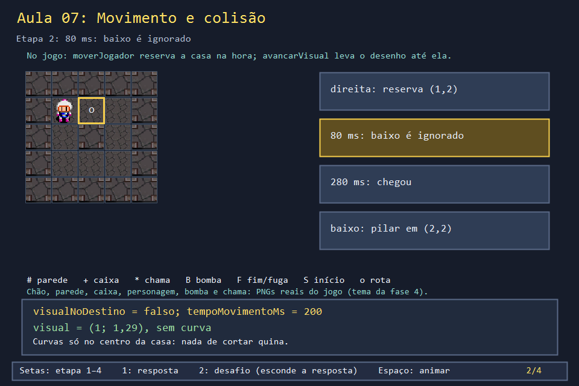
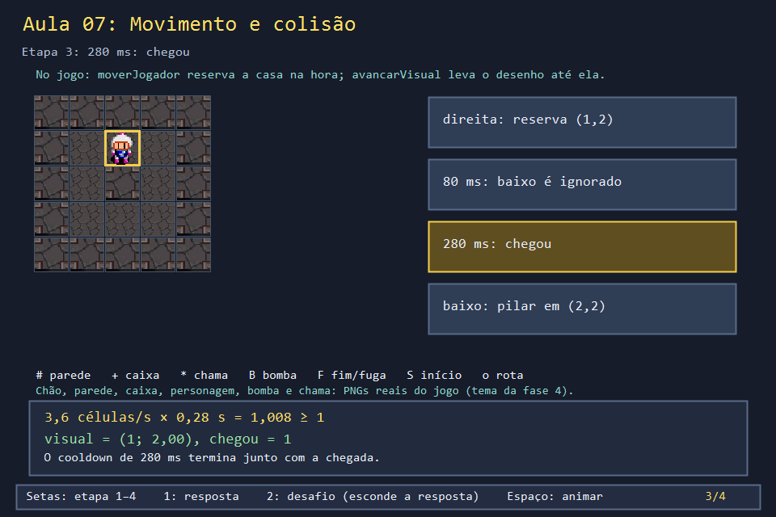
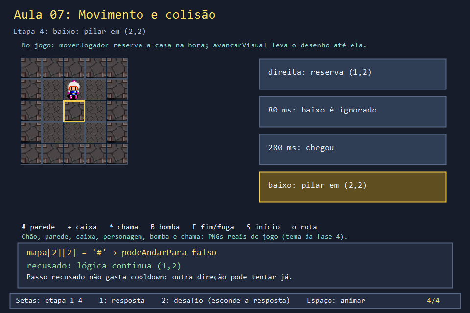

# Aula 07 — Movimento e colisão

| Trilha | Duração | Antes desta aula | Próxima na trilha |
| --- | --- | --- | --- |
| Tempo, movimento e animação (06 → 07 → 18) | 60–75 min | [Aula 06](../Aula_06_tempo_entrada_e_animacao/Aula_06_tempo_entrada_e_animacao.md) | [Aula 18 — Animação direcional](../Aula_18_animacao_direcional_gdiplus/Aula_18_animacao_direcional_gdiplus.md) |



No Bomberman, cada personagem tem **duas posições**. A casa lógica (`jogador`, inteira) diz onde ele está para as regras: colisão, bomba, coleta. A posição desenhada (`jogadorVisualL/C`, `float`) diz onde o sprite aparece na tela e desliza até a casa lógica. Esta aula mostra como o jogo decide se um passo é aceito e por que a curva espera o centro da casa.

## O que você vai conseguir fazer

- Seguir `moverJogador` linha a linha e listar as três guardas que recusam um passo.
- Explicar por que a casa é **reservada** antes de o desenho chegar.
- Separar "pode entrar nesta casa?" (`podeAndarPara`) de "já chegou?" (`visualNoDestino`).
- Medir quando dois personagens se tocam usando a posição desenhada.

## 1. A ideia

```text
aperta →    casa lógica (1,1) ──► (1,2)   reservada na hora, se livre
            desenho     1,00 ──► 1,29 ──► ... ──► 2,00   3,6 células/s
            curva ↓     recusada até o desenho chegar ao centro
```

Um passo só é aceito se **as três** guardas deixarem:

| Guarda | Por quê |
| --- | --- |
| `tempoMovimentoMs > 0` → recusa | ritmo: uma casa a cada 280 ms |
| `!visualNoDestino(...)` → recusa | curvas só no centro; sem cortar quina de pilar |
| `!podeAndarPara(destino)` → não move | parede, caixa, bomba ou chefe |

## 2. O código real

<!-- trecho simbolo="moverJogador" -->
```cpp
// projeto_final/bomberman.cpp, linhas 1371–1386 (moverJogador)
void moverJogador(int dl, int dc) {
    if (estado != JOGANDO || jogadorCaido[0] || tempoMovimentoMs > 0 ||
        !visualNoDestino(jogadorVisualL, jogadorVisualC, jogador)) return;
    direcaoJogador = {dl, dc};
    Posicao origem = jogador;
    Posicao destino{jogador.linha + dl, jogador.coluna + dc};
    if (podeAndarPara(destino)) jogador = destino;
    if (!iguais(origem, jogador)) {
        estatisticas.movimentos++;
        estatisticas.movimentosFase++;
        estatisticas.movimentosJogador[0]++;
        quadroAnimJogador = (quadroAnimJogador + 1) % QUADROS_POR_DIRECAO;
    }
    atingirSePerigoso(jogadorVisualL,jogadorVisualC,1);
    tempoMovimentoMs = iguais(origem,jogador) ? 0 : INTERVALO_MOVIMENTO_MS;
}
```

`podeAndarPara` junta todas as regras de colisão num lugar. Bomba e chefe bloqueiam; a carta `ATRAVESSA_BLOCO` (Aula 19) libera caixas comuns:

<!-- trecho simbolo="podeAndarPara" -->
```cpp
// projeto_final/bomberman.cpp, linhas 1352–1357 (podeAndarPara)
bool podeAndarPara(Posicao destino) {
    if (bloqueadoBoss(destino) || bombaEm(destino)) return false;
    return livre(destino.linha, destino.coluna) ||
           (atravessaBlocoQuebravel && dentro(destino.linha, destino.coluna) &&
            mapa[destino.linha][destino.coluna] == PAREDE_FRAGIL);
}
```

<!-- trecho simbolo="livre" -->
```cpp
// projeto_final/bomberman.cpp, linhas 886–888 (livre)
bool livre(int linha, int coluna) {
    return dentro(linha, coluna) && (mapa[linha][coluna] == VAZIO || mapa[linha][coluna] == PORTAL);
}
```

<!-- trecho simbolo="visualNoDestino" -->
```cpp
// projeto_final/bomberman.cpp, linhas 861–863 (visualNoDestino)
bool visualNoDestino(float visualL, float visualC, Posicao alvo) {
    return abs(visualL - alvo.linha) < 0.0001f && abs(visualC - alvo.coluna) < 0.0001f;
}
```

O **toque** em inimigos usa as posições desenhadas, com uma caixa de meia célula em volta de cada personagem:

<!-- trecho simbolo="personagensEmContato" -->
```cpp
// projeto_final/bomberman.cpp, linhas 991–993 (personagensEmContato)
bool personagensEmContato(float l1, float c1, float l2, float c2) {
    return abs(l1-l2) < 2*MEIA_CAIXA_PERSONAGEM && abs(c1-c2) < 2*MEIA_CAIXA_PERSONAGEM;
}
```

## 3. A versão desta aula

`Aula_07_movimento_e_colisao.cpp` tem `moverJogador`, `podeAndarPara`, `livre`, `visualNoDestino` e `avancarVisual` com as mesmas regras e constantes (280 ms, 3,6 células/s), num mapa 5 × 5 com um pilar em (2,2). `esperar(ms)` roda `atualizar(8)` como o `WM_TIMER` da Aula 06.

```text
t=  0 direita: reserva (1,2)             logica=(1,2) visual=(1.00,1.00) chegou=0
t= 80 80 ms depois                       logica=(1,2) visual=(1.00,1.29) chegou=0
t= 80 baixo no meio do passo: ignorado   logica=(1,2) visual=(1.00,1.29) chegou=0
t=280 mais 200 ms: chegou ao centro      logica=(1,2) visual=(1.00,2.00) chegou=1
t=280 baixo: (2,2) e pilar, recusado     logica=(1,2) visual=(1.00,2.00) chegou=1
t=280 direita: reserva (1,3)             logica=(1,3) visual=(1.00,2.00) chegou=0
```

Os números não são coincidência: 3,6 × 0,28 = 1,008. O jogo foi ajustado para o desenho chegar ao centro no mesmo momento em que o cooldown termina, e por isso segurar a seta produz um movimento contínuo, sem trancos.

## 4. O que mudou em relação ao jogo e por quê

| No jogo | Nesta aula | Motivo |
| --- | --- | --- |
| `moverJogador` também confere `estado` e `jogadorCaido` | não confere | sem partida, morte ou dois jogadores |
| conta movimentos para o ranking e troca o quadro da animação | não conta | ranking é a Aula 21; animação, a Aula 18 |
| `podeAndarPara` consulta bombas, chefe e a carta de atravessar | só o mapa | esses sistemas chegam nas Aulas 08, 19 e 22 |
| depois de mover, `atingirSePerigoso` testa chama e inimigos | não testa | contato é o exercício 2 |

## 5. Laboratório visual

| | |
| --- | --- |
|  |  |
|  |  |

```powershell
.\compilar_aula.ps1 -Numero 7
.\build\Aula_07_movimento_e_colisao.exe
.\abrir_aula.ps1 -Numero 7 -Modo Exemplo
```

## 6. Exercícios

1. **Previsão.** Se `VELOCIDADE_VISUAL_CELS_SEG` fosse 2,0 (e o cooldown continuasse 280 ms), quando o desenho chegaria ao centro? O que aconteceria ao segurar a seta? *(500 ms. Entre 280 e 500 ms o cooldown já acabou, mas `visualNoDestino` ainda recusa: o personagem anda com "pausas", na velocidade do desenho.)*
2. **Toque justo.** Um inimigo está parado em c = 2,3, na linha 1. O jogador reserva (1,2) partindo de (1,1). Em que instante o toque acontece se ele usar a casa lógica? E se usar `personagensEmContato` com as posições desenhadas? *Solução: `solucoes/`. Lógica: t = 0, com o sprite ainda longe; visual: t = 224 ms.*
3. **Caixa de contato.** Com `MEIA_CAIXA_PERSONAGEM = 0,25`, dois personagens parados no centro de casas vizinhas se tocam? *(Não: a distância é 1,0, e o toque exige menos de 0,5.)* E se o inimigo estiver exatamente em 2,5? *(Também não, porque 0,5 não é menor que 0,5.)*
4. **Leitura.** Em `podeAndarPara`, por que `bombaEm(destino)` vem antes do teste de parede? Mudaria algo trocar a ordem? *(O resultado seria o mesmo, porque é um `||`/`&&` de condições independentes. A ordem só economiza trabalho: o teste mais barato ou mais comum pode vir primeiro.)*

## 7. Erros comuns

- **Mover o desenho e a casa juntos.** O personagem "teleporta" de casa em casa. O jogo antigo fazia isso, e o comentário no topo do fonte conta como mudou.
- **Testar colisão com a posição desenhada.** Um `float` como 1,29 não indexa a matriz. Colisão e bomba usam a casa lógica; toque e dano usam a posição desenhada.
- **Gastar o cooldown num passo recusado.** O jogador bate na parede e fica 280 ms sem poder virar. O jogo zera `tempoMovimentoMs` quando a posição não mudou.

## 8. Antes de seguir

- [ ] Listei as três guardas de `moverJogador`.
- [ ] Expliquei por que 3,6 células/s combina com 280 ms.
- [ ] Resolvi o exercício 2 e sei dizer qual posição cada regra usa.

## Referências

- [Fix Your Timestep! — Glenn Fiedler](https://gafferongames.com/post/fix_your_timestep/) (a seção final trata de interpolar o desenho entre estados)
- [`std::fabs` (cppreference)](https://en.cppreference.com/w/cpp/numeric/math/fabs)
- Marco 1 (`marcos/`): a primeira versão jogável usa exatamente estas regras.
