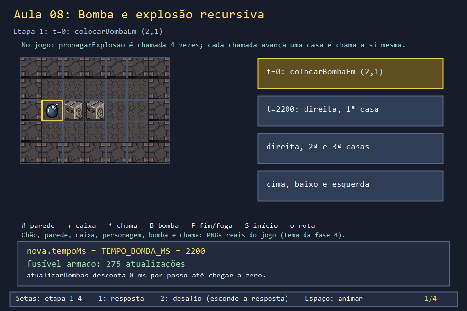
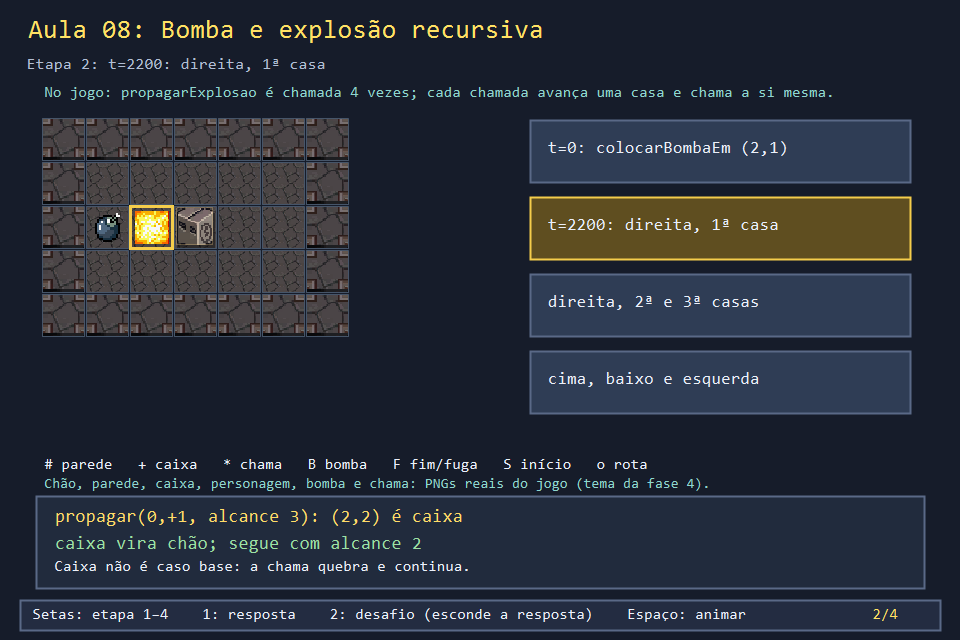
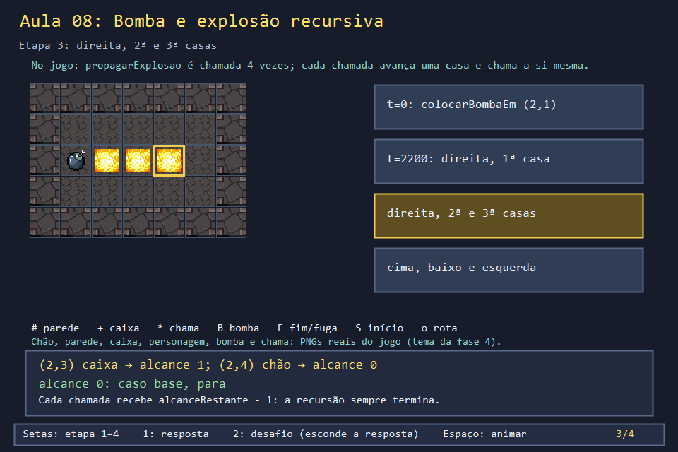
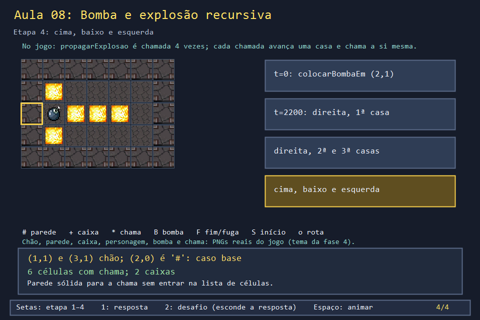

# Aula 08 — Bomba e explosão recursiva

| Trilha | Duração | Antes desta aula | Próxima na trilha |
| --- | --- | --- | --- |
| Bombas e poderes (08 → 09 → 19) | 75–90 min | [Aula 07](../Aula_07_movimento_e_colisao/Aula_07_movimento_e_colisao.md), Aula 29 (recursão) | [Aula 09 — Os oito poderes](../Aula_09_oito_poderes/Aula_09_oito_poderes.md) |


A bomba é o coração do Bomberman. No código, ela é uma `struct` dentro de um `vector`, com um contador de tempo, e a chama é calculada por uma função **recursiva**: cada chamada acende uma casa e chama a si mesma para a casa seguinte. Nesta aula você segue a vida de uma bomba do jeito que o jogo a vive: armada, explodindo e removida.

## O que você vai conseguir fazer

- Seguir a cadeia `colocarBombaEm → atualizarBombas → iniciarExplosaoBomba → propagarExplosao`.
- Apontar os dois casos base de `propagarExplosao` e explicar por que a recursão termina.
- Explicar por que a chama atravessa caixas mas para na parede.
- Remover elementos de um `vector` dentro de um laço sem pular nenhum.

## 1. A ideia

```text
propagar((2,1), →, alcance 3)
  └─ (2,2) caixa: quebra, acende ─► propagar((2,2), →, 2)
                                     └─ (2,3) caixa ─► propagar((2,3), →, 1)
                                                        └─ (2,4) chão ─► propagar((2,4), →, 0)
                                                                          └─ alcance 0: PARA
```

Dois casos base: **alcance acabou** ou **parede sólida / fora do mapa**. Caixa não é caso base: ela vira chão, entra na lista de chamas, e a recursão continua.

O tempo segue a Aula 06: `tempoMs` começa em 2200 e cai 8 por passo. Ao chegar a zero, a bomba explode, e o **mesmo** contador passa a medir os 650 ms da chama.

## 2. O código real

<!-- trecho simbolo="Bomba" -->
```cpp
// projeto_final/bomberman.cpp, linhas 136–145 (Bomba)
struct Bomba {
    Posicao posicao{0, 0};
    bool ativa = false;
    bool explodindo = false;
    int tempoMs = 0;
    bool relogio = false;
    bool bossAtingido = false;
    vector<Posicao> celulasExplosao;
    int dono = 0; // 0 = P1 (ou bot), 1 = P2, DONO_INIMIGO = bomba de inimigo
};
```

<!-- trecho simbolo="colocarBombaEm" -->
```cpp
// projeto_final/bomberman.cpp, linhas 1411–1426 (colocarBombaEm)
void colocarBombaEm(Posicao pos, int dono = 0) {
    if (estado != JOGANDO || bombasDoDono(dono) >= limiteBombas() || bombaEm(pos)) return;
    if ((dono == 0 || dono == 1) && jogadorCaido[dono]) return;
    Bomba nova;
    nova.posicao = pos;
    nova.ativa = true;
    nova.tempoMs = TEMPO_BOMBA_MS;
    // So P1 tem tecla de detonar; no modo inimigos a bomba de P2 nao seria
    // detonada pelo dono, entao ela volta a ser uma bomba comum.
    nova.relogio = temBombaRelogio && (dono == 0 || !modoRivais);
    nova.dono = dono;
    bombas.push_back(nova);
    estatisticas.bombasUsadas++;
    estatisticas.bombasFase++;
    estatisticas.bombasJogador[dono]++;
}
```

<!-- trecho simbolo="atualizarBombas" -->
```cpp
// projeto_final/bomberman.cpp, linhas 1607–1624 (atualizarBombas)
void atualizarBombas(int tempoMs) {
    for (Bomba& b : bombas) {
        if (!b.ativa || b.relogio || b.explodindo) continue;
        b.tempoMs -= tempoMs;
        if (b.tempoMs <= 0) iniciarExplosaoBomba(b);
    }
    bool alguemExplodindo = false;
    for (Bomba& b : bombas) if (b.explodindo) { alguemExplodindo = true; break; }
    if (alguemExplodindo) { atingirPersonagens(inimigos, estado, pontos); atingirBoss(); }
    for (size_t i = 0; i < bombas.size();) {
        Bomba& b = bombas[i];
        if (b.explodindo) {
            b.tempoMs -= tempoMs;
            if (b.tempoMs <= 0) { bombas.erase(bombas.begin() + i); continue; }
        }
        i++;
    }
}
```

<!-- trecho simbolo="iniciarExplosaoBomba" -->
```cpp
// projeto_final/bomberman.cpp, linhas 1593–1605 (iniciarExplosaoBomba)
void iniciarExplosaoBomba(Bomba& b) {
    b.explodindo = true;
    b.tempoMs = TEMPO_EXPLOSAO_MS;
    b.celulasExplosao.clear();
    b.celulasExplosao.push_back(b.posicao);
    int alcance = alcanceDaBomba(b);
    propagarExplosao(b.celulasExplosao, -1, 0, b.posicao, alcance, b.dono);
    propagarExplosao(b.celulasExplosao, 1, 0, b.posicao, alcance, b.dono);
    propagarExplosao(b.celulasExplosao, 0, -1, b.posicao, alcance, b.dono);
    propagarExplosao(b.celulasExplosao, 0, 1, b.posicao, alcance, b.dono);
    atingirPersonagens(inimigos, estado, pontos);
    atingirBoss();
}
```

<!-- trecho simbolo="propagarExplosao" -->
```cpp
// projeto_final/bomberman.cpp, linhas 1502–1522 (propagarExplosao)
void propagarExplosao(vector<Posicao>& celulas, int dl, int dc, Posicao posAtual, int alcanceRestante, int dono = 0) {
    if (alcanceRestante <= 0) return;
    Posicao proxima{posAtual.linha + dl, posAtual.coluna + dc};
    if (!dentro(proxima.linha, proxima.coluna) || mapa[proxima.linha][proxima.coluna] == PAREDE_SOLIDA) return;
    celulas.push_back(proxima);
    if (mapa[proxima.linha][proxima.coluna] == PAREDE_FRAGIL) {
        mapa[proxima.linha][proxima.coluna] = VAZIO;
        bool libertando=marioAliado.escondido && iguais(proxima,marioAliado.bloco);
        libertarMario(proxima, dono);
        if(marioAliado.ativo && !libertando && gerador()%3==0)macasNoChao.push_back(proxima);
        invalidarCacheMapa();
        // Caixa quebrada por bomba de inimigo nao rende pontos a ninguem.
        if (dono != DONO_INIMIGO) { estatisticas.caixasDestruidas++; ajustarPontos(PONTOS_POR_CAIXA, dono); }
    } else if (mapa[proxima.linha][proxima.coluna] == PAREDE_BONUS) {
        mapa[proxima.linha][proxima.coluna] = VAZIO;
        destruirBlocoBonus(proxima.linha, proxima.coluna);
        invalidarCacheMapa();
        if (dono != DONO_INIMIGO) { estatisticas.caixasDestruidas++; ajustarPontos(PONTOS_POR_CAIXA, dono); }
    }
    propagarExplosao(celulas, dl, dc, proxima, alcanceRestante - 1, dono);
}
```

Três detalhes reais para notar:

- **`dono`** viaja da bomba até `propagarExplosao`. Ele decide quem ganha os 20 pontos da caixa e se a chama fere o próprio dono (carta `IMUNE_BOMBA`, Aula 19).
- **`PAREDE_BONUS`** é tratada como caixa, mas ao quebrar chama `destruirBlocoBonus`, que revela um item (Aula 09).
- **Não há reação em cadeia.** A chama passa por cima de outra bomba e não a detona. Cada bomba espera o próprio fusível. Isso é uma decisão do jogo, e o exercício 3 pede para mudá-la.

## 3. A versão desta aula

`Aula_08_bomba_e_explosao_recursiva.cpp` tem `Bomba`, `colocarBombaEm`, `atualizarBombas`, `iniciarExplosaoBomba` e `propagarExplosao` com os mesmos corpos. Ficaram de fora pontos, Mario e bônus. O `main` roda `atualizarBombas(8)` até a bomba sair do vetor:

```text
t=0     bomba em (2,1), fusivel=2200 ms, alcance=3
t=2200  explodiu: 6 celulas com chama
  #######
  #*....#
  #B***.#
  #*....#
  #######
t=2848  a chama acabou e a bomba saiu do vetor
caixas destruidas=2
```

Por que 2848, e não 2850? A chama dura 650 ms, mas `atualizarBombas` desconta os primeiros 8 ms no mesmo passo em que a bomba explode. Assim, 650 viram 81 passos inteiros mais um: 2200 + 648.

## 4. O que mudou em relação ao jogo e por quê

| No jogo | Nesta aula | Motivo |
| --- | --- | --- |
| alcance inicial 1 (sobe até 5 com a carta RAIO) | alcance 3 | ver a chama atravessar duas caixas |
| `colocarBombaEm` confere limite por dono, bomba repetida e jogador caído | só cria | limites são o assunto da Aula 09 |
| bombas-relógio (`relogio`) só explodem com F | não existem | Aula 19 |
| a chama fere inimigos, jogadores e chefe (`atingirPersonagens`, `atingirBoss`) | só quebra caixas | dano entra nas Aulas 14 e 22 |

## 5. Laboratório visual

| | |
| --- | --- |
|  |  |
|  |  |

```powershell
.\compilar_aula.ps1 -Numero 8
.\build\Aula_08_bomba_e_explosao_recursiva.exe
.\abrir_aula.ps1 -Numero 8 -Modo Exemplo
```

## 6. Exercícios

1. **Previsão.** Com `alcanceExplosao = 1`, quantas células pegam fogo e quantas caixas quebram? *(4 células: centro, cima, baixo e (2,2); 1 caixa.)* E com 5? *(Direita: (2,2) a (2,5), e (2,6) é parede. Cima: (1,1), e (0,1) é parede. Baixo: (3,1). Total 7 células, 2 caixas.)*
2. **Pilha de chamadas.** Desenhe a pilha de `propagarExplosao` para a direita com alcance 3, como no diagrama da seção 1. Quantas chamadas existem ao mesmo tempo no ponto mais fundo? *(4: com alcance 3, 2, 1 e 0.)*
3. **Reação em cadeia.** Ponha uma segunda bomba em (2,4) no instante t = 1000. No jogo real, ela explode em t = 3200. Mude `iniciarExplosaoBomba` para detonar na hora toda bomba ainda armada que estiver na chama. *Solução: `solucoes/` — com a regra nova, as duas explodem em t = 2200.*
4. **Apagar no laço.** Em `atualizarBombas`, por que o segundo laço não usa `for (size_t i = 0; i < bombas.size(); i++)` com `erase` dentro? *(Depois de `erase(i)`, o elemento seguinte passa a ocupar a posição i. O `i++` o pularia. Por isso o `continue` vem antes do `i++`.)*

## 7. Erros comuns

- **Esquecer o caso base do alcance.** Num mapa sem paredes, a recursão nunca para e o programa estoura a pilha.
- **Tratar caixa como caso base** (`return` ao quebrar). A chama para na primeira caixa. É uma regra válida em alguns Bomberman, mas não neste jogo. A previsão do bot comete esse erro, como mostra a Aula 11.
- **Guardar `Bomba&` e depois dar `push_back`.** Se o vetor crescer, a referência fica inválida. O jogo nunca cria bombas dentro de `atualizarBombas`.

## 8. Antes de seguir

- [ ] Apontei os dois casos base no código real.
- [ ] Previ as seis células e o tempo 2848 antes de rodar.
- [ ] Implementei a reação em cadeia e sei explicar a cópia de `chama` na solução.

## Referências

- [Recursão (Programiz, em inglês)](https://www.programiz.com/cpp-programming/recursion)
- [`std::vector::erase` (cppreference)](https://en.cppreference.com/w/cpp/container/vector/erase)
- Aula 11: a previsão de perigo do bot, que **não** usa esta mesma regra.
