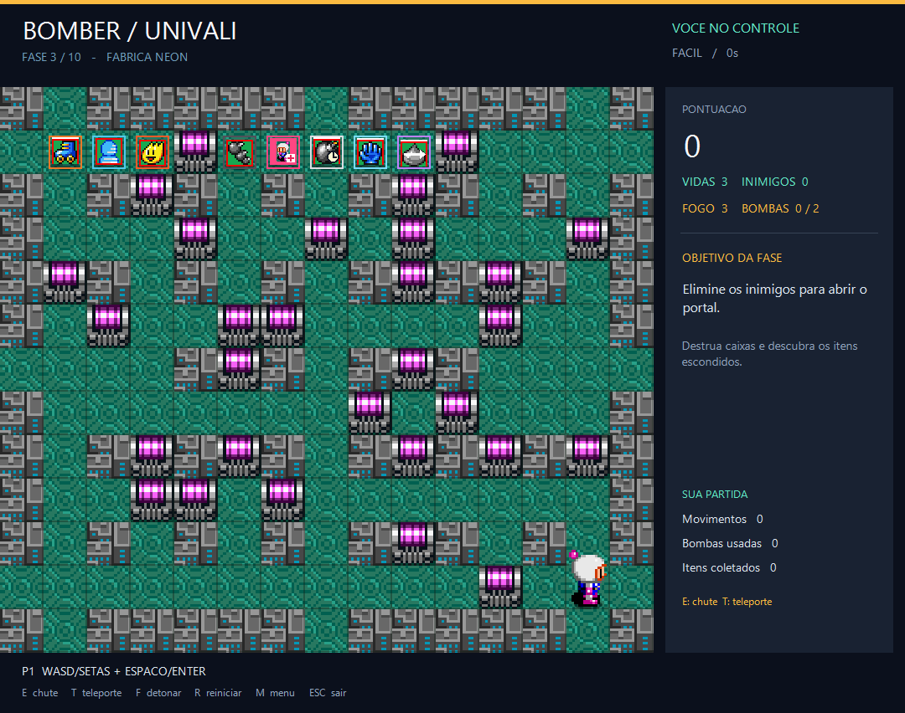
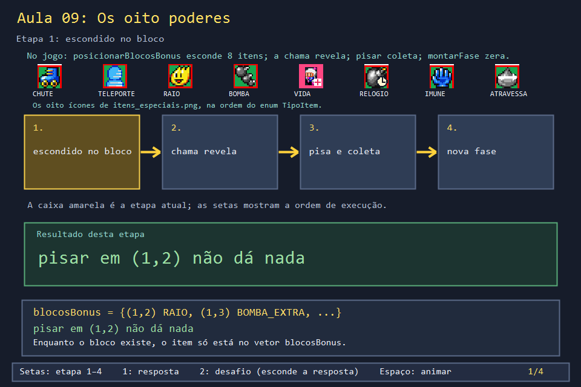
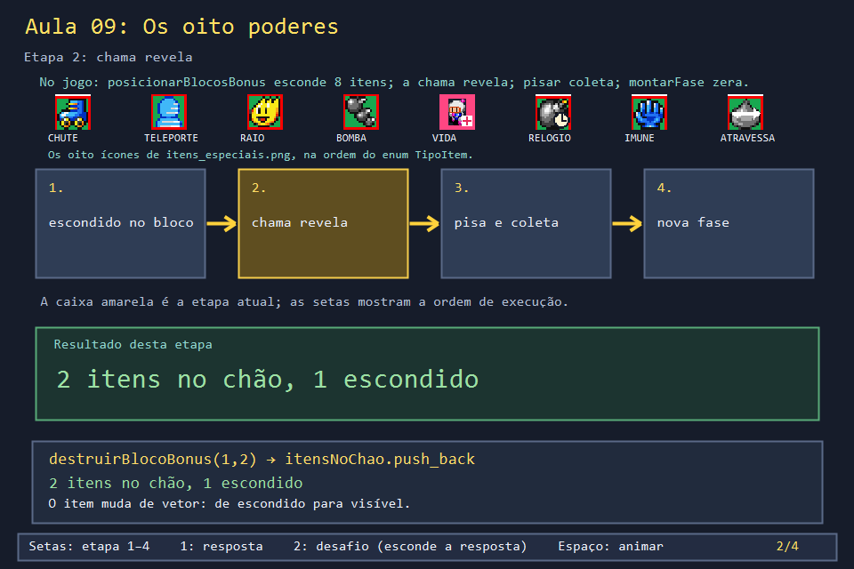
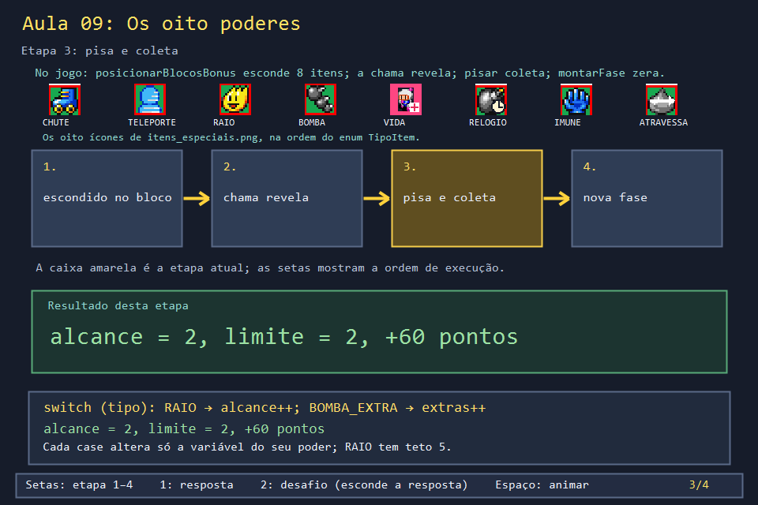
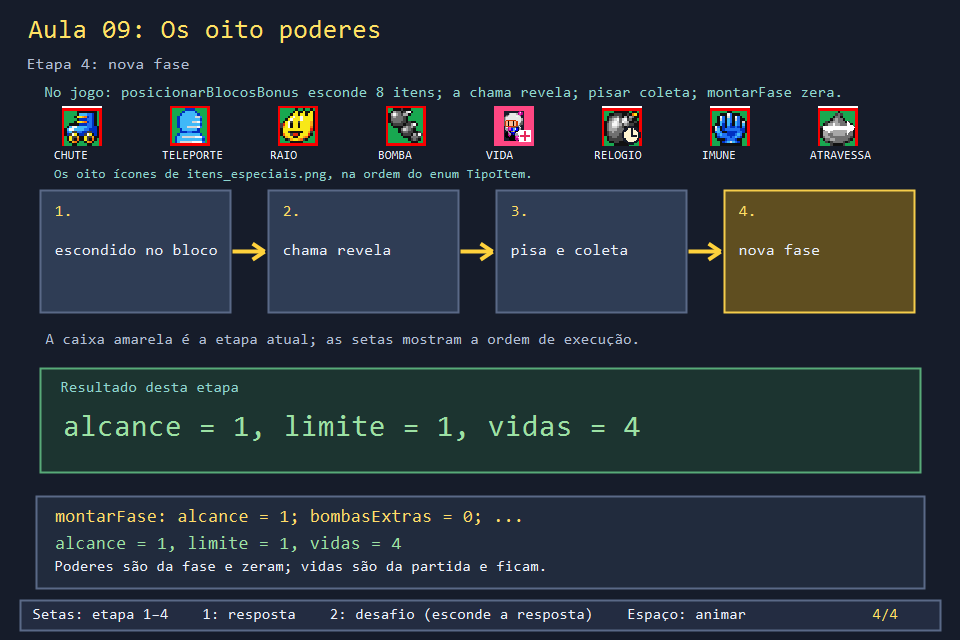

# Aula 09 — Os oito poderes

| Trilha | Duração | Antes desta aula | Próxima na trilha |
| --- | --- | --- | --- |
| Bombas e poderes (08 → 09 → 19) | 60–75 min | [Aula 08](../Aula_08_bomba_e_explosao_recursiva/Aula_08_bomba_e_explosao_recursiva.md) | [Aula 19 — Motor completo dos poderes](../Aula_19_motor_completo_dos_poderes/Aula_19_motor_completo_dos_poderes.md) |



Cada fase esconde **oito itens**, um de cada tipo, dentro de blocos que parecem caixas comuns. A chama quebra o bloco, o item aparece no chão, e quem pisar nele ganha o poder até o fim da fase. Esta aula segue um item por esse caminho: escondido, revelado, coletado e zerado. Ela também discute uma escolha de design do jogo que pode virar bug.

## O que você vai conseguir fazer

- Explicar por que o jogo usa **dois vetores** (`blocosBonus` e `itensNoChao`) para o mesmo item.
- Ler o `switch` de `coletarItensEm` e dizer o que cada carta altera.
- Separar o que zera a cada fase (poderes) do que dura a partida inteira (vidas, pontos).
- Transformar variáveis soltas numa `struct` com valores iniciais.

## 1. A ideia

```text
posicionarBlocosBonus     destruirBlocoBonus          coletarItensEm             montarFase
  blocosBonus  ─────────────► itensNoChao  ──────────────► efeito aplicado ─────────► efeito zerado
  (escondido)    a chama       (visível)     o jogador      (alcance++ ...)   nova    (alcance = 1 ...)
                 quebra                       pisa                           fase
```

As cartas se dividem em dois grupos:

| Efeito imediato | Habilidade usada depois (Aula 19) |
| --- | --- |
| `RAIO` alcance +1 (até 5) | `CHUTE` (E): empurra uma bomba |
| `BOMBA_EXTRA` +1 bomba ao mesmo tempo | `TELEPORTE` (T): salta para casa livre |
| `VIDA_EXTRA` +1 vida | `BOMBA_RELOGIO` (F): bombas explodem quando você quiser |
| `IMUNE_BOMBA` a própria chama não fere | `ATRAVESSA_BLOCO`: anda através de caixas |

## 2. O código real

A struct de item é mínima: posição e tipo. Os oito tipos são um `enum`:

<!-- trecho simbolo="TipoItem" -->
```cpp
// projeto_final/bomberman.cpp, linha 105 (TipoItem)
enum TipoItem { CHUTE, TELEPORTE, RAIO, BOMBA_EXTRA, VIDA_EXTRA, BOMBA_RELOGIO, IMUNE_BOMBA, ATRAVESSA_BLOCO };
```

<!-- trecho simbolo="Item" -->
```cpp
// projeto_final/bomberman.cpp, linha 149 (Item)
struct Item { Posicao posicao; TipoItem tipo; };
```

Na montagem da fase, oito caixas comuns viram `PAREDE_BONUS`, cada uma com um tipo sorteado:

<!-- trecho simbolo="posicionarBlocosBonus" -->
```cpp
// projeto_final/bomberman.cpp, linhas 1114–1128 (posicionarBlocosBonus)
void posicionarBlocosBonus() {
    blocosBonus.clear();
    vector<Posicao> candidatos = posicoesLivresParaBonus();
    shuffle(candidatos.begin(), candidatos.end(), gerador);
    // Os 6 itens obrigatorios do enunciado + os 2 extras que ja existiam
    // (chute/teleporte); embaralhados pra nao sair sempre na mesma ordem.
    vector<TipoItem> tipos = {RAIO, BOMBA_EXTRA, VIDA_EXTRA, BOMBA_RELOGIO,
                               IMUNE_BOMBA, ATRAVESSA_BLOCO, CHUTE, TELEPORTE};
    shuffle(tipos.begin(), tipos.end(), gerador);
    int total = min(static_cast<int>(tipos.size()), static_cast<int>(candidatos.size()));
    for (int i = 0; i < total; i++) {
        mapa[candidatos[i].linha][candidatos[i].coluna] = PAREDE_BONUS;
        blocosBonus.push_back({candidatos[i], tipos[i]});
    }
}
```

Quando a chama quebra um `PAREDE_BONUS` (Aula 08), o item passa de um vetor para o outro:

<!-- trecho simbolo="destruirBlocoBonus" -->
```cpp
// projeto_final/bomberman.cpp, linhas 1477–1485 (destruirBlocoBonus)
void destruirBlocoBonus(int linha, int coluna) {
    for (size_t i = 0; i < blocosBonus.size(); i++) {
        if (blocosBonus[i].posicao.linha == linha && blocosBonus[i].posicao.coluna == coluna) {
            itensNoChao.push_back({blocosBonus[i].posicao, blocosBonus[i].tipo});
            blocosBonus.erase(blocosBonus.begin() + i);
            return;
        }
    }
}
```

Ao pisar na casa, `coletarItensEm` aplica o efeito, apaga o item e soma 30 pontos:

<!-- trecho simbolo="coletarItensEm" -->
```cpp
// projeto_final/bomberman.cpp, linhas 1328–1346 (coletarItensEm)
void coletarItensEm(Posicao pos, int dono = 0) {
    for (size_t i = 0; i < itensNoChao.size(); i++) {
        if (!iguais(itensNoChao[i].posicao, pos)) continue;
        switch (itensNoChao[i].tipo) {
            case CHUTE: possuiCartaChute = true; break;
            case TELEPORTE: possuiCartaTeleporte = true; break;
            case RAIO: if (alcanceExplosao < ALCANCE_EXPLOSAO_MAXIMO) alcanceExplosao++; break;
            case BOMBA_EXTRA: bombasExtras++; break;
            case VIDA_EXTRA: vidas++; break;
            case BOMBA_RELOGIO: temBombaRelogio = true; break;
            case IMUNE_BOMBA: imuneAPropriaBomba = true; break;
            case ATRAVESSA_BLOCO: atravessaBlocoQuebravel = true; break;
        }
        itensNoChao.erase(itensNoChao.begin() + i);
        estatisticas.itensColetados++;
        ajustarPontos(PONTOS_POR_ITEM, dono);
        return;
    }
}
```

E `montarFase` zera tudo o que é da fase. Repare no comentário sobre `vidas`:

<!-- trecho simbolo="montarFase" de="itensNoChao.clear();" ate="// montarFase (avancarFase" -->
```cpp
// projeto_final/bomberman.cpp, linhas 1250–1261 (montarFase)
    itensNoChao.clear();
    possuiCartaChute = false;
    possuiCartaTeleporte = false;
    alcanceExplosao = ALCANCE_EXPLOSAO_INICIAL;
    bombas.clear();
    // Bonus resetam ao trocar de fase (regra explicita do enunciado).
    bombasExtras = 0;
    temBombaRelogio = false;
    imuneAPropriaBomba = false;
    atravessaBlocoQuebravel = false;
    // NAO mexe em "vidas" aqui: isso e responsabilidade de quem chama
    // montarFase (avancarFase/novaPartida zeram pro valor base; reiniciarFase
```

## 3. A versão desta aula

`Aula_09_oito_poderes.cpp` tem as mesmas variáveis globais e as funções `destruirBlocoBonus`, `coletarItensEm` e `limiteBombas` com o corpo do jogo. `zerarPoderesDaFase` é o trecho de `montarFase` acima.

```text
pisou em (1,2) antes da explosao: alcance=1 (nada no chao)
chama quebrou 2 blocos: escondidos=1 no chao=2
coletou: alcance=2 limite=2 pontos=60
mais 6 RAIO e 1 VIDA: alcance=5 (teto 5) vidas=4
nova fase: alcance=1 limite=1 vidas=4
```

## 4. O que mudou em relação ao jogo e por quê

| No jogo | Nesta aula | Motivo |
| --- | --- | --- |
| a coleta só acontece quando o desenho chega ao centro da casa (`visualNoDestino`) | chamada direta | a regra de chegada é da Aula 07 |
| os pontos passam por `ajustarPontos`, que separa P1 e P2 | `pontos +=` | dois jogadores são a Aula 12 |
| `estatisticas.itensColetados++` alimenta o fim de partida | ausente | ranking é a Aula 21 |
| os oito tipos são embaralhados por fase | fixados | saída previsível |

## 5. Laboratório visual

| | |
| --- | --- |
|  |  |
|  |  |

```powershell
.\compilar_aula.ps1 -Numero 9
.\build\Aula_09_oito_poderes.exe
.\abrir_aula.ps1 -Numero 9 -Modo Exemplo
```

## 6. Exercícios

1. **Previsão.** O jogador tem alcance 4 e pega duas cartas RAIO seguidas. Qual o alcance final? *(5: a segunda carta não faz nada por causa do teto. Ainda assim ela some e rende 30 pontos.)*
2. **Por que dois vetores?** `desenharMapa` desenha todos os itens de `itensNoChao` (procure `for (const Item& item : itensNoChao)`). O que aconteceria se o jogo pusesse os itens direto nesse vetor na montagem da fase? *(Os oito ícones apareceriam desenhados em cima das caixas desde o início, e a surpresa acabaria. Com dois vetores, a pergunta "o item está visível?" vira "em qual vetor ele está?".)*
3. **Refatoração.** Junte os sete poderes que zeram por fase numa `struct Poderes` com valores iniciais, e escreva `zerarPoderesDaFase` como `poderes = Poderes{}`. Por que `vidas` fica fora da struct? *Solução: `solucoes/`. Um poder novo, colocado na struct, é zerado sem ninguém lembrar de mexer em `montarFase`.*
4. **Leitura.** Procure no jogo onde `possuiCartaChute` volta a `false` além de `montarFase`. *(Em `chutarBomba`, depois de um chute válido: a carta é de uso único. Aula 19.)*

## 7. Erros comuns

- **Zerar vidas junto com os poderes.** O jogador perderia as vidas extras a cada fase. O comentário em `montarFase` existe justamente para evitar isso.
- **Esquecer o teto do RAIO.** Com alcance 15, a chama cruza o mapa inteiro, e o bot (que prevê a chama, Aula 11) fica sem lugar seguro.
- **Remover do vetor e continuar o laço.** `coletarItensEm` dá `return` logo depois do `erase`. Se continuasse, pularia o item seguinte (Aula 08, exercício 4).

## 8. Antes de seguir

- [ ] Sei em qual vetor o item está em cada momento.
- [ ] Previ as cinco linhas da saída.
- [ ] Fiz a refatoração do exercício 3 e sei explicar o que ela evita.

## Referências

- [`switch` (cppreference)](https://en.cppreference.com/w/cpp/language/switch)
- [Inicializadores de membros padrão (cppreference)](https://en.cppreference.com/w/cpp/language/data_members#Member_initialization)
- Aula 19: como chute, teleporte, relógio, imunidade e travessia são **usados**.
