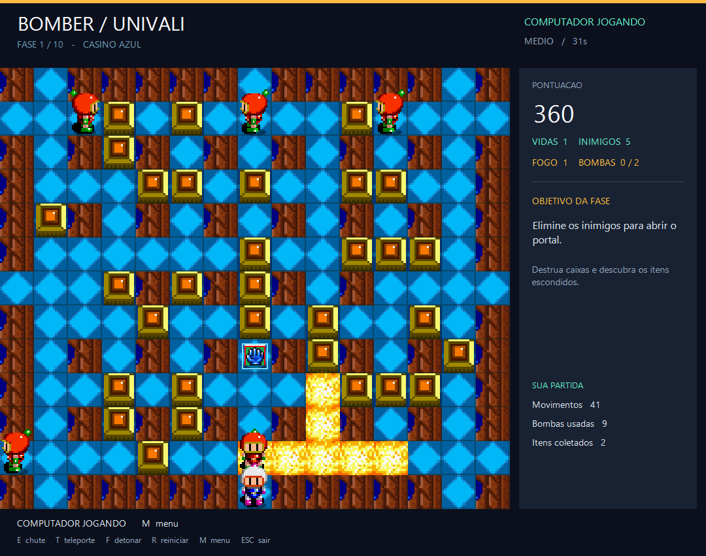
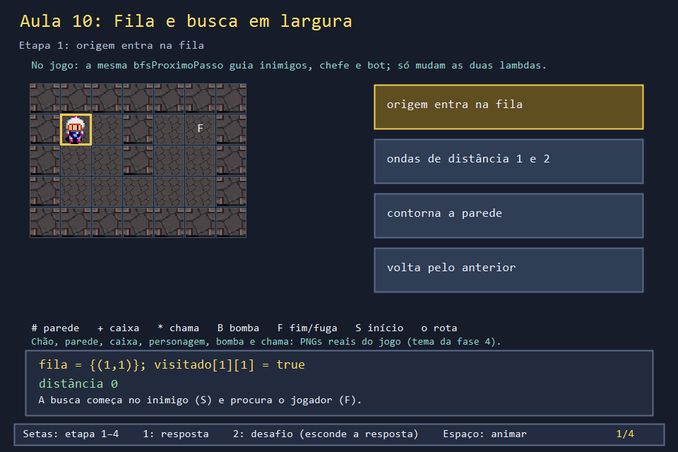
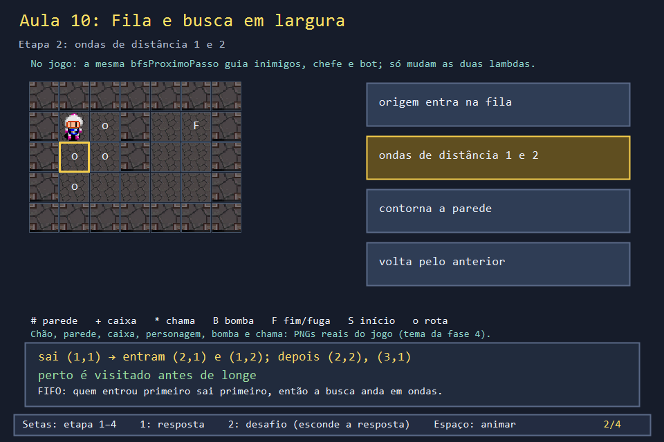
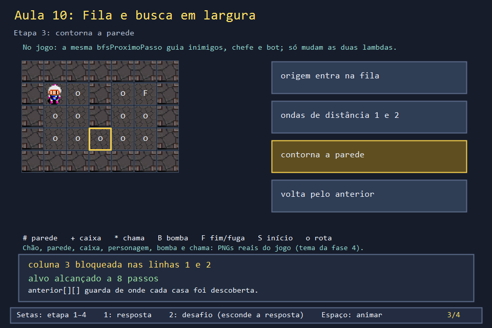
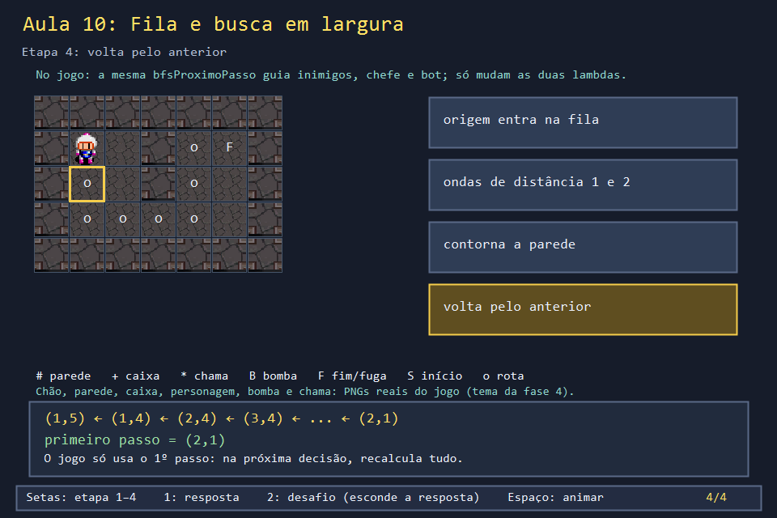

# Aula 10 — Fila e busca em largura (BFS)

| Trilha | Duração | Antes desta aula | Próxima na trilha |
| --- | --- | --- | --- |
| IA e busca (10 → 11 → 20) | 75–90 min | [Aula 07](../Aula_07_movimento_e_colisao/Aula_07_movimento_e_colisao.md), Aula 29 (template e lambda) | [Aula 11 — Perigo e fuga do bot](../Aula_11_perigo_e_fuga_do_bot/Aula_11_perigo_e_fuga_do_bot.md) |



Como um inimigo sabe por onde ir para alcançar o jogador, contornando pilares e caixas? Ele faz uma **busca em largura** (BFS) a partir de onde está, até encontrar o jogador, e dá um passo na direção certa. No jogo, uma única função faz isso para todos: inimigos, chefe e o bot do modo demonstração.

## O que você vai conseguir fazer

- Explicar por que uma **fila** (FIFO) faz a busca andar em "ondas" de distância.
- Seguir `bfsProximoPasso` e reconstruir o primeiro passo com o vetor `anterior`.
- Explicar por que a casa é marcada como visitada ao **entrar** na fila.
- Reaproveitar a mesma busca com outro critério de parada (`ehAlvo`).

## 1. A ideia

```text
distâncias a partir de S (1,1):        fila ao longo do tempo
# # # # # # #                         [ (1,1) ]
# 0 1 # 7 8 #   ← F em (1,5)           [ (2,1) (1,2) ]            ← distância 1
# 1 2 # 6 7 #                         [ (1,2) (3,1) (2,2) ]
# 2 3 4 5 6 #                         ...
# # # # # # #
```

A fila garante que todas as casas a distância 1 saem antes das casas a distância 2. Por isso, a primeira vez que a busca encontra o alvo é pelo **caminho mais curto**. Para saber o caminho, cada casa guarda em `anterior` de onde foi descoberta. No fim, basta voltar do alvo até a vizinha da origem.

## 2. O código real

O comentário do jogo explica a escolha do `template`: eram três buscas copiadas, que viraram uma.

<!-- trecho de="// Template de proposito" ate="    return objetivo;" -->
```cpp
// projeto_final/bomberman.cpp, linhas 1626–1661
// Template de proposito (criterio tecnico do trabalho): as tres buscas que
// existiam nesta secao (perseguicao de inimigo/boss, busca de alvo seguro do
// bot, fuga do bot) eram a mesma busca em largura copiada tres vezes, so
// variando "quando parar" e "por quais celulas dá pra passar". Em vez de
// manter três copias quase identicas, a busca vira uma unica funcao
// parametrizada pelos dois criterios - cada chamador passa suas proprias
// lambdas, e o compilador gera uma versao especializada pra cada combinacao
// (por isso precisa ser template: cada lambda tem um tipo proprio).
template <typename EhAlvo, typename PodeAndarPor>
Posicao bfsProximoPasso(Posicao origem, EhAlvo ehAlvo, PodeAndarPor podeAndarPor) {
    const int direcoes[4][2] = {{-1, 0}, {1, 0}, {0, -1}, {0, 1}};
    bool visitado[LINHAS][COLUNAS]{};
    Posicao anterior[LINHAS][COLUNAS];
    queue<Posicao> fila;
    fila.push(origem);
    visitado[origem.linha][origem.coluna] = true;
    Posicao objetivo = origem;
    bool encontrou = false;

    while (!fila.empty() && !encontrou) {
        Posicao atual = fila.front();
        fila.pop();
        if (ehAlvo(atual)) { objetivo = atual; encontrou = true; break; }
        for (const auto& direcao : direcoes) {
            Posicao proxima{atual.linha + direcao[0], atual.coluna + direcao[1]};
            if (!podeAndarPor(proxima) || visitado[proxima.linha][proxima.coluna]) continue;
            visitado[proxima.linha][proxima.coluna] = true;
            anterior[proxima.linha][proxima.coluna] = atual;
            fila.push(proxima);
        }
    }

    if (!encontrou || iguais(objetivo, origem)) return origem;
    while (!iguais(anterior[objetivo.linha][objetivo.coluna], origem))
        objetivo = anterior[objetivo.linha][objetivo.coluna];
    return objetivo;
```

Os chamadores só trocam as duas lambdas. A perseguição de inimigos para quando chega ao alvo e anda por casas livres:

<!-- trecho simbolo="podeAndarLivre" -->
```cpp
// projeto_final/bomberman.cpp, linha 1664 (podeAndarLivre)
bool podeAndarLivre(Posicao p) { return livre(p.linha, p.coluna) && !bloqueadoBoss(p); }
```

<!-- trecho simbolo="proximoPassoParaAlvo" -->
```cpp
// projeto_final/bomberman.cpp, linhas 1667–1670 (proximoPassoParaAlvo)
Posicao proximoPassoParaAlvo(Posicao origem, Posicao alvo) {
    return bfsProximoPasso(
        origem, [&](Posicao p) { return iguais(p, alvo); }, podeAndarLivre);
}
```

E o inimigo usa o passo devolvido, como qualquer movimento (Aula 07):

<!-- trecho simbolo="moverIndividualPerseguicao" -->
```cpp
// projeto_final/bomberman.cpp, linhas 1709–1718 (moverIndividualPerseguicao)
void moverIndividualPerseguicao(Inimigo& inimigo, int indice) {
    Posicao origemPasso = inimigo.posicao;
    Posicao alvo = proximoPassoParaAlvo(inimigo.posicao, alvoDePerseguicaoPara(inimigo.posicao));
    bool bloqueado = iguais(alvo, inimigo.posicao) || temInimigo(alvo, indice) || bombaEm(alvo);
    if (bloqueado) return;
    inimigo.posicao = alvo;
    inimigo.direcao = {alvo.linha - origemPasso.linha, alvo.coluna - origemPasso.coluna};
    inimigo.quadroAnim = (inimigo.quadroAnim + 1) % QUADROS_POR_DIRECAO;
    // Reservar a casa do jogador nao causa dano antes do contato visual.
}
```

## 3. A versão desta aula

`Aula_10_fila_e_bfs.cpp` copia `bfsProximoPasso` e `proximoPassoParaAlvo` sem mudança. `mapaDeDistancias` é uma BFS extra que só serve para imprimir as ondas:

```text
distancias a partir do inimigo em (1,1):
# # # # # # #
# 0 1 # 7 8 #
# 1 2 # 6 7 #
# 2 3 4 5 6 #
# # # # # # #
jogador em (1,5); primeiro passo do inimigo=(2,1)
ja no alvo: devolve a propria origem=(1,5)
```

A última linha mostra um contrato da função: se não houver caminho, ou se a origem já for o alvo, ela devolve a própria origem. `moverIndividualPerseguicao` testa exatamente isso (`iguais(alvo, inimigo.posicao)`) para saber que deve ficar parado.

## 4. O que mudou em relação ao jogo e por quê

| No jogo | Nesta aula | Motivo |
| --- | --- | --- |
| mapa 13 × 15 | 5 × 7 | dá para conferir as distâncias à mão |
| `podeAndarLivre` também evita o chefe (`bloqueadoBoss`) | só o mapa | sem chefe aqui |
| o inimigo só persegue com uma chance que depende da dificuldade e da distância (`moverInimigos`) | persegue sempre | a chance é assunto da Aula 12 |
| não há `mapaDeDistancias` | há | tornar as ondas visíveis |

## 5. Laboratório visual

| | |
| --- | --- |
|  |  |
|  |  |

```powershell
.\compilar_aula.ps1 -Numero 10
.\build\Aula_10_fila_e_bfs.exe
.\abrir_aula.ps1 -Numero 10 -Modo Exemplo
```

## 6. Exercícios

1. **Previsão.** Abra uma passagem trocando `mapa[2][3]` por `'.'`. Qual a nova distância até (1,5) e o primeiro passo? *(6 passos; o primeiro passo continua (2,1), porque "para baixo" é testado antes de "para a direita" e chega a (2,2) com a mesma distância. Confira imprimindo as distâncias.)*
2. **Rota completa.** Escreva `rotaCompleta`, que devolve um `vector<Posicao>` com todas as casas da origem ao alvo. *Solução: `solucoes/` — `(1,1) (2,1) (3,1) (3,2) (3,3) (3,4) (2,4) (1,4) (1,5)`.*
3. **Outro alvo, mesma busca.** Ponha uma caixa `+` em (2,5) e use a busca para chegar à primeira casa **vizinha de uma caixa**, como o bot faz para escolher onde plantar. Só a lambda `ehAlvo` muda. *Solução: `solucoes/` — 6 passos, até (2,4).*
4. **Marcar cedo.** Mova `visitado[...] = true` para logo depois de `fila.pop()`. O resultado muda? E o trabalho? *(O caminho continua certo, mas a mesma casa pode entrar várias vezes na fila: em mapas abertos, a fila cresce muito mais.)*

## 7. Erros comuns

- **Usar pilha em vez de fila.** Com `std::stack`, a busca vira em profundidade (DFS): encontra **um** caminho, não o mais curto, e o inimigo dá voltas estranhas.
- **Esquecer de testar `visitado` antes de enfileirar.** O programa não trava, mas fica lento; num mapa sem paredes, a fila explode.
- **Reconstruir a rota quando o alvo é a origem.** O `while` procuraria um `anterior` que nunca foi preenchido. O jogo trata esse caso antes, com `iguais(objetivo, origem)`.

## 8. Antes de seguir

- [ ] Sei explicar por que a primeira chegada ao alvo é pelo caminho mais curto.
- [ ] Reproduzi a tabela de distâncias à mão.
- [ ] Usei a mesma busca com dois `ehAlvo` diferentes.

## Referências

- [Introdução ao A* e à BFS — Red Blob Games](https://www.redblobgames.com/pathfinding/a-star/introduction.html) (com animações interativas)
- [`std::queue` (cppreference)](https://en.cppreference.com/w/cpp/container/queue)
- [Expressões lambda (cppreference)](https://en.cppreference.com/w/cpp/language/lambda)
- Aula 20: a mesma BFS buscando uma casa **fora** da chama.
