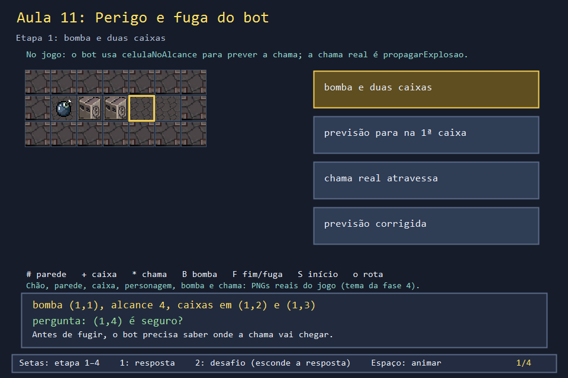
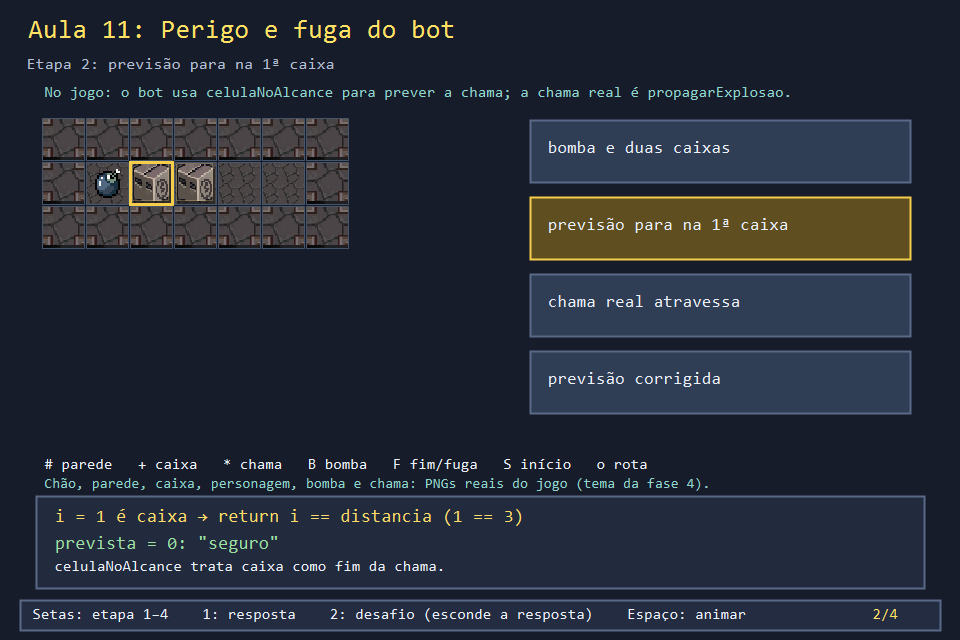
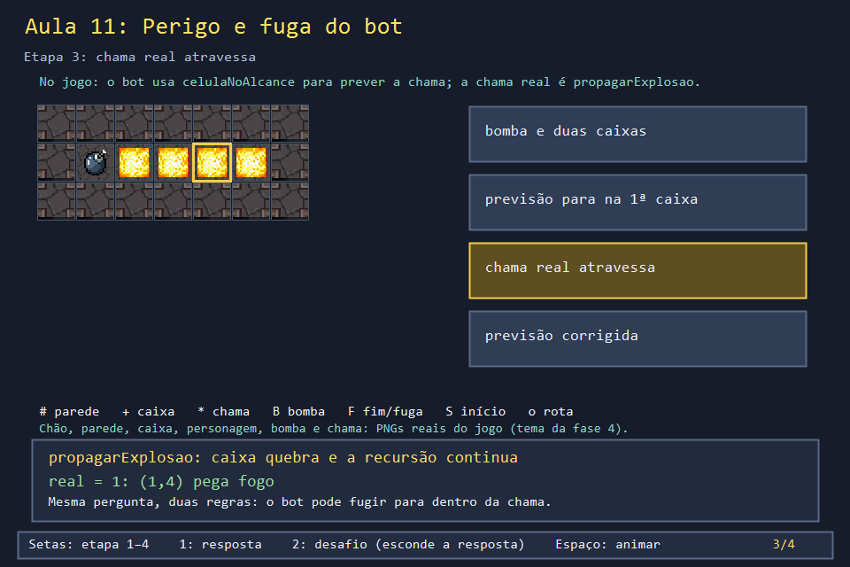
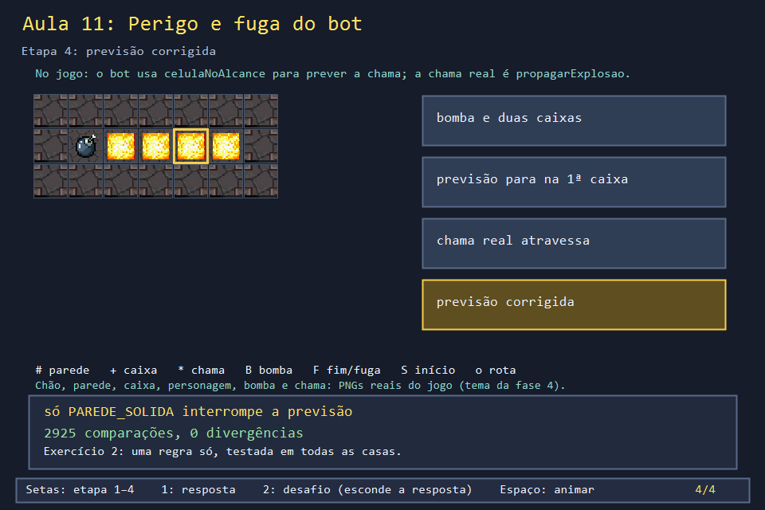

# Aula 11 — Perigo e fuga do bot

| Trilha | Duração | Antes desta aula | Próxima na trilha |
| --- | --- | --- | --- |
| IA e busca (10 → 11 → 20) | 60–75 min | [Aula 08](../Aula_08_bomba_e_explosao_recursiva/Aula_08_bomba_e_explosao_recursiva.md), [Aula 10](../Aula_10_fila_e_bfs/Aula_10_fila_e_bfs.md) | [Aula 20 — BFS de fuga segura](../Aula_20_bfs_fuga_segura/Aula_20_bfs_fuga_segura.md) |


No modo demonstração, o computador joga sozinho. A cada passo, o bot faz uma pergunta: "se eu plantar aqui, ou se eu ficar aqui, a chama me pega?". Para responder sem explodir nada de verdade, ele usa uma **previsão**. Esta aula compara essa previsão com a chama real do jogo e encontra uma diferença entre elas.

## O que você vai conseguir fazer

- Ler `celulaNoAlcance` e explicar como ela anda da bomba até a casa perguntada.
- Ler `atualizarBot` e listar as decisões do bot, em ordem de prioridade.
- Mostrar, com um caso concreto, que previsão e chama real discordam.
- Corrigir a previsão e **provar** a correção com um teste exaustivo.

## 1. A ideia

```text
linha:     #  B  +  +  .  .  #        alcance 4
casa:      0  1  2  3  4  5  6
chama:        *  *  *  *  *           propagarExplosao: caixas quebram, a chama segue
previsão:     *  *  .  .  .           celulaNoAlcance: na 1ª caixa, "o resto está seguro"
```

O bot confia na previsão. Se a única casa "segura" que ele encontrar estiver atrás de duas caixas, ele vai até lá, e a chama o alcança.

## 2. O código real

A previsão. Repare na última linha do `for`: ao encontrar uma caixa, ela devolve "atingido" só se a casa perguntada for a própria caixa.

<!-- trecho simbolo="celulaNoAlcance" de="bool celulaNoAlcance(Posicao origemBomba, Posicao p, int alcance = -1) {" -->
```cpp
// projeto_final/bomberman.cpp, linhas 2157–2174 (celulaNoAlcance)
bool celulaNoAlcance(Posicao origemBomba, Posicao p, int alcance = -1) {
    if (alcance < 0) alcance = alcanceExplosao;
    if (iguais(p, origemBomba)) return true;
    int dl = p.linha - origemBomba.linha;
    int dc = p.coluna - origemBomba.coluna;
    if (dl != 0 && dc != 0) return false;
    int distancia = abs(dl) + abs(dc);
    if (distancia > alcance) return false;
    int passoL = (dl > 0) - (dl < 0);
    int passoC = (dc > 0) - (dc < 0);
    for (int i = 1; i <= distancia; i++) {
        int l = origemBomba.linha + passoL * i;
        int c = origemBomba.coluna + passoC * i;
        if (mapa[l][c] == PAREDE_SOLIDA) return false;
        if (mapa[l][c] == PAREDE_FRAGIL || mapa[l][c] == PAREDE_BONUS) return i == distancia;
    }
    return true;
}
```

A fuga usa a previsão dentro de uma BFS com prazo. O bot tem `2200 / 280 = 7` passos antes de a bomba explodir:

<!-- trecho simbolo="existeFugaSegura" -->
```cpp
// projeto_final/bomberman.cpp, linhas 2186–2207 (existeFugaSegura)
bool existeFugaSegura(Posicao origem) {
    int passosDisponiveis = TEMPO_BOMBA_MS / INTERVALO_MOVIMENTO_MS;
    const int direcoes[4][2] = {{-1, 0}, {1, 0}, {0, -1}, {0, 1}};
    bool visitado[LINHAS][COLUNAS]{};
    queue<pair<Posicao, int>> fila;
    fila.push({origem, 0});
    visitado[origem.linha][origem.coluna] = true;
    while (!fila.empty()) {
        auto [atual, passos] = fila.front();
        fila.pop();
        if (!iguais(atual, origem) && !celulaNoAlcance(origem, atual)) return true;
        if (passos >= passosDisponiveis) continue;
        for (const auto& direcao : direcoes) {
            Posicao proxima{atual.linha + direcao[0], atual.coluna + direcao[1]};
            if (!podeAndarLivre(proxima) || visitado[proxima.linha][proxima.coluna] ||
                temInimigo(proxima)) continue;
            visitado[proxima.linha][proxima.coluna] = true;
            fila.push({proxima, passos + 1});
        }
    }
    return false;
}
```

E a cabeça do bot, decidida a cada atualização. A ordem dos `if` é a ordem de prioridade: fugir, ir ao portal, plantar se houver fuga, andar até um bom lugar para plantar.

<!-- trecho simbolo="atualizarBot" -->
```cpp
// projeto_final/bomberman.cpp, linhas 2368–2394 (atualizarBot)
void atualizarBot() {
    // Decide a cada tick de logica (nao mais a cada INTERVALO_BOT_MS), mas o
    // movimento em si continua pausado pelo mesmo cooldown do jogador manual
    // (tempoMovimentoMs, dentro de moverJogador). Isso elimina a dessincronia
    // entre "quando o bot decide" e "quando o jogo deixa mover", que causava
    // o personagem parecendo travar/bater em paredes no modo automatico.
    if (modo != AUTOMATICO || estado != JOGANDO || tempoMovimentoMs > 0) return;
    // Bombas de inimigos so importam quando ameacam o bot; a dele, sempre.
    if (bombasDoDono(0) > 0 || perigoDaBomba(jogador) || perigoDoBoss(jogador)) {
        if (!perigoDaBomba(jogador) && !perigoDoBoss(jogador)) return;
        Posicao destino = proximoPassoParaFuga();
        if (!iguais(destino, jogador)) moverJogador(destino.linha - jogador.linha, destino.coluna - jogador.coluna);
        return;
    }
    if(portalAtivo) {
        Posicao destino=proximoPassoParaAlvo(jogador,portalPosicao);
        if(!iguais(destino,jogador)) moverJogador(destino.linha-jogador.linha,destino.coluna-jogador.coluna);
        return;
    }
    if (alvoParaBombaSeguro(jogador)) {
        colocarBomba();
        return;
    }
    Posicao destino = proximoPassoDoBot();
    if (perigoDaBomba(destino)) return; // espera a bomba do inimigo explodir
    if (!iguais(destino, jogador)) moverJogador(destino.linha - jogador.linha, destino.coluna - jogador.coluna);
}
```

## 3. A versão desta aula

`Aula_11_perigo_e_fuga_do_bot.cpp` copia `celulaNoAlcance` e a parte de `propagarExplosao` que decide até onde a chama vai. Ela compara as duas casa por casa:

```text
linha #.++..#, bomba em (1,1), alcance 4
(1,2) + prevista=1 real=1
(1,3) + prevista=0 real=1 <- o bot acha seguro, mas a chama chega
(1,4) . prevista=0 real=1 <- o bot acha seguro, mas a chama chega
(1,5) . prevista=0 real=1 <- o bot acha seguro, mas a chama chega
```

Na versão do jogo copiada para este curso, essa diferença existe e não foi corrigida. Na prática, ela raramente mata o bot, porque `existeFugaSegura` costuma achar antes uma casa segura de verdade, fora da linha da bomba. Mas, num corredor cheio de caixas, acontece.

## 4. O que mudou em relação ao jogo e por quê

| No jogo | Nesta aula | Motivo |
| --- | --- | --- |
| `celulaNoAlcance` usa `alcanceExplosao` quando não recebe alcance | recebe sempre | sem variáveis globais escondidas |
| `propagarExplosao` quebra caixas, pontua e liberta o Mario | só anota as células | não alterar o mapa durante a comparação |
| `perigoDaBomba` testa todas as bombas ativas; `perigoDoBoss`, os ataques do chefe | uma bomba | a pergunta é a mesma para cada bomba |

## 5. Laboratório visual

| | |
| --- | --- |
|  |  |
|  |  |

```powershell
.\compilar_aula.ps1 -Numero 11
.\build\Aula_11_perigo_e_fuga_do_bot.exe
.\abrir_aula.ps1 -Numero 11 -Modo Exemplo
```

## 6. Exercícios

1. **Previsão.** Com alcance 2, quais casas da linha `#.++..#` divergem? *(Só (1,3): a chama chega a (1,2) e (1,3); a previsão diz 1 para (1,2) e 0 para (1,3). (1,4) e (1,5) estão fora do alcance nas duas regras.)*
2. **Corrija e prove.** Escreva `celulaNoAlcanceCorrigida`, em que só a parede sólida para a previsão. Prove a correção comparando com a chama para **toda** posição de bomba, **toda** casa do mapa e alcances de 1 a 5. *Solução: `solucoes/` — `comparacoes=2925 divergencias=0`.* Um teste que percorre todos os casos vale mais que cinco exemplos escolhidos à mão.
3. **Prioridades.** Em `atualizarBot`, o que o bot faz se estiver em perigo e o portal estiver aberto ao mesmo tempo? *(Foge. O teste de perigo vem antes e termina com `return`.)*
4. **Prazo da fuga.** Se `INTERVALO_MOVIMENTO_MS` subisse para 400, quantos passos o bot teria? O que mudaria no comportamento? *(2200 / 400 = 5 passos, por divisão inteira. Ele plantaria menos, porque menos lugares teriam fuga a tempo.)*

## 7. Erros comuns

- **Duas funções para a mesma regra.** Previsão e realidade escritas em lugares diferentes acabam divergindo quando alguém muda uma delas. Se possível, faça uma chamar a outra, ou teste uma contra a outra, como no exercício 2.
- **Testar só o caso que você imaginou.** O exemplo antigo do curso comparava uma única casa. O teste exaustivo da solução cobre 2925 combinações em milissegundos.
- **Esquecer o prazo.** Uma fuga a 9 passos é inútil se a bomba explode em 7. `existeFugaSegura` limita a busca com `passosDisponiveis`.

## 8. Antes de seguir

- [ ] Sei dizer em que linha de `celulaNoAlcance` a divergência nasce.
- [ ] Listei as quatro decisões do bot, em ordem.
- [ ] Rodei o teste exaustivo e entendi por que ele dá mais confiança que exemplos.

## Referências

- [Testes exaustivos e por propriedade (Hypothesis, conceito)](https://hypothesis.readthedocs.io/en/latest/) — a ideia vale em C++ também
- [`std::abs` (cppreference)](https://en.cppreference.com/w/cpp/numeric/math/abs)
- Aula 20: `existeFugaSegura` em detalhe, com o prazo de passos.
