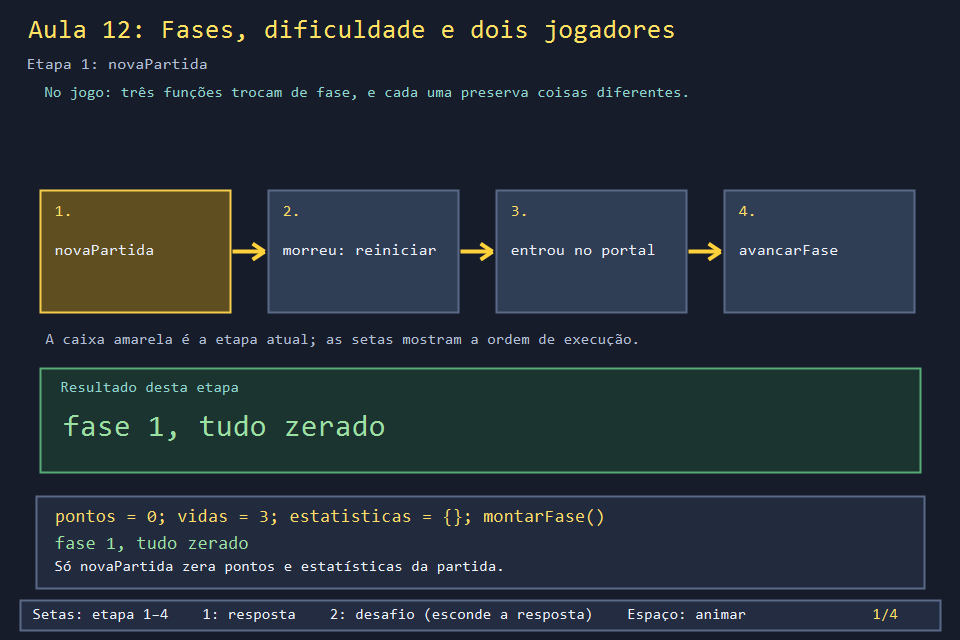
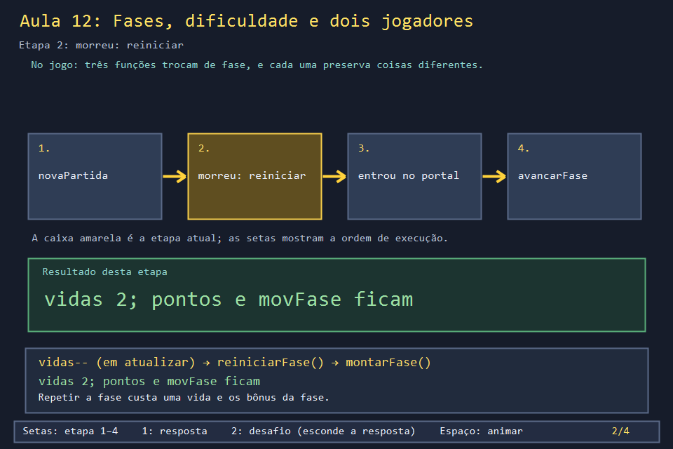
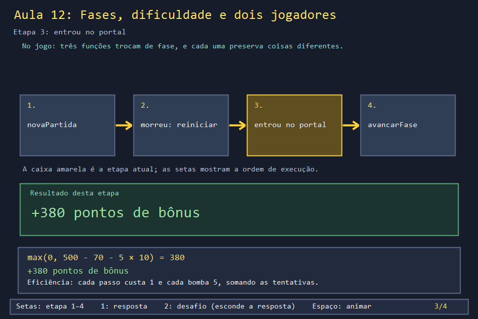
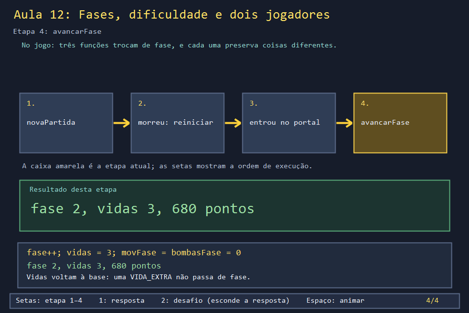

# Aula 12 — Fases, dificuldade e dois jogadores

| Trilha | Duração | Antes desta aula | Próxima na trilha |
| --- | --- | --- | --- |
| Campanha e cenário (12 → 27) | 60–75 min | [Aula 09](../Aula_09_oito_poderes/Aula_09_oito_poderes.md) | [Aula 27 — Cenários, tabuleiro e tiles](../Aula_27_cenarios_tabuleiro_e_tiles/Aula_27_cenarios_tabuleiro_e_tiles.md) |

| Escolha no menu | A partida com dois jogadores |
| --- | --- |
|  |  |

A campanha tem dez fases. Entre elas, o jogo precisa decidir o que **continua** (pontos, estatísticas da partida) e o que **recomeça** (mapa, poderes, vidas da fase). Errar essa lista é um dos bugs mais comuns em jogos: o jogador perde algo que deveria guardar ou leva para a próxima fase algo que deveria zerar. Nesta aula você segue as três funções que fazem a troca e mede o efeito de cada uma.

## O que você vai conseguir fazer

- Dizer o que `novaPartida`, `reiniciarFase` e `avancarFase` preservam e zeram.
- Calcular o bônus do portal a partir dos passos e das bombas da fase.
- Prever quantos inimigos cada dificuldade cria, e quantos soltam bomba.
- Explicar como os pontos se dividem entre P1 e P2.

## 1. A ideia

| | `novaPartida` | `reiniciarFase` (morreu) | `avancarFase` (portal) |
| --- | --- | --- | --- |
| mapa, inimigos, poderes | recomeça | recomeça | recomeça |
| fase | a escolhida no menu | a mesma | +1 |
| vidas | 3 | as que sobraram | **3** |
| pontos e estatísticas da partida | zeram | ficam | ficam |
| passos e bombas **da fase** | zeram | **ficam** | zeram |

Todas chamam `montarFase` no fim. A diferença está no que cada uma faz **antes**.

## 2. O código real

<!-- trecho simbolo="reiniciarFase" -->
```cpp
// projeto_final/bomberman.cpp, linhas 1298–1300 (reiniciarFase)
void reiniciarFase() {
    montarFase();
}
```

<!-- trecho simbolo="avancarFase" -->
```cpp
// projeto_final/bomberman.cpp, linhas 1302–1307 (avancarFase)
void avancarFase() {
    if (faseAtual < TOTAL_FASES) faseAtual++;
    vidas = VIDAS_BASE;
    estatisticas.movimentosFase = estatisticas.bombasFase = 0;
    montarFase();
}
```

<!-- trecho simbolo="novaPartida" -->
```cpp
// projeto_final/bomberman.cpp, linhas 1311–1326 (novaPartida)
void novaPartida(ModoJogo novoModo, Dificuldade novaDificuldade) {
    modo = novoModo;
    if(novoModo==AUTOMATICO)doisJogadores=false;
    dificuldade = novaDificuldade;
    telaMenu = MENU_PRINCIPAL;
    faseAtual = faseSelecionada;
    pontos = 0;
    pontosJogador[0] = pontosJogador[1] = 0;
    vidas = VIDAS_BASE;
    estatisticas = EstatisticasPartida{};
    registroSalvo = false;
    erroSalvarRanking = false;
    botaoBombaControleAnterior=entradaControle.bomba;
    tempoPartidaMs = 0;
    montarFase();
}
```

O portal aparece quando não há mais inimigos (e, nas fases pares, depois do chefe). Pisar nele dá o bônus de eficiência:

<!-- trecho simbolo="verificarVitoria" -->
```cpp
// projeto_final/bomberman.cpp, linhas 2143–2151 (verificarVitoria)
void verificarVitoria() {
    if (estado != JOGANDO || portalAtivo) return;
    for (const Inimigo& inimigo : inimigos) if (inimigo.vivo) return;
    if (faseAtual % 2 == 0 && !bossConcluido) {
        if (!bossIniciado) iniciarBoss();
        return;
    }
    colocarPortal();
}
```

<!-- trecho simbolo="avancarOuVencerSePortal" -->
```cpp
// projeto_final/bomberman.cpp, linhas 1363–1369 (avancarOuVencerSePortal)
void avancarOuVencerSePortal(Posicao pos, int dono = 0) {
    if (estado == JOGANDO && mapa[pos.linha][pos.coluna] == PORTAL) {
        ajustarPontos(max(0,PONTOS_POR_FASE-estatisticas.movimentosFase*CUSTO_POR_MOVIMENTO-estatisticas.bombasFase*CUSTO_POR_BOMBA), dono);
        if (faseAtual < TOTAL_FASES) avancarFase();
        else estado = VITORIA;
    }
}
```

A dificuldade define quantos inimigos nascem e quantos deles soltam bomba. O `+ 50` antes de dividir por 100 arredonda para o inteiro mais próximo:

<!-- trecho simbolo="quantidadeInimigosNormais" -->
```cpp
// projeto_final/bomberman.cpp, linhas 1140–1147 (quantidadeInimigosNormais)
int quantidadeInimigosNormais() {
    switch (dificuldade) {
        case FACIL: return 3;
        case MEDIO: return 5;
        case DIFICIL: return 7;
    }
    return 3;
}
```

<!-- trecho simbolo="montarFase" de="// Facil: um inimigo solta bomba" ate=": (static_cast<int>(inimigos.size()) * percentual + 50) / 100;" -->
```cpp
// projeto_final/bomberman.cpp, linhas 1237–1240 (montarFase)
    // Facil: um inimigo solta bomba; Medio: metade; Dificil: 75%.
    int percentual = dificuldade == MEDIO ? 50 : 75;
    int comBomba = dificuldade == FACIL ? min(1, static_cast<int>(inimigos.size()))
                 : (static_cast<int>(inimigos.size()) * percentual + 50) / 100;
```

Com dois jogadores, todo ponto passa por `ajustarPontos`, que também anota a parte de quem pontuou. No modo **amigos**, o time divide o total; no modo **inimigos**, cada um leva a sua parte para o ranking.

<!-- trecho simbolo="ajustarPontos" -->
```cpp
// projeto_final/bomberman.cpp, linhas 893–896 (ajustarPontos)
void ajustarPontos(int delta, int dono = -1) {
    pontos = max(0, pontos + delta);
    if (dono == 0 || dono == 1) pontosJogador[dono] = max(0, pontosJogador[dono] + delta);
}
```

## 3. A versão desta aula

`Aula_12_fases_dificuldade_e_cooperativo.cpp` tem as três funções, `ajustarPontos`, `quantidadeInimigosNormais` e o cálculo de inimigos com bomba, com os mesmos nomes e números do jogo. O `main` encena uma partida: joga, morre, joga de novo, entra no portal.

```text
novaPartida                  fase=1 vidas=3 pontos=0    alcance=1 movFase=0   bombasFase=0
jogou: 40 passos, 6 bombas   fase=1 vidas=3 pontos=200  alcance=2 movFase=40  bombasFase=6
morreu -> reiniciarFase      fase=1 vidas=2 pontos=200  alcance=1 movFase=40  bombasFase=6
jogou: 30 passos, 4 bombas   fase=1 vidas=2 pontos=300  alcance=2 movFase=70  bombasFase=10
  bonus do portal = max(0, 500 - 70 - 5 x 10) = 380
portal -> avancarFase        fase=2 vidas=3 pontos=680  alcance=1 movFase=0   bombasFase=0

inimigos por dificuldade (e quantos soltam bomba):
  FACIL   3 inimigos, 1 com bomba
  MEDIO   5 inimigos, 3 com bomba
  DIFICIL 7 inimigos, 5 com bomba

dois jogadores: total=120 P1=100 P2=20
```

Repare na terceira linha. Depois da morte, o alcance voltou a 1 (o poder era da fase), mas `movFase` continuou em 40. Por isso o bônus do portal desconta as duas tentativas.

## 4. O que mudou em relação ao jogo e por quê

| No jogo | Nesta aula | Motivo |
| --- | --- | --- |
| `vidas--` acontece no fim de `atualizar`, uma vez por morte | `vidas--` direto no `main` | a detecção de morte depende de chama e inimigos |
| `montarFase` monta mapa, inimigos, chefe, Mario, P2 | só zera o alcance | o resto é das Aulas 02, 09, 22 e 27 |
| com dois jogadores, cada um tem 3 vidas **por fase** (`vidasJogador`) | só as vidas globais | as vidas individuais aparecem na Aula 31 |
| vitória na fase 10 encerra a campanha (`estado = VITORIA`) | o exemplo não chega lá | uma fase basta para ver a regra |

## 5. Laboratório visual

| | |
| --- | --- |
|  |  |
|  |  |

```powershell
.\compilar_aula.ps1 -Numero 12
.\build\Aula_12_fases_dificuldade_e_cooperativo.exe
.\abrir_aula.ps1 -Numero 12 -Modo Exemplo
```

## 6. Exercícios

1. **Previsão.** O jogador pega duas `VIDA_EXTRA` na fase 3 (fica com 5 vidas) e entra no portal sem morrer. Com quantas vidas começa a fase 4? *(3: `avancarFase` faz `vidas = VIDAS_BASE`. As vidas extras só valem na fase em que foram coletadas.)* Você manteria essa regra?
2. **Bônus justo.** Escreva uma variação em que `reiniciarFase` zera `movimentosFase` e `bombasFase`. Qual seria o bônus no cenário do exemplo? Quanto a morte custou, em pontos de bônus, na regra do jogo? *Solução: `solucoes/` — 450 em vez de 380; a tentativa perdida custou 70.*
3. **Dificuldade.** Se o jogo tivesse um nível com 9 inimigos e 75% com bomba, quantos soltariam bomba? *((9 × 75 + 50) / 100 = 725 / 100 = 7.)* E sem o `+ 50`? *(675 / 100 = 6: a divisão inteira sempre arredonda para baixo.)*
4. **Pontos nunca negativos.** Por que `ajustarPontos` usa `max(0, ...)`? Procure no jogo uma chamada com `delta` negativo. *(Hoje nenhuma chamada passa valor negativo, mas a regra protege contra uma penalidade futura. O bônus do portal usa o mesmo cuidado.)*

## 7. Erros comuns

- **Zerar pontos em `montarFase`.** Como as três funções chamam `montarFase`, os pontos sumiriam a cada morte. O jogo zera pontos só em `novaPartida`, a única função que começa uma partida.
- **Somar pontos direto em `pontos`.** Funciona com um jogador; com dois, a parte de cada um fica errada. Tudo passa por `ajustarPontos`.
- **Divisão inteira sem arredondar.** `5 * 50 / 100` dá 2 inimigos com bomba no Médio; o jogo quer 3 (metade de 5, arredondada).

## 8. Antes de seguir

- [ ] Preenchi a tabela da seção 1 sem olhar.
- [ ] Calculei o bônus de 380 à mão.
- [ ] Respondi o exercício 1 e sei qual linha do código causa isso.

## Referências

- [Divisão inteira em C++ (cppreference)](https://en.cppreference.com/w/cpp/language/operator_arithmetic#Multiplicative_operators)
- [`std::max` (cppreference)](https://en.cppreference.com/w/cpp/algorithm/max)
- Aula 21: como pontos, bombas e movimentos entram no ranking.
