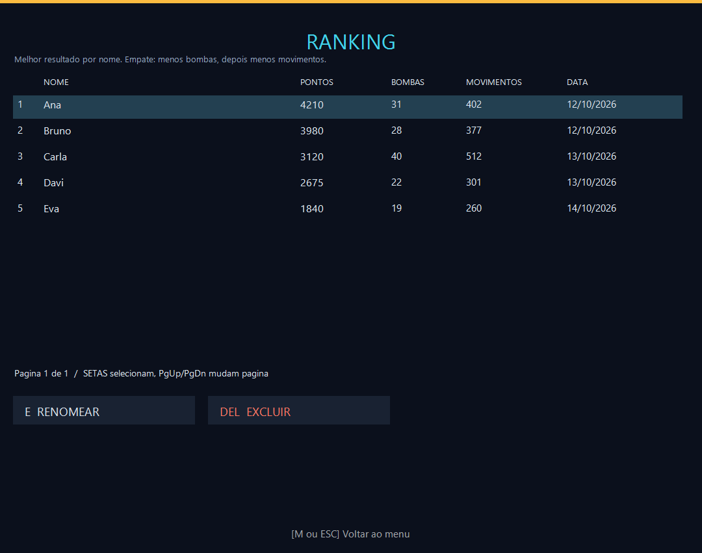
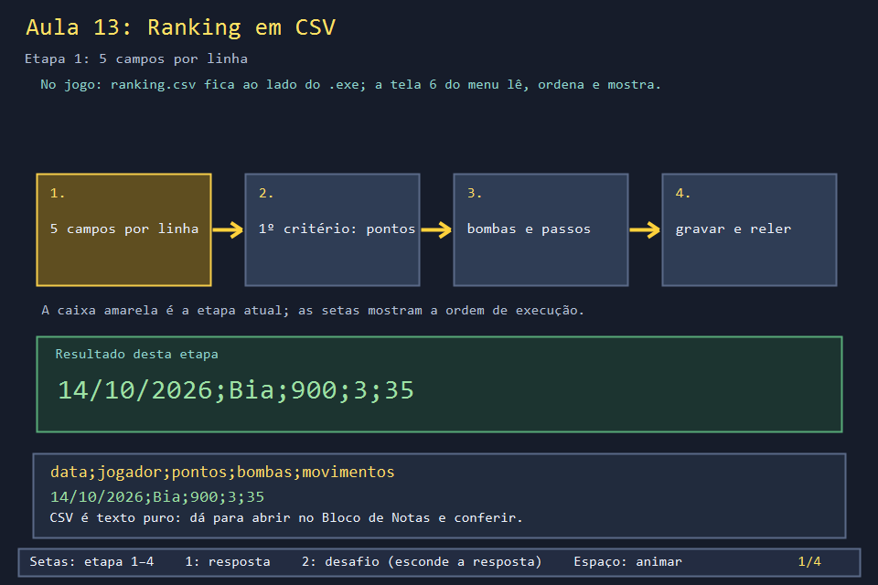
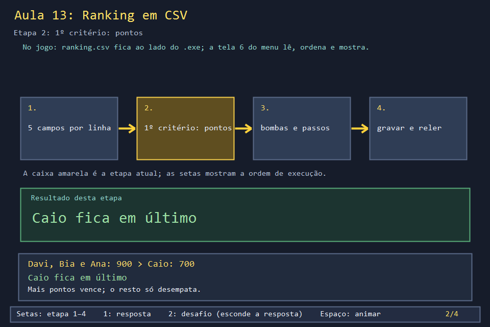
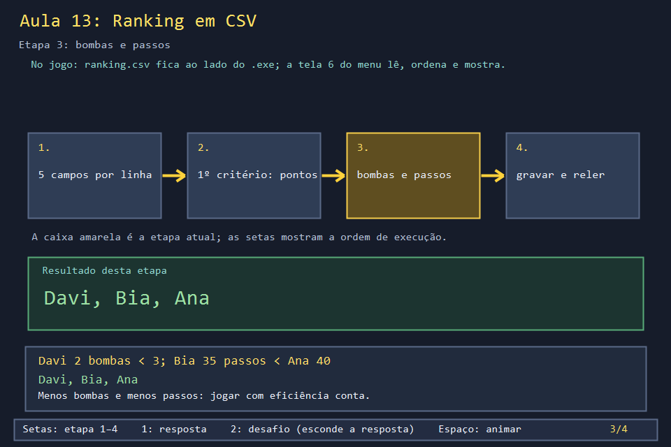
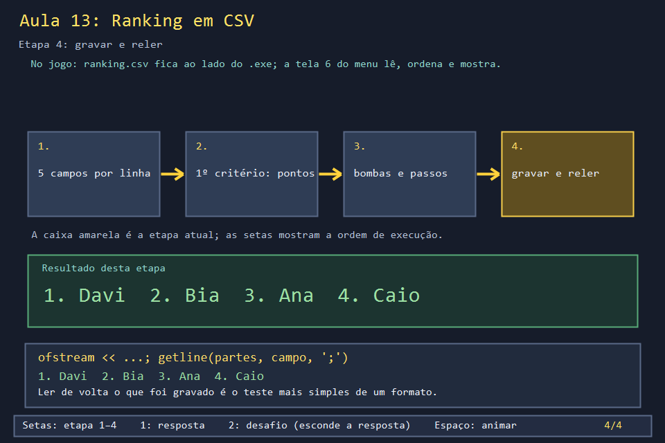

# Aula 13 — Ranking em CSV

| Trilha | Duração | Antes desta aula | Próxima na trilha |
| --- | --- | --- | --- |
| Ranking e arquivos (13 → 21 → 32) | 60 min | [Aula 12](../Aula_12_fases_dificuldade_e_cooperativo/Aula_12_fases_dificuldade_e_cooperativo.md) | [Aula 21 — Ranking CSV completo](../Aula_21_ranking_csv_completo/Aula_21_ranking_csv_completo.md) |



Quando uma partida termina, o jogo grava o resultado num arquivo `ranking.csv` ao lado do executável. Na próxima vez que o jogo abre, lê esse arquivo e mostra o TOP 10. Nesta aula você grava e lê esse arquivo do jeito mais simples e usa a mesma regra de desempate do jogo.

## O que você vai conseguir fazer

- Gravar uma `struct` como uma linha de texto com `std::ofstream`.
- Ler o arquivo de volta e separar os campos com `std::getline(..., ';')`.
- Ordenar com um comparador de vários critérios (`melhorRegistro`).
- Manter um registro por jogador, só substituindo quando a partida nova for melhor.

## 1. A ideia

```text
ranking.csv                         RegistroPontuacao
14/10/2026;Davi;900;2;50    ──►     { data, jogador, pontuacao, bombas, movimentos }
14/10/2026;Bia;900;3;35
13/10/2026;Ana;900;3;40             ordem: mais pontos ▸ menos bombas ▸ menos passos ▸ nome
13/10/2026;Caio;700;2;30
```

CSV ("valores separados por vírgula") é só texto: cada linha é um registro, e um caractere separa os campos. O jogo usa `;`, porque a vírgula aparece em números no padrão brasileiro.

## 2. O código real

<!-- trecho simbolo="RegistroPontuacao" -->
```cpp
// projeto_final/bomberman.cpp, linhas 190–196 (RegistroPontuacao)
struct RegistroPontuacao {
    string data;
    string jogador;
    int pontuacao = 0;
    int bombas = 0;
    int movimentos = 0;
};
```

O comparador. `sort` o chama para decidir quem vem antes, e cada `if` só decide quando o critério anterior empatou:

<!-- trecho simbolo="melhorRegistro" -->
```cpp
// projeto_final/bomberman.cpp, linhas 695–700 (melhorRegistro)
bool melhorRegistro(const RegistroPontuacao& a,const RegistroPontuacao& b){
    if(a.pontuacao!=b.pontuacao)return a.pontuacao>b.pontuacao;
    if(a.bombas!=b.bombas)return a.bombas<b.bombas;
    if(a.movimentos!=b.movimentos)return a.movimentos<b.movimentos;
    return chaveNomeRanking(a.jogador)<chaveNomeRanking(b.jogador);
}
```

Gravar uma partida: ler o que já existe, procurar o mesmo jogador e só trocar se for recorde pessoal.

<!-- trecho simbolo="salvarRegistroPartida" de="bool salvarRegistroPartida(const RegistroPontuacao& registro, const string& caminhoArquivo) {" -->
```cpp
// projeto_final/bomberman.cpp, linhas 711–719 (salvarRegistroPartida)
bool salvarRegistroPartida(const RegistroPontuacao& registro, const string& caminhoArquivo) {
    RegistroPontuacao novo=registro;novo.jogador=limparNomeRanking(novo.jogador);
    if(novo.jogador.empty())return false;
    auto registros=lerRanking(caminhoArquivo);
    auto existente=find_if(registros.begin(),registros.end(),[&](const RegistroPontuacao& r){return chaveNomeRanking(r.jogador)==chaveNomeRanking(novo.jogador);});
    if(existente==registros.end())registros.push_back(novo);
    else if(melhorRegistro(novo,*existente))*existente=novo;
    return gravarRanking(registros,caminhoArquivo);
}
```

E quando isso acontece: no fim de `atualizar`, uma única vez, só em partida manual e só quando ela acaba (vitória ou fim de jogo):

<!-- trecho simbolo="atualizar" de="// So gravamos partidas manuais no ranking" ate="registro.movimentos = movimentos;" -->
```cpp
// projeto_final/bomberman.cpp, linhas 2495–2506 (atualizar)
    // So gravamos partidas manuais no ranking, e so quando a partida de fato
    // termina (fim de jogo ou vitoria) - "derrota" sozinha agora e so perder
    // uma vida e tentar de novo, nao e o fim da partida.
    if ((estado == FIM_DE_JOGO || estado == VITORIA) && modo == MANUAL && !registroSalvo) {
        registroSalvo = true;
        auto salvar = [](const wstring& nome, const wstring& padrao, int pontuacao, int bombasUsadas, int movimentos) {
            RegistroPontuacao registro;
            registro.data = dataAtual();
            registro.jogador = wparaStr(nome.empty() ? padrao : nome);
            registro.pontuacao = pontuacao;
            registro.bombas = bombasUsadas;
            registro.movimentos = movimentos;
```

## 3. A versão desta aula

`Aula_13_ranking_csv.cpp` usa `RegistroPontuacao` e `melhorRegistro` como no jogo e escreve versões simples de `gravarRanking` e `lerRanking`. Quatro partidas mostram cada critério de desempate:

```text
conteudo de ranking_aula.csv:
  14/10/2026;Davi;900;2;50
  14/10/2026;Bia;900;3;35
  13/10/2026;Ana;900;3;40
  13/10/2026;Caio;700;2;30
ranking relido:
  1. Davi 900 pts, 2 bombas, 50 passos
  2. Bia 900 pts, 3 bombas, 35 passos
  3. Ana 900 pts, 3 bombas, 40 passos
  4. Caio 700 pts, 2 bombas, 30 passos
```

Davi passou na frente com mais passos que todos, porque bombas desempatam antes de passos.

## 4. O que mudou em relação ao jogo e por quê

| No jogo | Nesta aula | Motivo |
| --- | --- | --- |
| `lerCamposCsv` entende aspas (nome com `;`) | `getline(partes, campo, ';')` | o formato completo é a Aula 21 |
| valida cada inteiro e pula linhas quebradas | `stoi` direto: texto inválido derruba o programa | idem |
| grava num `.tmp` e troca de nome; guarda `.bak` | grava direto | idem |
| compara nomes sem diferenciar maiúsculas (`chaveNomeRanking`) | `<` simples | o exercício 2 trata disso |

## 5. Laboratório visual

| | |
| --- | --- |
|  |  |
|  |  |

```powershell
.\compilar_aula.ps1 -Numero 13
.\build\Aula_13_ranking_csv.exe
.\abrir_aula.ps1 -Numero 13 -Modo Exemplo     # cria aulas\Aula_13_ranking_csv\ranking_aula.csv
```

## 6. Exercícios

1. **Previsão.** Acrescente `{"15/10/2026", "Eva", 900, 2, 50}`. Em que posição ela fica? *(Empata com Davi em tudo, até nos passos. Decide o nome: "Davi" < "Eva", então Davi 1º e Eva 2º.)*
2. **Um por jogador.** Escreva `salvarRegistroPartida`: ler o ranking, procurar o mesmo jogador **sem diferenciar maiúsculas**, trocar só se `melhorRegistro(novo, existente)`, gravar. Teste com Ana 900, Bia 800, Ana 600 e "ana" 950. *Solução: `solucoes/` — sobra `ana 950` e `Bia 800`.*
3. **Quebre o leitor.** Abra `ranking_aula.csv` no Bloco de Notas, troque um `900` por `novecentos` e rode de novo só a leitura. O que acontece? *(`std::stoi` lança `std::invalid_argument` e o programa termina. O jogo real ignora a linha: veja `inteiroValido` na Aula 21.)*
4. **Leitura.** No trecho de `atualizar`, o que impede que a mesma partida seja gravada duas vezes? *(A variável `registroSalvo`, que vira `true` antes de gravar e só volta a `false` em `novaPartida`.)*

## 7. Erros comuns

- **Comparador que não é "menor estrito".** `return a.pontuacao >= b.pontuacao;` parece funcionar, mas viola a regra de `std::sort` e pode travar ou corromper a ordenação com empates.
- **Gravar sem `\n` no fim.** A última linha fica colada na próxima gravação.
- **Caminho relativo.** `ranking_aula.csv` vai parar na pasta de onde o programa foi **executado**. O jogo monta o caminho a partir da pasta do `.exe` (`caminhoRankingUtf8`) para não depender disso.

## 8. Antes de seguir

- [ ] Ordenei as quatro partidas à mão antes de rodar.
- [ ] Fiz o exercício 2 e entendi por que "ana" e "Ana" são a mesma pessoa.
- [ ] Quebrei o arquivo (exercício 3) e vi o programa falhar.

## Referências

- [`std::getline` com delimitador (cppreference)](https://en.cppreference.com/w/cpp/string/basic_string/getline)
- [`std::sort` e o requisito de ordem estrita (cppreference)](https://en.cppreference.com/w/cpp/algorithm/sort)
- [Leitura e escrita de arquivos com fstream (cppreference)](https://en.cppreference.com/w/cpp/io/basic_fstream)
