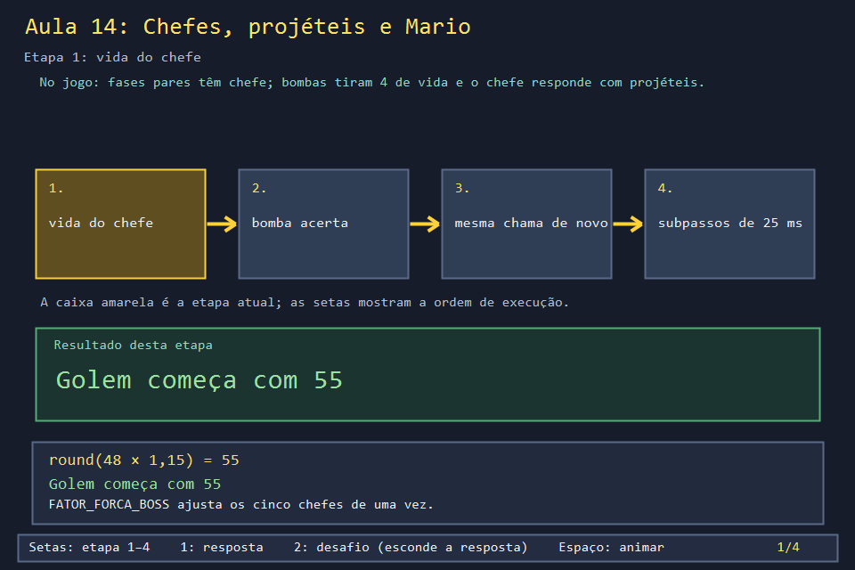
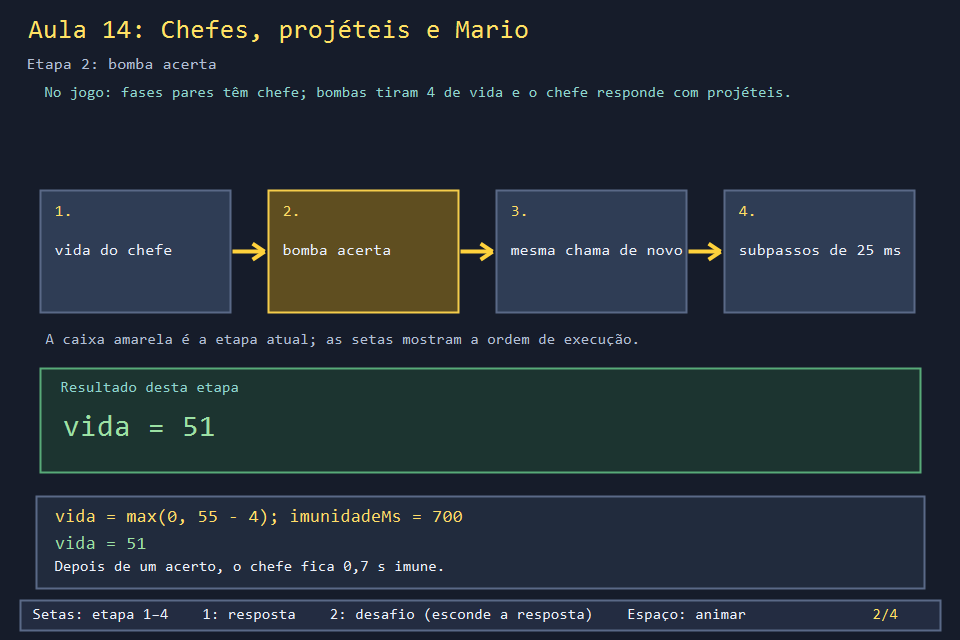
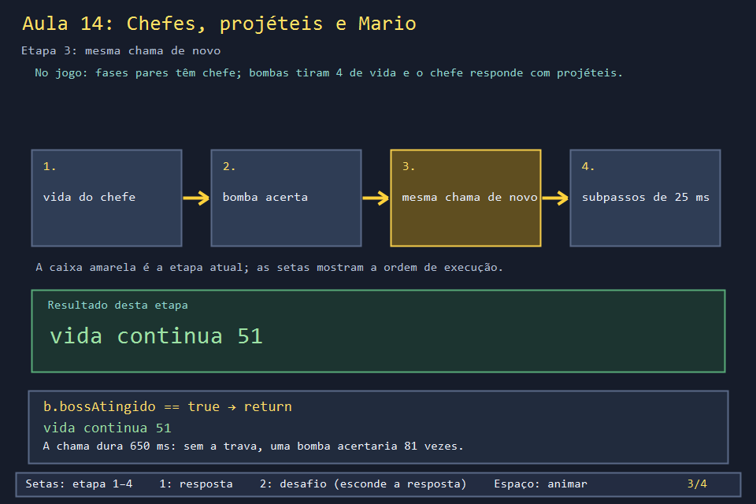
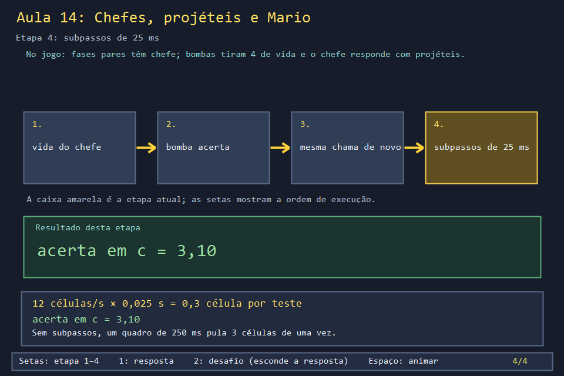

# Aula 14 — Chefes, projéteis e Mario: os números da luta

| Trilha | Duração | Antes desta aula | Próxima na trilha |
| --- | --- | --- | --- |
| Chefes e aliado (14 → 22 → 25 → 26) | 60 min | [Aula 08](../Aula_08_bomba_e_explosao_recursiva/Aula_08_bomba_e_explosao_recursiva.md), [Aula 12](../Aula_12_fases_dificuldade_e_cooperativo/Aula_12_fases_dificuldade_e_cooperativo.md) | [Aula 22 — Máquina de estados do chefe](../Aula_22_maquina_de_estados_boss/Aula_22_maquina_de_estados_boss.md) |

| Golem (fase 2) | Bowser (fase 10) |
| --- | --- |
|  |  |

Nas fases pares, depois dos inimigos comuns, aparece um chefe. Cada um tem vida própria, ataques próprios e, às vezes, a ajuda do Mario escondido numa caixa. Antes de estudar o comportamento (Aula 22) e os cinco chefes um a um (Aulas 25 e 26), esta aula separa as **três regras numéricas** que valem para todos: quanta vida, quanto dano e como um projétil anda sem atravessar ninguém.

## O que você vai conseguir fazer

- Calcular a vida de cada chefe a partir da tabela do jogo.
- Explicar as duas travas que impedem uma bomba de acertar várias vezes.
- Explicar por que um projétil precisa andar em **subpassos** quando um quadro atrasa.
- Ler as structs `Boss`, `ProjetilBoss` e `MarioAliado`.

## 1. A ideia

```text
um quadro atrasado de 250 ms, projétil a 12 células/s:

sem subpassos:   c=1.0 ───────────────────────────► c=4.0      (jogador em 3: nunca testado)
com subpassos:   c=1.0 ► 1.3 ► 1.6 ► ... ► 3.1  ✔ acertou    (testa a cada 25 ms)
```

O passo fixo da Aula 06 já limita a simulação a 8 ms por vez. O jogo ainda limita cada movimento de projétil a 25 ms, e os comentários do código explicam: "subpassos impedem atravessar paredes/corpos quando um quadro atrasa".

## 2. O código real

A vida: uma tabela de cinco números, multiplicada por um fator único de força.

<!-- trecho de="int indiceBoss()" ate="int vidaMaximaBoss()" -->
```cpp
// projeto_final/bomberman.cpp, linhas 304–306
int indiceBoss(){return max(0,min(4,faseAtual/2-1));}
bool bossAnimado(){return indiceBoss()==2 || indiceBoss()==4;}
int vidaMaximaBoss(){const int vidas[]={48,64,80,VIDA_BOSS,112};return int(round(vidas[indiceBoss()]*FATOR_FORCA_BOSS));}
```

O estado do chefe é uma struct com muitos campos. Vários deles são da máquina de estados da Hornet, que a Aula 22 explica:

<!-- trecho simbolo="Boss" -->
```cpp
// projeto_final/bomberman.cpp, linhas 153–171 (Boss)
struct Boss {
    Posicao posicao{0, 0};
    bool vivo = false;
    int vida = 0;
    int tempoProximoMovimentoMs = 0;
    int tempoProximoAtaqueMs = 0;
    float visualL = 0, visualC = 0;
    Posicao destino{0,0};
    bool movendo = false, horizontal = true;
    int imunidadeMs = 0;
    bool investindo = false, investidaPendente = false;
    int avisoInvestidaMs = 0, animAtaqueMs = 0, sequenciaAtaque = 0;
    int acaoEspecial = 0, tempoEspecialMs = 0, relogioPoseMs = 0, morteMs = 0;
    bool olhandoDireita = false;
    EtapaHornet etapaHornet=H_IDLE;
    int tempoEtapaHornetMs=0,duracaoEtapaHornetMs=0;
    float alturaHornet=0;
    bool contraPendenteHornet=false;
};
```

O dano. Duas travas: `imunidadeMs` (700 ms depois de qualquer acerto) e `b.bossAtingido` (cada bomba acerta uma vez só):

<!-- trecho simbolo="atingirBoss" -->
```cpp
// projeto_final/bomberman.cpp, linhas 1575–1591 (atingirBoss)
void atingirBoss() {
    if (!boss.vivo || boss.imunidadeMs>0) return;
    for (Bomba& b : bombas) {
        if (!b.explodindo || b.bossAtingido || b.dono == DONO_INIMIGO) continue;
        bool atingiu = false;
        for (const Posicao& p : b.celulasExplosao) if (celulaBoss(p.linha,p.coluna)) { atingiu = true; break; }
        if (!atingiu) continue;
        b.bossAtingido = true;
        boss.vida=max(0,boss.vida-4);
        boss.imunidadeMs=IMUNIDADE_BOSS_MS;
        reagirDanoHornet();
        if (boss.vida <= 0) {
            concluirLutaBoss(b.dono);
        }
        break;
    }
}
```

O projétil e o laço de subpassos. Note também que a agulha da Hornet **volta** ao chefe (`retornando`):

<!-- trecho simbolo="ProjetilBoss" -->
```cpp
// projeto_final/bomberman.cpp, linhas 310–311 (ProjetilBoss)
struct ProjetilBoss { float l,c,vl,vc,idade,vida; PoderBoss poder; int avisoMs; int arma = 0;
    float origemL=0,origemC=0;bool retornando=false; };
```

<!-- trecho simbolo="atualizarProjeteisBoss" de="void atualizarProjeteisBoss" ate="if(!dentro(l,c)){p.vida=0;break;}" -->
```cpp
// projeto_final/bomberman.cpp, linhas 1929–1945 (atualizarProjeteisBoss)
void atualizarProjeteisBoss(int tempoMs) {
    float dt=tempoMs/1000.f;
    for(auto& i:impactosBoss)i.idade+=dt;
    for(auto& p:projeteisBoss){
        float restante=dt;
        if(p.avisoMs>0){int aviso=p.avisoMs;p.avisoMs=max(0,p.avisoMs-tempoMs);restante=max(0.f,(tempoMs-aviso)/1000.f);}
        // Subpassos impedem atravessar paredes/corpos quando um quadro atrasa.
        while(restante>0 && p.vida>0){float passo=min(restante,.025f);restante-=passo;
            float antesL=p.l,antesC=p.c;
            if(p.poder==AGULHA){
                if(!p.retornando && p.idade+passo>=1.1f*FATOR_FORCA_BOSS)recolherAgulha(p);
                if(p.retornando){float dl=p.origemL-p.l,dc=p.origemC-p.c,n=hypot(dl,dc);
                    if(n<.12f){p.vida=0;break;}p.vl=dl/max(.01f,n)*3.f;p.vc=dc/max(.01f,n)*3.f;}
            }
            p.l+=p.vl*passo;p.c+=p.vc*passo;p.idade+=passo;p.vida-=passo;
            int l=int(p.l),c=int(p.c);
            if(!dentro(l,c)){p.vida=0;break;}
```

E o aliado: o Mario começa **escondido** numa caixa comum das fases pares. Quando a chama quebra essa caixa, ele é libertado:

<!-- trecho simbolo="MarioAliado" -->
```cpp
// projeto_final/bomberman.cpp, linhas 316–323 (MarioAliado)
struct MarioAliado {
    Posicao posicao{0,0}; float l=0,c=0;
    int direcao=0,hp=0,movendo=-1;
    float pensar=0,imunidade=0,distancia=0,recarga=0,pose=0;
    bool ativo=false,andando=false,escondido=false;
    Posicao bloco{0,0};
    int dono=-1; // Modo inimigos: jogador que o libertou (0/1); ataca o outro.
} marioAliado;
```

<!-- trecho simbolo="libertarMario" -->
```cpp
// projeto_final/bomberman.cpp, linhas 1494–1501 (libertarMario)
void libertarMario(Posicao p, int dono = 0) {
    if(!marioAliado.escondido || !iguais(p,marioAliado.bloco))return;
    marioAliado.escondido=false;marioAliado.ativo=true;marioAliado.hp=3;
    // No modo inimigos ele fica do lado de quem o libertou primeiro.
    marioAliado.dono=modoRivais && segundoJogadorAtivo() && (dono==0 || dono==1) ? dono : -1;
    marioAliado.posicao=p;marioAliado.l=float(p.linha);marioAliado.c=float(p.coluna);
    marioAliado.imunidade=2.f; // A bomba que liberta nao machuca o aliado.
}
```

## 3. A versão desta aula

`Aula_14_chefes_projeteis_e_mario.cpp` copia `vidaMaximaBoss` e a lógica de `atingirBoss`, e reduz o laço de subpassos ao essencial: andar, testar o toque com o mesmo raio de 0,48 e parar.

```text
vida dos chefes: Golem=55 Egg-HVC=74 Hornet=92 Guardiao=115 Bowser=129
bomba 1 acerta:              vida=51
a mesma chama no passo seguinte: vida=51 (bossAtingido)
bomba 2, 300 ms depois:       vida=51 (imune por mais 400 ms)
bomba 2, depois da imunidade: vida=47
sem subpassos         : passou por cima do jogador (c=4.00)
com subpassos de 25 ms: acertou em c=3.10
```

Confira a primeira linha com as capturas do jogo: o painel lateral mostra "VIDA DO CHEFE 55 / 55" no Golem e "129 / 129" no Bowser.

## 4. O que mudou em relação ao jogo e por quê

| No jogo | Nesta aula | Motivo |
| --- | --- | --- |
| `atingirBoss` percorre todas as bombas explodindo e testa se a chama toca o corpo do chefe (2 × 2 ou 2 × 3 casas) | recebe a bomba pronta | o teste de área é geometria, não regra de dano |
| o projétil testa parede, caixa, bloco do Mario, P1, P2 e Mario | só um alvo | o laço é o mesmo para cada teste |
| projéteis de 2,1 a 3,6 células/s | 12 células/s | exagerar a velocidade torna o problema visível num quadro só |

## 5. Laboratório visual

| | |
| --- | --- |
|  |  |
|  |  |

```powershell
.\compilar_aula.ps1 -Numero 14
.\build\Aula_14_chefes_projeteis_e_mario.exe
.\abrir_aula.ps1 -Numero 14 -Modo Exemplo
```

## 6. Exercícios

1. **Previsão.** Qual seria a vida do Guardião se `FATOR_FORCA_BOSS` fosse 1,0? E 1,5? *(100 e 150.)*
2. **Quantas bombas?** Calcule quantos acertos derrubam cada chefe e o tempo mínimo de luta, dada a imunidade de 0,7 s. *Solução: `solucoes/` — de 14 acertos (Golem) a 33 (Bowser).*
3. **Subpasso seguro.** A janela de toque tem 0,96 célula. Até que velocidade o subpasso de 25 ms garante que nenhum projétil pule um alvo? *(0,96 / 0,025 = 38,4 células/s; os projéteis do jogo andam no máximo 3,6.)*
4. **Leitura.** Em `libertarMario`, por que o Mario recebe `imunidade = 2` ao ser libertado? *(O comentário responde: a mesma bomba que quebrou a caixa ainda está em chamas e o feriria na hora.)*

## 7. Erros comuns

- **Dano por quadro em vez de dano por evento.** "Se a chama toca o chefe, tire 4" roda a cada 8 ms durante 650 ms. Toda área de dano precisa de uma trava: imunidade, flag de "já acertei", ou as duas.
- **Mover rápido sem subdividir.** O bug aparece só em máquinas lentas ou quando a janela é arrastada, e é difícil de reproduzir. O teste do exemplo força um quadro de 250 ms para mostrar o problema na hora.
- **Esquecer de remover projéteis mortos.** O jogo usa `erase(remove_if(...))` no fim de cada atualização. Sem isso, o vetor cresce até o fim da fase.

## 8. Antes de seguir

- [ ] Conferi as cinco vidas com as capturas do jogo.
- [ ] Sei apontar as duas travas de dano em `atingirBoss`.
- [ ] Expliquei o exemplo do projétil que passa por cima do jogador.

## Referências

- [Tunneling (efeito túnel) em física de jogos — Gaffer On Games](https://gafferongames.com/post/integration_basics/)
- [`std::remove_if` + `erase` (cppreference)](https://en.cppreference.com/w/cpp/algorithm/remove)
- Aulas 25 e 26: o Mario e os cinco chefes com seus sprites e ataques reais.
