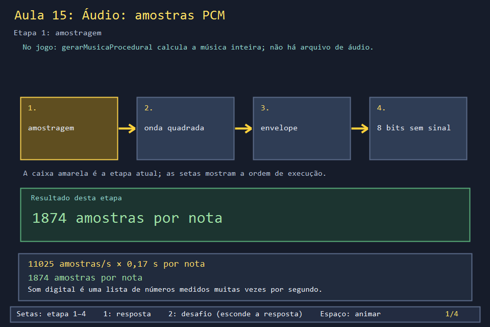
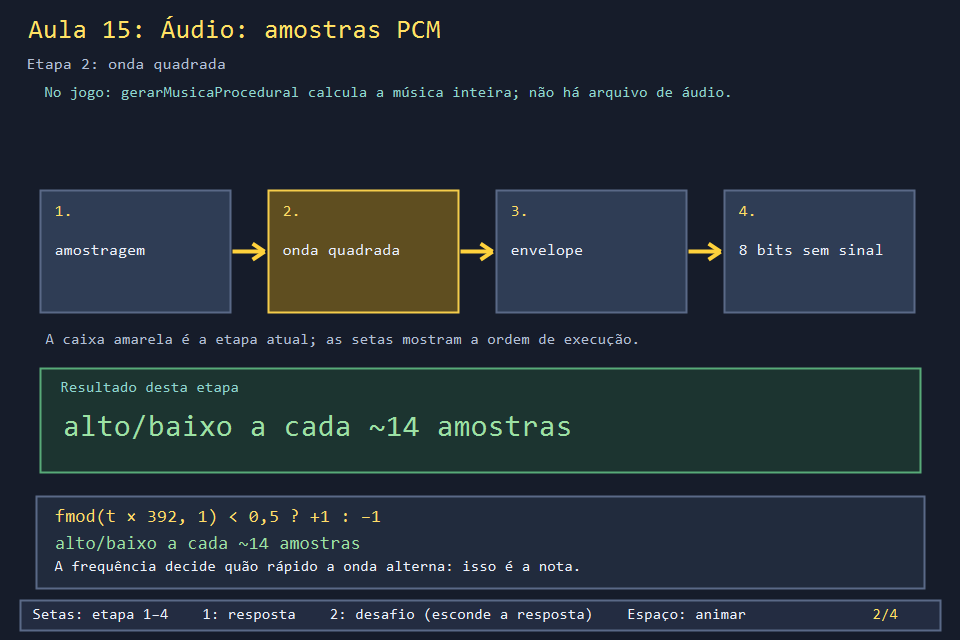
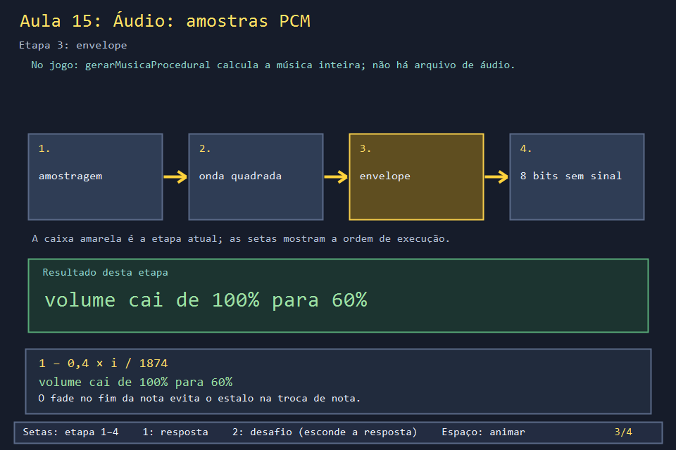
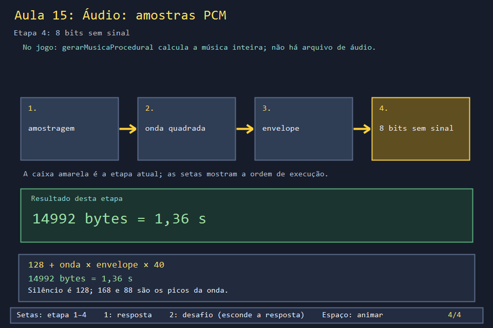

# Aula 15 — Áudio: amostras PCM

| Trilha | Duração | Antes desta aula | Próxima na trilha |
| --- | --- | --- | --- |
| Áudio (15 → 23) | 45–60 min | [Aula 06](../Aula_06_tempo_entrada_e_animacao/Aula_06_tempo_entrada_e_animacao.md) | [Aula 23 — Arquivo WAV completo](../Aula_23_wav_pcm_completo/Aula_23_wav_pcm_completo.md) |

O Bomberman toca uma melodia em loop desde a abertura, e o projeto não tem nenhum arquivo `.mp3` ou `.wav` para isso. A música é **calculada** quando o jogo abre: oito notas, uma onda quadrada no estilo dos videogames antigos, 14 992 números entre 0 e 255. Esta aula refaz essa conta e mostra o que cada número significa.

## O que você vai conseguir fazer

- Explicar amostragem (amostras por segundo) e frequência (a nota).
- Gerar uma onda quadrada com `fmod` e aplicar um envelope de volume.
- Converter o valor da onda para PCM de 8 bits sem sinal (silêncio = 128).
- Calcular o tamanho em bytes de um trecho de áudio em qualquer formato.

## 1. A ideia

```text
amostra:  0    5    10   14   20   25   28 ...       11025 amostras = 1 segundo
valor:   168  168  168  167  88   88   88  168 ...   uma onda de 392 Hz (G4)
         ▔▔▔▔▔▔▔▔▔▔▔▔▔▔▔╲___________╱▔▔▔▔             período: 11025 / 392 = 28,1 amostras
```

- **Amostragem** (11025): quantas vezes por segundo o som é medido.
- **Frequência** (392 Hz): quantas vezes por segundo a onda sobe e desce. Mais alta, nota mais aguda.
- **Amplitude** (40): quanto a onda se afasta do silêncio (128). Mais alta, som mais forte.

## 2. O código real

<!-- trecho simbolo="gerarMusicaProcedural" -->
```cpp
// projeto_final/bomberman.cpp, linhas 2722–2751 (gerarMusicaProcedural)
vector<unsigned char> gerarMusicaProcedural() {
    const int amostragem = 11025;
    const double duracaoNota = 0.17;
    // Melodia curta e simples (G4 A4 C5 A4 G4 F4 G4 C5), repete em loop pelo
    // proprio SND_LOOP do PlaySound - nao precisa duplicar os dados aqui.
    const double notas[] = {392.00, 440.00, 523.25, 440.00, 392.00, 349.23, 392.00, 523.25};
    int amostrasPorNota = static_cast<int>(amostragem * duracaoNota);
    vector<unsigned char> amostras;
    amostras.reserve(amostrasPorNota * size(notas));
    for (double frequencia : notas) {
        for (int i = 0; i < amostrasPorNota; i++) {
            double t = static_cast<double>(i) / amostragem;
            double ciclo = fmod(t * frequencia, 1.0);
            double onda = ciclo < 0.5 ? 1.0 : -1.0;
            // Fade-out suave no fim de cada nota pra evitar estalo na troca.
            double envelope = 1.0 - (static_cast<double>(i) / amostrasPorNota) * 0.4;
            int amostra = static_cast<int>(128 + onda * envelope * 40);
            amostra = max(0, min(255, amostra));
            amostras.push_back(static_cast<unsigned char>(amostra));
        }
    }

    CabecalhoWav cabecalho;
    cabecalho.tamanhoDados = static_cast<uint32_t>(amostras.size());
    cabecalho.tamanhoArquivo = static_cast<uint32_t>(sizeof(CabecalhoWav) - 8 + amostras.size());
    vector<unsigned char> arquivo(sizeof(CabecalhoWav) + amostras.size());
    memcpy(arquivo.data(), &cabecalho, sizeof(CabecalhoWav));
    memcpy(arquivo.data() + sizeof(CabecalhoWav), amostras.data(), amostras.size());
    return arquivo;
}
```

Três detalhes:

- `fmod(t * frequencia, 1.0)` dá a posição dentro do período atual, entre 0 e 1. A primeira metade é alta e a segunda, baixa.
- O **envelope** reduz o volume para 60% ao longo da nota. Sem ele, a troca brusca entre notas faz um "clique".
- `max(0, min(255, amostra))` garante que o valor cabe em 8 bits, mesmo que alguém aumente a amplitude.

## 3. A versão desta aula

`Aula_15_audio_wav_e_recursos.cpp` tem o mesmo laço de `gerarMusicaProcedural`, sem o cabeçalho WAV, e imprime as contas:

```text
amostras por nota=1874 (11025 x 0,17)
total=14992 amostras = 14992 bytes = 1.36 s de musica
periodo de G4: 11025 / 392 = 28.1 amostras (metade alta, metade baixa)
inicio da onda:
  168 ########
  167 ########
  ...
   88 #
ultima amostra da 1a nota: 103 (o fade baixou a amplitude)
```

Por que 167 e não 168? `128 + 1 × 0,9998 × 40 = 167,99`, e `static_cast<int>` corta a parte decimal: o envelope já caiu um pouquinho desde a primeira amostra.

## 4. O que mudou em relação ao jogo e por quê

| No jogo | Nesta aula | Motivo |
| --- | --- | --- |
| as amostras vão para um `vector` junto com um cabeçalho WAV de 44 bytes | só as amostras | o cabeçalho é o assunto da Aula 23 |
| `PlaySoundW` toca em loop (`SND_LOOP`) | não toca | idem |
| `size(notas)` sem `std::` | `std::size` (de `<iterator>`) | deixar claro de onde vem |

## 5. Laboratório visual

| | |
| --- | --- |
|  |  |
|  |  |

```powershell
.\compilar_aula.ps1 -Numero 15
.\build\Aula_15_audio_wav_e_recursos.exe
.\abrir_aula.ps1 -Numero 15 -Modo Exemplo
```

## 6. Exercícios

1. **Previsão.** Se `duracaoNota` fosse 0,25, quantos bytes teria a música? *(int(11025 × 0,25) = 2756 por nota; × 8 = 22 048 bytes; 2 s.)*
2. **Formatos.** Calcule o tamanho da mesma música em 16 bits mono e em qualidade de CD (44 100 Hz, estéreo, 16 bits). *Solução: `solucoes/` — 29 984 e 239 872 bytes. O jogo economiza 16 vezes em relação ao CD, e uma onda quadrada não ganharia nada com mais qualidade.*
3. **Oitava.** Troque todas as notas pelo dobro da frequência. O tamanho muda? *(Não: a frequência muda o som, não a quantidade de amostras. O período de G4 cai de 28,1 para 14,1 amostras.)*
4. **Envelope.** O que acontece se trocar `0.4` por `1.0`? E por `0.0`? *(Com 1,0, cada nota termina em silêncio total, um som "picotado". Com 0,0, não há fade, e um clique aparece na troca de nota.)*

## 7. Erros comuns

- **Confundir amostragem com frequência.** A amostragem é do arquivo (11025); a frequência é da nota (392). A amostragem precisa ser pelo menos o dobro da frequência mais alta (teorema de Nyquist), e 11025 dá conta de notas até 5512 Hz.
- **8 bits com sinal.** WAV de 8 bits é **sem** sinal: silêncio é 128, não 0. Gravar `-40` num `unsigned char` vira 216, e o som sai distorcido.
- **Esquecer o `clamp`.** Com amplitude 100, `128 + 100 = 228` ainda cabe, mas um envelope acima de 1 passaria de 255 e daria a volta.

## 8. Antes de seguir

- [ ] Sei explicar 11025, 392 e 40, cada um com uma frase.
- [ ] Calculei 1874 × 8 = 14 992 bytes à mão.
- [ ] Resolvi o exercício 2 e entendi por que o jogo usa 8 bits mono.

## Referências

- [Pulse-code modulation (Wikipédia)](https://pt.wikipedia.org/wiki/Modula%C3%A7%C3%A3o_por_c%C3%B3digo_de_pulsos)
- [Teorema da amostragem de Nyquist–Shannon (Wikipédia)](https://pt.wikipedia.org/wiki/Teorema_da_amostragem_de_Nyquist%E2%80%93Shannon)
- [`std::fmod` (cppreference)](https://en.cppreference.com/w/cpp/numeric/math/fmod)
