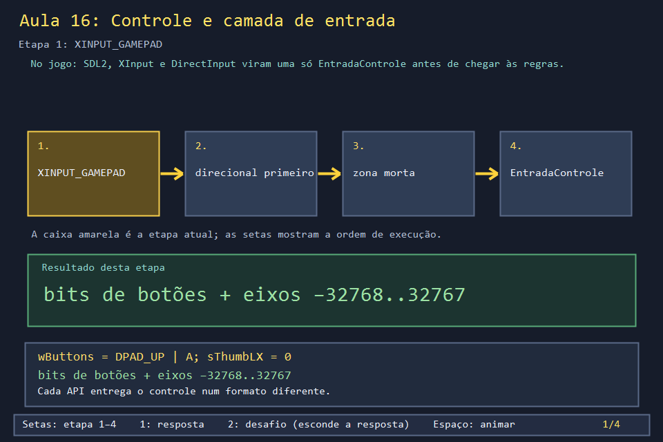
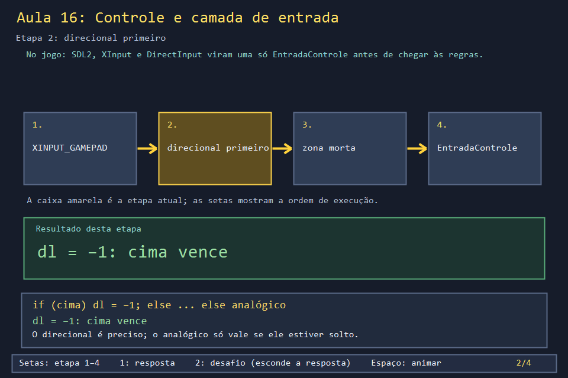
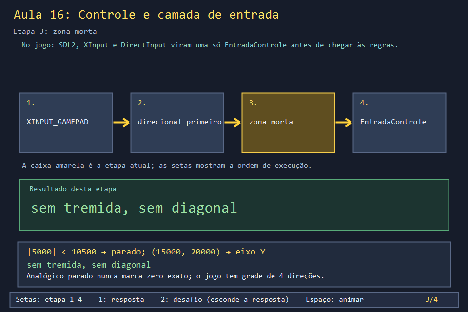
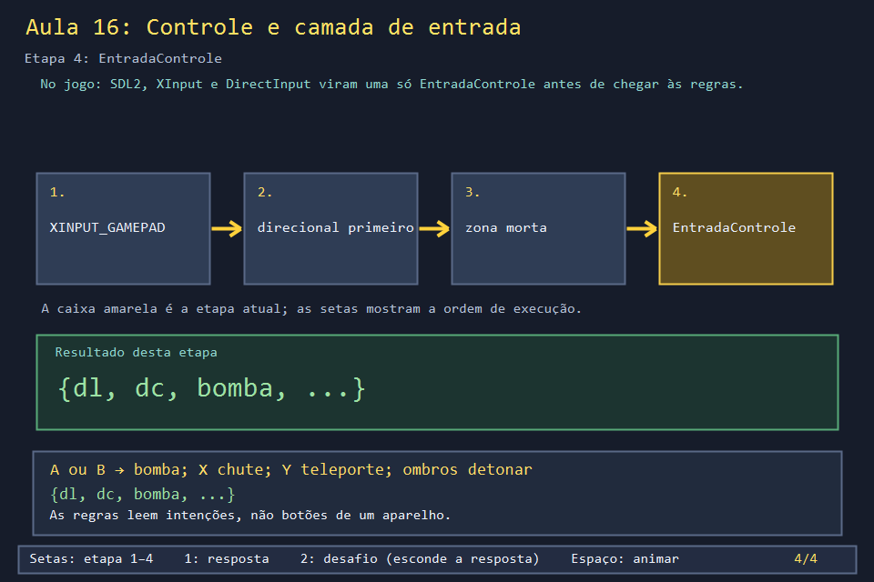

# Aula 16 — Controle e camada de entrada

| Trilha | Duração | Antes desta aula | Próxima na trilha |
| --- | --- | --- | --- |
| Entrada e menus (16 → 31 → 33 → 28 → 30) | 60 min | [Aula 03](../Aula_03_janela_e_mensagens_win32/Aula_03_janela_e_mensagens_win32.md), [Aula 06](../Aula_06_tempo_entrada_e_animacao/Aula_06_tempo_entrada_e_animacao.md) | [Aula 31 — Conectando um joystick de verdade](../Aula_31_joystick_real/Aula_31_joystick_real.md) |


O jogo aceita teclado, controle de Xbox, de PlayStation, Switch Pro, 8BitDo e controles genéricos USB. Cada um chega ao programa num formato diferente. Em vez de espalhar "se for Xbox faça isso, se for PlayStation faça aquilo" pelas regras, o jogo cria uma **camada de entrada**: tudo vira uma `EntradaControle` com as intenções do jogador (andar, bomba, voltar). Esta aula constrói essa camada para o XInput, com as funções do jogo.

## O que você vai conseguir fazer

- Explicar o que é uma camada de entrada e por que ela simplifica as regras.
- Traduzir um `XINPUT_GAMEPAD` para `EntradaControle` com as funções reais.
- Explicar a zona morta e a escolha do eixo dominante.
- Testar a tradução **sem** nenhum controle conectado.

## 1. A ideia

```text
 XInput (Xbox)      ─┐
 SDL2 (PS, Switch)  ─┼─► montarEntrada ─► EntradaControle {dl, dc, bomba, confirmar, voltar, chute, ...}
 DirectInput (USB)  ─┘                        │
 teclado ───────────────────────────────────► moverJogador / colocarBomba / menus
```

Duas decisões de projeto estão em `montarEntrada`:

- **Direcional antes do analógico.** Se o direcional estiver apertado, o analógico é ignorado.
- **Uma direção só.** Fora da zona morta, vence o eixo mais inclinado. Uma grade não tem diagonais.

## 2. O código real

<!-- trecho simbolo="EntradaControle" -->
```cpp
// projeto_final/bomberman.cpp, linha 266 (EntradaControle)
struct EntradaControle { int dl=0,dc=0;bool bomba=false,confirmar=false,voltar=false,chute=false,teleporte=false,detonar=false,start=false,select=false; };
```

<!-- trecho simbolo="direcaoDoControle" -->
```cpp
// projeto_final/bomberman.cpp, linhas 430–436 (direcaoDoControle)
EntradaControle direcaoDoControle(int x,int y,int limite){
    EntradaControle e;
    if(abs(x)<limite && abs(y)<limite)return e;
    if(abs(x)>abs(y))e.dc=x>0?1:-1;
    else e.dl=y>0?1:-1;
    return e;
}
```

<!-- trecho simbolo="montarEntrada" -->
```cpp
// projeto_final/bomberman.cpp, linhas 439–446 (montarEntrada)
EntradaControle montarEntrada(bool cima,bool baixo,bool esq,bool dir,int x,int y,int limite,
                              bool a,bool b,bool xb,bool yb,bool ombro,bool start,bool select){
    EntradaControle e;
    if(cima)e.dl=-1;else if(baixo)e.dl=1;else if(esq)e.dc=-1;else if(dir)e.dc=1;
    else e=direcaoDoControle(x,y,limite);
    e.confirmar=a;e.voltar=b;e.bomba=a||b;e.chute=xb;e.teleporte=yb;e.detonar=ombro;e.start=start;e.select=select;
    return e;
}
```

<!-- trecho simbolo="traduzirXInput" -->
```cpp
// projeto_final/bomberman.cpp, linhas 447–452 (traduzirXInput)
EntradaControle traduzirXInput(const XINPUT_GAMEPAD& g){
    WORD b=g.wButtons;
    return montarEntrada(b&XINPUT_GAMEPAD_DPAD_UP,b&XINPUT_GAMEPAD_DPAD_DOWN,b&XINPUT_GAMEPAD_DPAD_LEFT,b&XINPUT_GAMEPAD_DPAD_RIGHT,
                         int(g.sThumbLX),-int(g.sThumbLY),10500,b&XINPUT_GAMEPAD_A,b&XINPUT_GAMEPAD_B,b&XINPUT_GAMEPAD_X,b&XINPUT_GAMEPAD_Y,
                         b&(XINPUT_GAMEPAD_LEFT_SHOULDER|XINPUT_GAMEPAD_RIGHT_SHOULDER),b&XINPUT_GAMEPAD_START,b&XINPUT_GAMEPAD_BACK);
}
```

Repare em `-int(g.sThumbLY)`: no XInput, empurrar o analógico para **cima** dá Y positivo, mas na matriz do jogo a linha **diminui** para cima. O sinal trocado conserta isso num lugar só.

## 3. A versão desta aula

`Aula_16_controle_e_camada_de_entrada.cpp` copia as quatro peças acima e as testa com controles simulados. No fim, tenta ler o controle 0 de verdade:

```text
direcional para cima + A               -> dl=-1 dc= 0 bomba=1 chute=0 voltar=0
analogico (22000, 2000) + B            -> dl= 0 dc= 1 bomba=1 chute=0 voltar=1
analogico (5000, 0) + X: zona morta    -> dl= 0 dc= 0 bomba=0 chute=1 voltar=0
analogico diagonal (15000, 20000)      -> dl=-1 dc= 0 bomba=0 chute=0 voltar=0
direcional esquerda + analogico direita -> dl= 0 dc=-1 bomba=0 chute=0 voltar=0
nenhum controle XInput conectado (os testes acima nao precisam de um)
```

A quarta linha surpreende à primeira vista. Y = 20000 vira `dl = -1` (cima) por causa do sinal trocado, e vence porque |20000| > |15000|.

## 4. O que mudou em relação ao jogo e por quê

| No jogo | Nesta aula | Motivo |
| --- | --- | --- |
| SDL2 primeiro, depois XInput, depois DirectInput (`atualizarEstadoControle`) | só XInput | as três camadas são a Aula 31 |
| procura a DLL entre `xinput1_4`, `xinput1_3` e `xinput9_1_0` | só `xinput1_4` | idem |
| lê o controle a cada `WM_TIMER` | uma leitura | idem |
| zonas mortas diferentes: 10500 (XInput), 12000 (SDL), 350 de 1000 (DirectInput) | só 10500 | cada API tem sua escala de eixo |

## 5. Laboratório visual

| | |
| --- | --- |
|  |  |
|  |  |

```powershell
.\compilar_aula.ps1 -Numero 16
.\build\Aula_16_controle_e_camada_de_entrada.exe
.\abrir_aula.ps1 -Numero 16 -Modo Exemplo
```

## 6. Exercícios

1. **Previsão.** Qual a saída para o analógico em (−11000, 10000)? *(|−11000| > |10000| e 11000 > 10500: `dc = -1`, esquerda.)* E em (10000, 10000)? *(As duas coordenadas estão abaixo de 10500: zona morta, parado.)*
2. **Teclado no mesmo formato.** Escreva `traduzirTeclado()`, que monta uma `EntradaControle` a partir de `teclaPressionada` (W/A/S/D e Espaço). Mostre que uma função de regra recebe o mesmo comando do teclado e do controle. *Solução: `solucoes/`.*
3. **Zona morta.** Por que não usar zona morta zero? *(Um analógico solto na mesa marca valores como 1500 ou −2300, nunca zero. Sem zona morta, o personagem andaria sozinho.)* Por que não 30000? *(Seria preciso empurrar o analógico até o fim para andar.)*
4. **Leitura.** Em `montarEntrada`, `bomba = a || b`, mas `confirmar = a` e `voltar = b`. Por que dois botões de bomba, e só um de cada para o menu? *(Na partida, qualquer um dos dois botões grandes planta: é confortável. No menu, A e B precisam ter sentidos opostos.)*

## 7. Erros comuns

- **Esquecer de inverter o Y.** O personagem anda para baixo quando você empurra para cima. Inverta num lugar só (a tradução), nunca nas regras.
- **Ler o controle dentro das regras.** Se `moverJogador` chamasse `XInputGetState`, o teclado e os outros controles precisariam de cópias da função.
- **Permitir diagonal.** `dl = 1, dc = 1` faria o personagem tentar entrar numa casa diagonal, e a grade inteira do jogo assume quatro vizinhos.

## 8. Antes de seguir

- [ ] Sei desenhar o diagrama da seção 1 de memória.
- [ ] Previ as cinco linhas antes de rodar.
- [ ] Resolvi o exercício 2.

## Referências

- [Introdução ao XInput (Microsoft Learn)](https://learn.microsoft.com/pt-br/windows/win32/xinput/getting-started-with-xinput)
- [`XINPUT_GAMEPAD` (Microsoft Learn)](https://learn.microsoft.com/en-us/windows/win32/api/xinput/ns-xinput-xinput_gamepad)
- [Command pattern — Game Programming Patterns](https://gameprogrammingpatterns.com/command.html) (a mesma ideia: separar o botão da ação)
