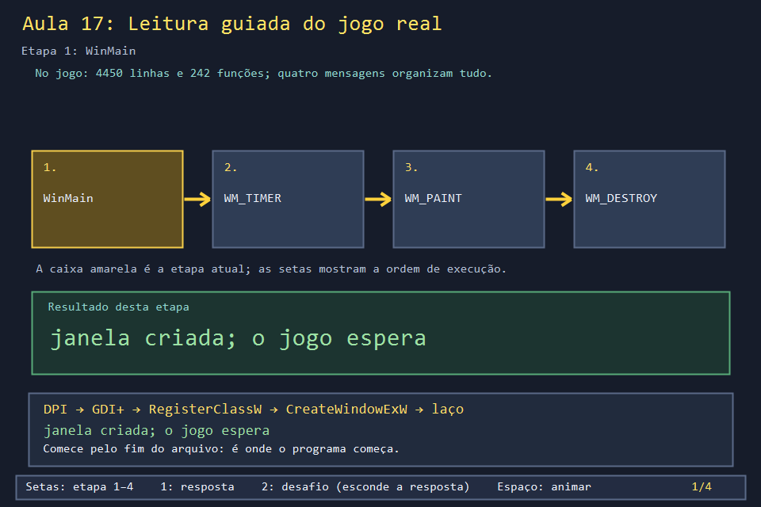
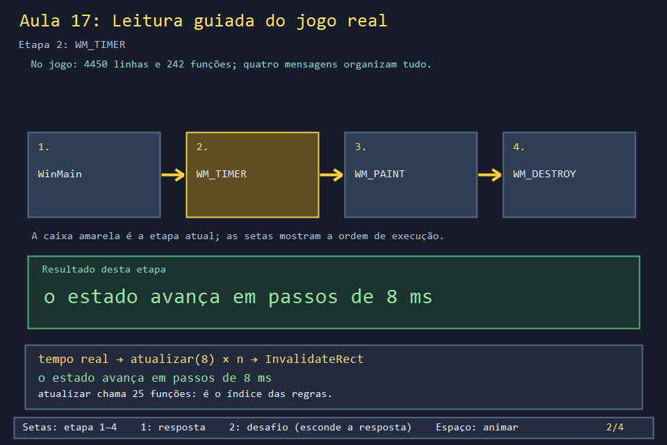
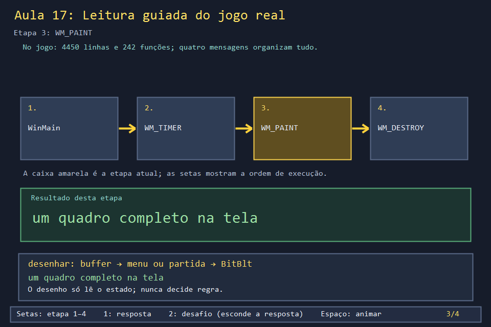
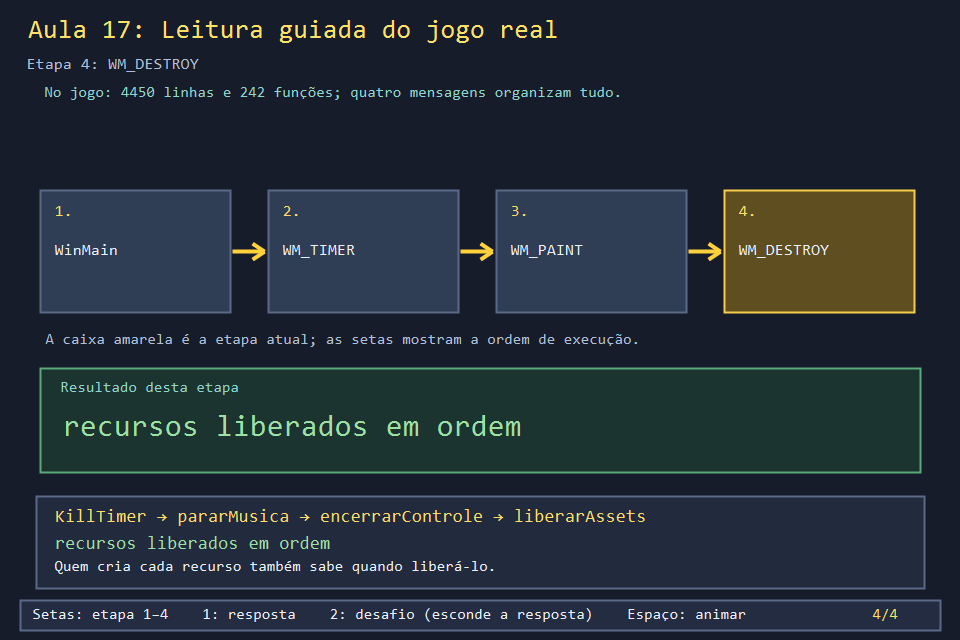

# Aula 17 — Leitura guiada do jogo real

| Trilha | Duração | Antes desta aula | Próxima na trilha |
| --- | --- | --- | --- |
| Integração (fim do curso) | 2–3 h | as trilhas que você já fez; idealmente todas | [ARQUITETURA_DA_RECONSTRUCAO.md](../../ARQUITETURA_DA_RECONSTRUCAO.md) e [DESAFIO_DE_RECONSTRUCAO.md](../../DESAFIO_DE_RECONSTRUCAO.md) |

| Menu | Partida | Chefe |
| --- | --- | --- |
|  |  |  |

`bomberman.cpp` tem 4450 linhas e 242 funções. Lido de cima para baixo, é uma parede de texto. Lido a partir das **mensagens do Windows**, vira um mapa: toda função do jogo é chamada, direta ou indiretamente, a partir de `WinMain` e de quatro `case` de `processarMensagem`. Esta aula entrega uma ferramenta para navegar no arquivo e um roteiro de leitura em oito paradas, cada uma ligada à aula que a explica.

## O que você vai conseguir fazer

- Usar um programa em C++ para listar funções, tamanhos e chamadas do jogo.
- Seguir o fluxo `WinMain → mensagens → atualizar → desenhar → liberar`.
- Localizar qualquer sistema do jogo sem decorar números de linha.
- Explicar como o jogo abre e espera o Modo Insano, um processo separado.

## 1. A ferramenta de leitura

`Aula_17_leitura_orientada_do_jogo_real.cpp` é um índice do jogo escrito em C++: lê o arquivo linha por linha, reconhece definições de função com uma expressão regular, conta chaves para achar o fim de cada uma e lista quais outras funções do jogo cada corpo chama.

```powershell
.\abrir_aula.ps1 -Numero 17 -Modo Exemplo                     # o roteiro completo
.\build\internos\exemplos\Aula_17_exemplo.exe colocarBombaEm  # uma função só
```

```text
4450 linhas, 242 funcoes
as 5 maiores: processarMensagem(149) lerTeclado(147) montarFase(95) atualizar(85) carregarAssets(83)

roteiro da leitura guiada:
WinMain  (linhas 4414-4450, 37 linhas)
   chama: tornarAplicacaoDpiAware atualizarEscalaDpi
processarMensagem  (linhas 4260-4408, 149 linhas)
   chama: atualizarEscalaDpi carregarAssets iniciarMusica atualizarEstadoControle processarControleNoMenu atualizar ...
atualizar  (linhas 2437-2521, 85 linhas)
   chama: reiniciarFase novaPartida atualizarVidasJogadores processarMovimentoContinuo atualizarBot atualizarBombas ...
```

A lista de `atualizar` é, na prática, o índice das regras do jogo, **na ordem em que rodam** a cada 8 ms.

## 2. O mapa do arquivo

O fonte segue uma ordem que se repete em muitos jogos: dados primeiro, regras no meio, desenho e entrada no fim, ponto de entrada por último. Use a ferramenta para achar a linha atual de cada função.

| Região | Funções que marcam a região | Aula |
| --- | --- | --- |
| Constantes, `enum`s e `struct`s | `TipoCelula`, `Posicao`, `Bomba`, `Boss`, `RegistroPontuacao` | [01](../Aula_01_tipos_funcões_e_referências/Aula_01_tipos_funcões_e_referências.md), [02](../Aula_02_matriz_enum_e_mapa/Aula_02_matriz_enum_e_mapa.md) |
| Controle (SDL2, XInput, DirectInput) | `montarEntrada`, `atualizarEstadoControle` | [16](../Aula_16_controle_e_camada_de_entrada/Aula_16_controle_e_camada_de_entrada.md), [31](../Aula_31_joystick_real/Aula_31_joystick_real.md) |
| Ranking e nomes | `lerRanking`, `gravarRanking`, `digitarNomeJogador` | [13](../Aula_13_ranking_csv/Aula_13_ranking_csv.md), [21](../Aula_21_ranking_csv_completo/Aula_21_ranking_csv_completo.md), [30](../Aula_30_menu_completo/Aula_30_menu_completo.md) |
| Regras básicas e montagem da fase | `iguais`, `avancarVisual`, `criarMapa`, `montarFase`, `avancarFase` | [02](../Aula_02_matriz_enum_e_mapa/Aula_02_matriz_enum_e_mapa.md), [07](../Aula_07_movimento_e_colisao/Aula_07_movimento_e_colisao.md), [12](../Aula_12_fases_dificuldade_e_cooperativo/Aula_12_fases_dificuldade_e_cooperativo.md) |
| Movimento, bombas e itens | `moverJogador`, `colocarBombaEm`, `propagarExplosao`, `chutarBomba` | [08](../Aula_08_bomba_e_explosao_recursiva/Aula_08_bomba_e_explosao_recursiva.md), [09](../Aula_09_oito_poderes/Aula_09_oito_poderes.md), [19](../Aula_19_motor_completo_dos_poderes/Aula_19_motor_completo_dos_poderes.md) |
| Inimigos, chefes, Mario e bot | `bfsProximoPasso`, `criarPoderBoss`, `atualizarHornet`, `atualizarMario`, `atualizarBot` | [10](../Aula_10_fila_e_bfs/Aula_10_fila_e_bfs.md), [11](../Aula_11_perigo_e_fuga_do_bot/Aula_11_perigo_e_fuga_do_bot.md), [14](../Aula_14_chefes_projeteis_e_mario/Aula_14_chefes_projeteis_e_mario.md), [20](../Aula_20_bfs_fuga_segura/Aula_20_bfs_fuga_segura.md), [22](../Aula_22_maquina_de_estados_boss/Aula_22_maquina_de_estados_boss.md), [25](../Aula_25_mario_aliado_e_maca/Aula_25_mario_aliado_e_maca.md), [26](../Aula_26_cinco_chefes_reais/Aula_26_cinco_chefes_reais.md) |
| O laço de regras | `processarMovimentoContinuo`, `atualizar` | [06](../Aula_06_tempo_entrada_e_animacao/Aula_06_tempo_entrada_e_animacao.md) |
| Imagens, áudio e buffer | `carregarAssets`, `gerarMusicaProcedural`, `garantirBuffer` | [05](../Aula_05_recorte_de_sprite_sheet/Aula_05_recorte_de_sprite_sheet.md), [15](../Aula_15_audio_wav_e_recursos/Aula_15_audio_wav_e_recursos.md), [23](../Aula_23_wav_pcm_completo/Aula_23_wav_pcm_completo.md), [24](../Aula_24_backbuffer_dpi_recursos/Aula_24_backbuffer_dpi_recursos.md) |
| Desenho | `desenharTerrenoCelula`, `desenharMapa`, `desenharMenu` | [04](../Aula_04_formas_cores_e_gdiplus/Aula_04_formas_cores_e_gdiplus.md), [18](../Aula_18_animacao_direcional_gdiplus/Aula_18_animacao_direcional_gdiplus.md), [27](../Aula_27_cenarios_tabuleiro_e_tiles/Aula_27_cenarios_tabuleiro_e_tiles.md), [28](../Aula_28_menu_e_transicoes_reais/Aula_28_menu_e_transicoes_reais.md) |
| Entrada e mensagens | `lerTeclado`, `processarControleNoMenu`, `processarMensagem`, `WinMain` | [03](../Aula_03_janela_e_mensagens_win32/Aula_03_janela_e_mensagens_win32.md), [30](../Aula_30_menu_completo/Aula_30_menu_completo.md) |

## 3. Leitura guiada em oito paradas

Para cada parada: abra a função no editor (Ctrl+G vai até a linha que a ferramenta mostrar), responda à pergunta e confira a resposta.

1. **`WinMain`.** Em que ordem são preparados DPI, GDI+ e janela? O que acontece depois do laço? *(DPI → GDI+ → classe → janela → laço; depois do laço, `GdiplusShutdown`.)* Aula 03.
2. **`processarMensagem`, `WM_CREATE`.** Quais cinco coisas são preparadas antes da primeira atualização? *(Escala de DPI, imagens, música, controle e o timer de 16 ms.)* Aula 03.
3. **`processarMensagem`, `WM_TIMER`.** Por que `atualizar` recebe sempre 8? *(Passo fixo: o tempo real é acumulado e consumido em fatias de 8 ms.)* Aula 06.
4. **`atualizar`.** Rode a ferramenta para `atualizar`. Por que `atingirPersonagens` vem **depois** de `avancarVisual`? *(O dano usa a posição desenhada, que acabou de ser atualizada; Aula 07.)*
5. **`desenhar`.** O que decide se aparece um menu ou a partida? *(A variável `modo`; dentro do menu, `telaMenu`.)* Aulas 24 e 28.
6. **`novaPartida` → `montarFase`.** Liste o que `montarFase` chama. *(`criarMapa`, `sortearPosicoesIniciais`, `posicionarBlocosBonus`, `quantidadeInimigosNormais`, `posicaoLivreAleatoria`, `limparArea`.)* Aulas 02, 12 e 27.
7. **`colocarBombaEm` → `atualizarBombas` → `iniciarExplosaoBomba` → `propagarExplosao`.** Quem chama `iniciarExplosaoBomba`? *(`atualizarBombas`, quando o fusível acaba, e `detonarBombasRelogio`; a solução desta aula responde isso automaticamente.)* Aula 08.
8. **`iniciarModoInsano` e a volta.** Veja o trecho abaixo.

O Modo Insano (tecla 9 no menu) é **outro programa**. O jogo o abre com `CreateProcessW`, esconde a própria janela, para a música e, a cada `WM_TIMER`, pergunta se o processo filho já terminou:

<!-- trecho simbolo="iniciarModoInsano" -->
```cpp
// projeto_final/bomberman.cpp, linhas 4037–4053 (iniciarModoInsano)
void iniciarModoInsano() {
    if(processoInsano) return;
    wstring caminho=pastaDoExecutavel()+L"\\modo_insano.exe";
    wstring comando=L"\""+caminho+L"\"";
    vector<wchar_t> argumentos(comando.begin(),comando.end()); argumentos.push_back(0);
    STARTUPINFOW inicio{}; inicio.cb=sizeof(inicio);
    PROCESS_INFORMATION processo{};
    wstring pasta=pastaDoExecutavel();
    if(!CreateProcessW(caminho.c_str(),argumentos.data(),nullptr,nullptr,FALSE,0,nullptr,pasta.c_str(),&inicio,&processo)) {
        MessageBoxW(janelaPrincipal,L"Nao foi possivel abrir o Modo Insano. Execute compilar.ps1 para gerar os dois jogos.",L"Modo Insano",MB_OK|MB_ICONERROR);
        return;
    }
    CloseHandle(processo.hThread); processoInsano=processo.hProcess;
    pararMusica();
    fill(begin(teclaPressionada),end(teclaPressionada),false);
    ShowWindow(janelaPrincipal,SW_HIDE);
}
```

<!-- trecho simbolo="processarMensagem" de="if(processoInsano) {" ate="} else return 0;" -->
```cpp
// projeto_final/bomberman.cpp, linhas 4272–4278 (processarMensagem)
        if(processoInsano) {
            if(WaitForSingleObject(processoInsano,0)==WAIT_OBJECT_0) {
                CloseHandle(processoInsano); processoInsano=nullptr;
                ShowWindow(janela,SW_SHOW);
                iniciarMusica();
                ultimoInstante=chrono::steady_clock::now();
            } else return 0;
```

`WaitForSingleObject(processoInsano, 0)` não espera: o `0` significa "só me diga se já terminou". Enquanto o Insano roda, o `return 0` pula toda a atualização do Bomberman.

## 4. Limites da ferramenta

| A ferramenta | Por quê |
| --- | --- |
| reconhece definições só na coluna 0 | é a convenção do arquivo; métodos dentro de `struct` não aparecem |
| não vê chamadas feitas por ponteiro de função ou lambda guardada | ela procura `nome(` no texto, não executa o programa |
| conta `{` e `}` ignorando texto entre aspas e comentários `//` | um `{` dentro de `/* ... */` a confundiria; o jogo não usa esse estilo |

Esses limites são uma lição em si: ferramentas simples resolvem 95% do problema, e saber onde elas falham evita conclusões erradas.

## 5. Laboratório visual

| | |
| --- | --- |
|  |  |
|  |  |

```powershell
.\compilar_aula.ps1 -Numero 17
.\build\Aula_17_leitura_orientada_do_jogo_real.exe
```

## 6. Exercícios

1. **Use a ferramenta.** O que `moverJogador` chama? *(`visualNoDestino`, `podeAndarPara`, `iguais` e `atingirSePerigoso`.)*
2. **Siga uma tecla.** Escreva o caminho da tecla E (chute) desde o Windows até a bomba se mover. *(`WM_KEYDOWN` → `lerTeclado` → `chutarBomba` → `b.posicao = destinoFinal`. Com o controle: `WM_TIMER` → `processarControleNoMenu` → `chutarBomba`.)*
3. **Quem chama?** Escreva o programa inverso: dada uma função, listar as funções que a chamam. *Solução: `solucoes/` — `montarFase` é chamada por `reiniciarFase`, `avancarFase` e `novaPartida`.*
4. **Processo filho.** O que acontece se `modo_insano.exe` não estiver ao lado de `bomberman.exe`? *(`CreateProcessW` falha e o jogo mostra uma `MessageBoxW` explicando que é preciso rodar `compilar.ps1`.)*

## 7. Erros comuns

- **Ler de cima para baixo.** As primeiras 400 linhas são declarações; começar por elas cansa antes de chegar ao que importa. Comece por `WinMain` e pelas mensagens.
- **Editar `projeto_final/bomberman.cpp` para "testar".** Ele é a referência do curso. Faça experimentos numa cópia ou no seu projeto de reconstrução.
- **Confiar em números de linha antigos.** Eles mudam a cada edição do jogo. Os trechos das aulas são regenerados por `ferramentas/trechos_reais.py`, e a ferramenta desta aula sempre lê o arquivo atual.

## 8. Antes de seguir

- [ ] Rodei a ferramenta para pelo menos cinco funções.
- [ ] Passei pelas oito paradas e conferi as respostas.
- [ ] Sei explicar o `WaitForSingleObject(..., 0)` do Modo Insano.

## Referências

- [`std::regex` (cppreference)](https://en.cppreference.com/w/cpp/regex)
- [`CreateProcessW` (Microsoft Learn)](https://learn.microsoft.com/en-us/windows/win32/api/processthreadsapi/nf-processthreadsapi-createprocessw)
- [`WaitForSingleObject` (Microsoft Learn)](https://learn.microsoft.com/en-us/windows/win32/api/synchapi/nf-synchapi-waitforsingleobject)
- [ARQUITETURA_DA_RECONSTRUCAO.md](../../ARQUITETURA_DA_RECONSTRUCAO.md): o próximo passo depois desta leitura.
