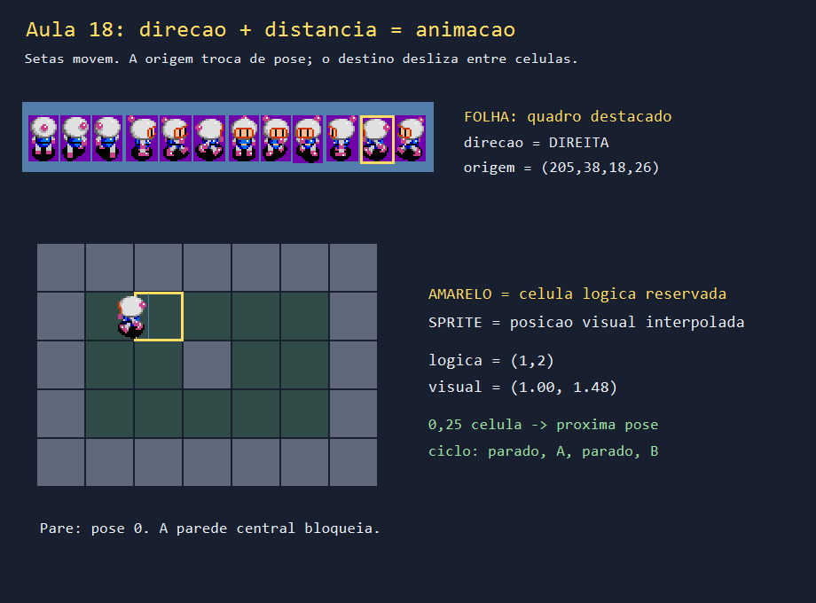
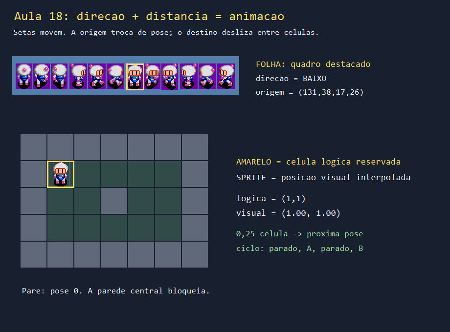
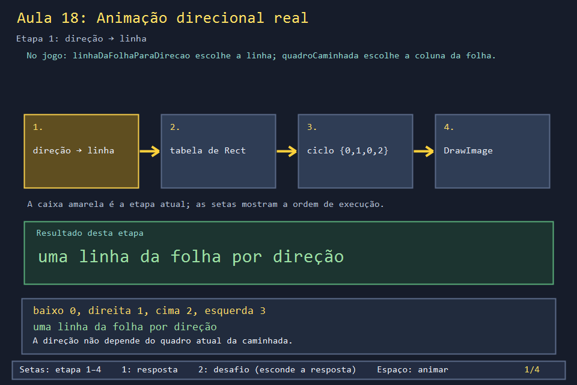
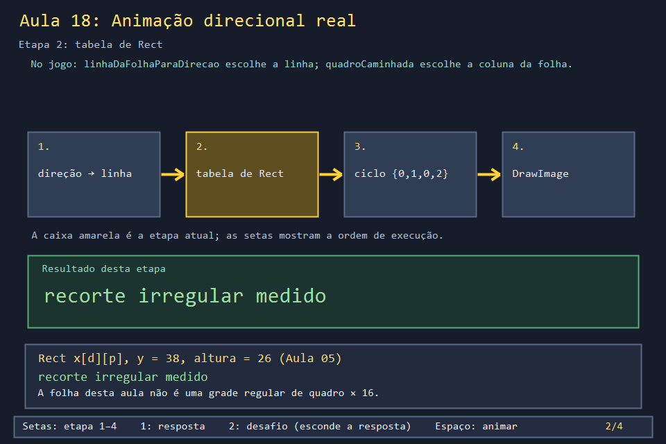
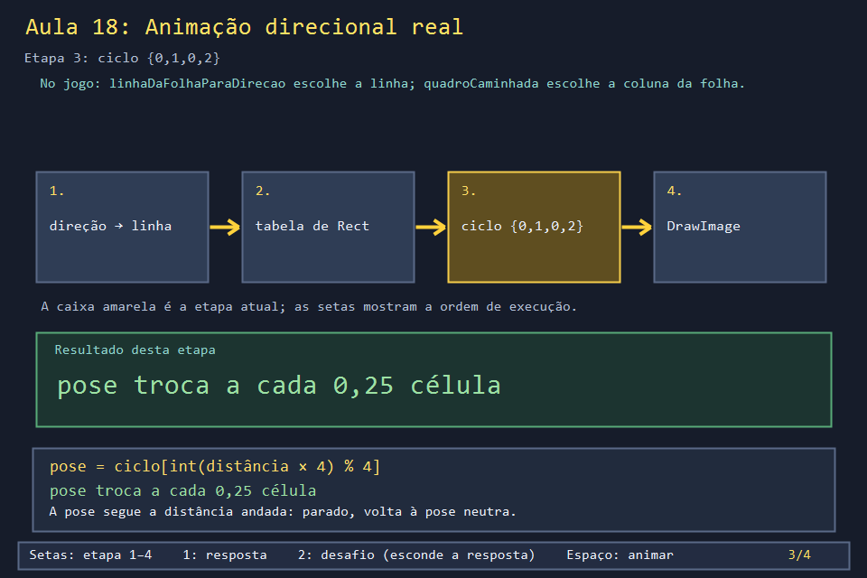
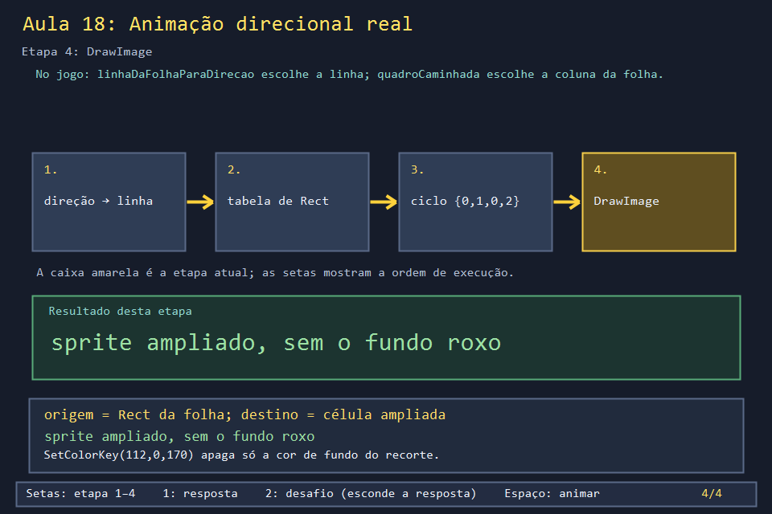

# Aula 18 — Animação direcional pela distância

| Trilha | Duração | Antes desta aula | Próxima na trilha |
| --- | --- | --- | --- |
| Tempo, movimento e animação (06 → 07 → 18) | 2–3 h | [Aula 05](../Aula_05_recorte_de_sprite_sheet/Aula_05_recorte_de_sprite_sheet.md), [Aula 06](../Aula_06_tempo_entrada_e_animacao/Aula_06_tempo_entrada_e_animacao.md), [Aula 07](../Aula_07_movimento_e_colisao/Aula_07_movimento_e_colisao.md) | fim da trilha; jogue o Marco 1 em `marcos/` |

| Nesta aula: folha, recorte e sprite em movimento | No jogo real: quatro personagens animados |
| --- | --- |
|  |  |

A Aula 05 ensinou a recortar um quadro de uma folha de sprites. Esta aula faz o personagem **andar**: escolher a linha da folha pela direção, trocar de pose conforme a distância percorrida e voltar à pose neutra ao parar. A folha usada aqui, `personagem_principal_sprite_v2.png`, é irregular. A tabela de `Rect` usa os mesmos recortes medidos na Aula 05, que é a referência para a origem e a cor chave.

## 1. Como o programa funciona

As setas reservam uma célula livre. `logicaL/C` muda imediatamente, e `visualL/C` se aproxima 0,08 célula por timer (a Aula 07 explica as duas posições). Cada 0,25 célula percorrida avança o ciclo `{0,1,0,2}`. Quando as posições coincidem, `indiceCiclo` volta a zero. A parede central bloqueia a entrada.

1. Releia `criarPersonagemFolhaIrregular` da Aula 05 e confira `quadroX`, `quadroLargura`, Y = 38 e altura = 26 desta aula. A origem não pode ser `quadro × 16`.
2. Siga `WM_KEYDOWN`: a direção é escolhida, e `mapa[l][c] == '.'` decide se a célula será reservada.
3. Siga `WM_TIMER` até `atualizarMovimento`: anote célula lógica, posição visual, distância acumulada e índice do ciclo a cada chamada.
4. Siga `WM_PAINT` até `desenharCena`: o contorno da folha usa a origem; o contorno amarelo no mapa usa a posição lógica; o sprite usa a visual.
5. Confira `ImageAttributes::SetColorKey`: RGB(112, 0, 170) remove o roxo só do sprite recortado.

```powershell
.\compilar_aula.ps1 -Numero 18
.\build\Aula_18_animacao_direcional_gdiplus.exe        # rode da raiz do curso
```

Use as quatro setas, tente atravessar a parede e pare depois de andar. Compare sua previsão com os números na tela.



## 2. O código real

O jogo usa folhas regulares para os personagens jogáveis (16 × 24 pixels por quadro, 3 quadros por direção). A linha da folha vem da direção:

<!-- trecho simbolo="linhaDaFolhaParaDirecao" -->
```cpp
// projeto_final/bomberman.cpp, linhas 2914–2919 (linhaDaFolhaParaDirecao)
int linhaDaFolhaParaDirecao(Posicao direcao) {
    if (direcao.linha == 1) return 0;
    if (direcao.coluna == 1) return 1;
    if (direcao.linha == -1) return 2;
    return 3;
}
```

A pose vem da distância percorrida (Aula 06). No jogo, ela troca a cada 0,4 célula (`× 2,5`); nesta aula, a cada 0,25:

<!-- trecho simbolo="quadroCaminhada" -->
```cpp
// projeto_final/bomberman.cpp, linhas 877–880 (quadroCaminhada)
int quadroCaminhada(float distancia, bool andando) {
    const int ciclo[] = {0, 1, 0, 2};
    return andando ? ciclo[static_cast<int>(distancia * 2.5f) % 4] : 1;
}
```

E o desenho junta tudo: origem na folha (`quadro × QUADRO_LARGURA`, `linhaFolha × QUADRO_ALTURA`), destino com os pés ancorados no chão da célula, e a sombra translúcida da Aula 04:

<!-- trecho simbolo="desenharQuadroNaCelula" -->
```cpp
// projeto_final/bomberman.cpp, linhas 2925–2946 (desenharQuadroNaCelula)
void desenharQuadroNaCelula(Gdiplus::Graphics& g, Gdiplus::Image* folha, float linha, float coluna,
                            int linhaFolha, int quadro, const wchar_t* fallback) {
    int xCelula = static_cast<int>(coluna * TAMANHO_CELULA * escalaDpi);
    int yCelula = static_cast<int>((ALTURA_CABECALHO + linha * TAMANHO_CELULA) * escalaDpi);
    if (!folha) {
        desenharTexto(g, fallback, coluna * TAMANHO_CELULA + 4,
                      ALTURA_CABECALHO + linha * TAMANHO_CELULA + 10, 18,
                      Gdiplus::Color(255, 255, 255, 255));
        return;
    }
    // Referencia: 40x60 em celulas de 46. Aqui 45x68 em celulas de 52.
    // Os pes ficam ancorados ao chao; a arte pode ultrapassar a casa sem
    // aumentar a caixa de contato ou permitir atravessar paredes.
    int largura = px(45), altura = px(68);
    int x = xCelula + (px(TAMANHO_CELULA) - largura) / 2;
    int y = yCelula + px(TAMANHO_CELULA-3) - altura;
    Gdiplus::SolidBrush sombra(Gdiplus::Color(105,0,0,0));
    g.FillEllipse(&sombra,xCelula+px(9),yCelula+px(41),px(34),px(11));
    Gdiplus::Rect destino(x, y, largura, altura);
    g.DrawImage(folha, destino, quadro * QUADRO_LARGURA, linhaFolha * QUADRO_ALTURA,
               QUADRO_LARGURA, QUADRO_ALTURA, Gdiplus::UnitPixel);
}
```

## 3. O que muda entre a aula e o jogo

| No jogo | Nesta aula | Motivo |
| --- | --- | --- |
| folhas regulares de 16 × 24 (`jogador_direcional.png`) | folha irregular com tabela de `Rect` | praticar o recorte medido da Aula 05 |
| desenho avança 3,6 células/s, em passos de 8 ms | 0,08 célula por timer | ver o deslizamento devagar |
| pose troca a cada 0,4 célula | a cada 0,25 | mais trocas por célula para observar |
| fundo transparente no próprio PNG | cor chave roxa removida com `SetColorKey` | a folha original tem fundo roxo |

## 4. Laboratório visual complementar

O diagrama `Aula_18_visual.cpp` resume a regra em quatro etapas:

| | |
| --- | --- |
|  |  |
|  |  |

```powershell
.\build\internos\visuais\Aula_18_visual.exe
```

## 5. Exercícios

1. **Previsão.** Com o limiar de 0,25, quantas trocas de pose acontecem ao andar uma célula? *(4: em 0,25, 0,5, 0,75 e 1,0; a sequência de poses é 1, 0, 2, 0.)* E com 0,50? *(2.)* A solução muda para 0,50.
2. **Jogo real.** Com o fator `2,5` de `quadroCaminhada`, quantas trocas há numa célula? *(2,5 por célula: a pose troca em 0,4, 0,8, 1,2...)*
3. **Direção sem passo.** No jogo, apertar uma seta contra a parede muda a direção do sprite? *(Sim: `moverJogador` grava `direcaoJogador` antes de testar a colisão. O personagem vira para a parede sem sair do lugar.)*
4. **Ancoragem.** Em `desenharQuadroNaCelula`, por que `y = yCelula + px(TAMANHO_CELULA - 3) - altura`, e não o centro da célula? *(O sprite é mais alto que a célula; ancorar pelos pés mantém o personagem "pisando" no chão, e a cabeça pode passar para a célula de cima sem mudar a colisão.)*

## 6. Erros comuns

- **Trocar a pose pelo tempo, não pela distância.** O personagem "pedala" parado contra a parede. A pose deve seguir o deslocamento.
- **Esquecer de voltar à pose neutra.** O personagem para no meio de um passo, com uma perna no ar.
- **Usar a grade 3 × 4 em folhas irregulares.** Hornet e Bowser usam tabelas próprias (`ANIM_HORNET`, `ANIM_BOWSER`), assim como esta aula usa a tabela de `Rect`.

## 7. Antes de seguir

- [ ] Encontrei no código desta aula os quatro valores que vêm da Aula 05.
- [ ] Previ as trocas de pose com os limiares 0,25 e 0,50.
- [ ] Comparei a aula com `desenharQuadroNaCelula` e expliquei a ancoragem pelos pés.

**Verificação:** `testes/verificar_aula18.cpp` exporta as duas capturas e verifica recorte, interpolação e pose de repouso.

## Referências

- [`Graphics::DrawImage` com retângulo de origem (Microsoft Learn)](https://learn.microsoft.com/en-us/windows/win32/api/gdiplusgraphics/nf-gdiplusgraphics-graphics-drawimage(image_constrect__int_int_int_int_unit_constimageattributes_drawimageabort_void))
- [`ImageAttributes::SetColorKey` (Microsoft Learn)](https://learn.microsoft.com/en-us/windows/win32/api/gdiplusimageattributes/nf-gdiplusimageattributes-imageattributes-setcolorkey)
- [The Spriters Resource](https://www.spriters-resource.com/), origem das folhas de sprite
