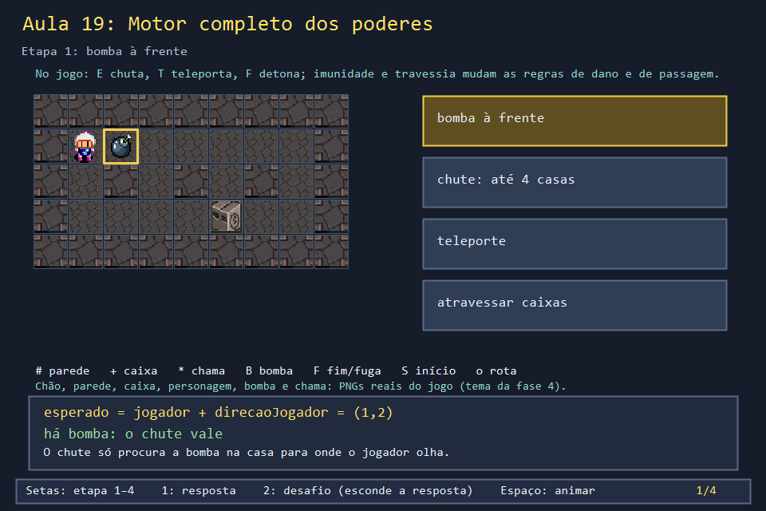
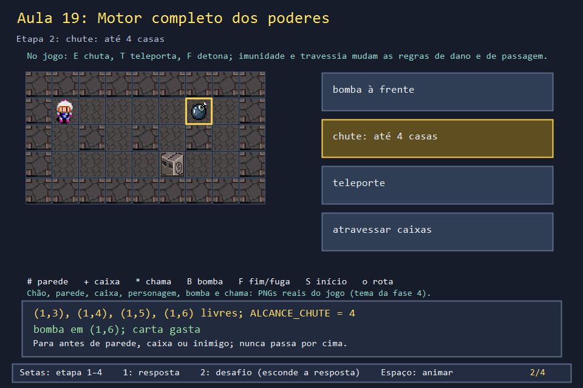
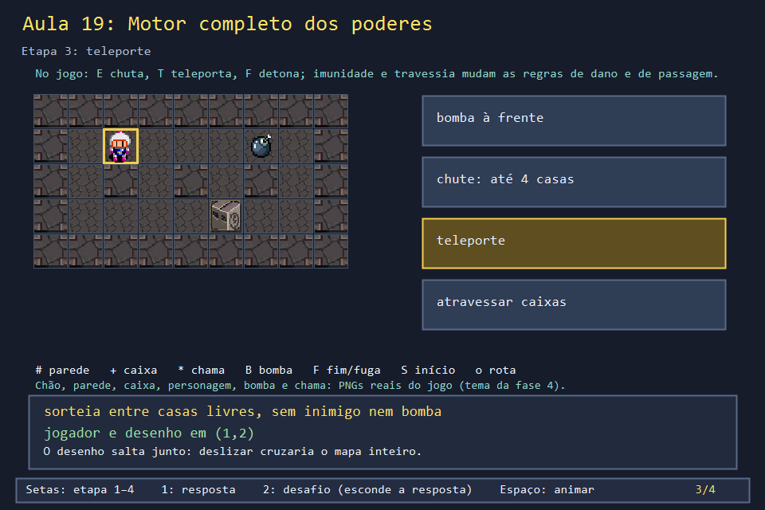
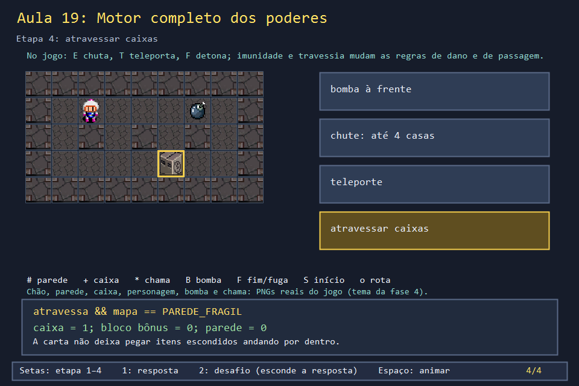

# Aula 19 — Motor completo dos poderes

| Trilha | Duração | Antes desta aula | Próxima na trilha |
| --- | --- | --- | --- |
| Bombas e poderes (08 → 09 → 19) | 75–90 min | [Aula 09](../Aula_09_oito_poderes/Aula_09_oito_poderes.md), [Aula 12](../Aula_12_fases_dificuldade_e_cooperativo/Aula_12_fases_dificuldade_e_cooperativo.md) | fim da trilha; o desafio final pede um **nono** poder |


A Aula 09 mostrou como cada carta é coletada e zerada. Quatro delas só valem quando o jogador **age**: chutar (E), teleportar (T), detonar (F) e andar através de caixas. Uma quinta muda uma regra escondida: de quem é a chama que pode ferir você. Esta aula lê as funções do jogo que fazem cada uma dessas coisas e testa os casos de borda.

## O que você vai conseguir fazer

- Seguir `chutarBomba` e prever onde a bomba para.
- Explicar por que o teleporte move o desenho junto com a posição lógica.
- Montar a tabela "quem fere quem" a partir de `bombaFereJogador`.
- Encontrar um caso de borda (chute contra a parede) e decidir a regra.

## 1. A ideia

| Tecla | Carta | O que muda | Quando a carta acaba |
| --- | --- | --- | --- |
| E | `CHUTE` | a bomba à frente desliza até 4 casas | no primeiro chute que encontra bomba |
| T | `TELEPORTE` | o jogador salta para uma casa livre sorteada | ao usar |
| F | `BOMBA_RELOGIO` | as bombas não explodem sozinhas; F detona todas | no fim da fase |
| — | `IMUNE_BOMBA` | a própria chama não fere | no fim da fase |
| — | `ATRAVESSA_BLOCO` | `podeAndarPara` aceita caixa comum | no fim da fase |

## 2. O código real

<!-- trecho simbolo="chutarBomba" -->
```cpp
// projeto_final/bomberman.cpp, linhas 1439–1455 (chutarBomba)
void chutarBomba() {
    if (estado != JOGANDO || jogadorCaido[0] || !possuiCartaChute) return;
    Posicao esperado{jogador.linha + direcaoJogador.linha, jogador.coluna + direcaoJogador.coluna};
    for (Bomba& b : bombas) {
        if (!b.ativa || b.explodindo || !iguais(b.posicao, esperado)) continue;
        Posicao destinoFinal = b.posicao;
        for (int passo = 1; passo <= ALCANCE_CHUTE; passo++) {
            Posicao tentativa{b.posicao.linha + direcaoJogador.linha * passo,
                              b.posicao.coluna + direcaoJogador.coluna * passo};
            if (!livre(tentativa.linha, tentativa.coluna) || temInimigo(tentativa)) break;
            destinoFinal = tentativa;
        }
        b.posicao = destinoFinal;
        possuiCartaChute = false;
        return;
    }
}
```

<!-- trecho simbolo="teletransportarJogador" -->
```cpp
// projeto_final/bomberman.cpp, linhas 1457–1475 (teletransportarJogador)
void teletransportarJogador() {
    if (estado != JOGANDO || jogadorCaido[0] || !possuiCartaTeleporte) return;
    vector<Posicao> livres;
    for (int l = 1; l < LINHAS - 1; l++)
        for (int c = 1; c < COLUNAS - 1; c++)
            if (livre(l, c) && !temInimigo({l, c}) && !bombaEm({l, c}) &&
                !(doisJogadores && iguais({l, c}, jogador2)))
                livres.push_back({l, c});
    if (livres.empty()) return;
    uniform_int_distribution<int> sorteio(0, static_cast<int>(livres.size()) - 1);
    jogador = livres[sorteio(gerador)];
    // Teleporte "pula" de verdade - a posicao visual tem que acompanhar na
    // hora, nao deslizar visivelmente atravessando o mapa inteiro.
    jogadorVisualL = static_cast<float>(jogador.linha);
    jogadorVisualC = static_cast<float>(jogador.coluna);
    atingirSePerigoso(jogadorVisualL,jogadorVisualC,1);
    coletarItens();
    possuiCartaTeleporte = false;
}
```

A bomba-relógio nasce com `relogio = true` em `colocarBombaEm` (Aula 08), e `atualizarBombas` não desconta o fusível dela. Só F a faz explodir:

<!-- trecho simbolo="detonarBombasRelogio" -->
```cpp
// projeto_final/bomberman.cpp, linhas 1434–1437 (detonarBombasRelogio)
void detonarBombasRelogio() {
    for (Bomba& b : bombas)
        if (b.ativa && !b.explodindo && b.relogio && (b.dono == 0 || !modoRivais)) iniciarExplosaoBomba(b);
}
```

Quem a chama fere. Três regras em três linhas: bomba de inimigo fere sempre; a própria, só sem imunidade; a do outro jogador, só no modo inimigos.

<!-- trecho simbolo="bombaFereJogador" -->
```cpp
// projeto_final/bomberman.cpp, linhas 1017–1021 (bombaFereJogador)
bool bombaFereJogador(const Bomba& b, int numero) {
    if (b.dono == DONO_INIMIGO) return true;
    if (b.dono == numero-1) return !imuneAPropriaBomba;
    return modoRivais;
}
```

E a travessia, em `podeAndarPara` (Aula 07): só `PAREDE_FRAGIL`, nunca `PAREDE_BONUS`.

<!-- trecho simbolo="podeAndarPara" -->
```cpp
// projeto_final/bomberman.cpp, linhas 1352–1357 (podeAndarPara)
bool podeAndarPara(Posicao destino) {
    if (bloqueadoBoss(destino) || bombaEm(destino)) return false;
    return livre(destino.linha, destino.coluna) ||
           (atravessaBlocoQuebravel && dentro(destino.linha, destino.coluna) &&
            mapa[destino.linha][destino.coluna] == PAREDE_FRAGIL);
}
```

## 3. A versão desta aula

`Aula_19_motor_completo_dos_poderes.cpp` copia as cinco funções e testa cada uma num mapa 5 × 9:

```text
chute com inimigo em (1,5): bomba para em (1,4); carta=0
chute sem inimigo:          bomba para em (1,6) (alcance 4)
teleporte: jogador em (1,2), desenho em (1,2), carta=0
relogio: F detonou 2 de 2 bombas
fere P1?  bomba do inimigo / propria / de P2
  amigos            1 / 1 / 0
  amigos   imune    1 / 0 / 0
  inimigos          1 / 1 / 1
  inimigos imune    1 / 0 / 1
atravessa: caixa=1 bloco bonus=0 parede=0
```

Leia a tabela de dano linha por linha. Ela responde a perguntas que um jogador faria: "no modo amigos, a bomba do meu parceiro me mata?" (não); "com imunidade, a bomba do inimigo me mata?" (sim).

## 4. O que mudou em relação ao jogo e por quê

| No jogo | Nesta aula | Motivo |
| --- | --- | --- |
| `chutarBomba` e `teletransportarJogador` só valem com `estado == JOGANDO` e o jogador de pé | não conferem | sem partida aqui |
| depois do teleporte, `atingirSePerigoso` e `coletarItens` rodam na casa nova | não rodam | sem chama nem itens |
| `detonarBombasRelogio` chama `iniciarExplosaoBomba` | só marca `explodindo` | a explosão é da Aula 08 |
| a semente do sorteio muda a cada partida | semente 7 | teleporte previsível |

## 5. Laboratório visual

| | |
| --- | --- |
|  |  |
|  |  |

```powershell
.\compilar_aula.ps1 -Numero 19
.\build\Aula_19_motor_completo_dos_poderes.exe
.\abrir_aula.ps1 -Numero 19 -Modo Exemplo
```

## 6. Exercícios

1. **Previsão.** O jogador em (1,1) olha para **baixo** e há uma bomba em (1,2). O chute funciona? *(Não: `esperado` é (2,1), e a bomba não está lá. A carta não é gasta.)*
2. **Chute contra a parede.** Uma bomba em (1,2) com parede em (1,3): o chute não move nada. A carta é gasta? Escreva a variação que só gasta a carta quando a bomba anda. *Solução: `solucoes/`. No jogo, a carta é gasta mesmo assim.*
3. **Tabela de dano.** No modo inimigos, com imunidade, a bomba de P2 fere P1? *(Sim: a imunidade só vale para a **própria** bomba.)*
4. **Nono poder.** Projete a carta "pavio curto": bombas futuras explodem em 1500 ms em vez de 2200, e o efeito some ao trocar de fase. Liste as funções que mudariam. *(`TipoItem` ganha um valor; `coletarItensEm` ganha um `case`; `colocarBombaEm` usa o fusível curto; `montarFase` zera a carta; `posicionarBlocosBonus` inclui o tipo; o desenho do ícone e o painel lateral também. É o exercício de apresentação do desafio final.)*

## 7. Erros comuns

- **Mover só a posição lógica no teleporte.** O desenho desliza pelo mapa inteiro em 3 s, atravessando paredes. O comentário no jogo explica a escolha de saltar.
- **Esquecer o dono da bomba.** Sem `dono`, não há como implementar imunidade nem o modo amigos. Por isso o campo viaja da bomba até a chama (Aula 08).
- **Liberar `PAREDE_BONUS` na travessia.** O jogador pegaria itens ainda escondidos andando por dentro dos blocos.

## 8. Antes de seguir

- [ ] Previ as duas posições finais do chute.
- [ ] Preenchi a tabela "quem fere quem" antes de rodar.
- [ ] Decidi, com justificativa, se a carta deve ser gasta no chute contra a parede.

## Referências

- [`std::uniform_int_distribution` (cppreference)](https://en.cppreference.com/w/cpp/numeric/random/uniform_int_distribution)
- [Component pattern — Game Programming Patterns](https://gameprogrammingpatterns.com/component.html) (para quando os poderes crescerem demais)
- [DESAFIO_DE_RECONSTRUCAO.md](../../DESAFIO_DE_RECONSTRUCAO.md): a carta nova da apresentação final.
