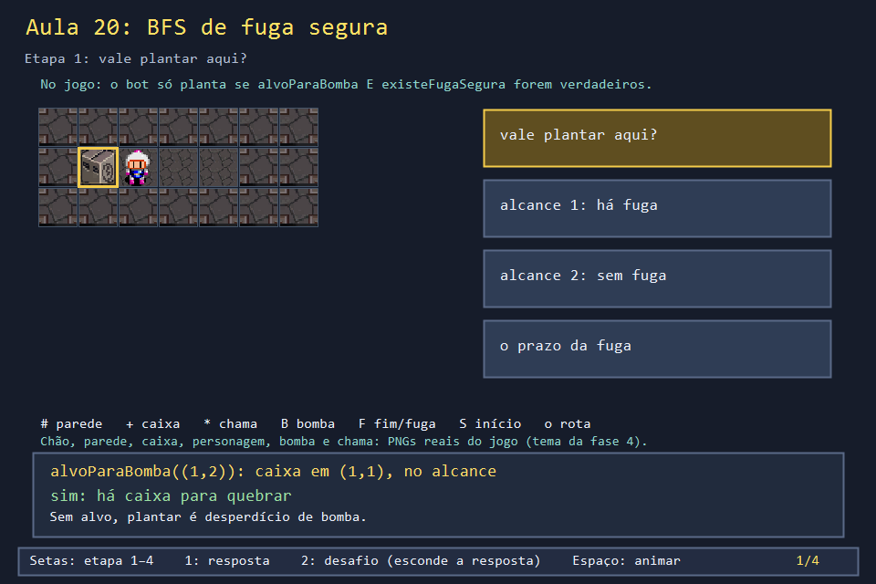
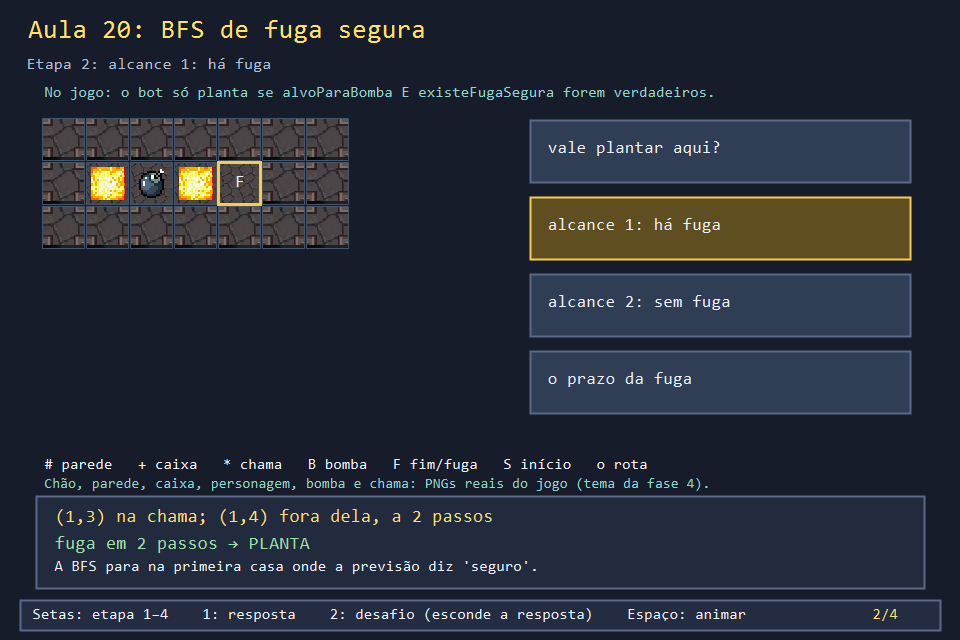
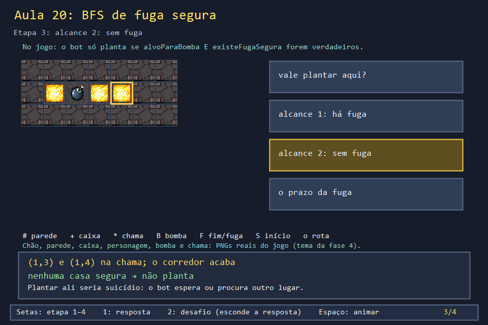
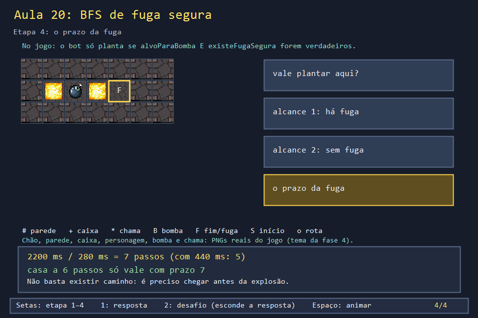

# Aula 20 — BFS de fuga segura: o bot só planta onde consegue fugir

| Trilha | Duração | Antes desta aula | Próxima na trilha |
| --- | --- | --- | --- |
| IA e busca (10 → 11 → 20) | 60–75 min | [Aula 10](../Aula_10_fila_e_bfs/Aula_10_fila_e_bfs.md), [Aula 11](../Aula_11_perigo_e_fuga_do_bot/Aula_11_perigo_e_fuga_do_bot.md) | fim da trilha |


Um bot que planta bombas em qualquer lugar morre na primeira caixa de um beco sem saída. O bot do jogo faz uma pergunta antes de plantar: **"se eu puser a bomba aqui, consigo chegar a uma casa segura antes de ela explodir?"**. A resposta vem de uma BFS com prazo, a mesma estrutura da Aula 10 com um critério de parada novo.

## O que você vai conseguir fazer

- Explicar `alvoParaBombaSeguro` como a junção de duas perguntas.
- Calcular o prazo da fuga a partir das constantes do jogo.
- Prever, para um corredor, se o bot planta ou não.
- Encontrar o primeiro passo da fuga e ver o efeito de uma segunda bomba.

## 1. A ideia

```text
alvoParaBombaSeguro(p) = alvoParaBomba(p)    "há caixa ou inimigo no alcance?"
                       && existeFugaSegura(p) "há casa fora da chama a até 7 passos?"

prazo = TEMPO_BOMBA_MS / INTERVALO_MOVIMENTO_MS = 2200 / 280 = 7 passos (divisão inteira)
```

A BFS de fuga é a da Aula 10, com duas diferenças: ela para na primeira casa **fora** da chama prevista, e não expande nenhum caminho com mais de 7 passos.

## 2. O código real

<!-- trecho simbolo="alvoParaBomba" de="bool alvoParaBomba(Posicao p) {" -->
```cpp
// projeto_final/bomberman.cpp, linhas 2209–2221 (alvoParaBomba)
bool alvoParaBomba(Posicao p) {
    const int direcoes[4][2] = {{-1, 0}, {1, 0}, {0, -1}, {0, 1}};
    for (int d = 0; d < 4; d++) {
        for (int distancia = 1; distancia <= alcanceExplosao; distancia++) {
            int l = p.linha + direcoes[d][0] * distancia;
            int c = p.coluna + direcoes[d][1] * distancia;
            if (!dentro(l, c) || mapa[l][c] == PAREDE_SOLIDA) break;
            if (mapa[l][c] == PAREDE_FRAGIL || mapa[l][c] == PAREDE_BONUS) return true;
            if (temInimigo({l, c}) || celulaBoss(l,c)) return true;
        }
    }
    return false;
}
```

<!-- trecho simbolo="existeFugaSegura" -->
```cpp
// projeto_final/bomberman.cpp, linhas 2186–2207 (existeFugaSegura)
bool existeFugaSegura(Posicao origem) {
    int passosDisponiveis = TEMPO_BOMBA_MS / INTERVALO_MOVIMENTO_MS;
    const int direcoes[4][2] = {{-1, 0}, {1, 0}, {0, -1}, {0, 1}};
    bool visitado[LINHAS][COLUNAS]{};
    queue<pair<Posicao, int>> fila;
    fila.push({origem, 0});
    visitado[origem.linha][origem.coluna] = true;
    while (!fila.empty()) {
        auto [atual, passos] = fila.front();
        fila.pop();
        if (!iguais(atual, origem) && !celulaNoAlcance(origem, atual)) return true;
        if (passos >= passosDisponiveis) continue;
        for (const auto& direcao : direcoes) {
            Posicao proxima{atual.linha + direcao[0], atual.coluna + direcao[1]};
            if (!podeAndarLivre(proxima) || visitado[proxima.linha][proxima.coluna] ||
                temInimigo(proxima)) continue;
            visitado[proxima.linha][proxima.coluna] = true;
            fila.push({proxima, passos + 1});
        }
    }
    return false;
}
```

<!-- trecho simbolo="alvoParaBombaSeguro" -->
```cpp
// projeto_final/bomberman.cpp, linhas 2225–2227 (alvoParaBombaSeguro)
bool alvoParaBombaSeguro(Posicao p) {
    return alvoParaBomba(p) && existeFugaSegura(p);
}
```

E depois de plantar, a fuga de verdade: a mesma `bfsProximoPasso`, parando onde nenhuma bomba (nem ataque do chefe) alcança:

<!-- trecho simbolo="perigoDaBomba" -->
```cpp
// projeto_final/bomberman.cpp, linhas 2176–2179 (perigoDaBomba)
bool perigoDaBomba(Posicao p) {
    for (const Bomba& b : bombas) if (b.ativa && celulaNoAlcance(b.posicao, p, alcanceDaBomba(b))) return true;
    return false;
}
```

<!-- trecho simbolo="proximoPassoParaFuga" -->
```cpp
// projeto_final/bomberman.cpp, linhas 2245–2248 (proximoPassoParaFuga)
Posicao proximoPassoParaFuga() {
    return bfsProximoPasso(
        jogador, [](Posicao p) { return !perigoDaBomba(p) && !perigoDoBoss(p); }, podeAndarLivreSemInimigo);
}
```

## 3. A versão desta aula

`Aula_20_bfs_fuga_segura.cpp` copia `alvoParaBomba`, `celulaNoAlcance`, `existeFugaSegura` e `alvoParaBombaSeguro`. A única mudança é que a BFS devolve **quantos** passos leva até a casa segura. Dois corredores, quatro decisões:

```text
corredor curto, alcance 1          prazo=7 passos  alvo=1  fuga=em 2 passos -> PLANTA
corredor curto, alcance 2          prazo=7 passos  alvo=1  fuga=nao         -> nao planta
corredor longo, alcance 5          prazo=7 passos  alvo=1  fuga=em 6 passos -> PLANTA
corredor longo, passo de 440 ms    prazo=5 passos  alvo=1  fuga=nao         -> nao planta
```

Na última linha, o caminho é o mesmo, mas o jogador anda mais devagar: 2200 / 440 = 5 passos, e a casa segura está a 6.

## 4. O que mudou em relação ao jogo e por quê

| No jogo | Nesta aula | Motivo |
| --- | --- | --- |
| `existeFugaSegura` devolve `bool` | `passosAteSeguro` devolve os passos (e `existeFugaSegura` usa ela) | ver o número |
| a fuga evita casas com inimigo (`temInimigo`) | sem inimigos | menos estado |
| `alvoParaBomba` também aceita inimigo ou chefe no alcance | só caixa | idem |
| `INTERVALO_MOVIMENTO_MS` é `const` | variável | testar o prazo |

## 5. Laboratório visual

| | |
| --- | --- |
|  |  |
|  |  |

```powershell
.\compilar_aula.ps1 -Numero 20
.\build\Aula_20_bfs_fuga_segura.exe
.\abrir_aula.ps1 -Numero 20 -Modo Exemplo
```

## 6. Exercícios

1. **Previsão.** No corredor longo com alcance 7, o bot planta? *(Não: a chama cobre (1,3) a (1,9), e as casas da coluna 9, abaixo, ficam a 8 e 9 passos, além do prazo de 7.)*
2. **Primeiro passo.** Depois de plantar no corredor longo (alcance 5), qual é o primeiro passo da fuga e quantos passos ela tem? *Solução: `solucoes/` — (1,3), 6 passos até (1,8).*
3. **Duas bombas.** Um inimigo planta em (1,9) com alcance 3. Ainda existe fuga? *Solução: `solucoes/` — não: a segunda chama cobre (1,6) a (1,8) e a curva. `perigoDaBomba` soma todas as bombas.* O que o `atualizarBot` real faz nesse caso? *(Tenta `proximoPassoParaFuga`; sem casa segura, a BFS devolve a própria posição, e o bot fica parado.)*
4. **Ordem do `&&`.** Em `alvoParaBombaSeguro`, por que `alvoParaBomba` vem antes? *(Ela é barata: no máximo 4 × alcance casas. `existeFugaSegura` roda uma BFS inteira. Com `&&`, a BFS só roda se houver alvo.)*

## 7. Erros comuns

- **Esquecer o prazo.** Sem `passosDisponiveis`, o bot planta onde a saída fica a 15 passos e morre no caminho.
- **Usar a chama prevista errada.** A fuga confia em `celulaNoAlcance`, que tem a divergência da Aula 11: casas atrás de duas caixas parecem seguras.
- **Pensar numa bomba só.** `perigoDaBomba` percorre todas as bombas ativas, inclusive as dos inimigos. Uma fuga planejada para uma bomba pode cair na chama de outra.

## 8. Antes de seguir

- [ ] Calculei os prazos de 7 e 5 passos.
- [ ] Previ as quatro decisões antes de rodar.
- [ ] Expliquei por que a segunda bomba fecha a fuga.

## Referências

- [Breadth-first search com limite de profundidade (Wikipédia)](https://en.wikipedia.org/wiki/Depth-limited_search)
- [Introdução ao A* e à BFS — Red Blob Games](https://www.redblobgames.com/pathfinding/a-star/introduction.html)
- [Avaliação em curto-circuito de `&&` (cppreference)](https://en.cppreference.com/w/cpp/language/operator_logical)
