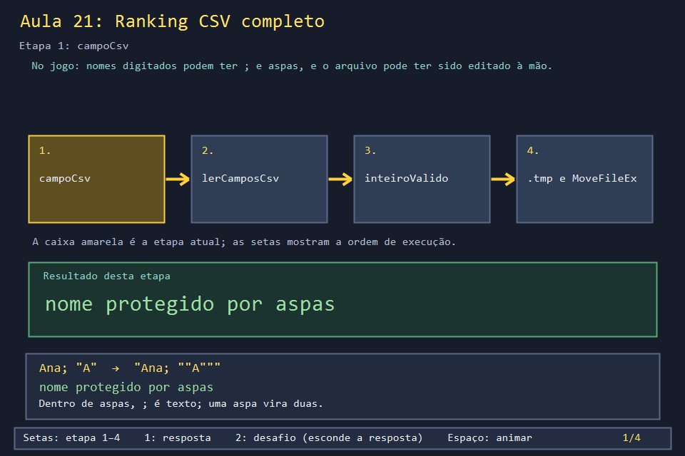
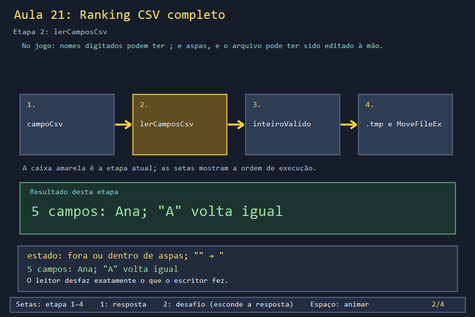
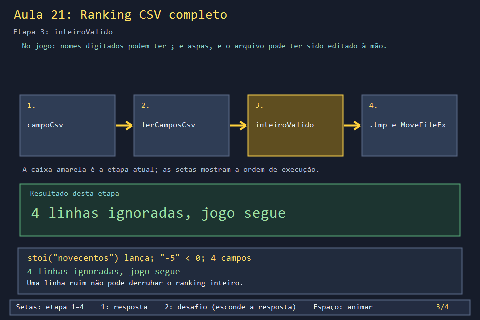
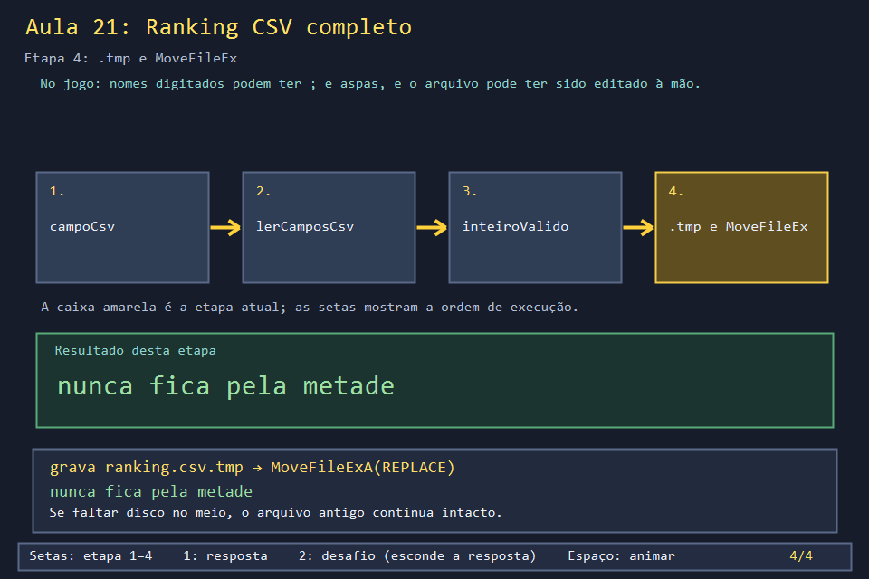

# Aula 21 — Ranking CSV completo

| Trilha | Duração | Antes desta aula | Próxima na trilha |
| --- | --- | --- | --- |
| Ranking e arquivos (13 → 21 → 32) | 75–90 min | [Aula 13](../Aula_13_ranking_csv/Aula_13_ranking_csv.md) | [Aula 32 — A tela de ranking: listar, renomear e excluir](../Aula_32_tela_de_ranking_crud/Aula_32_tela_de_ranking_crud.md) |

| A tela de nomes alimenta o ranking | O ranking com renomear e excluir |
| --- | --- |
|  |  |

A versão da Aula 13 funciona até alguém digitar um nome com `;`, editar o arquivo no Bloco de Notas ou o computador desligar no meio da gravação. O jogo real trata os três casos. Esta aula mostra como, com as funções do jogo.

## O que você vai conseguir fazer

- Escrever e ler campos CSV com aspas (`campoCsv` e `lerCamposCsv`).
- Validar números lidos de texto sem deixar uma exceção derrubar o programa.
- Explicar por que o jogo grava num `.tmp` e só depois troca o arquivo.
- Descobrir, testando, qual versão o `.bak` do jogo realmente guarda.

## 1. A ideia

```text
nome digitado:   Ana; "A"
no arquivo:      13/10/2026;"Ana; ""A""";900;4;24
                            └─ aspas protegem o ; e cada " vira ""

gravação segura:  ranking.csv.tmp  ──MoveFileExA──►  ranking.csv
                  (escreve tudo aqui)               (troca de uma vez)
```

## 2. O código real

<!-- trecho simbolo="campoCsv" -->
```cpp
// projeto_final/bomberman.cpp, linhas 680–683 (campoCsv)
string campoCsv(const string& campo){
    if(campo.find_first_of(";\"\r\n")==string::npos)return campo;
    string saida="\"";for(char c:campo){if(c=='\"')saida+='\"';saida+=c;}return saida+'\"';
}
```

O leitor é uma pequena máquina de estados: `aspas` diz se estamos dentro de um campo protegido, e `fechado` impede lixo depois da aspa final.

<!-- trecho simbolo="lerCamposCsv" -->
```cpp
// projeto_final/bomberman.cpp, linhas 684–694 (lerCamposCsv)
bool lerCamposCsv(const string& linha,vector<string>& campos){
    campos.clear();string campo;bool aspas=false,fechado=false;
    for(size_t i=0;i<linha.size();++i){char c=linha[i];
        if(aspas){if(c=='\"'){if(i+1<linha.size() && linha[i+1]=='\"'){campo+='\"';++i;}else {aspas=false;fechado=true;}}else campo+=c;}
        else if(c==';'){campos.push_back(campo);campo.clear();fechado=false;}
        else if(c=='\"'){if(!campo.empty() || fechado)return false;aspas=true;}
        else if(c!='\r'){if(fechado)return false;campo+=c;}
    }
    if(aspas)return false;
    campos.push_back(campo);return campos.size()==5;
}
```

`lerRanking` valida cada número com uma lambda e pula a linha inteira se algo estiver errado. Também consolida nomes repetidos, que podem ter sido digitados com maiúsculas diferentes:

<!-- trecho simbolo="lerRanking" -->
```cpp
// projeto_final/bomberman.cpp, linhas 727–749 (lerRanking)
vector<RegistroPontuacao> lerRanking(const string& caminhoArquivo = "") {
    vector<RegistroPontuacao> registros;
    string caminho = caminhoArquivo.empty() ? caminhoRankingUtf8() : caminhoArquivo;
    ifstream arquivo(caminho);
    if (!arquivo) return registros;
    string linha;
    while (getline(arquivo, linha)) {
        if (linha.empty()) continue;
        vector<string> campos;if(!lerCamposCsv(linha,campos))continue;
        RegistroPontuacao registro;
        registro.data=campos[0];registro.jogador=campos[1];
        auto inteiroValido=[](const string& valor,int& destino){try{size_t fim;destino=stoi(valor,&fim);return fim==valor.size() && destino>=0;}catch(...){return false;}};
        if(!inteiroValido(campos[2],registro.pontuacao) || !inteiroValido(campos[3],registro.bombas) || !inteiroValido(campos[4],registro.movimentos))continue;
        registro.jogador=limparNomeRanking(registro.jogador);
        if(registro.jogador.empty() || registro.pontuacao<0 || registro.bombas<0 || registro.movimentos<0)continue;
        auto existente=find_if(registros.begin(),registros.end(),[&](const RegistroPontuacao& r){return chaveNomeRanking(r.jogador)==chaveNomeRanking(registro.jogador);});
        if(existente==registros.end())registros.push_back(registro);
        else if(melhorRegistro(registro,*existente))*existente=registro;
    }
    sort(registros.begin(), registros.end(),
         melhorRegistro);
    return registros;
}
```

<!-- trecho simbolo="gravarRanking" -->
```cpp
// projeto_final/bomberman.cpp, linhas 702–710 (gravarRanking)
bool gravarRanking(vector<RegistroPontuacao> registros,const string& caminhoArquivo){
    sort(registros.begin(),registros.end(),melhorRegistro);
    CopyFileA(caminhoArquivo.c_str(),(caminhoArquivo+".bak").c_str(),TRUE);
    string temporario=caminhoArquivo+".tmp";ofstream arquivo(temporario,ios::trunc);
    if(!arquivo)return false;
    for(const auto& r:registros)arquivo<<campoCsv(r.data)<<';'<<campoCsv(r.jogador)<<';'<<r.pontuacao<<';'<<r.bombas<<';'<<r.movimentos<<'\n';
    arquivo.flush();if(!arquivo)return false;arquivo.close();
    return MoveFileExA(temporario.c_str(),caminhoArquivo.c_str(),MOVEFILE_REPLACE_EXISTING|MOVEFILE_WRITE_THROUGH)!=FALSE;
}
```

## 3. A versão desta aula

`Aula_21_ranking_csv_completo.cpp` copia `campoCsv`, `lerCamposCsv` e `gravarRanking`, e a parte de validação de `lerRanking`. O programa grava um nome difícil, estraga o arquivo de quatro jeitos e relê:

```text
gravado:
  13/10/2026;"Ana; ""A""";900;4;24
  13/10/2026;Bia;800;2;20
relido:
  Ana; "A" pontos=900
  Bia pontos=800
linhas ignoradas=4
```

As quatro linhas estragadas são: texto no lugar de número, número negativo, só quatro campos e aspa sem fechar.

## 4. O que mudou em relação ao jogo e por quê

| No jogo | Nesta aula | Motivo |
| --- | --- | --- |
| `limparNomeRanking` tira espaços duplos e caracteres de controle | ausente | uma limpeza a menos para acompanhar |
| `chaveNomeRanking` compara nomes sem maiúsculas, inclusive acentos (`LCMapStringEx`) | `<` simples | a ideia está na solução da Aula 13 |
| nomes em UTF-8 (`wparaStr` / `strParaW`), porque o jogo digita em `wstring` | `string` direto | codificação é assunto da Aula 30 |
| `linhasIgnoradas` não existe: o jogo só pula a linha | contador | ver o efeito |

## 5. Laboratório visual

| | |
| --- | --- |
|  |  |
|  |  |

```powershell
.\compilar_aula.ps1 -Numero 21
.\build\Aula_21_ranking_csv_completo.exe
.\abrir_aula.ps1 -Numero 21 -Modo Exemplo
```

## 6. Exercícios

1. **Previsão.** Como fica no arquivo o nome `"oi"` (com as aspas)? *(`"""oi"""`: aspas de proteção em volta, e cada aspa do nome duplicada.)* E o nome `a;b`? *(`"a;b"`.)*
2. **Mais um defeito.** O que `lerCamposCsv` faz com `14/10/2026;"Gil"x;300;1;1`? Por quê? *(Devolve `false`: há texto depois da aspa final, e `fechado` detecta isso.)*
3. **O backup.** Grave três versões seguidas usando o `CopyFileA(..., TRUE)` do jogo. O que fica no `.bak`? Troque para `FALSE` e repita. *Solução: `solucoes/`. Com `TRUE`, o `.bak` guarda a versão 1 para sempre; com `FALSE`, guarda sempre a anterior. Qual você prefere para um ranking? Escreva a justificativa.*
4. **Por que `.tmp`?** Imagine `ofstream` direto em `ranking.csv` e o jogo travando depois de gravar metade das linhas. O que o jogador vê na próxima vez? *(Um ranking pela metade, ou vazio, porque `ios::trunc` apagou o antigo antes de escrever. Com o `.tmp`, o arquivo antigo só é substituído depois que o novo está completo.)*

## 7. Erros comuns

- **Separar com `getline(..., ';')` um campo com aspas.** `Ana; "A"` vira dois campos e todos os números se deslocam. Por isso o jogo não usa `getline` para separar.
- **`stoi` sem `try`.** Uma letra no arquivo derruba o jogo inteiro. Além disso, `stoi("12abc")` devolve 12 sem reclamar; o jogo confere `fim == valor.size()` para recusar isso.
- **Confiar no nome do `.bak`.** Ele sugere "a versão anterior", mas o código guarda a primeira. Teste antes de prometer ao usuário.

## 8. Antes de seguir

- [ ] Codifiquei e decodifiquei à mão um nome com `;` e `"`.
- [ ] Sei por que cada uma das quatro linhas estragadas foi recusada.
- [ ] Rodei o exercício 3 e decidi qual comportamento de backup prefiro.

## Referências

- [RFC 4180 — formato CSV](https://www.rfc-editor.org/rfc/rfc4180)
- [`MoveFileExA` (Microsoft Learn)](https://learn.microsoft.com/en-us/windows/win32/api/winbase/nf-winbase-movefileexa)
- [`CopyFileA` e `bFailIfExists` (Microsoft Learn)](https://learn.microsoft.com/en-us/windows/win32/api/winbase/nf-winbase-copyfilea)
- [`std::stoi` e suas exceções (cppreference)](https://en.cppreference.com/w/cpp/string/basic_string/stol)
