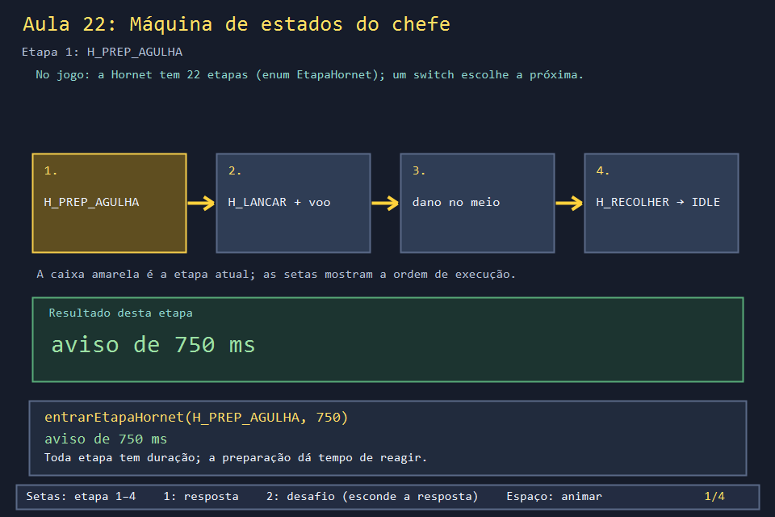
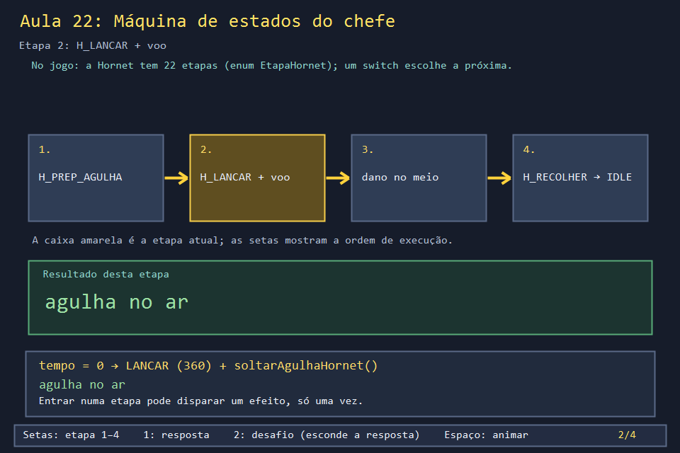
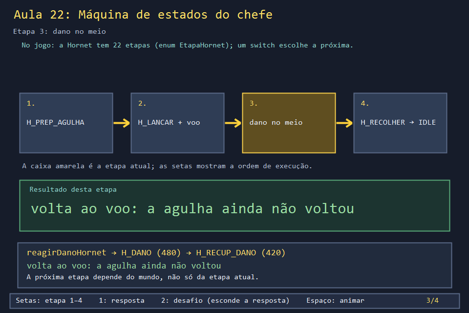
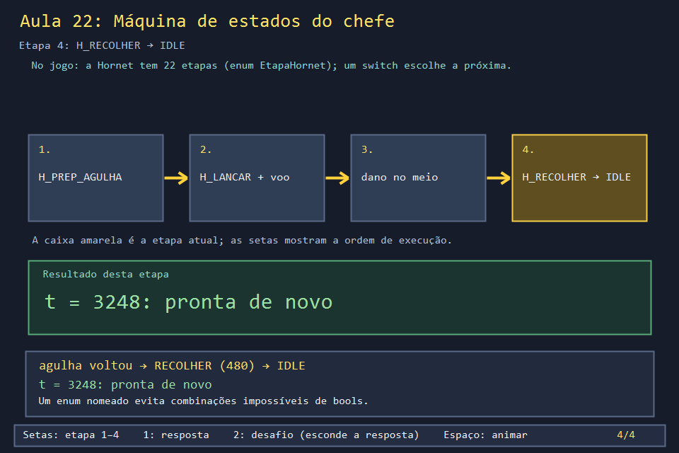

# Aula 22 — Máquina de estados do chefe

| Trilha | Duração | Antes desta aula | Próxima na trilha |
| --- | --- | --- | --- |
| Chefes e aliado (14 → 22 → 25 → 26) | 75–90 min | [Aula 14](../Aula_14_chefes_projeteis_e_mario/Aula_14_chefes_projeteis_e_mario.md) | [Aula 25 — Mario aliado e maçã](../Aula_25_mario_aliado_e_maca/Aula_25_mario_aliado_e_maca.md) |


Um chefe faz uma coisa de cada vez: prepara um ataque, ataca, se recupera, leva dano. Com uma variável `bool` para cada situação (`preparando`, `atacando`, `ferido`...), logo aparecem combinações impossíveis, como "preparando e ferido ao mesmo tempo". O jogo resolve isso com uma **máquina de estados**: um `enum` diz em que etapa a Hornet está, um contador diz quanto falta, e um `switch` decide a próxima etapa.

## O que você vai conseguir fazer

- Desenhar o diagrama de estados do ataque da agulha a partir do código.
- Explicar o trio **etapa + tempo restante + `switch` de transição**.
- Mostrar uma transição que depende do mundo (a agulha ainda está no ar?) e não só do relógio.
- Acrescentar um ramo novo (guarda e contra-ataque) sem quebrar os existentes.

## 1. A ideia

```text
                   750 ms              360 ms              até a agulha voltar        480 ms
   H_IDLE ──► H_PREP_AGULHA ──► H_LANCAR ──► H_VOO_AGULHA ───────────────► H_RECOLHER ──► H_IDLE
                                  │ solta a agulha    │
                                                      │ bomba acerta
                                                      ▼
                                                   H_DANO ──480──► H_RECUP_DANO ──420──┐
                                                                     agulha no ar? ─sim─┘► H_VOO_AGULHA
                                                                                 └não──► H_IDLE
```

Três peças fazem tudo funcionar:

1. `entrarEtapaHornet(etapa, duracao)` é o **único** jeito de trocar de etapa.
2. A cada passo, o tempo da etapa diminui; enquanto for maior que zero, nada acontece.
3. Quando chega a zero, o `switch` escolhe a próxima etapa e, às vezes, dispara um efeito (soltar a agulha, soltar fios).

## 2. O código real

<!-- trecho simbolo="EtapaHornet" de="enum EtapaHornet" ate="H_DANO,H_RECUP_DANO };" -->
```cpp
// projeto_final/bomberman.cpp, linhas 109–111 (EtapaHornet)
enum EtapaHornet { H_IDLE,H_CORRIDA,H_PREP_AGULHA,H_LANCAR,H_VOO_AGULHA,H_RECOLHER,
    H_PREP_DASH,H_DASH,H_RECUP_DASH,H_PREP_SALTO,H_SALTO,H_PREP_GIRO,H_GIRO,H_POUSO,
    H_PREP_AEREO,H_AEREO,H_RECUP_AEREO,H_GUARDA,H_CONTRA,H_RECUP_CONTRA,H_DANO,H_RECUP_DANO };
```

<!-- trecho simbolo="entrarEtapaHornet" -->
```cpp
// projeto_final/bomberman.cpp, linhas 1565–1567 (entrarEtapaHornet)
void entrarEtapaHornet(EtapaHornet etapa,int duracao){
    boss.etapaHornet=etapa;boss.tempoEtapaHornetMs=duracao;boss.duracaoEtapaHornetMs=duracao;
}
```

<!-- trecho simbolo="reagirDanoHornet" -->
```cpp
// projeto_final/bomberman.cpp, linhas 1568–1574 (reagirDanoHornet)
void reagirDanoHornet(){
    if(indiceBoss()!=2 || boss.vida<=0)return;
    boss.contraPendenteHornet=boss.contraPendenteHornet || boss.etapaHornet==H_GUARDA;
    // Termina o deslocamento no destino antes da recuperacao, sem teleportar.
    if(boss.movendo || hornetNoAr())return;
    entrarEtapaHornet(H_DANO,480);
}
```

O coração da máquina: as etapas com tempo descontam, e o `switch` decide. Repare no `[[fallthrough]]`, um `case` que cai de propósito no `default`:

<!-- trecho simbolo="atualizarHornet" de="if(boss.tempoEtapaHornetMs>0)continue;" ate="boss.tempoProximoMovimentoMs=1200;boss.tempoProximoAtaqueMs" -->
```cpp
// projeto_final/bomberman.cpp, linhas 2031–2056 (atualizarHornet)
        if(boss.tempoEtapaHornetMs>0)continue;
        switch(boss.etapaHornet){
            case H_PREP_AGULHA:entrarEtapaHornet(H_LANCAR,360);soltarAgulhaHornet();break;
            case H_LANCAR:entrarEtapaHornet(H_VOO_AGULHA,3000);break;
            case H_VOO_AGULHA:entrarEtapaHornet(H_RECOLHER,480);break;
            case H_PREP_DASH:case H_PREP_AEREO:{bool aereo=boss.etapaHornet==H_PREP_AEREO;
                boss.avisoInvestidaMs=0;abrirPassagemBoss(boss.destino);boss.movendo=true;
                entrarEtapaHornet(aereo?H_AEREO:H_DASH,0);break;}
            case H_PREP_SALTO:entrarEtapaHornet(H_SALTO,550);break;
            case H_SALTO:entrarEtapaHornet(H_PREP_GIRO,420);break;
            case H_PREP_GIRO:entrarEtapaHornet(H_GIRO,660);soltarFiosHornet(dificuldade==FACIL?6:8);break;
            case H_GIRO:entrarEtapaHornet(H_POUSO,500);break;
            case H_GUARDA:
                if(hypot(jogadorVisualL-boss.visualL-.5f,jogadorVisualC-boss.visualC-.5f)<3.f){entrarEtapaHornet(H_CONTRA,630);soltarFiosHornet(4);}
                else entrarEtapaHornet(H_RECUP_CONTRA,480);
                break;
            case H_CONTRA:entrarEtapaHornet(H_RECUP_CONTRA,480);break;
            case H_DANO:entrarEtapaHornet(H_RECUP_DANO,420);break;
            case H_RECUP_DANO:
                if(boss.contraPendenteHornet){boss.contraPendenteHornet=false;entrarEtapaHornet(H_CONTRA,630);soltarFiosHornet(4);break;}
                if(any_of(projeteisBoss.begin(),projeteisBoss.end(),[](const ProjetilBoss& p){return p.poder==AGULHA && p.vida>0;})){
                    entrarEtapaHornet(H_VOO_AGULHA,3000);break;}
                // Recuperacao comum abaixo.
                [[fallthrough]];
            default:boss.alturaHornet=0;entrarEtapaHornet(H_IDLE,0);
                boss.tempoProximoMovimentoMs=1200;boss.tempoProximoAtaqueMs=max(1000,boss.tempoProximoAtaqueMs);break;
```

E quem escolhe **qual** ataque começa é `criarPoderBoss`, quando a Hornet está parada (`H_IDLE`) e o tempo do próximo ataque acaba:

<!-- trecho simbolo="criarPoderBoss" de="if(indiceBoss()==2){" ate="case 5:entrarEtapaHornet(H_GUARDA,1200);break;" -->
```cpp
// projeto_final/bomberman.cpp, linhas 1850–1862 (criarPoderBoss)
    if(indiceBoss()==2){
        if(boss.etapaHornet!=H_IDLE || boss.movendo){--boss.sequenciaAtaque;return;}
        boss.acaoEspecial=(boss.sequenciaAtaque-1)%5+1;
        boss.olhandoDireita=jogadorVisualC>boss.visualC;
        boss.tempoProximoAtaqueMs=INTERVALO_ATAQUE_BOSS_MS;
        switch(boss.acaoEspecial){
            case 1:entrarEtapaHornet(H_PREP_AGULHA,750);break;
            case 2:case 4:
                if(prepararInvestidaBoss())entrarEtapaHornet(boss.acaoEspecial==2?H_PREP_DASH:H_PREP_AEREO,1000);
                else {boss.acaoEspecial=0;boss.tempoProximoAtaqueMs=1000;}
                break;
            case 3:entrarEtapaHornet(H_PREP_SALTO,350);break;
            case 5:entrarEtapaHornet(H_GUARDA,1200);break;
```

## 3. A versão desta aula

`Aula_22_maquina_de_estados_boss.cpp` tem sete das 22 etapas, com os mesmos nomes, durações e funções (`entrarEtapaHornet`, `reagirDanoHornet`, `atualizarHornet`). A agulha é só um contador de tempo no ar. Uma bomba acerta a Hornet em t = 1296:

```text
t=  16  H_IDLE        -> H_PREP_AGULHA
t= 768  H_PREP_AGULHA -> H_LANCAR
t=1136  H_LANCAR      -> H_VOO_AGULHA
t=1296  ** bomba acerta a Hornet **
t=1296  H_VOO_AGULHA  -> H_DANO
t=1760  H_DANO        -> H_RECUP_DANO
t=2192  H_RECUP_DANO  -> H_VOO_AGULHA
t=2768  H_VOO_AGULHA  -> H_RECOLHER
t=3248  H_RECOLHER    -> H_IDLE
```

A linha de t = 2192 é a mais importante. A recuperação terminou, mas a agulha ainda está voando. Por isso a Hornet volta a esperá-la (`H_VOO_AGULHA`) em vez de ficar parada com a agulha perdida no mapa.

## 4. O que mudou em relação ao jogo e por quê

| No jogo | Nesta aula | Motivo |
| --- | --- | --- |
| 22 etapas: corrida, investida, salto, giro, voo aéreo, guarda... | 7 | o padrão é o mesmo em todas |
| a agulha é um `ProjetilBoss` que vai, para e volta | um contador `agulhaNoArMs` | o movimento é da Aula 14 |
| `reagirDanoHornet` ignora o dano visual se ela estiver se movendo ou no ar | sempre reage | menos condições para acompanhar |
| os outros quatro chefes usam campos mais simples (`acaoEspecial`, `animAtaqueMs`) | não aparecem | a Aula 26 mostra cada um |

## 5. Laboratório visual

| | |
| --- | --- |
|  |  |
|  |  |

```powershell
.\compilar_aula.ps1 -Numero 22
.\build\Aula_22_maquina_de_estados_boss.exe
.\abrir_aula.ps1 -Numero 22 -Modo Exemplo
```

## 6. Exercícios

1. **Previsão.** Se a bomba acertasse em t = 400 (durante `H_PREP_AGULHA`), a Hornet chegaria a lançar a agulha? *(Não. Ela vai para `H_DANO`, e o `case H_PREP_AGULHA` nunca roda. Depois da recuperação, sem agulha no ar, volta a `H_IDLE`. Confira mudando `1296` para `400`.)*
2. **Novo ramo.** Implemente a guarda: `H_GUARDA` (1200 ms) termina em `H_CONTRA` (630 ms) se o jogador estiver a menos de 3 casas, ou em `H_RECUP_CONTRA` (480 ms) se estiver longe. Um acerto **durante** a guarda deixa um contra-ataque pendente para depois da recuperação. *Solução: `solucoes/` — três cenários: perto, longe e acertada na guarda.*
3. **Desenhe.** A partir do `switch` real, desenhe o caminho do salto: `H_PREP_SALTO → ? → ? → ? → H_IDLE`, com as durações. *(`H_PREP_SALTO` 350 → `H_SALTO` 550 → `H_PREP_GIRO` 420 → `H_GIRO` 660 (solta 6 ou 8 fios) → `H_POUSO` 500 → `H_IDLE`.)*
4. **Por que um enum?** Reescreva mentalmente a máquina com quatro `bool` (`preparando`, `lancando`, `ferido`, `recolhendo`). Quantas combinações eles permitem? Quantas fazem sentido? *(16 combinações, das quais só 5 fazem sentido: nenhum, ou exatamente um. O `enum` só aceita estados válidos.)*

## 7. Erros comuns

- **Trocar de etapa escrevendo `boss.etapaHornet = ...` direto.** O tempo da etapa anterior fica no contador, e a nova etapa "herda" um tempo errado. Use sempre `entrarEtapaHornet`.
- **Disparar o efeito todo passo.** Se `soltarAgulhaHornet()` ficasse fora do `case`, sairia uma agulha a cada 16 ms. Efeitos vão na **transição**.
- **`fallthrough` acidental.** Esquecer o `break` faz um `case` cair no seguinte sem querer. O jogo marca o único proposital com `[[fallthrough]]`, e o compilador avisa nos outros com `-Wimplicit-fallthrough`.

## 8. Antes de seguir

- [ ] Desenhei o diagrama do ataque da agulha sem olhar.
- [ ] Expliquei por que a linha de t = 2192 volta ao voo.
- [ ] Implementei a guarda (exercício 2) e os três cenários bateram com a solução.

## Referências

- [State pattern — Game Programming Patterns, Robert Nystrom](https://gameprogrammingpatterns.com/state.html) (gratuito online; o capítulo mais citado sobre o assunto)
- [`[[fallthrough]]` (cppreference)](https://en.cppreference.com/w/cpp/language/attributes/fallthrough)
- Aula 26: os cinco chefes com sprites e poderes reais.
