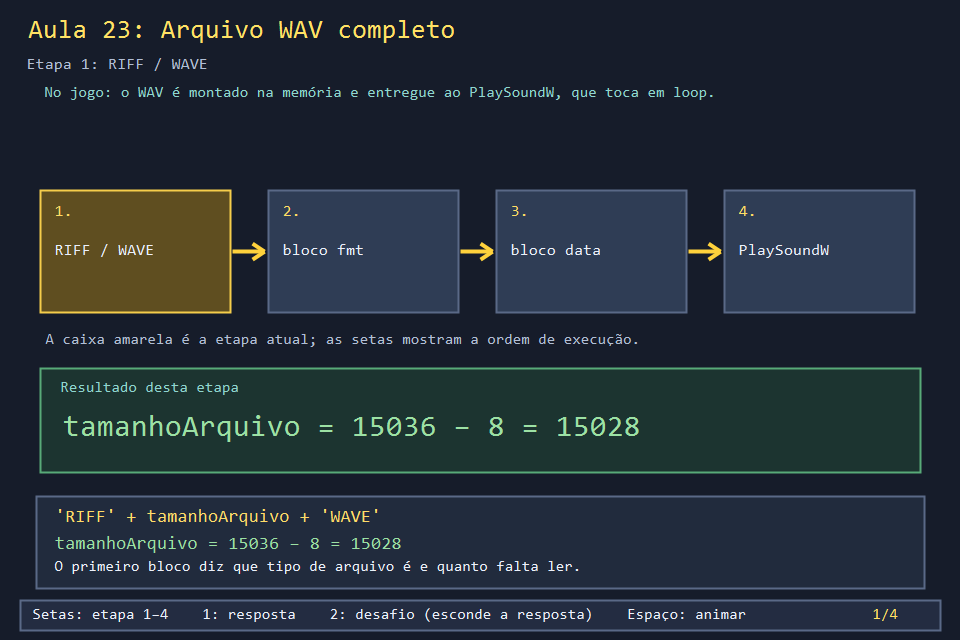
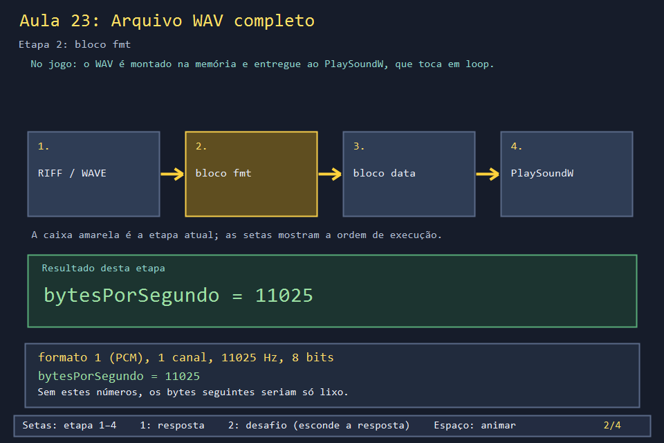
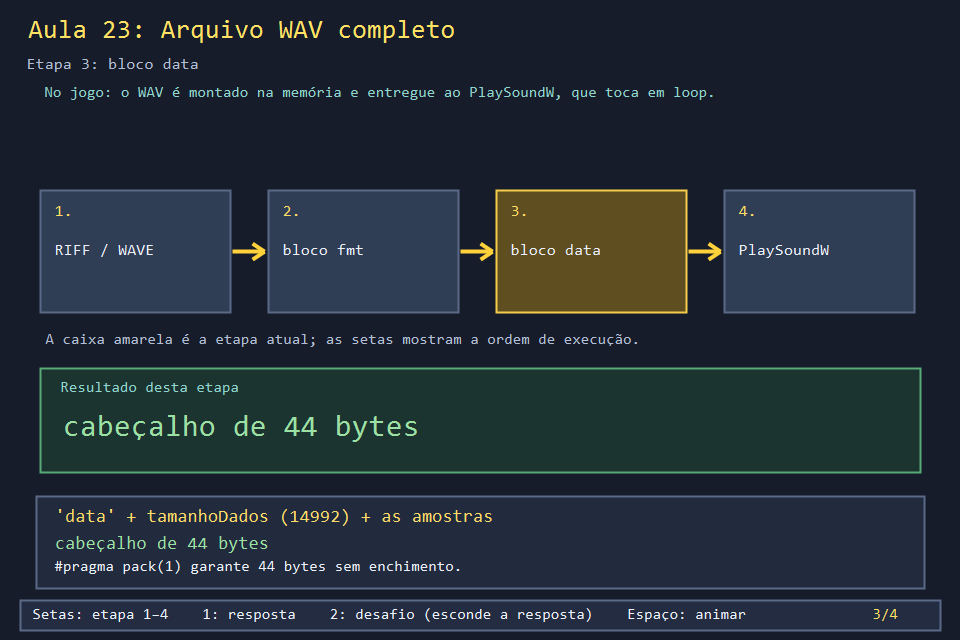
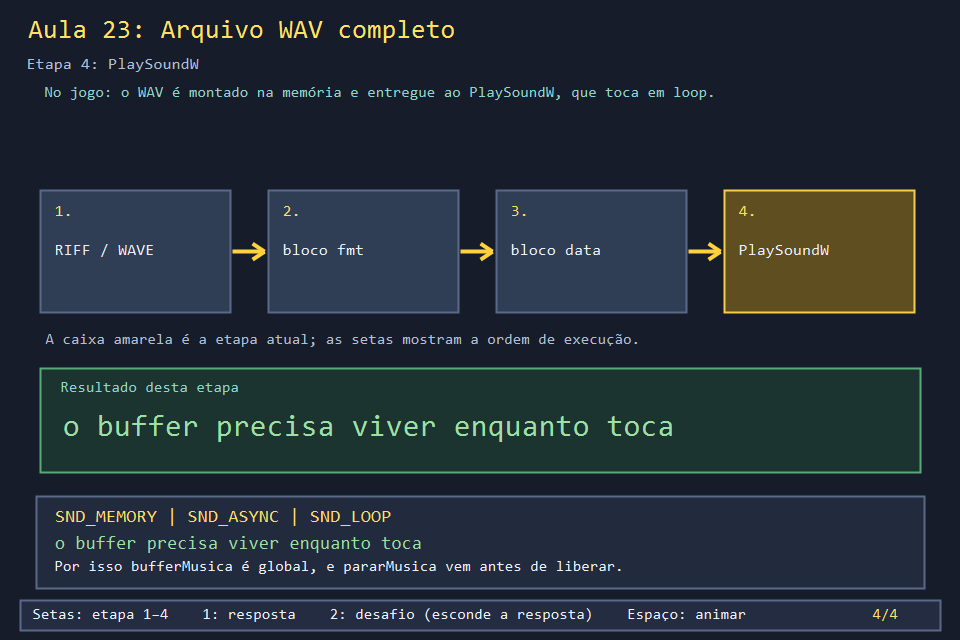

# Aula 23 — Arquivo WAV completo e reprodução

| Trilha | Duração | Antes desta aula | Próxima na trilha |
| --- | --- | --- | --- |
| Áudio (15 → 23) | 60–75 min | [Aula 15](../Aula_15_audio_wav_e_recursos/Aula_15_audio_wav_e_recursos.md) | fim da trilha; o ciclo de vida dos recursos continua na [Aula 24](../Aula_24_backbuffer_dpi_recursos/Aula_24_backbuffer_dpi_recursos.md) |

Na Aula 15, a música virou 14 992 números. Mas um tocador não sabe o que fazer com números soltos: precisa saber quantas amostras por segundo, quantos bits, quantos canais. Um arquivo **WAV** é exatamente isso: um cabeçalho de 44 bytes com essas informações, seguido das amostras. O jogo monta esse arquivo inteiro na memória e o entrega ao Windows para tocar em loop.

## O que você vai conseguir fazer

- Ler a struct `CabecalhoWav` e explicar cada um dos 13 campos.
- Explicar por que `#pragma pack(1)` é necessário.
- Tocar um WAV a partir da memória com `PlaySoundW` e `SND_MEMORY`.
- Explicar por que o buffer da música precisa "viver" enquanto ela toca.

## 1. A ideia

```text
byte 0           12              36                44                         15036
     ┌─ RIFF ──┬─ fmt  (24 bytes) ─┬─ data (8) ──┬─ amostras (14 992 bytes) ──┐
     │RIFF size│fmt  16 1 1 11025 │data 14992   │168 168 167 ... 88 88 ...   │
     │    WAVE │11025 1 8         │             │                            │
     └─────────┴──────────────────┴─────────────┴────────────────────────────┘
```

## 2. O código real

<!-- trecho de="#pragma pack(push, 1)" ate="#pragma pack(pop)" -->
```cpp
// projeto_final/bomberman.cpp, linhas 2701–2717
#pragma pack(push, 1)
struct CabecalhoWav {
    char riff[4] = {'R', 'I', 'F', 'F'};
    uint32_t tamanhoArquivo = 0;
    char onda[4] = {'W', 'A', 'V', 'E'};
    char fmt[4] = {'f', 'm', 't', ' '};
    uint32_t tamanhoFmt = 16;
    uint16_t formato = 1; // PCM
    uint16_t canais = 1;
    uint32_t amostragem = 11025;
    uint32_t bytesPorSegundo = 11025;
    uint16_t alinhamentoBloco = 1;
    uint16_t bitsPorAmostra = 8;
    char dataTag[4] = {'d', 'a', 't', 'a'};
    uint32_t tamanhoDados = 0;
};
#pragma pack(pop)
```

Os valores padrão dos campos já descrevem a música do jogo: só os dois tamanhos são preenchidos depois de gerar as amostras (veja o fim de `gerarMusicaProcedural` na Aula 15).

Para tocar, o jogo guarda o arquivo num vetor **global** e passa o endereço dele para `PlaySoundW`:

<!-- trecho de="// Precisa ficar viva enquanto a musica toca" ate="    PlaySoundW(nullptr, nullptr, 0);" -->
```cpp
// projeto_final/bomberman.cpp, linhas 2753–2764
// Precisa ficar viva enquanto a musica toca (PlaySound com SND_MEMORY le
// direto deste buffer, inclusive repetidamente por causa do SND_LOOP).
vector<unsigned char> bufferMusica;

void iniciarMusica() {
    bufferMusica = gerarMusicaProcedural();
    PlaySoundW(reinterpret_cast<LPCWSTR>(bufferMusica.data()), nullptr,
              SND_MEMORY | SND_ASYNC | SND_LOOP | SND_NODEFAULT);
}

void pararMusica() {
    PlaySoundW(nullptr, nullptr, 0);
```

Com `SND_ASYNC`, `PlaySoundW` volta na hora e o som continua tocando em segundo plano, lendo do vetor. Se o vetor fosse uma variável local de `iniciarMusica`, seria destruído no fim da função, e o Windows leria memória já liberada. A música é ligada em `WM_CREATE`, parada em `WM_DESTROY` antes de liberar o resto (Aula 03), e religada quando o Modo Insano fecha (Aula 17).

## 3. A versão desta aula

`Aula_23_wav_pcm_completo.cpp` tem `CabecalhoWav` e `gerarMusicaProcedural` iguais aos do jogo. Ele relê o cabeçalho do próprio buffer, grava uma cópia em `som_aula.wav` e toca **uma vez** (`SND_SYNC`):

```text
cabecalho=44 bytes, dados=14992 bytes, arquivo=15036 bytes
campo tamanhoArquivo=15028 (= arquivo - 8)
duracao=1.36 s (dados / bytesPorSegundo)
gravado som_aula.wav (abra num player para ouvir de novo)
```

Abra `som_aula.wav` em qualquer tocador: é exatamente a música do menu.

## 4. O que mudou em relação ao jogo e por quê

| No jogo | Nesta aula | Motivo |
| --- | --- | --- |
| `SND_ASYNC \| SND_LOOP`: toca para sempre em segundo plano | `SND_SYNC`: toca uma vez e espera | um programa de console terminaria antes do som |
| nenhum arquivo em disco | grava `som_aula.wav` | para abrir num tocador e num editor hexadecimal |
| sempre toca | não toca se `CURSO_BOMBERMAN_SEM_SOM` estiver definida | a validação automática roda em silêncio |

## 5. Laboratório visual

| | |
| --- | --- |
|  |  |
|  |  |

```powershell
.\compilar_aula.ps1 -Numero 23
.\build\Aula_23_wav_pcm_completo.exe
.\abrir_aula.ps1 -Numero 23 -Modo Exemplo      # toca 1,36 s de música
```

## 6. Exercícios

1. **Previsão.** Se a música fosse 16 bits, quais campos do cabeçalho mudariam, e para quanto? *(`bitsPorAmostra` = 16, `alinhamentoBloco` = 2, `bytesPorSegundo` = 22 050, `tamanhoDados` = 29 984, `tamanhoArquivo` = 30 020. As amostras também passariam a ter sinal: silêncio em 0.)*
2. **Sem `pack`.** Comente `#pragma pack(push, 1)` e `#pragma pack(pop)` e compile. O `static_assert` reclama? *(Neste struct, não: os campos já caem alinhados e o tamanho continua 44. Troque a ordem de dois campos, por exemplo `canais` antes de `tamanhoFmt`, e o compilador passa a inserir enchimento: aí o `static_assert` falha. É por isso que ele está ali.)*
3. **Leitor.** Escreva `validar`, que confere as quatro marcas, o formato PCM, a coerência de `bytesPorSegundo` e os tamanhos, e recusa um arquivo cortado. *Solução: `solucoes/` — aceita `som_aula.wav` (1,36 s) e recusa uma cópia truncada em 2000 bytes.*
4. **Leitura.** Em `processarMensagem`, encontre os três lugares onde a música liga ou para. *(`WM_CREATE` → `iniciarMusica`; `WM_TIMER`, quando o Modo Insano fecha → `iniciarMusica`; `WM_DESTROY` → `pararMusica`. E `iniciarModoInsano` chama `pararMusica` antes de esconder a janela.)*

## 7. Erros comuns

- **Buffer local com `SND_ASYNC`.** Funciona às vezes, toca lixo outras vezes e trava de vez em quando, conforme o que reaproveita aquela memória. O jogo evita isso com o vetor global e um comentário explicando.
- **`tamanhoArquivo` = tamanho total.** O campo conta a partir do byte 8: é `total - 8`. Muitos tocadores toleram o erro; outros recusam o arquivo.
- **Esquecer `-lwinmm`.** `PlaySoundW` está na biblioteca `winmm`. Sem ela, o linker reclama de `undefined reference to PlaySoundW`.

## 8. Antes de seguir

- [ ] Marquei no diagrama da seção 1 onde estão os valores 15 028, 11 025 e 14 992.
- [ ] Sei explicar por que `bufferMusica` é global.
- [ ] Ouvi `som_aula.wav` num tocador e validei o arquivo com a solução.

## Referências

- [Formato WAVE (especificação resumida, Stanford CCRMA)](http://soundfile.sapp.org/doc/WaveFormat/)
- [`PlaySound` (Microsoft Learn)](https://learn.microsoft.com/en-us/previous-versions/dd743680(v=vs.85))
- [`#pragma pack` (GCC)](https://gcc.gnu.org/onlinedocs/gcc/Structure-Layout-Pragmas.html)
