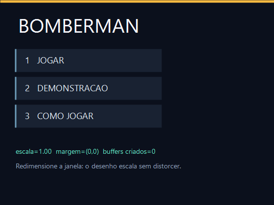
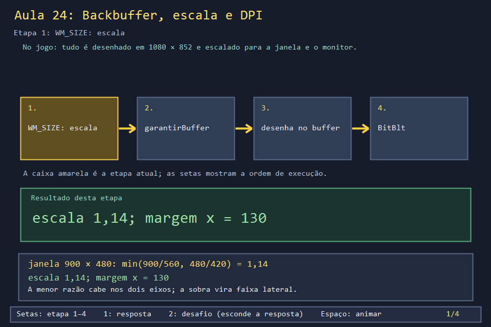
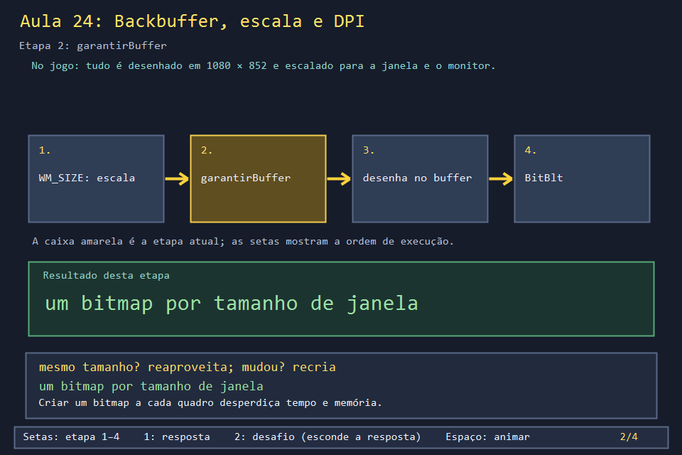
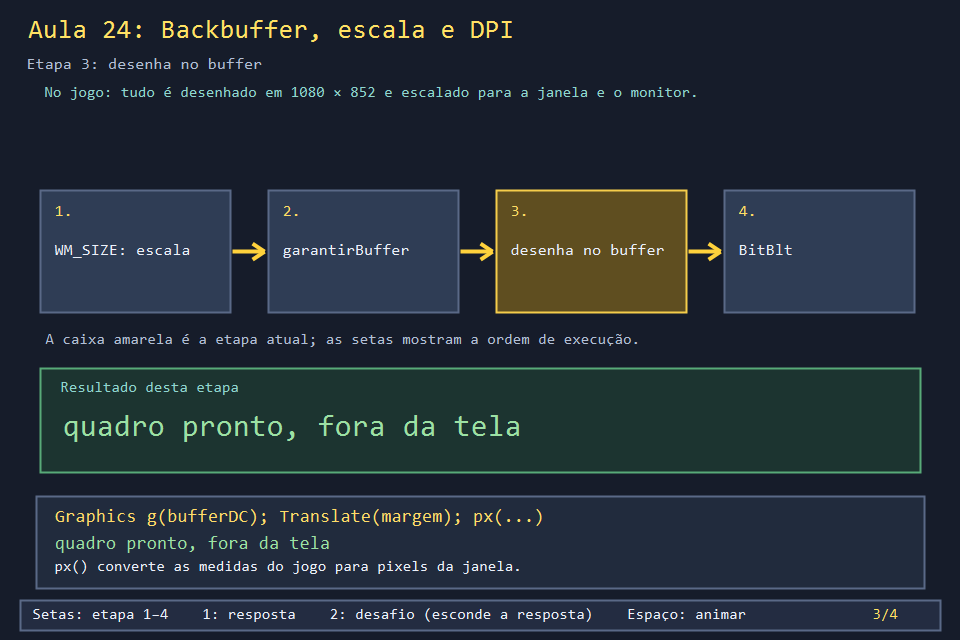
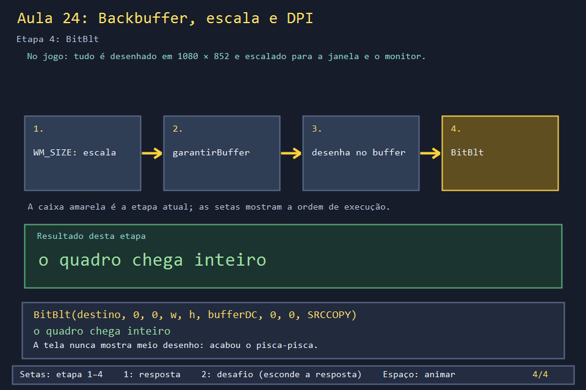

# Aula 24 — Backbuffer, escala e DPI

| Trilha | Duração | Antes desta aula | Próxima na trilha |
| --- | --- | --- | --- |
| Janela e desenho (03 → 04 → 05 → 24) | 75–90 min | [Aula 04](../Aula_04_formas_cores_e_gdiplus/Aula_04_formas_cores_e_gdiplus.md), [Aula 05](../Aula_05_recorte_de_sprite_sheet/Aula_05_recorte_de_sprite_sheet.md) | fim da trilha; o fluxo completo de desenho está na [Aula 17](../Aula_17_leitura_orientada_do_jogo_real/Aula_17_leitura_orientada_do_jogo_real.md) |

| O jogo real (1080 × 852 de projeto) | O exemplo desta aula |
| --- | --- |
|  |  |

O jogo foi desenhado para uma tela de 1080 × 852. Mas o jogador pode maximizar a janela, usar um notebook com escala de 150% ou arrastar o jogo para um segundo monitor. Três técnicas fazem o desenho continuar nítido, sem distorção e sem piscar: o **backbuffer**, a **escala com faixas laterais** e a resposta à **mudança de DPI**.

## O que você vai conseguir fazer

- Explicar por que desenhar direto na janela pisca, e como o backbuffer resolve.
- Reaproveitar o buffer entre quadros e só recriá-lo quando o tamanho muda.
- Calcular escala e margens para manter a proporção do jogo em qualquer janela.
- Converter um clique do mouse de pixels da janela para coordenadas do jogo.

## 1. A ideia

```text
janela 900 × 480                                  coordenadas do jogo (560 × 420)
┌────────┬──────────────────────────┬────────┐
│ faixa  │  desenho escalado 1,14×   │ faixa  │    escala = min(900/560, 480/420) = 1,14
│ 130 px │       640 × 480           │ 130 px │    margem = (900 − 640) / 2 = 130
└────────┴──────────────────────────┴────────┘    px(v) = v × escala
```

O desenho é feito **inteiro** num bitmap fora da tela (o backbuffer) e copiado de uma vez com `BitBlt`. A janela nunca mostra um quadro pela metade.

## 2. O código real

<!-- trecho simbolo="garantirBuffer" -->
```cpp
// projeto_final/bomberman.cpp, linhas 2818–2826 (garantirBuffer)
void garantirBuffer(HDC referencia, int largura, int altura) {
    if (bufferDC && bufferLargura == largura && bufferAltura == altura) return;
    liberarBuffer();
    bufferDC = CreateCompatibleDC(referencia);
    bufferBitmap = CreateCompatibleBitmap(referencia, largura, altura);
    SelectObject(bufferDC, bufferBitmap);
    bufferLargura = largura;
    bufferAltura = altura;
}
```

<!-- trecho simbolo="liberarBuffer" -->
```cpp
// projeto_final/bomberman.cpp, linhas 2767–2772 (liberarBuffer)
void liberarBuffer() {
    if (bufferDC) { DeleteDC(bufferDC); bufferDC = nullptr; }
    if (bufferBitmap) { DeleteObject(bufferBitmap); bufferBitmap = nullptr; }
    bufferLargura = 0;
    bufferAltura = 0;
}
```

<!-- trecho simbolo="ajustarAreaDesenho" -->
```cpp
// projeto_final/bomberman.cpp, linhas 3986–3997 (ajustarAreaDesenho)
void ajustarAreaDesenho(int largura, int altura) {
    if(largura<=0 || altura<=0) return;
    float escala = min(static_cast<float>(largura)/LARGURA_JOGO,static_cast<float>(altura)/ALTURA_JOGO);
    if(abs(escala-escalaDpi)>.0001f) {
        escalaDpi=escala;
        cacheFontes.clear();
        invalidarCacheMapa();
        cacheSpriteBoss.reset();
    }
    margemJanelaX=(largura-px(LARGURA_JOGO))/2;
    margemJanelaY=(altura-px(ALTURA_JOGO))/2;
}
```

<!-- trecho de="int px(int valor)" ate="float px(float valor)" -->
```cpp
// projeto_final/bomberman.cpp, linhas 2529–2530
int px(int valor) { return static_cast<int>(valor * escalaDpi + 0.5f); }
float px(float valor) { return valor * escalaDpi; }
```

O `desenhar` real junta tudo: garante o buffer, desloca pela margem, desenha a tela da vez (menu ou partida) e copia com um único `BitBlt`:

<!-- trecho simbolo="desenhar" -->
```cpp
// projeto_final/bomberman.cpp, linhas 3999–4035 (desenhar)
void desenhar(HWND janela) {
    PAINTSTRUCT ps;
    HDC destino = BeginPaint(janela, &ps);
    RECT cliente;
    GetClientRect(janela, &cliente);
    ajustarAreaDesenho(cliente.right,cliente.bottom);
    garantirBuffer(destino, cliente.right, cliente.bottom);
    Gdiplus::Graphics g(bufferDC);
    g.TranslateTransform(static_cast<float>(margemJanelaX),static_cast<float>(margemJanelaY));
    g.SetSmoothingMode(Gdiplus::SmoothingModeAntiAlias);
    g.SetInterpolationMode(Gdiplus::InterpolationModeNearestNeighbor);
    g.SetPixelOffsetMode(Gdiplus::PixelOffsetModeHalf);
    fundoInterface(g);
    if (modo == MENU) {
        switch (telaMenu) {
            case MENU_FASES: desenharSeletorFases(g); break;
            case MENU_PERSONAGENS: desenharPersonagens(g); break;
            case MENU_RANKING: desenharRanking(g); break;
            case MENU_DIFICULDADE: desenharEscolhaDificuldade(g); break;
            case MENU_DIFICULDADES_INFO: desenharEscolhaDificuldade(g); break;
            case MENU_COMO_JOGAR: desenharComoJogar(g); break;
            case MENU_PONTUACAO: desenharPontuacaoInfo(g); break;
            case MENU_QUANTIDADE_JOGADORES: desenharQuantidadeJogadores(g); break;
            case MENU_ATRIBUICAO_CONTROLES: desenharAtribuicaoControles(g); break;
            case MENU_NOMES: desenharNomes(g); break;
            default: desenharMenu(g); break;
        }
    } else {
        desenharHUD(g);
        desenharMapa(g);
        desenharPainelLateral(g);
        desenharRodape(g);
        desenharFimPartida(g);
    }
    BitBlt(destino, 0, 0, cliente.right, cliente.bottom, bufferDC, 0, 0, SRCCOPY);
    EndPaint(janela, &ps);
}
```

E o DPI: o processo se declara "consciente de DPI por monitor" e, quando a janela muda de monitor, recalcula a escala e aceita o tamanho sugerido pelo Windows:

<!-- trecho simbolo="tornarAplicacaoDpiAware" -->
```cpp
// projeto_final/bomberman.cpp, linhas 4410–4412 (tornarAplicacaoDpiAware)
void tornarAplicacaoDpiAware() {
    SetProcessDpiAwarenessContext(DPI_AWARENESS_CONTEXT_PER_MONITOR_AWARE_V2);
}
```

<!-- trecho simbolo="processarMensagem" de="case WM_DPICHANGED: {" ate="SWP_NOZORDER | SWP_NOACTIVATE);" -->
```cpp
// projeto_final/bomberman.cpp, linhas 4384–4391 (processarMensagem)
    case WM_DPICHANGED: {
        RECT* sugerido = reinterpret_cast<RECT*>(lParam);
        atualizarEscalaDpi(janela);
        RECT area{0, 0, px(LARGURA_JOGO), px(ALTURA_JOGO)};
        AdjustWindowRect(&area, WS_OVERLAPPEDWINDOW, FALSE);
        if(!IsZoomed(janela)) SetWindowPos(janela, nullptr, sugerido->left, sugerido->top,
                     area.right-area.left, area.bottom-area.top,
                     SWP_NOZORDER | SWP_NOACTIVATE);
```

## 3. A versão desta aula

`Aula_24_backbuffer_dpi_recursos.cpp` tem `garantirBuffer`, `liberarBuffer`, `ajustarAreaDesenho` e `px` com o corpo do jogo, e desenha o pedaço de menu da Aula 04 numa área de 560 × 420. A tela mostra a escala, as margens e **quantos buffers já foram criados**.

Rode, redimensione a janela algumas vezes e observe:

- o menu cresce e encolhe sem esticar, e as faixas pretas aparecem do lado que sobra;
- `buffers criados` só aumenta quando o tamanho muda, não a cada repintura;
- num monitor com escala de 125% ou 150%, o texto continua nítido.

## 4. O que mudou em relação ao jogo e por quê

| No jogo | Nesta aula | Motivo |
| --- | --- | --- |
| `atualizarEscalaDpi` também limita a janela ao tamanho útil do monitor | escala só pela janela | menos contas para acompanhar |
| caches de fontes, mapa e sprites escalados são invalidados quando a escala muda | sem caches | os caches são otimizações; a regra é a mesma |
| `WM_GETMINMAXINFO` impede a janela de ficar menor que 640 × 520 | sem limite | experimente janelas minúsculas e veja o que acontece |
| `WM_DPICHANGED` não redimensiona se a janela estiver maximizada | sempre redimensiona | idem |

## 5. Laboratório visual

| | |
| --- | --- |
|  |  |
|  |  |

```powershell
.\compilar_aula.ps1 -Numero 24
.\build\Aula_24_backbuffer_dpi_recursos.exe       # diagrama
.\abrir_aula.ps1 -Numero 24 -Modo Exemplo         # a janela redimensionável
```

## 6. Exercícios

1. **Contas.** Para uma janela de 1920 × 1080 e o jogo real (1080 × 852), calcule a escala e as margens. *(min(1,778; 1,268) = 1,268; largura desenhada = 1369; margem x = 275, margem y = 0.)*
2. **Clique.** Implemente `WM_LBUTTONUP`: converta o clique para coordenadas do jogo com `(x - margem) / escala` e destaque o cartão clicado. Teste em tamanhos diferentes. *Solução: `solucoes/`. Compare com o `WM_LBUTTONUP` real, que faz a mesma conta.*
3. **Sem backbuffer.** Troque `Graphics g(bufferDC)` por `Graphics g(destino)` e apague o `BitBlt`. Redimensione rápido. O que você vê? *(Pisca: o fundo e os cartões aparecem em momentos diferentes. Com `WM_ERASEBKGND` devolvendo 0, pisca mais ainda.)*
4. **Vazamento.** O que aconteceria se `garantirBuffer` não chamasse `liberarBuffer` antes de criar o novo? *(Cada redimensionamento deixaria um bitmap e um DC perdidos. O Gerenciador de Tarefas, na coluna "Objetos GDI", mostra o número subindo; perto de 10 000, o Windows recusa criar novos.)*

## 7. Erros comuns

- **Criar o bitmap dentro de `WM_PAINT` toda vez.** Funciona, mas aloca e libera megabytes a cada quadro. O jogo cria só quando o tamanho muda.
- **Esquecer `WM_ERASEBKGND`.** O Windows pinta o fundo com a cor da classe antes de cada `WM_PAINT`, e o resultado é um flash.
- **Escalar posições e esquecer as fontes.** O texto fica pequeno numa tela grande. O jogo passa o tamanho da fonte por `px()` também.
- **Não se declarar DPI-aware.** O Windows desenha em 96 DPI e amplia a imagem pronta: tudo fica borrado em telas de 150%.

## 8. Antes de seguir

- [ ] Calculei escala e margens para duas janelas diferentes.
- [ ] Vi `buffers criados` mudar só com o tamanho.
- [ ] Fiz o clique funcionar em qualquer tamanho de janela.

## Referências

- [DPI e aplicações de alta resolução (Microsoft Learn)](https://learn.microsoft.com/pt-br/windows/win32/hidpi/high-dpi-desktop-application-development-on-windows)
- [`WM_DPICHANGED` (Microsoft Learn)](https://learn.microsoft.com/en-us/windows/win32/hidpi/wm-dpichanged)
- [`BitBlt` (Microsoft Learn)](https://learn.microsoft.com/en-us/windows/win32/api/wingdi/nf-wingdi-bitblt)
- [Double buffering — Game Programming Patterns](https://gameprogrammingpatterns.com/double-buffer.html)
