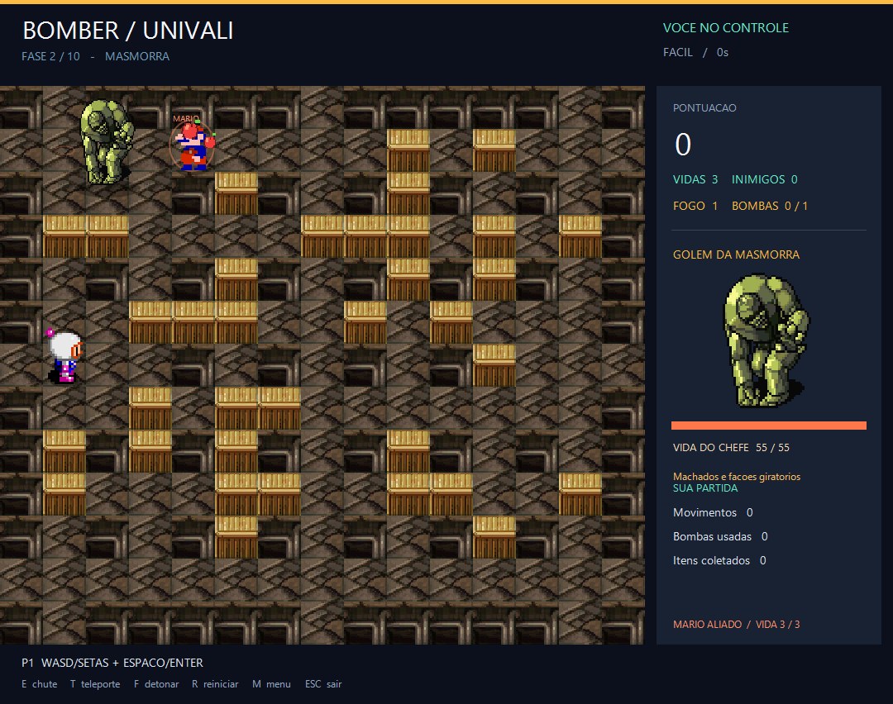
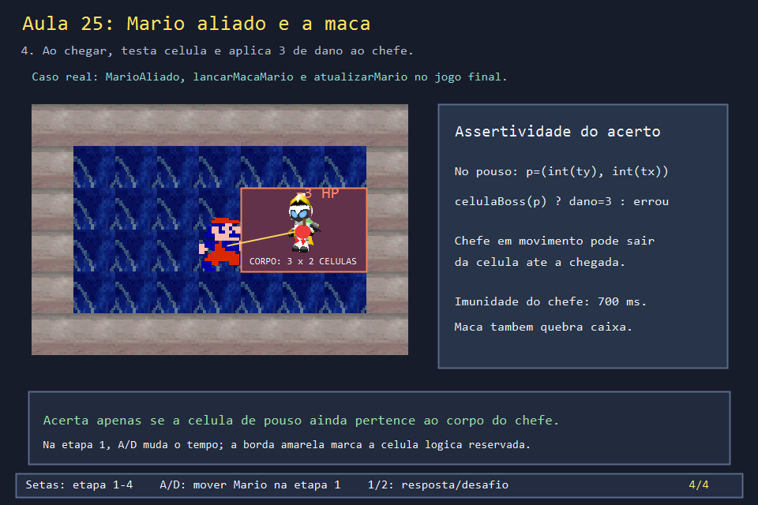
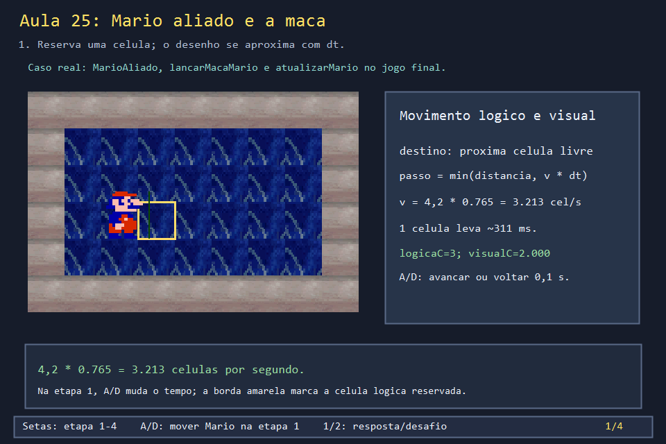

# Aula 25 — Mario aliado: movimento e maçã

| Trilha | Duração | Antes desta aula | Próxima na trilha |
| --- | --- | --- | --- |
| Chefes e aliado (14 → 22 → 25 → 26) | 2–3 h | Aulas [07](../Aula_07_movimento_e_colisao/Aula_07_movimento_e_colisao.md), [10](../Aula_10_fila_e_bfs/Aula_10_fila_e_bfs.md), [14](../Aula_14_chefes_projeteis_e_mario/Aula_14_chefes_projeteis_e_mario.md), [18](../Aula_18_animacao_direcional_gdiplus/Aula_18_animacao_direcional_gdiplus.md) e [20](../Aula_20_bfs_fuga_segura/Aula_20_bfs_fuga_segura.md) | [Aula 26 — Os cinco chefes](../Aula_26_cinco_chefes_reais/Aula_26_cinco_chefes_reais.md) |

| No jogo real: Mario libertado na fase do Golem | Nesta aula: a maçã chegando ao chefe |
| --- | --- |
|  |  |

Nas fases pares, uma caixa comum esconde o Mario. Quem a quebra ganha um aliado que anda sozinho, foge do perigo e lança maçãs nos inimigos e no chefe. Esta aula usa `mario.png`, o Guardião de `boss.png` e os tiles do **Templo Arcano (fase 8)** de `arenas_estudo.png`, os mesmos arquivos do jogo. A maçã é desenhada no código, como no jogo final.

O programa abre uma janela com quatro etapas. Use as setas para avançar, `2` para esconder a conclusão e `1` para revelá-la. Na etapa 1, **A/D** volta ou avança o Mario em intervalos de 0,1 s.

```powershell
.\compilar_aula.ps1 -Numero 25
.\build\Aula_25_mario_aliado_e_maca.exe
```



## 1. Como o Mario passa de uma célula a outra

No jogo, `MarioAliado::posicao` é a célula lógica reservada; `l` e `c` são as coordenadas desenhadas (`float`), a mesma divisão da Aula 07. A direção usa `MARIO_DL` e `MARIO_DC`, e `marioPodeAndar` rejeita borda, parede, bomba e corpo do chefe. Quando há perigo, `fugaMario()` faz uma BFS (Aula 20). Fora do perigo, o jogo pontua vizinhos livres, maçãs no chão e distância dos adversários.

O passo visual de cada atualização é `min(distância restante, 4,2 × FATOR_MARIO × dt)`. O fator do jogo é `0,765`, então a velocidade é **3,213 células/s** e uma célula leva cerca de **311 ms**. Com `dt = 0,10 s`, o deslocamento máximo é `0,3213` célula. A posição lógica chega ao destino antes do desenho. A animação usa a distância percorrida e o ciclo `{0,1,0,2}`, como na Aula 18.

Na janela, a borda amarela marca a **célula lógica 3**, já reservada. Aperte D duas vezes: a posição visual vai de `2,000` para `2,643`, enquanto a lógica já vale 3. Mais duas amostras encerram o deslocamento em 3, porque o `min` impede ultrapassar a célula.

## 2. Como ele decide jogar a maçã

`lancarMacaMario` só lança se o Mario está ativo, vivo e sem recarga. O alvo é o mais próximo entre inimigos vivos, o jogador rival (no modo inimigos) e o chefe. Se não houver ninguém, o destino fica três células à frente. O alvo é limitado ao interior da arena. A origem é o centro do Mario; o alvo de um inimigo é o centro da sua célula, e o do chefe é o centro do corpo.

O lançamento cria `MacaMario{sx, sy, tx, ty, idade, duracao}`. O tempo de voo é `clamp(distância / 5, 0,65, 1,45)` segundos, e a recarga é **1,05 s**. A direção é decidida **no instante do lançamento**: a maçã não persegue um chefe que mudou de lugar.

## 3. Velocidade, curva e acerto

Durante o voo, `u = idade / duracao` vai de 0 a 1. A posição no chão interpola origem e destino: `x = sx + (tx - sx)·u`, `y = sy + (ty - sy)·u`. A altura aparente é `sin(π·u) × 1,7 célula + (1 - u) × 20 px`. A curva e a rotação deixam o voo legível, mas o acerto só é decidido quando `idade >= duracao`.

No pouso, a célula testada é `(int(ty), int(tx))`. Se `celulaBoss` ainda cobre essa célula, o chefe perde **3 de vida** e recebe **700 ms** de imunidade; se ele saiu, o ataque erra. A maçã também quebra caixa, acerta inimigo ou rival e detona bomba. O laboratório desta aula foca no acerto ao chefe.


## 4. O código real

O teste de passagem e o lançamento:

<!-- trecho simbolo="marioPodeAndar" -->
```cpp
// projeto_final/bomberman.cpp, linha 2257 (marioPodeAndar)
bool marioPodeAndar(Posicao p){return dentro(p.linha,p.coluna) && livre(p.linha,p.coluna) && !bombaEm(p) && !bloqueadoBoss(p);}
```

<!-- trecho simbolo="lancarMacaMario" -->
```cpp
// projeto_final/bomberman.cpp, linhas 2270–2284 (lancarMacaMario)
void lancarMacaMario(){
    auto& m=marioAliado;if(!m.ativo || m.hp<=0 || m.recarga>0)return;
    float tx=m.c+MARIO_DC[m.direcao]*3+.5f,ty=m.l+MARIO_DL[m.direcao]*3+.5f,maisPerto=1e9f;
    for(const auto& i:inimigos)if(i.vivo){float d=hypot(i.visualC-m.c,i.visualL-m.l);
        if(d<maisPerto){maisPerto=d;tx=i.posicao.coluna+.5f;ty=i.posicao.linha+.5f;}}
    // Modo inimigos: o jogador rival de quem libertou o Mario tambem e alvo.
    if(m.dono>=0 && jogadorEmCampo(2-m.dono)){float rl=m.dono==0?jogador2VisualL:jogadorVisualL,rc=m.dono==0?jogador2VisualC:jogadorVisualC;
        Posicao rp=m.dono==0?jogador2:jogador;float d=hypot(rc-m.c,rl-m.l);
        if(d<maisPerto){maisPerto=d;tx=rp.coluna+.5f;ty=rp.linha+.5f;}}
    if(boss.vivo && hypot(m.c-boss.visualC-1,m.l-boss.visualL)<maisPerto){tx=boss.visualC+larguraBoss()/2.f;ty=boss.visualL+1;}
    tx=clamp(tx,1.5f,COLUNAS-1.5f);ty=clamp(ty,1.5f,LINHAS-1.5f);
    float sx=m.c+.5f,sy=m.l+.5f;
    macasMario.push_back({sx,sy,tx,ty,0,clamp(hypot(tx-sx,ty-sy)/5,.65f,1.45f)});
    m.recarga=1.05f;m.pose=.28f;
}
```

O pouso, dentro de `atualizarMario`: só no fim do voo a célula é testada.

<!-- trecho simbolo="atualizarMario" de="for(auto& a:macasMario){" ate="macasMario.erase(" -->
```cpp
// projeto_final/bomberman.cpp, linhas 2312–2329 (atualizarMario)
    for(auto& a:macasMario){a.idade+=dt;if(a.idade<a.duracao)continue;
        Posicao p{int(a.ty),int(a.tx)};bool acertou=false;
        if(dentro(p.linha,p.coluna) && (mapa[p.linha][p.coluna]==PAREDE_FRAGIL || mapa[p.linha][p.coluna]==PAREDE_BONUS)){
            if(mapa[p.linha][p.coluna]==PAREDE_BONUS)destruirBlocoBonus(p.linha,p.coluna);
            mapa[p.linha][p.coluna]=VAZIO;invalidarCacheMapa();estatisticas.caixasDestruidas++;ajustarPontos(PONTOS_POR_CAIXA,marioAliado.dono);acertou=true;}
        for(auto& i:inimigos)if(i.vivo && hypot(a.tx-i.visualC-.5f,a.ty-i.visualL-.5f)<.95f){matarInimigo(i,pontos,marioAliado.dono);acertou=true;}
        if(marioAliado.dono>=0 && estado==JOGANDO && jogadorEmCampo(2-marioAliado.dono)){
            int rival=1-marioAliado.dono;float rl=rival==0?jogadorVisualL:jogador2VisualL,rc=rival==0?jogadorVisualC:jogador2VisualC;
            if(hypot(a.tx-rc-.5f,a.ty-rl-.5f)<.95f){derrubarJogador(rival+1);ajustarPontos(PONTOS_POR_INIMIGO,marioAliado.dono);acertou=true;}
        }
        for(auto& b:bombas)if(b.ativa && iguais(b.posicao,p)){b.tempoMs=0;acertou=true;}
        if(celulaBoss(p.linha,p.coluna)){
            boss.vida=max(0,boss.vida-3);boss.imunidadeMs=IMUNIDADE_BOSS_MS;reagirDanoHornet();acertou=true;
            if(boss.vida==0)concluirLutaBoss(marioAliado.dono);
        }
        (void)acertou; // Pontos somente por conquistas, nao por acertos isolados.
    }
    macasMario.erase(remove_if(macasMario.begin(),macasMario.end(),[](const MacaMario& a){return a.idade>=a.duracao;}),macasMario.end());
```

E a pergunta "esta célula é parte do chefe?", usada pela maçã, pelas bombas e pela colisão:

<!-- trecho simbolo="celulaBoss" -->
```cpp
// projeto_final/bomberman.cpp, linhas 1028–1031 (celulaBoss)
bool celulaBoss(int l, int c) {
    return boss.vivo && !hornetNoAr() && c+1>boss.visualC+.001f && c<boss.visualC+larguraBoss()-.001f &&
           l+1>boss.visualL+.001f && l<boss.visualL+2-.001f;
}
```

## 5. Experimentos de reconstrução

1. Antes de avançar a janela, calcule a velocidade e o tempo para uma célula. Troque `FATOR_MARIO_AULA` para `0,900` e compare com a solução. Explique por que o passo deve ser limitado à distância restante. *(Com 0,900: 4,2 × 0,9 = 3,78 células/s, ≈ 265 ms por célula. Sem o `min`, o último passo passaria do centro, e o Mario "tremeria" em volta do destino.)*
2. Ponha um inimigo mais perto que o chefe no seu rascunho. Qual alvo a maçã escolhe? E o destino quando não há nenhum alvo? *(O inimigo, porque o chefe só vence se estiver mais perto que todos. Sem alvos, o destino é três células à frente, na direção em que o Mario olha.)*
3. Faça uma tabela com `u = 0`, `0,5` e `1` e calcule posição e altura da maçã. Mude a posição do chefe antes do pouso e explique quando `celulaBoss` é falsa. *(Em `u = 0,5`, a altura é máxima: `1,7 célula + 10 px`. `celulaBoss` é falsa quando a célula de pouso já não está dentro do retângulo do corpo, ou quando a Hornet está no ar.)*
4. No projeto final, localize o recorte de `mario.png` para baixo (`x = 60 + 17 × quadro`, `y = 6`, 16 × 16), a cor chave RGB `(56, 135, 0)` e o desenho programático da maçã. *(Recorte e cor chave estão no começo de `carregarAssets`; a maçã, em `desenharMacasMario`.)*

## 6. Erros comuns

- **Decidir o acerto durante o voo.** A maçã visualmente "passa" pelo inimigo na subida e o acertaria antes da hora. O jogo só testa no pouso.
- **Mirar onde o alvo vai estar.** O Mario mira onde o alvo **está**. Isso é intencional: a maçã pode errar, e o jogador entende por quê. Os projéteis do chefe, ao contrário, usam `anteciparAlvoBoss`.
- **Esquecer a imunidade do Mario ao ser libertado.** A mesma chama que quebrou a caixa o mataria na hora (Aula 14, exercício 4).

## 7. Antes de seguir

- [ ] Calculei 3,213 células/s e 311 ms por célula.
- [ ] Sei quais alvos a maçã considera, e em que ordem de preferência.
- [ ] Expliquei por que o acerto é decidido só no pouso.

**Verificação:** `compilar_aula.ps1` compila a janela e um modo de captura, exporta duas imagens distintas e confere o cálculo da velocidade. A solução em `solucoes/Aula_25_mario_aliado_e_maca_solucao.cpp` mostra a alteração do fator; o executável fica em `build/internos/solucoes/`.

## Referências

- [Interpolação linear (lerp) — Red Blob Games](https://www.redblobgames.com/grids/line-drawing/)
- [`std::clamp` (cppreference)](https://en.cppreference.com/w/cpp/algorithm/clamp)
- [`std::hypot` (cppreference)](https://en.cppreference.com/w/cpp/numeric/math/hypot)
