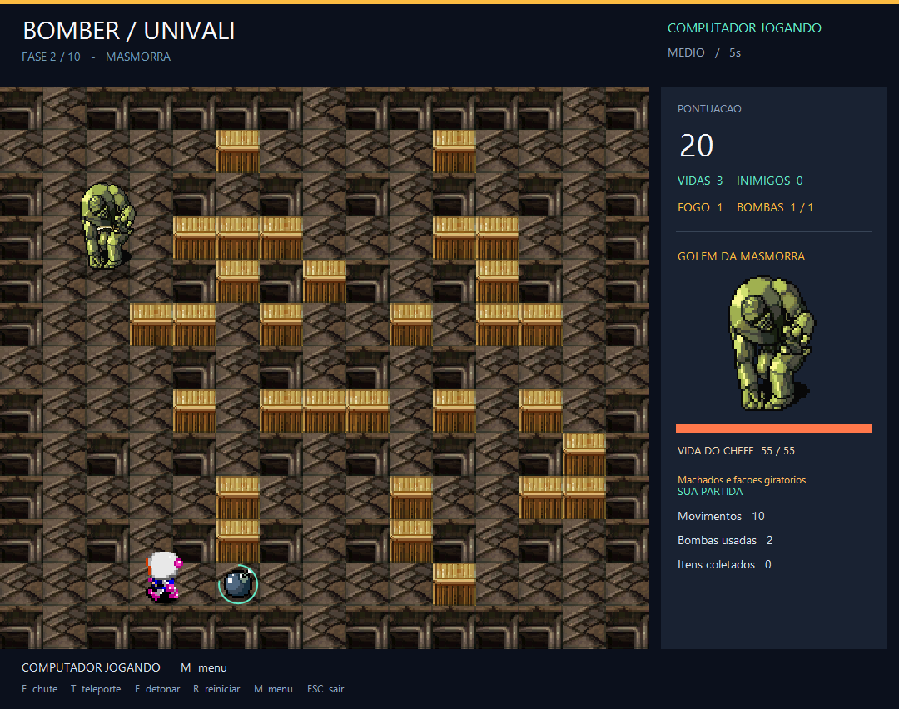
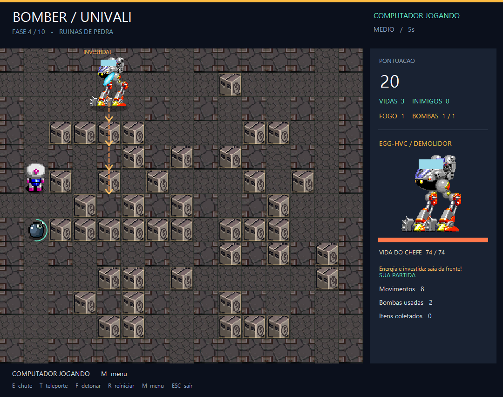
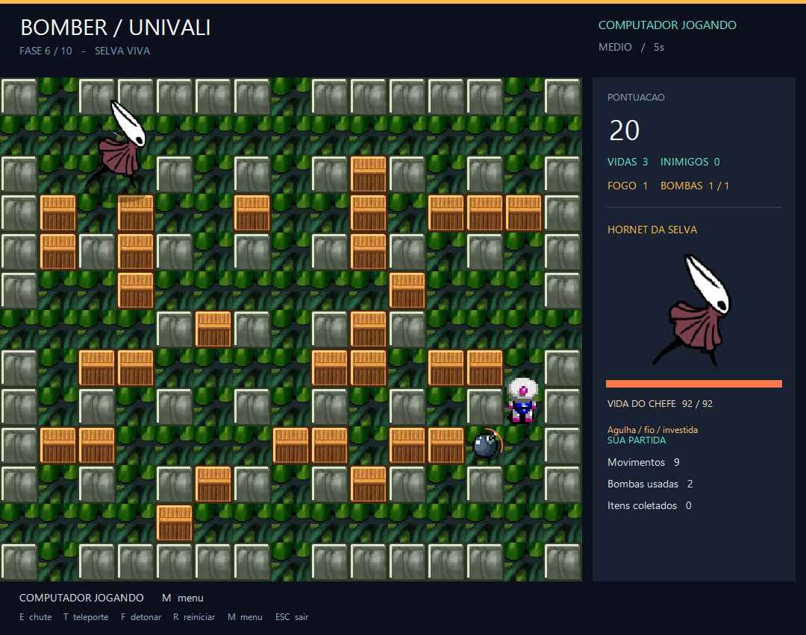
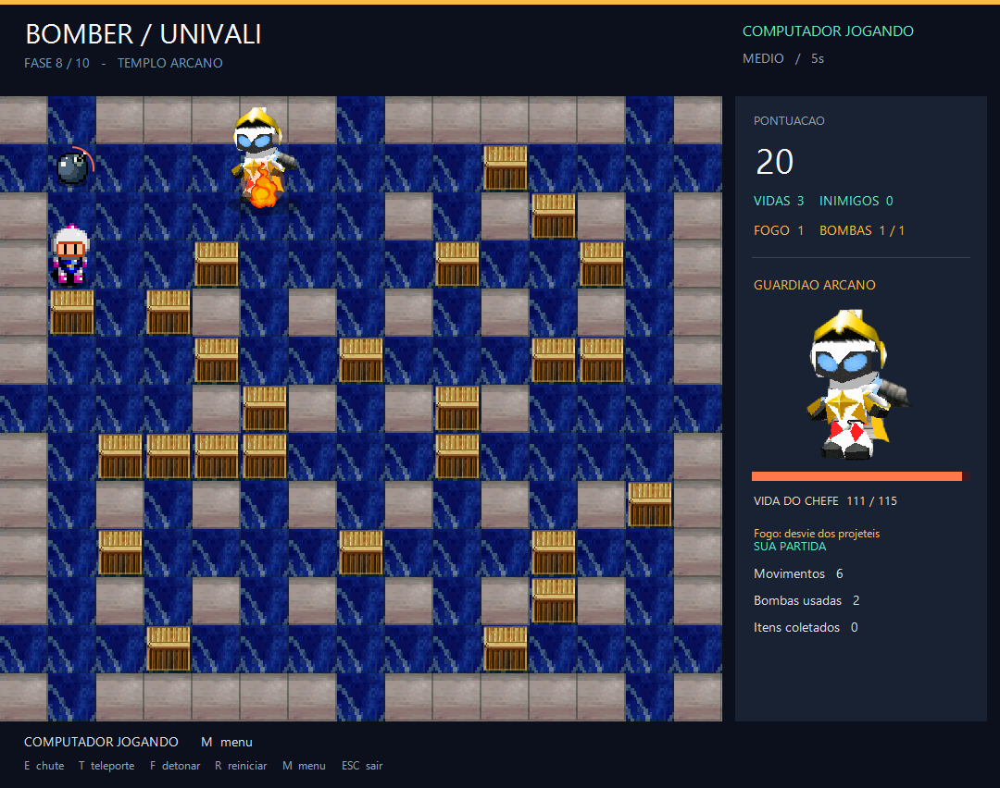
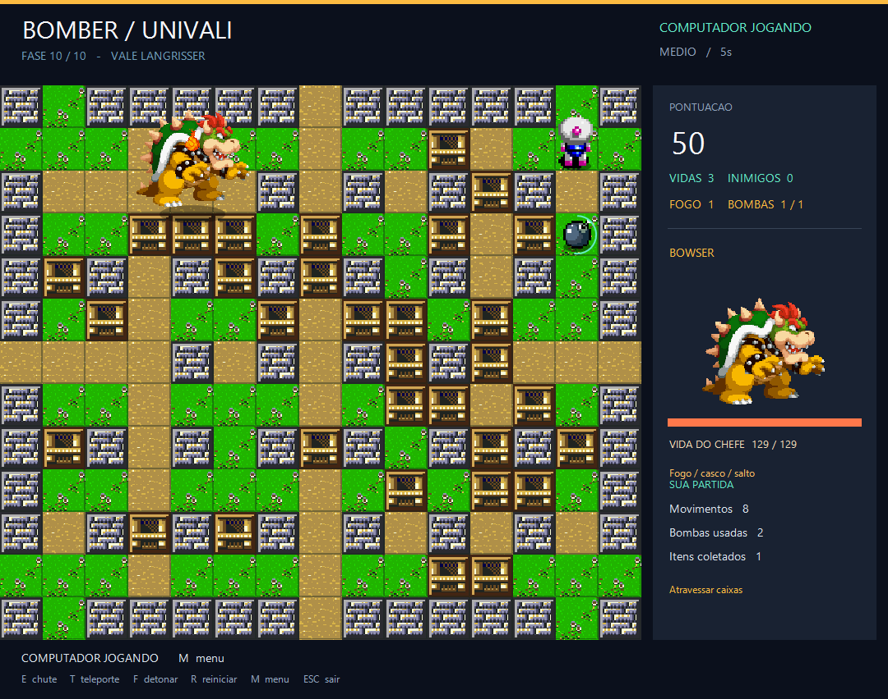
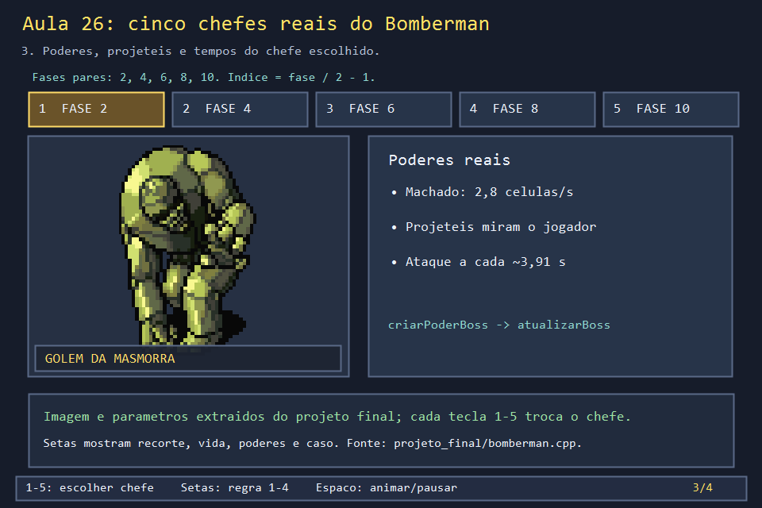
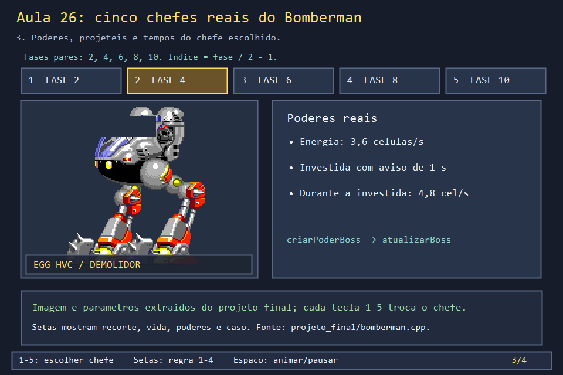
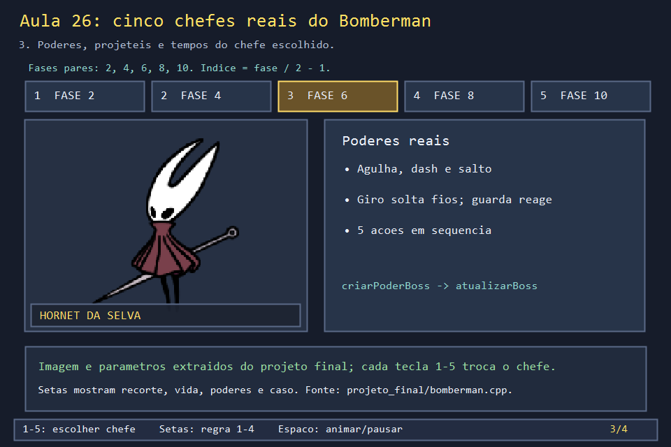
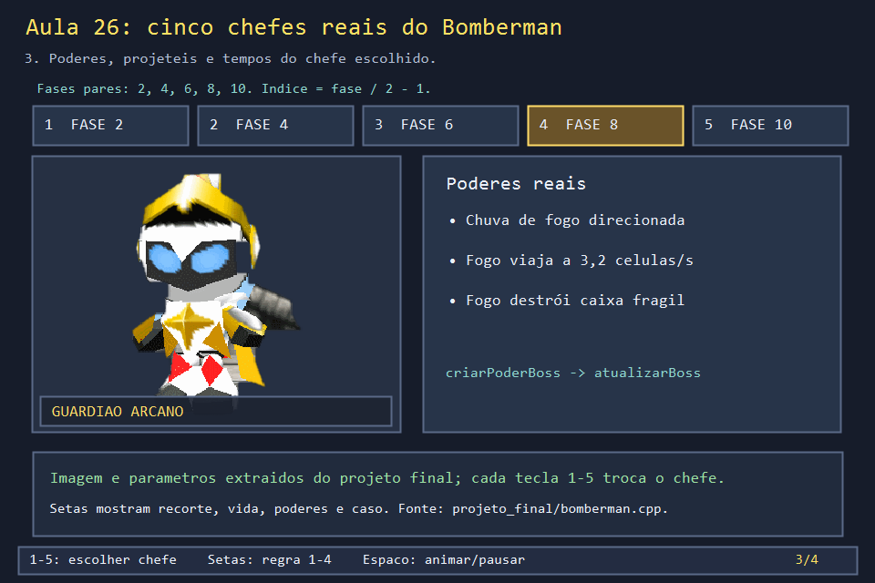
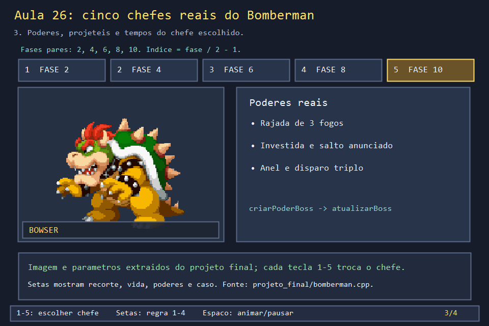

# Aula 26 — Os cinco chefes reais da campanha

| Trilha | Duração | Antes desta aula | Próxima na trilha |
| --- | --- | --- | --- |
| Chefes e aliado (14 → 22 → 25 → 26) | 3–4 h | Aulas [05](../Aula_05_recorte_de_sprite_sheet/Aula_05_recorte_de_sprite_sheet.md), [14](../Aula_14_chefes_projeteis_e_mario/Aula_14_chefes_projeteis_e_mario.md), [18](../Aula_18_animacao_direcional_gdiplus/Aula_18_animacao_direcional_gdiplus.md), [22](../Aula_22_maquina_de_estados_boss/Aula_22_maquina_de_estados_boss.md) e [25](../Aula_25_mario_aliado_e_maca/Aula_25_mario_aliado_e_maca.md) | fim da trilha; integre no [desafio de reconstrução](../../DESAFIO_DE_RECONSTRUCAO.md) |

## Os cinco encontros, no jogo real

| Fase 2 — Golem | Fase 4 — Egg-HVC | Fase 6 — Hornet |
| --- | --- | --- |
|  |  |  |
| **Fase 8 — Guardião Arcano** | **Fase 10 — Bowser** | |
|  |  | |

Essas capturas foram geradas por `ferramentas/capturar_jogo_real.ps1`, que roda o código do jogo sem janela e fotografa a primeira vez que cada chefe ataca. O painel lateral mostra o nome, a vida (55, 74, 92, 115 e 129) e a descrição do poder, que vêm de `NOMES_BOSSES` e `PODERES_BOSSES`.

## O laboratório desta aula

Execute a galeria: teclas **1 a 5** escolhem o chefe; as setas percorrem **carregamento, estado, poderes e um caso calculado**. Todos os retratos são recortes dos PNGs usados em `projeto_final/bomberman.cpp`.

```powershell
.\compilar_aula.ps1 -Numero 26
.\build\Aula_26_cinco_chefes_reais.exe
```

## Como o jogo escolhe e carrega um chefe

Há dez fases. Nas fases pares, `indiceBoss() = faseAtual/2 - 1` escolhe um dos cinco encontros. `carregarBossesCampanha` extrai os retratos do Golem e do Egg de folhas maiores, removendo a cor de fundo. `carregarAssets` lê os atlas da Hornet e do Bowser e a imagem do Guardião. Hornet e Bowser usam quadros de **160 × 160** em atlas: `quadroAnimacaoBoss` escolhe o índice, e `desenharBossAnimado` recorta a pose. O projeto guarda só os quadros usados, para não recortar a folha inteira a cada pintura.

| Tecla | Fase e chefe | Arquivo de sprite e recorte | Vida final | Poderes que observar |
| --- | --- | --- | ---: | --- |
| 1 | 2, Golem da Masmorra | `SNES - Final Fantasy V - Enemies & Bosses - Enemies.png`, `(656,16,40,64)` | 55 | Machado a 2,8 células/s, mira no jogador |
| 2 | 4, Egg-HVC / Demolidor | `Sega CD - Sonic the Hedgehog CD - Bosses - Palmtree Panic Boss - EGG-HVC-001.png`, `(869,424,112,124)` | 74 | Energia a 3,6 células/s e investida avisada |
| 3 | 6, Hornet da Selva | `hornet_animacoes.png`, quadros de 160 × 160 | 92 | Agulha, investida, salto com fios, ataque aéreo, guarda e contra-ataque |
| 4 | 8, Guardião Arcano | `boss.png`, imagem de 253 × 253 | 115 | Chuva de fogo direcionada, 3,2 células/s, destrói caixas |
| 5 | 10, Bowser | `bowser_animacoes.png`, quadros de 160 × 160 | 129 | Rajada, investida, salto com anel de oito projéteis e disparo triplo |

As vidas vêm das bases `{48, 64, 80, 100, 112}` multiplicadas por `FATOR_FORCA_BOSS = 1,15` e arredondadas (Aula 14). O corpo tem duas células de largura na Hornet e três nos demais; todos ocupam duas linhas. Por isso, desenhar um sprite menor não muda a área de colisão: ela é definida por `celulaBoss`, não pela imagem.







## Poder, tempo e ligação com o código

`criarPoderBoss` decide o ataque; `atualizarBoss(tempoMs)` avança movimento, aviso, projéteis, impactos e imunidade. O intervalo base de ataque é `4500 / 1,15 ≈ 3913 ms`, e o de movimento é `4000 / 1,15 ≈ 3478 ms`. Uma investida é anunciada durante **1000 ms** antes de o corpo se deslocar a **4,8 células/s**. O aviso visual dá ao jogador tempo de planejar a fuga.

- **Golem:** usa machado. Para uma distância de três células, `3 / 2,8 ≈ 1,07 s` sem obstáculos.
- **Egg:** usa energia e prepara investida. Compare a velocidade do projétil com a do avanço.
- **Hornet:** tem máquina de estados própria (`EtapaHornet`, Aula 22). `criarPoderBoss` alterna cinco ações; a preparação da agulha dura 750 ms e a guarda, 1200 ms. O giro solta fios, e a guarda pode virar contra-ataque.
- **Guardião:** lança fogo na direção antecipada do alvo. O fogo atravessa o espaço e remove caixas ao tocá-las.
- **Bowser:** alterna quatro ações especiais. A primeira dispara três fogos; a terceira é um salto anunciado com um anel de oito projéteis no pouso; a quarta cria três tiros de 2,8 células/s.

## O código real

Nome, poder e tamanho de cada chefe estão em tabelas indexadas por `indiceBoss()`:

<!-- trecho de="const wchar_t* NOMES_BOSSES[]" ate="int larguraBoss()" -->
```cpp
// projeto_final/bomberman.cpp, linhas 302–307
const wchar_t* NOMES_BOSSES[]={L"GOLEM DA MASMORRA",L"EGG-HVC / DEMOLIDOR",L"HORNET DA SELVA",L"GUARDIAO ARCANO",L"BOWSER"};
const wchar_t* PODERES_BOSSES[]={L"Machados e facoes giratorios",L"Energia e investida: saia da frente!",L"Agulha / fio / investida",L"Fogo: desvie dos projeteis",L"Fogo / casco / salto"};
int indiceBoss(){return max(0,min(4,faseAtual/2-1));}
bool bossAnimado(){return indiceBoss()==2 || indiceBoss()==4;}
int vidaMaximaBoss(){const int vidas[]={48,64,80,VIDA_BOSS,112};return int(round(vidas[indiceBoss()]*FATOR_FORCA_BOSS));}
int larguraBoss(){return indiceBoss()==2?2:3;}
```

O começo de `criarPoderBoss`. A Hornet tem um ramo próprio que só **entra numa etapa** da máquina de estados; os outros chefes disparam projéteis por meio da lambda `lancar`:

<!-- trecho simbolo="criarPoderBoss" ate="if(poder==MACHADO)projeteisBoss.back().arma=boss.sequenciaAtaque%2;" -->
```cpp
// projeto_final/bomberman.cpp, linhas 1847–1872 (criarPoderBoss)
void criarPoderBoss() {
    boss.animAtaqueMs=700;
    ++boss.sequenciaAtaque;
    if(indiceBoss()==2){
        if(boss.etapaHornet!=H_IDLE || boss.movendo){--boss.sequenciaAtaque;return;}
        boss.acaoEspecial=(boss.sequenciaAtaque-1)%5+1;
        boss.olhandoDireita=jogadorVisualC>boss.visualC;
        boss.tempoProximoAtaqueMs=INTERVALO_ATAQUE_BOSS_MS;
        switch(boss.acaoEspecial){
            case 1:entrarEtapaHornet(H_PREP_AGULHA,750);break;
            case 2:case 4:
                if(prepararInvestidaBoss())entrarEtapaHornet(boss.acaoEspecial==2?H_PREP_DASH:H_PREP_AEREO,1000);
                else {boss.acaoEspecial=0;boss.tempoProximoAtaqueMs=1000;}
                break;
            case 3:entrarEtapaHornet(H_PREP_SALTO,350);break;
            case 5:entrarEtapaHornet(H_GUARDA,1200);break;
        }
        return;
    }
    auto lancar=[&](float l,float c,PoderBoss poder,float desvio=0.f){
        float origemL=boss.visualL+.8f,origemC=boss.visualC+larguraBoss()/2.f;
        float velocidade=poder==MACHADO?2.8f:poder==ENERGIA?3.6f:3.f;
        auto alvo=anteciparAlvoBoss(l,c,origemL,origemC,velocidade);
        float angulo=atan2(alvo.first+.5f-origemL,alvo.second+.5f-origemC)+desvio*.85f;
        projeteisBoss.push_back({origemL,origemC,sin(angulo)*velocidade,cos(angulo)*velocidade,0,4.5f*FATOR_FORCA_BOSS,poder,700});
        if(poder==MACHADO)projeteisBoss.back().arma=boss.sequenciaAtaque%2;
```

A área do corpo, que vale para bombas, maçãs e colisão:

<!-- trecho simbolo="celulaBoss" -->
```cpp
// projeto_final/bomberman.cpp, linhas 1028–1031 (celulaBoss)
bool celulaBoss(int l, int c) {
    return boss.vivo && !hornetNoAr() && c+1>boss.visualC+.001f && c<boss.visualC+larguraBoss()-.001f &&
           l+1>boss.visualL+.001f && l<boss.visualL+2-.001f;
}
```

## Faça você mesmo

1. Na galeria, escolha cada chefe e preveja a vida antes de abrir a etapa 2. Calcule os cinco valores com papel ou planilha. Depois confira nas capturas do jogo real, no topo desta página.
2. Siga em `projeto_final/bomberman.cpp` a trilha `carregarAssets → criarPoderBoss → atualizarBoss → desenharBossAnimado`. Para Golem e Egg, troque `carregarAssets` por `carregarBossesCampanha`.
3. Escolha um ataque por chefe. Escreva entrada, aviso, duração, efeito na arena e condição de parada. Reproduza o encontro no jogo final.
4. Faça a Hornet entrar em guarda e observe quando ela reage com fios. Faça o Bowser saltar e conte os oito projéteis do anel.
5. A solução começa pela Hornet, para facilitar o estudo da máquina de estados. Adapte sua versão para começar pelo chefe que você quer estudar.
6. **Leitura.** Em `criarPoderBoss`, a lambda `participantes` recebe outra lambda (`atacar`). Para quem cada chefe atira quando há dois jogadores e o Mario? *(Para os três: P1, P2 se estiver ativo, e o Mario se estiver vivo. Cada chamada de `atacar` cria um projétil.)*

## Erros comuns

- **Usar o tamanho do sprite como área de colisão.** O sprite do Guardião tem 253 × 253 pixels, e o corpo dele ocupa 3 × 2 células. Regras usam `celulaBoss`; o desenho só mostra.
- **Esquecer a Hornet no ar.** `celulaBoss` devolve falso quando `hornetNoAr()`: bombas e maçãs passam por baixo dela. Um chefe novo que voe precisa da mesma exceção.
- **Repetir o código de cada chefe.** O jogo concentra o que é comum (vida, nome, largura, `lancar`) em tabelas e lambdas, e só a Hornet tem um ramo à parte.

## Antes de seguir

- [ ] Conferi as cinco vidas nas capturas do jogo real.
- [ ] Sei por que a Hornet tem um ramo separado em `criarPoderBoss`.
- [ ] Descrevi um ataque de cada chefe com aviso, duração e efeito.

**Verificação:** o script da aula compila a janela, captura a primeira e a última etapa e exporta `chefe_1.png` a `chefe_5.png`. A solução em `solucoes/Aula_26_cinco_chefes_reais_solucao.cpp` também é compilada por `compilar_solucoes.ps1`.

## Referências

- [State pattern — Game Programming Patterns](https://gameprogrammingpatterns.com/state.html), para organizar os ataques de um chefe novo
- [Lambdas genéricas com `auto` (cppreference)](https://en.cppreference.com/w/cpp/language/lambda)
- [The Spriters Resource](https://www.spriters-resource.com/), origem das folhas de sprite usadas no projeto
