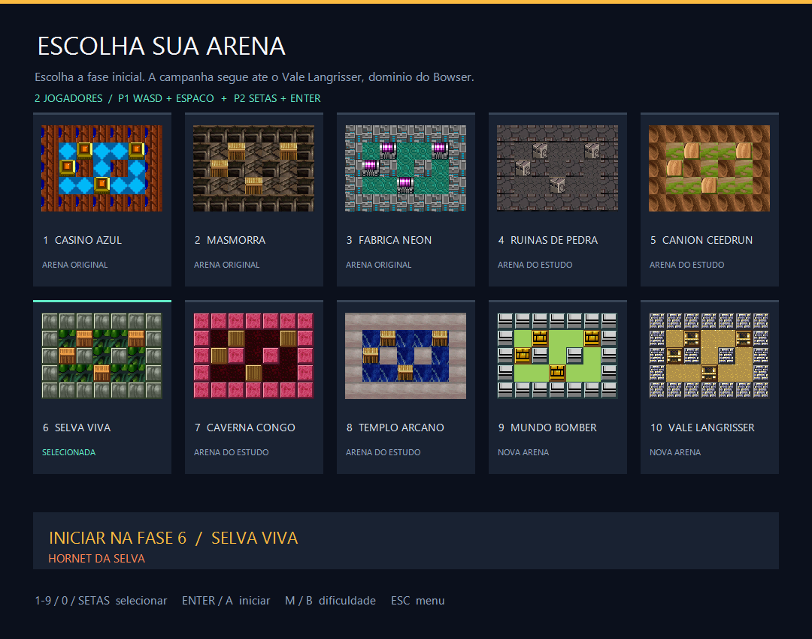
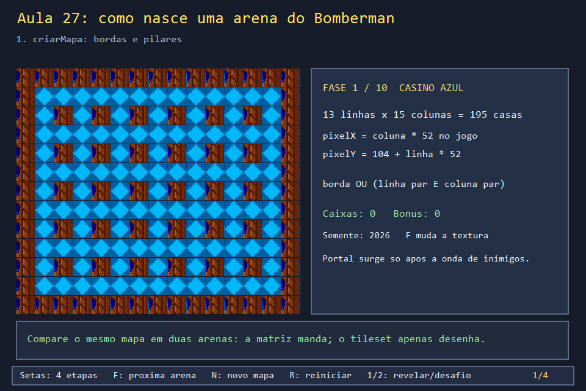
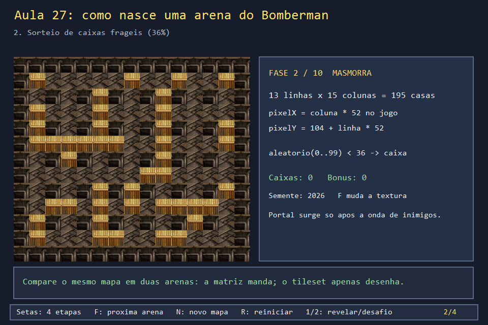
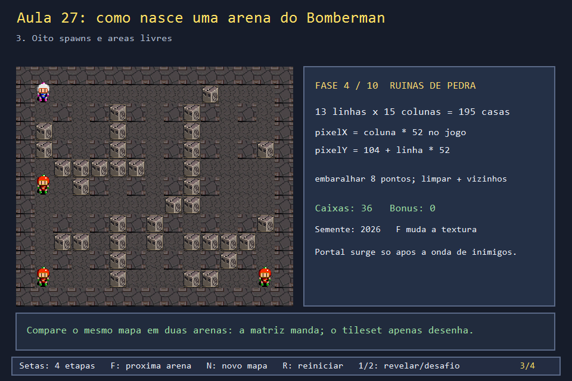
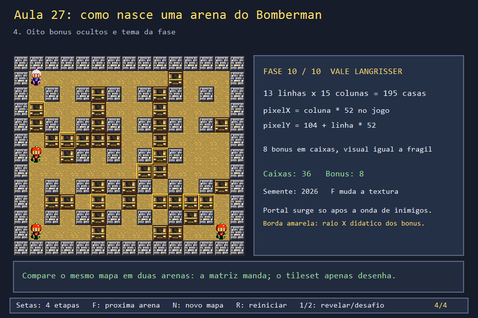
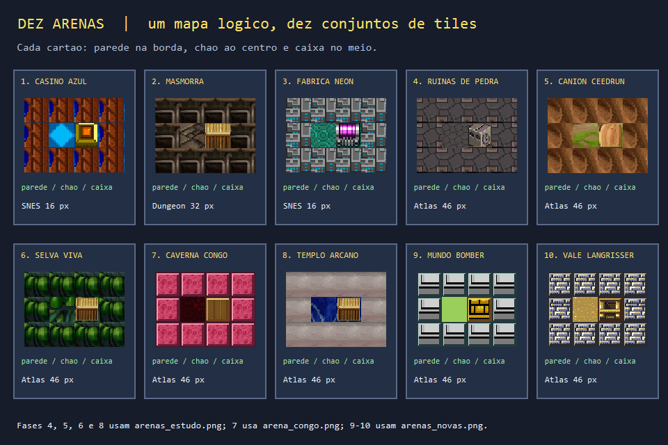

# Aula 27 — Cenários: da matriz à arena desenhada

| Trilha | Duração | Antes desta aula | Próxima na trilha |
| --- | --- | --- | --- |
| Campanha e cenário (12 → 27) | 90–120 min | Aulas [02](../Aula_02_matriz_enum_e_mapa/Aula_02_matriz_enum_e_mapa.md), [04](../Aula_04_formas_cores_e_gdiplus/Aula_04_formas_cores_e_gdiplus.md), [05](../Aula_05_recorte_de_sprite_sheet/Aula_05_recorte_de_sprite_sheet.md), [09](../Aula_09_oito_poderes/Aula_09_oito_poderes.md) e [12](../Aula_12_fases_dificuldade_e_cooperativo/Aula_12_fases_dificuldade_e_cooperativo.md) | fim da trilha; jogue o Marco 3 em `marcos/` |

| A fase 1 no jogo real | O seletor de fases do jogo real |
| --- | --- |
|  |  |

Esta aula aprofunda o que as Aulas 02 e 12 apresentaram de forma reduzida.

## O que você vai conseguir fazer

Ao final, construa um tabuleiro de **13 linhas por 15 colunas**; separe parede fixa, caixa frágil, bloco com bônus e chão; reserve áreas seguras para o jogador e os inimigos; escolha a textura de cada uma das dez fases; e explique quando o portal aparece. Consegue repetir um mapa com a mesma semente e alterar a chance de caixas sem modificar os pilares.

## Resultado visual e fonte de verdade

Abra o executável principal. **Setas** revelam quatro momentos de uma arena; **F** percorre as dez fases, **N** sorteia outro tabuleiro, **R** retorna ao caso inicial e **2/1** escondem/revelam a conclusão. Os tiles, o jogador e os nomes vêm dos recursos e valores do `bomberman.cpp` original. O contorno amarelo dos bônus é um **raio X didático**: no jogo o bloco com item parece uma caixa comum.









Compare agora **as dez arenas na mesma mini matriz**. Como as posições de parede, chão e caixa são iguais em todos os cartões, a diferença visível vem da escolha do tileset.



Fonte primária: `projeto_final/bomberman.cpp`, obtido por `baixar_jogo_final.ps1`. Localize `TipoCelula`, `criarMapa`, `limparArea`, `sortearPosicoesIniciais`, `posicionarBlocosBonus`, `montarFase`, `prepararTemaFase2Compacto`, `temaDaFase`, `desenharTerrenoCelula`, `desenharMapa`, `colocarPortal` e `avancarFase`.

## Como o jogo monta uma fase, passo a passo

| Etapa no código real | Entrada e regra | O que você vê |
| --- | --- | --- |
| `criarMapa()` | `mapa[13][15]`: borda ou linha/coluna pares vira `PAREDE_SOLIDA`; outras casas têm 36% de chance de `PAREDE_FRAGIL` | Moldura e pilares fixos; caixas mudam com a semente |
| `sortearPosicoesIniciais()` | Embaralha oito pontos de início; `limparArea` remove obstáculos do ponto e de quatro vizinhos | O jogador e até três inimigos do Fácil têm lugar para nascer |
| `posicionarBlocosBonus()` | Recolhe caixas frágeis, embaralha e marca até oito como `PAREDE_BONUS` | Oito blocos continuam com sprite de caixa; o laboratório destaca sua posição |
| `montarFase()` | Chama as três operações acima; posiciona jogador e 3/5/7 inimigos conforme dificuldade; reseta recursos da fase | Tabuleiro jogável sem apagar pontos acumulados da partida |
| `temaDaFase()` + `desenharTerrenoCelula()` | Traduz o tipo da matriz em recorte `Rect` de chão/parede/caixa e em destino na tela | O mesmo tipo lógico recebe o visual da arena escolhida |
| `colocarPortal()` | Depois da onda de inimigos, escolhe uma casa livre e marca `PORTAL` | O portal não nasce em `criarMapa()`; aparece após a condição de avanço |

### Faça as contas de coordenadas

No jogo real, cada célula mede **52 pixels**. A coluna 7 começa em `x=7*52=364`. A linha 5 começa em `y=104+5*52=364`, pois há um cabeçalho de 104 pixels. A janela didática usa 31 pixels por célula para caber lado a lado com a explicação; ela mantém a matriz real de 13 × 15. Confundir o tamanho de demonstração com o tamanho do jogo desloca sprites e colisões.

### Como os cenários são carregados

O jogo carrega PNGs de `projeto_final/assets/` durante a inicialização e guarda os objetos de imagem. `temaDaFase(fase)` escolhe **três recortes** para cada arena. As fases 1 e 3 usam folhas SNES de 16 × 16; a 2 usa três recortes de 32 × 32 da folha Dungeon; as fases 4, 5, 6 e 8 usam colunas de `arenas_estudo.png`; a 7 usa `arena_congo.png`; as 9 e 10 usam `arenas_novas.png`. O jogo compacta os três recortes da fase 2 uma vez e descarta a folha grande, evitando recortá-la a cada desenho. O exemplo desta aula faz a mesma compactação para todas as arenas. Na fase 6, o jogo também recolore a parede e a caixa da selva; o laboratório mostra os recortes base do mesmo atlas para concentrar a atenção na regra de montagem.

**Regras e aparência são camadas diferentes.** `mapa[l][c]` decide colisão, explosão e conteúdo oculto. `DrawImage` recebe `c*52`, `104+l*52` e o recorte do tema. Ao destruir uma caixa, o jogo altera a matriz, marca o cache do terreno como sujo e só então redesenha. Trocar apenas a textura não transforma chão em parede. No laboratório, **F** preserva a mesma matriz e troca apenas o tema para facilitar a comparação. No jogo, `avancarFase()` chama `montarFase()` e sorteia um mapa novo.

## O código real

Cada fase escolhe três recortes (chão, parede, caixa) de uma folha. A struct `TemaFase` guarda a folha e os três `Rect`:

<!-- trecho simbolo="temaDaFase" -->
```cpp
// projeto_final/bomberman.cpp, linhas 2980–3005 (temaDaFase)
TemaFase temaDaFase(int fase) {
    fase = max(1,min(TOTAL_FASES,fase));
    if(fase==7){auto* f=spriteArenaCongo.get();
        return {f,Gdiplus::Rect(0,0,46,46),f,Gdiplus::Rect(0,46,46,46),f,Gdiplus::Rect(0,92,46,46)};}
    if(fase>=9){auto* f=spriteArenasNovas.get();int x=(fase-9)*46;
        return {f,Gdiplus::Rect(x,0,46,46),f,Gdiplus::Rect(x,46,46,46),f,Gdiplus::Rect(x,92,46,46)};}
    if (fase>3) {
        auto* f=spriteArenasEstudo.get();
        int x=INDICES_ATLAS_FASES[fase-1]*46;
        if(fase==6)return {f,Gdiplus::Rect(x,0,46,46),spritePedraSelva.get(),Gdiplus::Rect(0,0,46,46),spriteCaixaSelva.get(),Gdiplus::Rect(0,0,46,46)};
        return {f,Gdiplus::Rect(x,0,46,46),f,Gdiplus::Rect(x,46,46,46),f,Gdiplus::Rect(x,92,46,46)};
    }
    if (fase <= 1) {
        Gdiplus::Image* f = spriteTemaFase1.get();
        return {f, Gdiplus::Rect(96, 48, 16, 16), f, Gdiplus::Rect(16, 16, 16, 16),
               f, Gdiplus::Rect(48, 32, 16, 16)};
    }
    if (fase == 2) {
        return {spriteTemaFase2Chao.get(), Gdiplus::Rect(0, 0, 32, 32),
               spriteTemaFase2Parede.get(), Gdiplus::Rect(0, 0, 32, 32),
               spriteTemaFase2Caixa.get(), Gdiplus::Rect(0, 0, 32, 32)};
    }
    Gdiplus::Image* f = spriteTemaFase3.get();
    return {f, Gdiplus::Rect(64, 16, 16, 16), f, Gdiplus::Rect(0, 0, 16, 16),
           f, Gdiplus::Rect(48, 32, 16, 16)};
}
```

O desenho de uma célula traduz o tipo lógico em recorte. Repare que `PAREDE_BONUS` usa o **mesmo** recorte da caixa comum: o bônus fica escondido.

<!-- trecho simbolo="desenharTerrenoCelula" ate="origemTextura.Width, origemTextura.Height, Gdiplus::UnitPixel);" -->
```cpp
// projeto_final/bomberman.cpp, linhas 3011–3035 (desenharTerrenoCelula)
void desenharTerrenoCelula(Gdiplus::Graphics& g, int l, int c) {
    int x = px(c * TAMANHO_CELULA);
    int y = px(l * TAMANHO_CELULA);
    int lado = px(TAMANHO_CELULA);
    TipoCelula tipo = mapa[l][c];
    TemaFase tema = temaDaFase(faseAtual);

    Gdiplus::Image* folhaTextura = nullptr;
    Gdiplus::Rect origemTextura;
    if (tipo == PAREDE_SOLIDA) { folhaTextura = tema.paredeFolha; origemTextura = tema.parede; }
    else if (tipo == PAREDE_FRAGIL || tipo == PAREDE_BONUS) { folhaTextura = tema.caixaFolha; origemTextura = tema.caixa; }
    else { folhaTextura = tema.chaoFolha; origemTextura = tema.chao; } // VAZIO e PORTAL usam o chao
    if((tipo==VAZIO || tipo==PORTAL) && faseAtual>=9){
        bool variante=faseAtual==10?(l%4!=2 && c%4!=3):(l+c)%5==0;
        if(variante)origemTextura.Y=138;
    }
    bool temTextura = folhaTextura != nullptr;
    if((tipo==VAZIO || tipo==PORTAL) && faseAtual==7){
        int variante=(l*3+c*7)%5;
        if(variante<2)origemTextura.Y=(3+variante)*46;
    }

    if (temTextura) {
        g.DrawImage(folhaTextura, Gdiplus::Rect(x, y, lado, lado), origemTextura.X, origemTextura.Y,
                   origemTextura.Width, origemTextura.Height, Gdiplus::UnitPixel);
```

O portal só nasce depois da condição de vitória (Aula 12), numa casa livre sorteada:

<!-- trecho simbolo="colocarPortal" -->
```cpp
// projeto_final/bomberman.cpp, linhas 1164–1170 (colocarPortal)
void colocarPortal() {
    if (portalAtivo) return;
    portalPosicao = posicaoLivreAleatoria();
    mapa[portalPosicao.linha][portalPosicao.coluna] = PORTAL;
    portalAtivo = true;
    invalidarCacheMapa();
}
```

> **Atenção, bug real.** `limparArea` abre as quatro vizinhas sem olhar se são parede. Como os oito pontos de início encostam na borda, a moldura externa ganha buracos, e nos pontos (6,1) e (6,13) um pilar some. A [Aula 02](../Aula_02_matriz_enum_e_mapa/Aula_02_matriz_enum_e_mapa.md) mostra o problema e a correção. Procure os buracos na fileira de cima da captura da fase 1, no topo desta página.

## Construa você mesmo

1. Abra `Aula_27_cenarios_tabuleiro_e_tiles.cpp`. Identifique `Mapa`, `Celula`, `montar` e `carregarTemas`. Preveja o tipo de `mapa[0][0]`, `mapa[2][2]` e de um spawn.
2. Execute a etapa 1: conte quatro bordas e os pilares pares. Na etapa 2, pressione **N** e observe somente as caixas móveis.
3. Na etapa 3, localize o jogador e os três adversários. Anote por que as cinco casas próximas de cada spawn foram limpas.
4. Na etapa 4, pressione **F** até a fase 10. Compare as mesmas categorias lógicas com texturas diferentes. O contorno amarelo revela onde há bônus ocultos.
5. Altere `AULA27_CHANCE_CAIXA` de 36 para 52 e repita com a mesma semente. Preveja a diferença no número de caixas. A solução comentada em `solucoes/` demonstra essa variação.

## Compile, execute e confira

Na raiz do curso, com MSYS2 UCRT64 `g++` no PATH:

```powershell
.\compilar_aula.ps1 -Numero 27
.\build\Aula_27_cenarios_tabuleiro_e_tiles.exe
```

O script compila em C++17 com `-lgdiplus -mwindows`, gera quatro capturas e a galeria comparativa, e compara a primeira com a última. Abra o `.exe` a partir de `build/` ou execute o comando acima na raiz, pois ele procura `projeto_final/assets/` em caminhos relativos previstos. Sem PNG, o painel avisa e mostra cores de diagnóstico. Se uma arena parecer vazia, confira o nome exato e a localização do asset antes de alterar coordenadas de recorte.

## Exercícios e checklist

- **Compreensão:** explique por que `(2,2)` é sempre pilar e por que um bônus pode estar numa caixa sem ser visível durante a partida. *(Linha e coluna pares: `criarMapa` sempre põe pilar. O bônus fica invisível porque `desenharTerrenoCelula` usa o recorte da caixa para `PAREDE_BONUS`.)*
- **Contas:** onde fica, em pixels, o canto superior esquerdo da célula (12, 14) no jogo real? *(x = 14 × 52 = 728; y = 104 + 12 × 52 = 728.)*
- **Modificação:** implemente mais uma opção de semente fixa e compare os pontos de início antes e depois do embaralhamento.
- **Aplicação:** no seu jogo próprio, armazene o mapa, desenhe-o com um tileset e faça uma bomba transformar uma caixa em chão; invalide o cache do terreno nesse momento.
- **Desafio:** marque um portal somente após zerar os inimigos; confira que ele nasce em casa livre e não substitui o jogador.

### Erros comuns

- **Decidir regra pela textura.** "Se o pixel for marrom, é caixa" quebra assim que a fase muda de tema. A regra sempre consulta `mapa[l][c]`.
- **Esquecer de invalidar o cache.** O jogo desenha o terreno num cache; se uma caixa vira chão e o cache não é marcado como sujo, a caixa continua aparecendo.
- **Confundir as escalas.** A janela didática usa 31 pixels por célula; o jogo usa 52 e ainda multiplica por `px()` (Aula 24).

Antes de avançar, consiga apontar em seu código onde a regra altera a matriz, onde a textura é selecionada, e onde a célula vira pixel. A Aula 28 usa a fase escolhida no menu para chamar a montagem do jogo.

## Referências

- `bomberman.cpp` original e `projeto_final/assets/`: fontes verificadas para regras, nomes, sprites e recortes.
- Aula 02: matriz, `criarMapa` e o bug de `limparArea`.
- [GDI+ Image::DrawImage](https://learn.microsoft.com/en-us/windows/win32/api/gdiplusgraphics/nf-gdiplusgraphics-graphics-drawimage(inimage_inconstrect_inreal_inreal_inreal_inreal_inunit_inconstimageattributes_inimageabort_invoid)).
