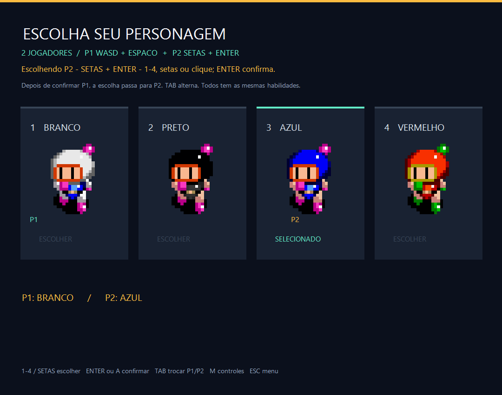
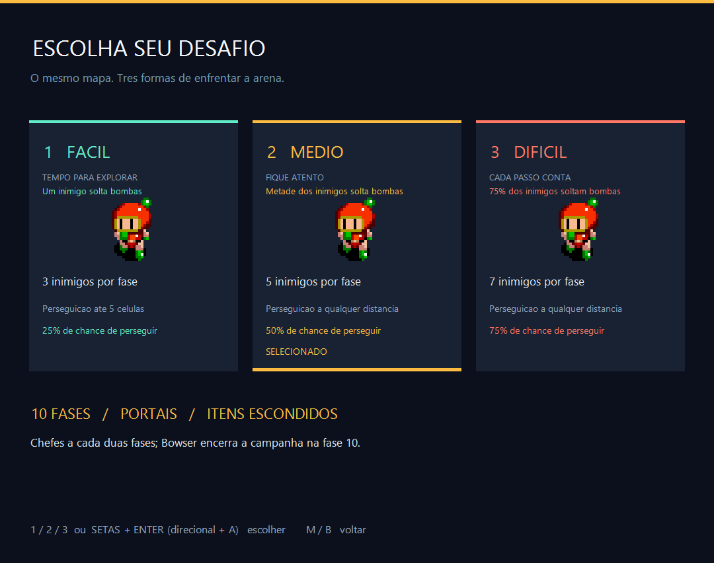
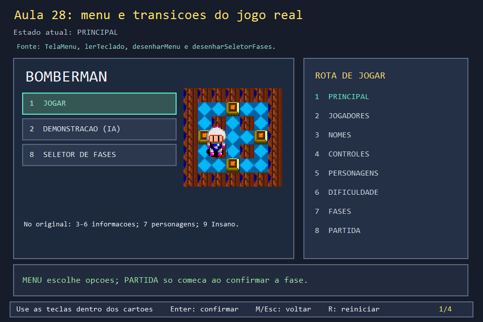
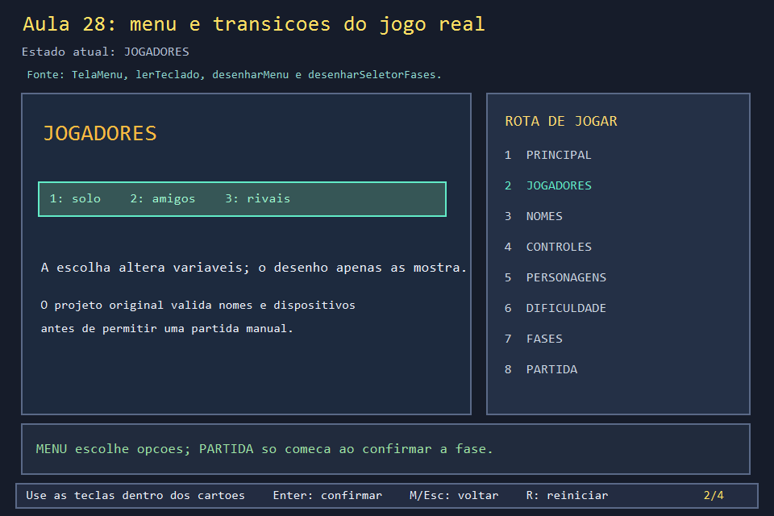
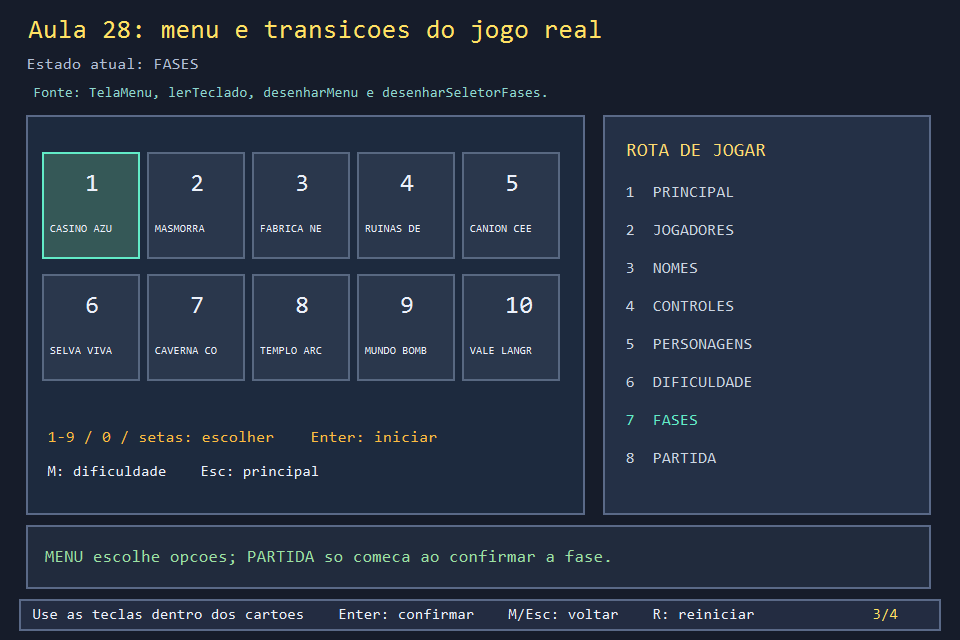
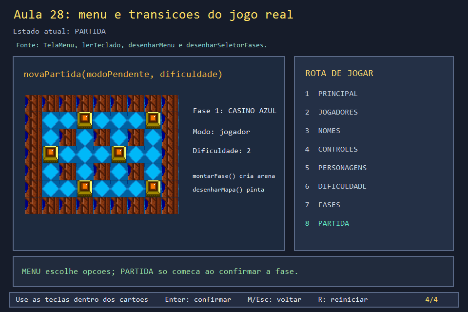

# Aula 28 — Como o menu conduz à partida

| Trilha | Duração | Antes desta aula | Próxima na trilha |
| --- | --- | --- | --- |
| Entrada e menus (16 → 31 → 33 → 28 → 30) | 90–120 min | Aulas [03](../Aula_03_janela_e_mensagens_win32/Aula_03_janela_e_mensagens_win32.md), [12](../Aula_12_fases_dificuldade_e_cooperativo/Aula_12_fases_dificuldade_e_cooperativo.md), [27](../Aula_27_cenarios_tabuleiro_e_tiles/Aula_27_cenarios_tabuleiro_e_tiles.md) [31](../Aula_31_joystick_real/Aula_31_joystick_real.md) e [33](../Aula_33_configuracao_de_controles/Aula_33_configuracao_de_controles.md) | [Aula 30 — Construindo um menu completo](../Aula_30_menu_completo/Aula_30_menu_completo.md) |

Esta aula mostra a **rota** do menu: que telas existem e em que ordem levam à partida. A [Aula 30](../Aula_30_menu_completo/Aula_30_menu_completo.md) mostra como cada tela é **construída** (campo de texto, mouse, cartões, joystick).

## As telas do jogo real, na ordem da rota "Jogar"

| 1. Menu principal | 2. Quantos jogam | 3. Nomes |
| --- | --- | --- |
|  |  |  |
| **4. Controles** | **5. Personagens** | **6. Dificuldade** |
|  |  |  |
| **7. Fases** | **Partida** | |
|  |  | |

## O que você vai conseguir fazer

Ao concluir, crie um menu com estado explícito, desenhe a tela correspondente, converta tecla em transição, preserve escolhas entre telas e só inicie a partida depois de uma confirmação válida. Explique o caminho de **Jogar**, **Demonstração** e **Seletor de fases**, inclusive onde entram nomes, controles, personagens e dificuldade.

## Experimento visual com arte real

O programa abre com um recorte do **Casino Azul** e o sprite do jogador usados pelo menu original. Pressione **1** para seguir a rota humana, **2** para observar a rota automática ou **8** para abrir diretamente o seletor de dez fases. Leia as ações mostradas nos cartões; **Enter** confirma, **M/Esc** volta e **R** reinicia o laboratório.









Fonte primária: `projeto_final/bomberman.cpp`, obtido por `baixar_jogo_final.ps1`. Procure `enum ModoJogo`, `enum TelaMenu`, `telaMenu`, `modoPendente`, `faseSelecionada`, `desenharMenu`, `desenharSeletorFases`, `desenhar`, `lerTeclado`, `processarMensagem`, `novaPartida` e `montarFase`.

## A arquitetura do menu real

`modo` decide entre `MENU`, `MANUAL` e `AUTOMATICO`. Enquanto `modo==MENU`, a variável `telaMenu` decide qual função de desenho roda no `switch` de `desenhar()`. O callback Win32 recebe `WM_KEYDOWN`, chama `lerTeclado` e pede novo desenho com `InvalidateRect`. A função de entrada altera **estado**, e a função de pintura apenas lê esse estado. Isso evita que desenhar um botão inicie uma fase por engano.

| Tela do jogo | O que ela guarda ou valida | Próxima ação relevante |
| --- | --- | --- |
| `MENU_PRINCIPAL` | Escolha 1 para Jogar, 2 para IA ou 8 para fases | 1 → quantidade de jogadores; 2 → dificuldade; 8 → seletor |
| `MENU_QUANTIDADE_JOGADORES` | 1 jogador, 2 amigos ou 2 rivais | Define `doisJogadores`/`modoRivais`; abre nomes |
| `MENU_NOMES` | Nomes para ranking e confirmação | Só segue com nomes válidos |
| `MENU_ATRIBUICAO_CONTROLES` | Teclado/joystick por jogador | Valida associação antes de seguir |
| `MENU_PERSONAGENS` | Sprite de P1/P2 | Leva à dificuldade |
| `MENU_DIFICULDADE` | Fácil, médio ou difícil | Ajusta regras e abre fases |
| `MENU_FASES` | `faseSelecionada` de 1 a 10 | Teclas 1–9/0, setas ou mouse; Enter chama `novaPartida` se puder |

O projeto ainda contém telas de **ranking**, **como jogar**, **dificuldades** e **pontuação**, além do **Modo Insano**. Elas aparecem no menu principal, mas o executável desta aula concentra o exercício no caminho até a campanha. No programa didático, o campo de nomes está representado por P1/P2 e os dispositivos já estão atribuídos; no jogo real, as duas telas têm digitação, validação e controle de foco. Abra o projeto final para praticar essas telas completas.

### Entrada, regra, pintura

Para o caso real de **8** no menu principal: `WM_KEYDOWN` entrega a tecla; `lerTeclado` guarda `modoPendente=MANUAL` e muda `telaMenu=MENU_FASES`; `desenhar` escolhe `desenharSeletorFases`; o aluno vê dez cards. Em `MENU_FASES`, a tecla **0** significa fase 10, as setas mudam a seleção circularmente e **Enter** pede `novaPartida(modoPendente,dificuldade)`. No modo manual, o código real verifica os nomes antes de começar. `novaPartida` copia `faseSelecionada` para `faseAtual` e chama `montarFase` — assunto da Aula 27.

O preview do menu original usa `temaDaFase(1)` para chão, parede e caixa, além dos sprites de personagem, inimigo e bomba. O exemplo mostra esses tiles e o jogador reais, em escala menor para caber ao lado do fluxograma. O seletor do original monta dez cards com um pequeno tabuleiro temático em cada um; nesta aula os dez cards enfatizam a navegação, enquanto a Aula 27 permite trocar e estudar as dez texturas em tamanho maior.

## O código real

O `enum` com as onze telas e as variáveis que guardam as escolhas entre elas:

<!-- trecho simbolo="TelaMenu" -->
```cpp
// projeto_final/bomberman.cpp, linha 232 (TelaMenu)
enum TelaMenu { MENU_PRINCIPAL, MENU_DIFICULDADE, MENU_RANKING, MENU_COMO_JOGAR, MENU_DIFICULDADES_INFO, MENU_PONTUACAO, MENU_PERSONAGENS, MENU_FASES, MENU_QUANTIDADE_JOGADORES, MENU_ATRIBUICAO_CONTROLES, MENU_NOMES };
```

O `switch` de `desenhar` (Aula 24): uma função de desenho por tela.

<!-- trecho simbolo="desenhar" de="if (modo == MENU) {" ate="    } else {" -->
```cpp
// projeto_final/bomberman.cpp, linhas 4012–4026 (desenhar)
    if (modo == MENU) {
        switch (telaMenu) {
            case MENU_FASES: desenharSeletorFases(g); break;
            case MENU_PERSONAGENS: desenharPersonagens(g); break;
            case MENU_RANKING: desenharRanking(g); break;
            case MENU_DIFICULDADE: desenharEscolhaDificuldade(g); break;
            case MENU_DIFICULDADES_INFO: desenharEscolhaDificuldade(g); break;
            case MENU_COMO_JOGAR: desenharComoJogar(g); break;
            case MENU_PONTUACAO: desenharPontuacaoInfo(g); break;
            case MENU_QUANTIDADE_JOGADORES: desenharQuantidadeJogadores(g); break;
            case MENU_ATRIBUICAO_CONTROLES: desenharAtribuicaoControles(g); break;
            case MENU_NOMES: desenharNomes(g); break;
            default: desenharMenu(g); break;
        }
    } else {
```

A tela principal em `lerTeclado`: cada número leva a uma tela, ou direto a uma ação.

<!-- trecho simbolo="lerTeclado" de="// O nome de cada jogador e pedido depois" ate="else if (tecla == 'Q' || tecla == VK_ESCAPE) DestroyWindow(janelaPrincipal);" -->
```cpp
// projeto_final/bomberman.cpp, linhas 4169–4179 (lerTeclado)
        // O nome de cada jogador e pedido depois da escolha de 1 ou 2 jogadores.
        if (tecla == '1' || tecla == VK_NUMPAD1) { modoPendente = MANUAL; telaMenu = MENU_QUANTIDADE_JOGADORES; }
        else if (tecla == '2' || tecla == VK_NUMPAD2) { modoPendente = AUTOMATICO; telaMenu = MENU_DIFICULDADE; }
        else if (tecla == '3') telaMenu = MENU_COMO_JOGAR;
        else if (tecla == '4') telaMenu = MENU_DIFICULDADES_INFO;
        else if (tecla == '5') telaMenu = MENU_PONTUACAO;
        else if (tecla == '6') telaMenu = MENU_RANKING;
        else if (tecla == '7' || tecla == VK_NUMPAD7) { modoPendente=MANUAL; telaMenu=MENU_PERSONAGENS; jogadorEmSelecao=1; }
        else if (tecla == '8' || tecla == VK_NUMPAD8) { modoPendente=MANUAL; telaMenu=MENU_FASES; }
        else if (tecla == '9' || tecla == VK_NUMPAD9) iniciarModoInsano();
        else if (tecla == 'Q' || tecla == VK_ESCAPE) DestroyWindow(janelaPrincipal);
```

E o seletor de fases, com a guarda que manda para a tela de nomes se uma partida manual ainda não tem nome:

<!-- trecho simbolo="lerTeclado" de="if (telaMenu==MENU_FASES) {" ate="            return;" -->
```cpp
// projeto_final/bomberman.cpp, linhas 4092–4102 (lerTeclado)
        if (telaMenu==MENU_FASES) {
            int escolha=tecla>='1' && tecla<='9' ? static_cast<int>(tecla-'0')
                       : tecla>=VK_NUMPAD1 && tecla<=VK_NUMPAD9 ? static_cast<int>(tecla-VK_NUMPAD1+1) : (tecla=='0' || tecla==VK_NUMPAD0)?10:0;
            if(escolha) faseSelecionada=escolha;
            else if(tecla==VK_LEFT) faseSelecionada=(faseSelecionada+TOTAL_FASES-2)%TOTAL_FASES+1;
            else if(tecla==VK_RIGHT) faseSelecionada=faseSelecionada%TOTAL_FASES+1;
            else if(tecla==VK_UP || tecla==VK_DOWN) faseSelecionada=(faseSelecionada+4)%TOTAL_FASES+1;
            else if(tecla==VK_RETURN){if(modoPendente!=MANUAL || nomesProntos())novaPartida(modoPendente,dificuldade);else abrirTelaNomes(MENU_FASES);}
            else if(tecla=='M') telaMenu=MENU_DIFICULDADE;
            else if(tecla==VK_ESCAPE) telaMenu=MENU_PRINCIPAL;
            return;
```

## Construa, altere e teste

1. Localize o `enum Tela` e a variável `tela`. Compare com `TelaMenu` e `telaMenu` do original. Diga por que um `bool estaNoMenu` não seria suficiente para tantas telas.
2. Pressione **1**, escolha **2** jogadores, confirme nomes e controles com Enter, escolha um personagem de 1 a 4 e confirme. Escolha dificuldade **3**, depois fase **0**, e inicie. Preveja `fase=10` e `dificuldade=2` antes de olhar o painel.
3. Reinicie com **R**, pressione **2** e observe que a rota automática pula as telas humanas. Reinicie e pressione **8**: o atalho chega às fases, mas o jogo real ainda exige nomes válidos para uma partida manual.
4. Mude `AULA28_FASE_INICIAL` para 8 e `AULA28_DIFICULDADE_INICIAL` para 2; confira o seletor e a partida. A solução em `solucoes/` traz essa variação.
5. Acrescente ao seu próprio menu uma tela de instruções que volte com Esc. Garanta que `WM_PAINT` não altere `tela`.

## Compile e execute

Na raiz do curso, com C++17 e GDI+ do Windows:

```powershell
.\compilar_aula.ps1 -Numero 28
.\build\Aula_28_menu_e_transicoes_reais.exe
```

O build gera quatro PNGs e testa por código a rota até a fase 10. Se a janela abre sem preview, confira `projeto_final/assets/SNES - Super Bomberman - Story Mode Stages - Stage 2-5.png`. Se uma tecla parece ignorada, observe em que tela está: cada estado aceita entradas diferentes. O apoio `visual_base.h` gerencia a janela e chama `tecla` antes de pintar; a lógica específica do menu está no arquivo desta aula.

## Checklist e próxima aplicação

Explique a sequência **evento → estado → desenho**, identifique a guarda que impede início sem nomes no jogo real, faça **0** selecionar a fase 10 e demonstre retorno sem perder uma escolha válida. Em seguida, construa suas telas próprias e conecte o botão Iniciar ao `montarFase()` implementado após a Aula 27.

## Erros comuns

- **Desenhar decidindo.** Se `desenharMenu` mudasse `telaMenu`, um simples `WM_PAINT` (ao mover a janela) trocaria de tela. Entrada muda o estado; o desenho só lê.
- **Um `bool` por tela.** Com onze telas, `bool emNomes, emFases, ...` permite duas telas ativas ao mesmo tempo. O `enum` garante uma.
- **Voltar perdendo escolhas.** `M`/`Esc` mudam `telaMenu`, mas não apagam `dificuldade`, `faseSelecionada` nem os nomes. Volte e confira.

## Referências

- `bomberman.cpp` original e `projeto_final/assets/`: fonte verificada para telas, transições, nomes e preview.
- [Mensagens de teclado Win32](https://learn.microsoft.com/en-us/windows/win32/inputdev/wm-keydown).
