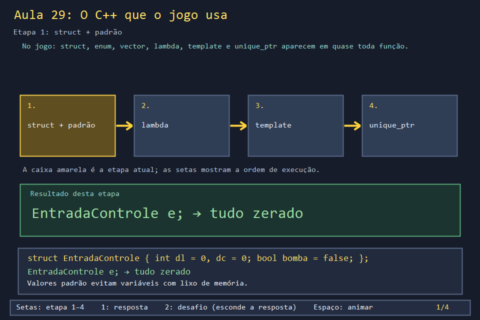
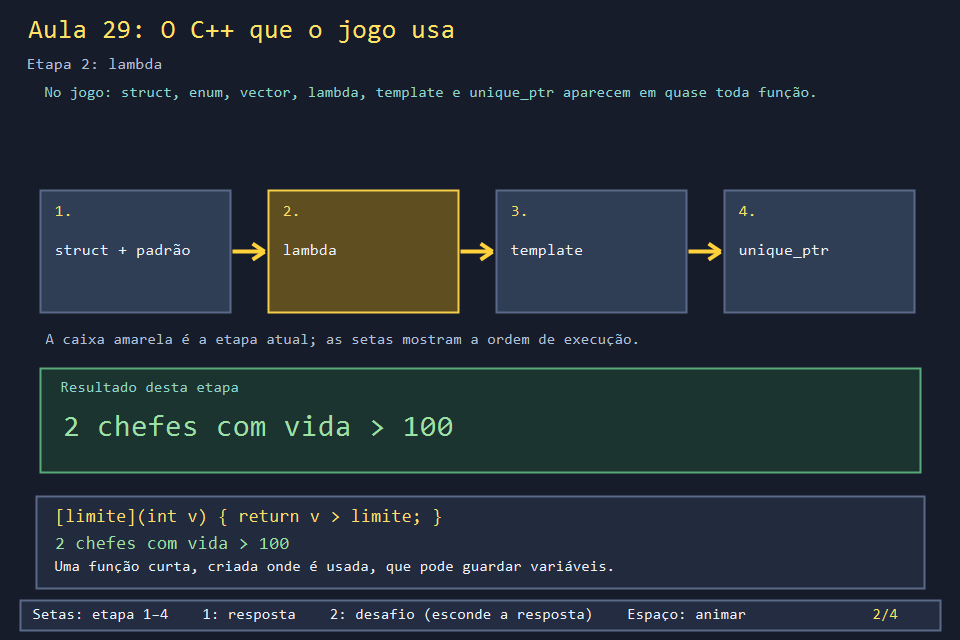
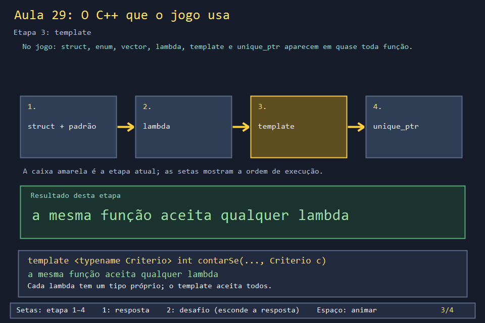
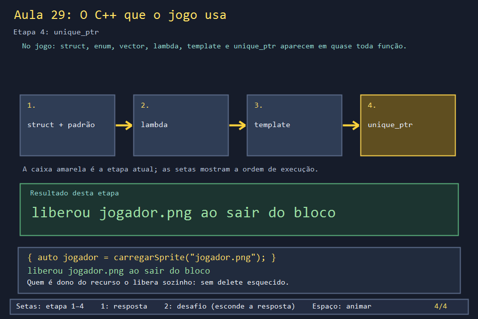

# Aula 29 — O C++ que o jogo usa

| Trilha | Duração | Antes desta aula | Próxima na trilha |
| --- | --- | --- | --- |
| Fundamentos de C++ (01 → 02 → 29) | 90–120 min, ou por partes | [Aula 02](../Aula_02_matriz_enum_e_mapa/Aula_02_matriz_enum_e_mapa.md) | [Aula 03 — Janela e mensagens Win32](../Aula_03_janela_e_mensagens_win32/Aula_03_janela_e_mensagens_win32.md) |

Um primeiro curso de C++ costuma terminar em `struct`, vetores e funções. O `bomberman.cpp` vai além: usa lambdas, templates, `unique_ptr`, ponteiros de função e `wstring`. Esta aula é um **guia de consulta**. Cada seção mostra um recurso da linguagem, o trecho real do jogo que o usa e a aula onde ele aparece. Você pode lê-la inteira agora ou voltar a cada seção quando uma aula pedir.

| Seção | Recurso | Leia antes de |
| --- | --- | --- |
| 1 | `struct` com valores padrão | Aulas 08, 09, 16 |
| 2 | `enum` e `switch` | Aulas 02, 09, 22 |
| 3 | referência `const&` e comparadores | Aulas 13, 21 |
| 4 | lambda e captura | Aulas 10, 13, 20, 26 |
| 5 | template | Aulas 10, 31 |
| 6 | `vector` com `erase` / `remove_if` | Aulas 08, 14 |
| 7 | `unique_ptr` e RAII | Aulas 05, 24 |
| 8 | ponteiro de função | Aulas 16, 31 |
| 9 | `wstring` e UTF-8 | Aulas 21, 30 |

## O que você vai conseguir fazer

- Reconhecer cada um desses recursos quando aparecer no jogo.
- Escrever uma lambda, decidir entre captura por valor e por referência, e passá-la a um template.
- Explicar por que o jogo usa `unique_ptr` para imagens e fontes.
- Converter texto entre `wstring` e UTF-8.

## 1. `struct` com valores padrão

Cada campo pode ter um valor inicial. Uma variável criada sem argumentos já começa válida, sem lixo de memória.

<!-- trecho simbolo="EntradaControle" -->
```cpp
// projeto_final/bomberman.cpp, linha 266 (EntradaControle)
struct EntradaControle { int dl=0,dc=0;bool bomba=false,confirmar=false,voltar=false,chute=false,teleporte=false,detonar=false,start=false,select=false; };
```

`Bomba`, `Boss` e `MarioAliado` usam a mesma técnica. Ela também permite "zerar" tudo de uma vez: `boss = Boss{};` (em `montarFase`).

## 2. `enum` e `switch`

Um `enum` dá nomes a uma lista fechada de valores. Com `switch` e `-Wall`, o compilador avisa se faltar um caso.

<!-- trecho simbolo="TipoItem" -->
```cpp
// projeto_final/bomberman.cpp, linha 105 (TipoItem)
enum TipoItem { CHUTE, TELEPORTE, RAIO, BOMBA_EXTRA, VIDA_EXTRA, BOMBA_RELOGIO, IMUNE_BOMBA, ATRAVESSA_BLOCO };
```

O `switch` de `coletarItensEm` (Aula 09) tem um `case` para cada item. O de `atualizarHornet` (Aula 22) tem um para cada etapa.

## 3. Referência `const&` e comparadores

`const Tipo&` passa o objeto sem copiar e sem permitir alterações. É o padrão para structs com `string` dentro. `std::sort` recebe um comparador que diz "a vem antes de b?".

<!-- trecho simbolo="melhorRegistro" -->
```cpp
// projeto_final/bomberman.cpp, linhas 695–700 (melhorRegistro)
bool melhorRegistro(const RegistroPontuacao& a,const RegistroPontuacao& b){
    if(a.pontuacao!=b.pontuacao)return a.pontuacao>b.pontuacao;
    if(a.bombas!=b.bombas)return a.bombas<b.bombas;
    if(a.movimentos!=b.movimentos)return a.movimentos<b.movimentos;
    return chaveNomeRanking(a.jogador)<chaveNomeRanking(b.jogador);
}
```

## 4. Lambda e captura

Uma lambda é uma função sem nome, escrita onde é usada. Entre colchetes vai a **captura**, que diz quais variáveis de fora ela pode usar: `[&]` por referência (lê o valor atual), `[=]` ou `[nome]` por cópia (guarda o valor do momento em que foi criada).

<!-- trecho simbolo="proximoPassoParaAlvo" -->
```cpp
// projeto_final/bomberman.cpp, linhas 1667–1670 (proximoPassoParaAlvo)
Posicao proximoPassoParaAlvo(Posicao origem, Posicao alvo) {
    return bfsProximoPasso(
        origem, [&](Posicao p) { return iguais(p, alvo); }, podeAndarLivre);
}
```

Aqui `[&]` captura `alvo`. A lambda é passada para a BFS e chamada para cada casa visitada.

## 5. Template

Cada lambda tem um tipo próprio, sem nome que você possa escrever. Para uma função aceitar **qualquer** lambda, ela vira um template: o compilador gera uma versão para cada tipo usado. O comentário do jogo explica a escolha:

<!-- trecho de="// Template de proposito" ate="Posicao bfsProximoPasso(Posicao origem, EhAlvo ehAlvo, PodeAndarPor podeAndarPor) {" -->
```cpp
// projeto_final/bomberman.cpp, linhas 1626–1635
// Template de proposito (criterio tecnico do trabalho): as tres buscas que
// existiam nesta secao (perseguicao de inimigo/boss, busca de alvo seguro do
// bot, fuga do bot) eram a mesma busca em largura copiada tres vezes, so
// variando "quando parar" e "por quais celulas dá pra passar". Em vez de
// manter três copias quase identicas, a busca vira uma unica funcao
// parametrizada pelos dois criterios - cada chamador passa suas proprias
// lambdas, e o compilador gera uma versao especializada pra cada combinacao
// (por isso precisa ser template: cada lambda tem um tipo proprio).
template <typename EhAlvo, typename PodeAndarPor>
Posicao bfsProximoPasso(Posicao origem, EhAlvo ehAlvo, PodeAndarPor podeAndarPor) {
```

O controle usa outro template pequeno, para carregar funções da SDL2 de tipos diferentes com o mesmo código (Aula 31):

<!-- trecho simbolo="obterFuncaoSDL" -->
```cpp
// projeto_final/bomberman.cpp, linhas 482–487 (obterFuncaoSDL)
template<class F> bool obterFuncaoSDL(const char* nome,F& funcao){
    FARPROC p=GetProcAddress(sdl.dll,nome);
    static_assert(sizeof(funcao)==sizeof(p));
    memcpy(&funcao,&p,sizeof(funcao));
    return funcao!=nullptr;
}
```

## 6. `vector` com `erase` e `remove_if`

Remover vários elementos de um `vector` de uma vez: `remove_if` empurra os que ficam para a frente e devolve onde começa o resto, e `erase` corta o resto.

<!-- trecho simbolo="atualizarProjeteisBoss" de="projeteisBoss.erase(remove_if" ate="projeteisBoss.erase(remove_if" -->
```cpp
// projeto_final/bomberman.cpp, linha 1963 (atualizarProjeteisBoss)
    projeteisBoss.erase(remove_if(projeteisBoss.begin(),projeteisBoss.end(),[](const ProjetilBoss& p){return p.vida<=0;}),projeteisBoss.end());
```

## 7. `unique_ptr` e RAII

Um `unique_ptr` é o **dono** de um objeto criado com `new` e o destrói sozinho quando sai de escopo. Por isso o jogo nunca chama `delete` em imagens ou fontes. RAII (Resource Acquisition Is Initialization) é o nome do padrão: o recurso vive exatamente o tempo da variável.

<!-- trecho simbolo="carregarSprite" -->
```cpp
// projeto_final/bomberman.cpp, linhas 2540–2548 (carregarSprite)
unique_ptr<Gdiplus::Image> carregarSprite(const wstring& nome) {
    wstring caminho = pastaDoExecutavel() + L"\\assets\\" + nome;
    auto imagem = make_unique<Gdiplus::Image>(caminho.c_str());
    if (imagem->GetLastStatus() == Gdiplus::Ok) return imagem;
    wstring mensagem = L"Nao foi possivel carregar o asset:\n" + caminho +
                       L"\n\nO jogo usara uma representacao textual.";
    MessageBoxW(janelaPrincipal, mensagem.c_str(), L"Asset nao encontrado", MB_OK | MB_ICONWARNING);
    return nullptr;
}
```

<!-- trecho de="unordered_map<int, unique_ptr<Gdiplus::Font>> cacheFontes;" ate="unordered_map<int, unique_ptr<Gdiplus::Font>> cacheFontes;" -->
```cpp
// projeto_final/bomberman.cpp, linha 410
unordered_map<int, unique_ptr<Gdiplus::Font>> cacheFontes;
```

Atenção à ordem: imagens GDI+ precisam ser destruídas **antes** de `GdiplusShutdown`. Por isso o jogo chama `liberarAssets()` em `WM_DESTROY`, e não espera o fim do programa (Aula 03).

## 8. Ponteiro de função

Uma variável pode guardar o endereço de uma função. O jogo usa isso para chamar `XInputGetState` de uma DLL carregada em tempo de execução: se a DLL não existir, o jogo continua funcionando, só sem controle Xbox.

<!-- trecho de="using FuncaoXInputGetState" ate="FuncaoXInputGetState obterEstadoXInput = nullptr;" -->
```cpp
// projeto_final/bomberman.cpp, linhas 268–270
using FuncaoXInputGetState = DWORD (WINAPI*)(DWORD,XINPUT_STATE*);
HMODULE bibliotecaXInput = nullptr;
FuncaoXInputGetState obterEstadoXInput = nullptr;
```

## 9. `wstring` e UTF-8

O Windows trabalha com texto em UTF-16 (`wchar_t`, `wstring`, funções terminadas em `W`). Arquivos costumam usar UTF-8 (`char`, `string`). O jogo digita nomes em `wstring` e grava o ranking em UTF-8:

<!-- trecho simbolo="wparaStr" -->
```cpp
// projeto_final/bomberman.cpp, linhas 652–657 (wparaStr)
string wparaStr(const wstring& texto) {
    int n=WideCharToMultiByte(CP_UTF8,0,texto.data(),int(texto.size()),nullptr,0,nullptr,nullptr);
    string resultado(n,'\0');
    if(n)WideCharToMultiByte(CP_UTF8,0,texto.data(),int(texto.size()),resultado.data(),n,nullptr,nullptr);
    return resultado;
}
```

Num nome como "João", o "ã" ocupa 1 `wchar_t` mas 2 bytes em UTF-8.

## A versão desta aula

`Aula_29_cpp_que_o_jogo_usa.cpp` demonstra oito desses recursos com exemplos que imitam o uso no jogo:

```text
1. struct com valores padrao
  dl=0 dc=0 bomba=0
...
4. lambda + template
  chefes com vida > 100: 2; com vida par: 2
5. vector + erase/remove_if (como os projeteis mortos)
  sobraram 3 projeteis
6. unique_ptr
  carregou jogador.png
  usando jogador.png
  liberou jogador.png
  (fim do bloco)
...
8. wstring -> UTF-8
  "João" tem 4 letras e 5 bytes em UTF-8
```

Na seção 6, "liberou" aparece **antes** de "(fim do bloco)": o `unique_ptr` destrói a imagem exatamente no `}`.

## Laboratório visual

| | |
| --- | --- |
|  |  |
|  |  |

```powershell
.\compilar_aula.ps1 -Numero 29
.\build\Aula_29_cpp_que_o_jogo_usa.exe
.\abrir_aula.ps1 -Numero 29 -Modo Exemplo
```

## Exercícios

1. **Leitura.** Em `salvarRegistroPartida` (Aula 13), qual é a lambda, o que ela captura e para que serve? *(`[&](const RegistroPontuacao& r){ return chaveNomeRanking(r.jogador) == chaveNomeRanking(novo.jogador); }`: captura `novo` por referência e é o critério de `find_if` para achar o mesmo jogador.)*
2. **Template.** Escreva `encontrarPrimeiro(vetor, criterio)`, que devolve o índice do primeiro elemento que satisfaz o critério, ou −1. *Solução: `solucoes/`.*
3. **Captura.** Crie duas lambdas, uma com `[=]` e outra com `[&]`, que comparam com uma variável `minimo`. Mude `minimo` depois de criá-las. Qual delas vê o valor novo? *Solução: `solucoes/` — só a `[&]`.*
4. **`unique_ptr` no vetor.** Por que `cache.push_back(nova)` não compila, mas `cache.push_back(std::move(nova))` compila? *(Copiar criaria dois donos para o mesmo objeto. `move` transfere a posse; `nova` fica vazia.)*

## Erros comuns

- **Capturar por referência algo que vai morrer.** Uma lambda `[&]` guardada para depois, que usa uma variável local já destruída, lê lixo. No jogo, as lambdas com `[&]` são usadas na hora e descartadas.
- **Misturar `string` e `wstring`.** `SetWindowTextW("texto")` não compila; o texto precisa ser `L"texto"`. Converta nas bordas: na tela use `wstring`, no arquivo use UTF-8.
- **`new` sem dono.** `Gdiplus::Image* img = new Gdiplus::Image(...)` vaza se ninguém der `delete`. Prefira `make_unique`, como o jogo.

## Antes de seguir

- [ ] Sei explicar a diferença entre `[&]` e `[=]` com um exemplo.
- [ ] Encontrei no jogo um uso de cada uma das nove seções.
- [ ] Resolvi os exercícios 2 e 3.

## Referências

- [Expressões lambda (cppreference)](https://en.cppreference.com/w/cpp/language/lambda)
- [Templates de função (cppreference)](https://en.cppreference.com/w/cpp/language/function_template)
- [`std::unique_ptr` (cppreference)](https://en.cppreference.com/w/cpp/memory/unique_ptr)
- [RAII (cppreference)](https://en.cppreference.com/w/cpp/language/raii)
- [Erase–remove idiom (Wikipédia)](https://en.wikipedia.org/wiki/Erase%E2%80%93remove_idiom)
- [`WideCharToMultiByte` (Microsoft Learn)](https://learn.microsoft.com/en-us/windows/win32/api/stringapiset/nf-stringapiset-widechartomultibyte)
