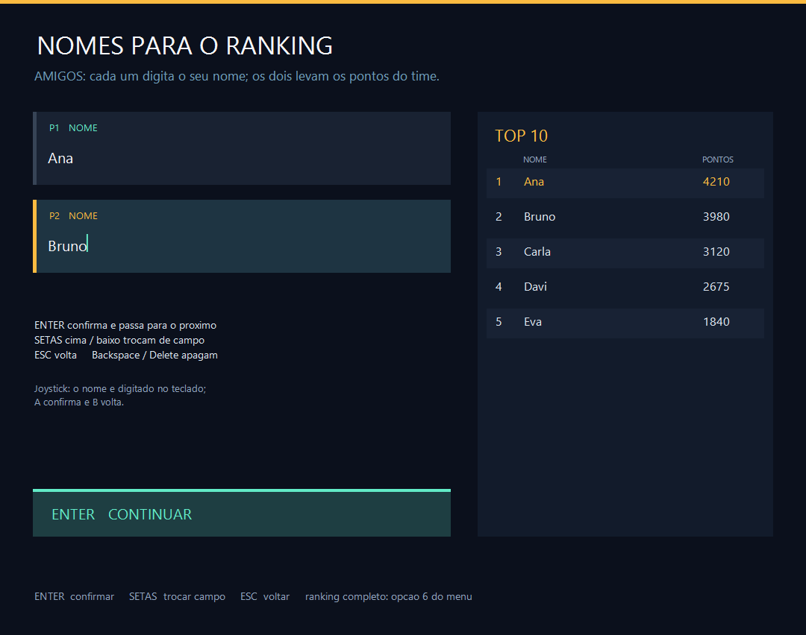
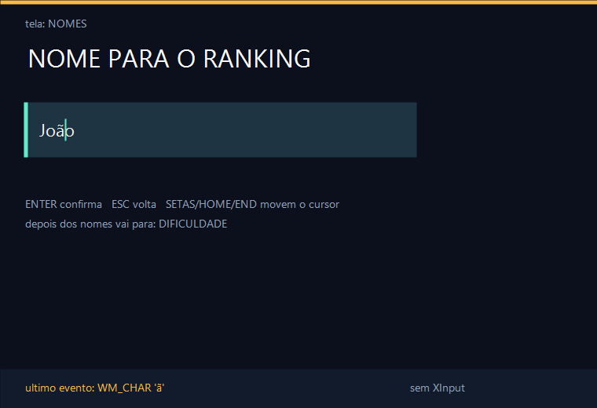
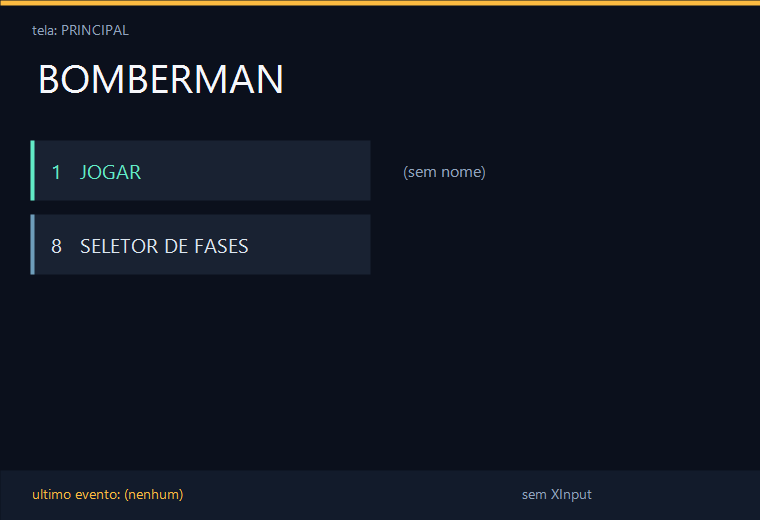
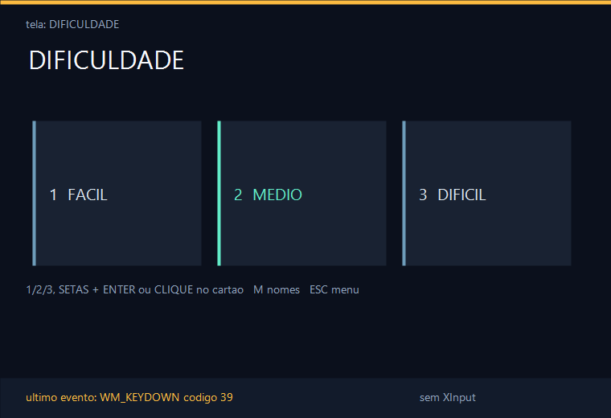
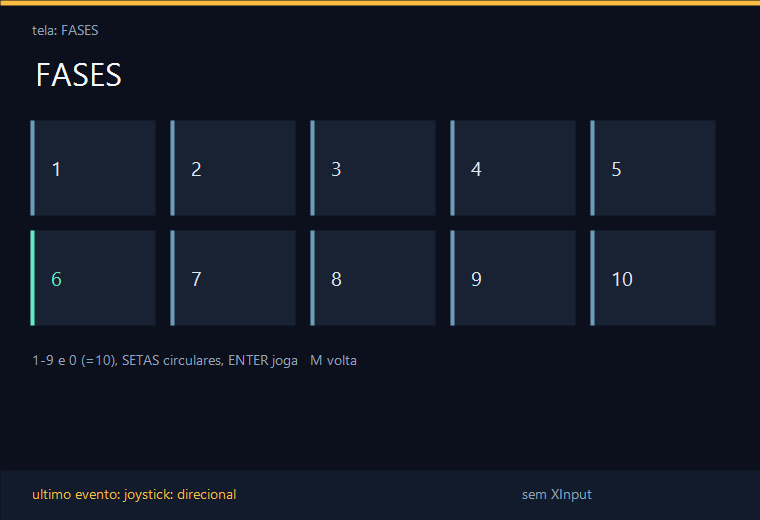
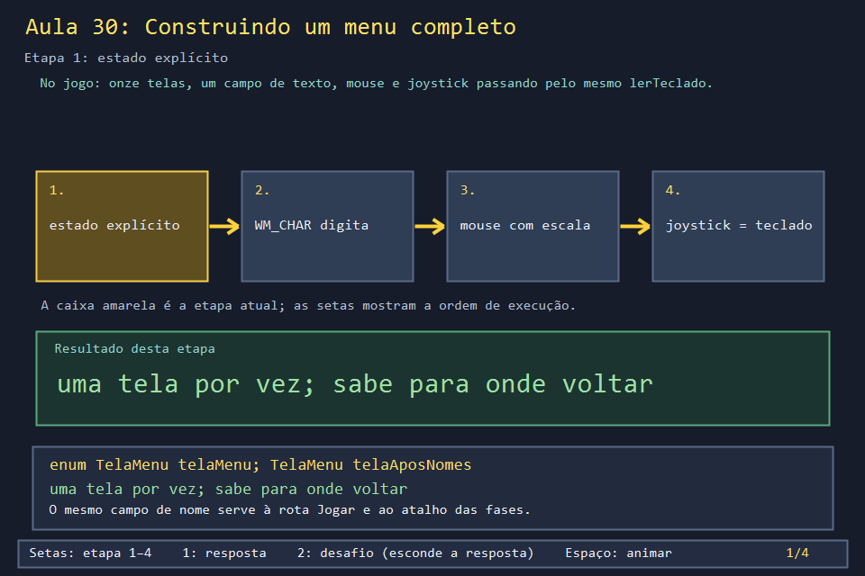
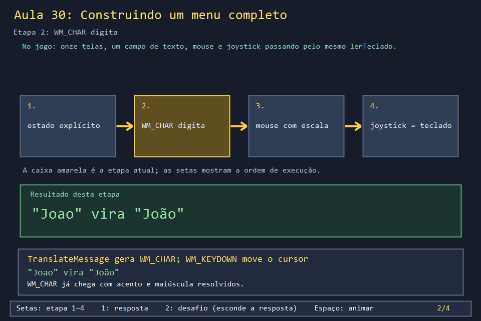
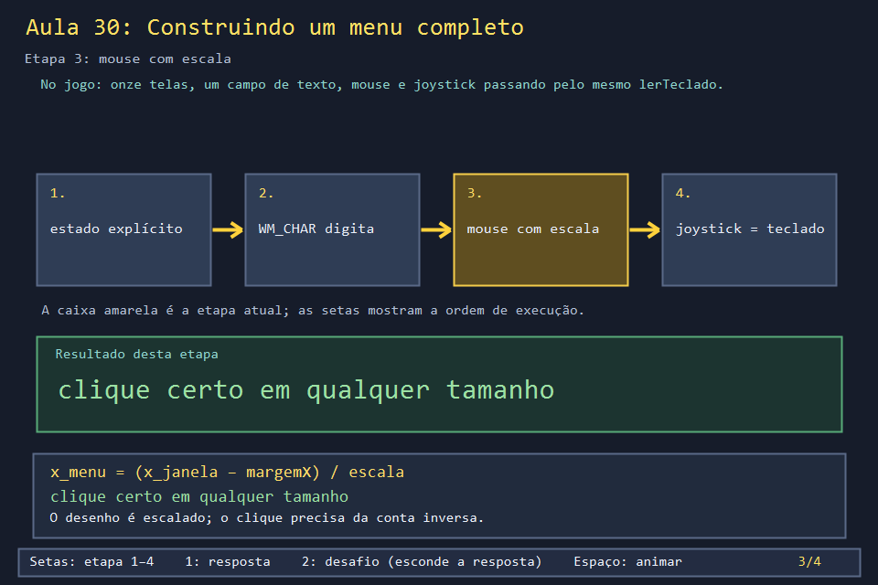
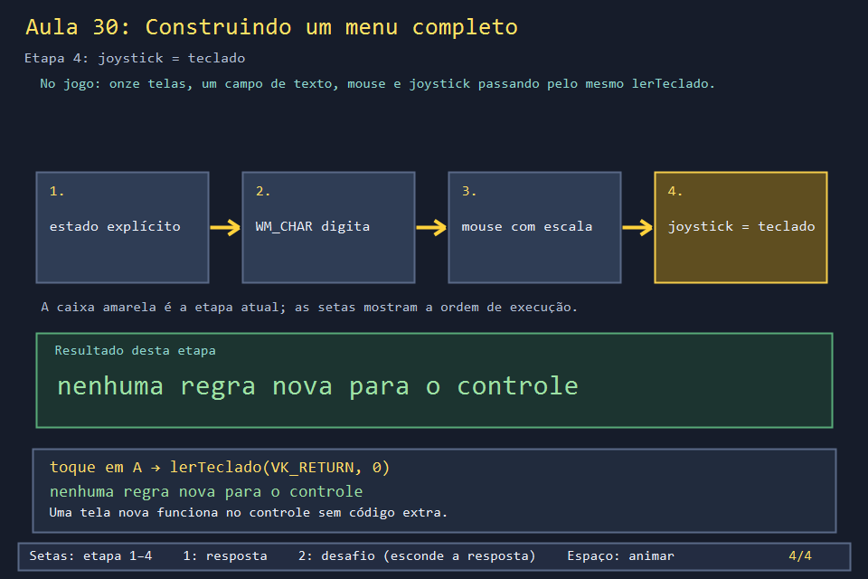

# Aula 30 — Construindo um menu completo

| Trilha | Duração | Antes desta aula | Próxima na trilha |
| --- | --- | --- | --- |
| Entrada e menus (16 → 31 → 33 → 28 → 30) | 2–3 h | [Aula 24](../Aula_24_backbuffer_dpi_recursos/Aula_24_backbuffer_dpi_recursos.md), [Aula 28](../Aula_28_menu_e_transicoes_reais/Aula_28_menu_e_transicoes_reais.md), [Aula 31](../Aula_31_joystick_real/Aula_31_joystick_real.md) | fim da trilha; leitura completa na [Aula 17](../Aula_17_leitura_orientada_do_jogo_real/Aula_17_leitura_orientada_do_jogo_real.md) |

| A tela de nomes do jogo real | O menu que você vai construir |
| --- | --- |
|  |  |

A Aula 28 mostrou a **rota** do menu: quais telas existem e em que ordem. Esta aula mostra como cada tela é **construída**. Um campo de texto em que se digita com acento e se move o cursor. Uma validação que manda o jogador de volta quando falta o nome e lembra para onde ele ia. Cartões que respondem ao mouse em qualquer tamanho de janela. E um controle que navega por tudo sem uma única regra própria. O exemplo é um mini-menu de verdade, que você pode abrir, usar e modificar.

## O que você vai conseguir fazer

- Implementar um campo de texto com `WM_CHAR`, cursor, Backspace, Home/End e limite de tamanho.
- Usar uma variável de "retorno" (`telaAposNomes`) para reaproveitar uma tela em duas rotas.
- Filtrar a repetição automática do teclado com o bit 30 de `lParam`.
- Converter cliques para as coordenadas do menu e testar áreas de cartões.
- Ligar o controle ao menu chamando `lerTeclado`, só no toque.

## 1. A ideia

```text
                    ┌─────────────── processarMensagem ───────────────┐
 tecla ── WM_KEYDOWN ──► lerTeclado(tecla, lParam) ──┐                 │
 letra ── WM_CHAR ─────► digitarNomeJogador(c) ──────┤                 │
 clique ─ WM_LBUTTONUP ► (x - margem) / escala ─► lerTeclado('1'...) ──┼─► telaMenu, nome, escolhas
 controle WM_TIMER ────► processarControleNoMenu ─► lerTeclado(VK_RETURN...)
                                                                       │
 WM_PAINT ─────────────► desenharCena ◄──── só LÊ o estado ────────────┘
```

Todas as entradas desembocam em poucas funções que alteram o estado. O desenho nunca altera nada.

## 2. O código real

### O campo de texto

As letras chegam por `WM_CHAR`, gerado por `TranslateMessage` a partir das teclas, já com maiúscula, acento e layout do teclado resolvidos. Backspace também chega como o caractere `'\b'`:

<!-- trecho simbolo="processarMensagem" de="case WM_CHAR:" ate="return 0;" -->
```cpp
// projeto_final/bomberman.cpp, linhas 4363–4367 (processarMensagem)
    case WM_CHAR:
        if (modo == MENU && (telaMenu == MENU_NOMES || telaMenu==MENU_RANKING))
            digitarNomeJogador(static_cast<wchar_t>(wParam));
        InvalidateRect(janela, nullptr, FALSE);
        return 0;
```

<!-- trecho simbolo="digitarNomeJogador" -->
```cpp
// projeto_final/bomberman.cpp, linhas 767–781 (digitarNomeJogador)
void digitarNomeJogador(wchar_t caractere) {
    if(!editandoNome)return;
    wstring& nome=nomeEmEdicao();
    cursorNome=min(cursorNome,nome.size());
    if (caractere == L'\b') {
        if(selecionarNome){nome.clear();cursorNome=0;selecionarNome=false;}
        else if(cursorNome>0){nome.erase(--cursorNome,1);}
        return;
    }
    bool valido=caractere>=L' ' && caractere!=127;
    if(valido){
        if(selecionarNome){nome.clear();cursorNome=0;selecionarNome=false;}
        if(nome.size()<24){nome.insert(cursorNome,1,caractere);cursorNome++;avisoNome.clear();confirmacaoEmEdicao().clear();}
    }
}
```

O que **não** é caractere (setas, Home, End, Delete, Enter, Esc) vem por `WM_KEYDOWN`. Note a primeira linha de `lerTeclado`: segurar uma tecla gera `WM_KEYDOWN` repetidos com o bit 30 ligado, e o jogo os ignora.

<!-- trecho simbolo="lerTeclado" ate="        return;" -->
```cpp
// projeto_final/bomberman.cpp, linhas 4055–4078 (lerTeclado)
void lerTeclado(WPARAM tecla, LPARAM lParam) {
    // Bit 30 do lParam indica auto-repeticao do SO; ignoramos para acoes
    // pontuais (senao segurar R/espaco dispara a acao varias vezes por
    // segundo na taxa de repeticao do teclado, fora do controle do jogo).
    bool repetida = (lParam & (1 << 30)) != 0;
    if (repetida) return;
    if(modo==MENU && (telaMenu==MENU_NOMES || telaMenu==MENU_RANKING) && editandoNome){
        wstring& nome=nomeEmEdicao();
        cursorNome=min(cursorNome,nome.size());
        bool telaNomes=telaMenu==MENU_NOMES;
        if(tecla==VK_RETURN || tecla==VK_TAB){if(telaNomes)confirmarCampoNome();else terminarRenomeacaoRanking(true);}
        else if(tecla==VK_ESCAPE){
            if(!telaNomes)terminarRenomeacaoRanking(false);
            else if(campoNome==2)editarCampoNome(1);
            else {editandoNome=false;selecionarNome=false;avisoNome.clear();telaMenu=MENU_QUANTIDADE_JOGADORES;}
        }
        else if(telaNomes && (tecla==VK_UP || tecla==VK_DOWN)){if(doisJogadores)editarCampoNome(3-campoNome);}
        else if(tecla==VK_HOME){cursorNome=0;selecionarNome=false;}
        else if(tecla==VK_END){cursorNome=nome.size();selecionarNome=false;}
        else if(tecla==VK_LEFT){if(cursorNome)cursorNome--;selecionarNome=false;}
        else if(tecla==VK_RIGHT){cursorNome=min(cursorNome+1,nome.size());selecionarNome=false;}
        else if(tecla==VK_DELETE){if(selecionarNome){nome.clear();cursorNome=0;selecionarNome=false;}else if(cursorNome<nome.size())nome.erase(cursorNome,1);}
        else if(tecla=='A' && (GetKeyState(VK_CONTROL)&0x8000))selecionarNome=true;
        return;
```

O cursor piscante é desenhado medindo o texto antes dele, com o **mesmo** formato usado para desenhar:

<!-- trecho simbolo="desenharNomeDigitavel" -->
```cpp
// projeto_final/bomberman.cpp, linhas 3589–3604 (desenharNomeDigitavel)
void desenharNomeDigitavel(Gdiplus::Graphics& g,int x,int y,int largura,const wstring& nomeJogador,bool editandoNome,
                           const wchar_t* vazio=L"Clique aqui e digite seu nome"){
    auto salvo=g.Save();g.SetClip(Gdiplus::Rect(px(x),px(y),px(largura),px(29)));
    auto formato=Gdiplus::StringFormat::GenericTypographic()->Clone();
    formato->SetFormatFlags(formato->GetFormatFlags()|Gdiplus::StringFormatFlagsMeasureTrailingSpaces);
    Gdiplus::RectF medida;wstring prefixo=nomeJogador.substr(0,min(cursorNome,nomeJogador.size()));
    auto* fonte=obterFonte(px(20));g.MeasureString(prefixo.c_str(),int(prefixo.size()),fonte,Gdiplus::PointF(0,0),formato,&medida);
    float deslocamento=editandoNome?max(0.f,medida.Width-px(largura)+px(8)):0.f;
    float origemX=px(x)-deslocamento;
    Gdiplus::SolidBrush cor(nomeJogador.empty()?Gdiplus::Color(255,144,164,190):Gdiplus::Color(255,246,247,251));
    const wchar_t* texto=nomeJogador.empty()?vazio:nomeJogador.c_str();
    g.DrawString(texto,-1,fonte,Gdiplus::PointF(origemX,float(px(y))),formato,&cor);
    if(editandoNome && (relogioAnimacaoMs/500)%2==0){Gdiplus::Pen cursor(Gdiplus::Color(255,98,235,199),max(1,px(2)));
        float cx=origemX+medida.Width;g.DrawLine(&cursor,cx,float(px(y)),cx,float(px(y+24)));}
    delete formato;g.Restore(salvo);
}
```

### Validar e saber para onde voltar

`abrirTelaNomes` recebe a tela seguinte. Assim, a mesma tela de nomes serve à rota "Jogar" (vai para a atribuição de controles) e ao atalho "8" (volta ao seletor de fases):

<!-- trecho simbolo="abrirTelaNomes" -->
```cpp
// projeto_final/bomberman.cpp, linhas 814–816 (abrirTelaNomes)
void abrirTelaNomes(TelaMenu depois){
    telaAposNomes=depois;telaMenu=MENU_NOMES;avisoNome.clear();editarCampoNome(1);
}
```

<!-- trecho simbolo="confirmarCampoNome" -->
```cpp
// projeto_final/bomberman.cpp, linhas 819–826 (confirmarCampoNome)
void confirmarCampoNome(){
    if(!confirmarNomeJogador(true))return;
    if(campoNome==1 && doisJogadores){editarCampoNome(2);return;}
    campoNome=1;
    if(!nomesProntos()){editarCampoNome(1);return;}
    if(telaAposNomes==MENU_ATRIBUICAO_CONTROLES)abrirAtribuicaoControles();
    else telaMenu=telaAposNomes;
}
```

<!-- trecho simbolo="nomesProntos" -->
```cpp
// projeto_final/bomberman.cpp, linhas 802–809 (nomesProntos)
bool nomesProntos(){
    auto pronto=[](const wstring& nome,const string& confirmado){
        string limpo=limparNomeRanking(wparaStr(nome));
        return !limpo.empty() && chaveNomeRanking(limpo)==confirmado;
    };
    if(!pronto(nomeJogador,nomeConfirmadoRanking))return false;
    return !doisJogadores || (pronto(nomeJogador2,nomeConfirmadoRanking2) && nomeConfirmadoRanking2!=nomeConfirmadoRanking);
}
```

### Mouse

A conta inversa da Aula 24, seguida de testes de área iguais às coordenadas usadas em `desenharMenu`:

<!-- trecho simbolo="processarMensagem" de="case WM_LBUTTONUP: {" ate="if(x>=550 && x<1036 && y>=604 && y<659) { lerTeclado('9',0); return 0; }" -->
```cpp
// projeto_final/bomberman.cpp, linhas 4306–4312 (processarMensagem)
    case WM_LBUTTONUP: {
        // Os cartoes visuais tambem podem ser escolhidos com o mouse.
        int x = static_cast<int>((static_cast<short>(LOWORD(lParam))-margemJanelaX) / escalaDpi);
        int y = static_cast<int>((static_cast<short>(HIWORD(lParam))-margemJanelaY) / escalaDpi);
        if (modo == MENU && telaMenu == MENU_PRINCIPAL) {
            if(x>=44 && x<514 && y>=192 && y<267){lerTeclado('1',0);InvalidateRect(janela,nullptr,FALSE);return 0;}
            if(x>=550 && x<1036 && y>=604 && y<659) { lerTeclado('9',0); return 0; }
```

### Joystick

Na tela de nomes, o controle não digita: ele confirma, volta e troca de campo, sempre chamando `lerTeclado`:

<!-- trecho simbolo="processarControleNoMenu" de="if (telaMenu == MENU_NOMES) {" ate="        return;" -->
```cpp
// projeto_final/bomberman.cpp, linhas 4230–4235 (processarControleNoMenu)
    if (telaMenu == MENU_NOMES) {
        // O nome vem do teclado; o joystick confirma, volta e troca o campo.
        if (direcaoNova && e.dl) lerTeclado(e.dl < 0 ? VK_UP : VK_DOWN, 0);
        else if (novo(e.voltar, ant.voltar) || novo(e.select, ant.select)) lerTeclado(VK_ESCAPE, 0);
        else if ((novo(e.confirmar, ant.confirmar) || novo(e.start, ant.start)) && !e.select) lerTeclado(VK_RETURN, 0);
        return;
```

## 3. A versão desta aula

`Aula_30_menu_completo.cpp` é um menu de cinco telas (principal, nome, dificuldade, fases, partida) com as mesmas técnicas e os mesmos nomes do jogo: `TelaMenu`, `telaAposNomes`, `abrirTelaNomes`, `digitarNomeJogador`, `confirmarCampoNome`, `nomesProntos`, `lerTeclado` e `processarControleNoMenu`. O rodapé mostra a última mensagem recebida, para você ver `WM_KEYDOWN`, `WM_CHAR` e `WM_LBUTTONUP` chegando.

| Principal | Nome (cursor depois do "ã") |
| --- | --- |
|  |  |
| **Dificuldade (clicável)** | **Fases (setas circulares)** |
|  |  |

Essas imagens foram geradas por [`testes/verificar_aula30.cpp`](../../testes/verificar_aula30.cpp), que percorre o menu chamando as funções diretamente, sem janela, e confere 13 comportamentos:

```text
ok    8 abre o seletor de fases
ok    Enter sem nome vai para NOMES e lembra de voltar a FASES
ok    nome vazio e recusado com aviso
ok    cursor, Backspace e acento editam o nome (Joao -> Joao com til)
ok    Enter de repeticao automatica (bit 30) e ignorado
ok    clique no 3o cartao com escala 2 escolhe DIFICIL
ok    direita na fase 10 volta para a 1
...
Aula 30: menu verificado
```

Experimente na janela:

1. Aperte **8** e depois **Enter** sem ter nome. Digite um nome e confirme: você volta às **fases**, não à dificuldade.
2. Digite "Joao", volte o cursor com as setas, apague e digite "ã" pelo teclado. Segure uma letra: ela se repete (pelo `WM_CHAR`); segure Enter: só confirma uma vez (bit 30).
3. Maximize a janela e clique nos cartões de dificuldade.
4. Com um controle Xbox conectado, navegue só com direcional, A e B.

## 4. O que mudou em relação ao jogo e por quê

| No jogo | Nesta aula | Motivo |
| --- | --- | --- |
| 11 telas; dois campos de nome quando jogam dois | 5 telas, um nome | as técnicas são as mesmas |
| confere se o nome já existe no ranking e pergunta com `MessageBoxW` | só recusa nome vazio | sem arquivo de ranking aqui; a consulta e a tela de ranking estão na [Aula 32](../Aula_32_tela_de_ranking_crud/Aula_32_tela_de_ranking_crud.md) |
| Ctrl+A seleciona o nome inteiro (`selecionarNome`) | não tem | exercício 3 |
| controle lido por SDL2, XInput ou DirectInput | só XInput | a Aula 31 trata as três |
| textos medidos com fonte em cache | fonte criada a cada desenho | Aula 04 |

## 5. Laboratório visual

| | |
| --- | --- |
|  |  |
|  |  |

```powershell
.\compilar_aula.ps1 -Numero 30
.\build\Aula_30_menu_completo.exe              # diagrama
.\abrir_aula.ps1 -Numero 30 -Modo Exemplo      # o menu interativo
```

## 6. Exercícios

1. **Previsão.** Na tela de fases, com a fase 3 selecionada, o que fazem ↓ e depois ←? *(↓: (3 + 4) % 10 + 1 = 8. ←: (8 + 10 − 2) % 10 + 1 = 7.)*
2. **Tela nova.** Acrescente uma tela de **Opções** com "música ligada/desligada", acessível pela tecla O, por um cartão clicável no menu principal e pelo controle. Quantas linhas de joystick você precisou escrever? *Solução: `solucoes/` — nenhuma: o adaptador já chama `lerTeclado`.*
3. **Ctrl+A.** Implemente "selecionar tudo": Ctrl+A marca o nome inteiro, e a próxima letra digitada substitui tudo. *(Dica: o jogo usa `GetKeyState(VK_CONTROL) & 0x8000` em `lerTeclado` e uma variável `selecionarNome` consultada em `digitarNomeJogador`.)*
4. **Por que `TranslateMessage`?** Comente essa linha no laço de mensagens e tente digitar o nome. O que acontece? *(Nada é digitado: sem `TranslateMessage`, nenhuma `WM_CHAR` é gerada. As setas continuam funcionando, porque chegam por `WM_KEYDOWN`.)*

## 7. Erros comuns

- **Digitar em `WM_KEYDOWN`.** `wParam` é o código da tecla, não o caractere: "a" e "A" chegam iguais, e "ã" exige duas teclas (til e a). `WM_CHAR` entrega o caractere pronto.
- **Esquecer o bit 30.** Segurar Enter confirma o nome **e** a tela seguinte, porque a repetição chega como novos `WM_KEYDOWN`.
- **Medir o texto com um formato e desenhar com outro.** O cursor fica deslocado alguns pixels. O exemplo errava assim na primeira versão; o jogo usa `GenericTypographic` nos dois.
- **Testar cliques em pixels da janela.** Funciona até alguém maximizar a janela. Converta para as coordenadas do menu primeiro.

## 8. Antes de seguir

- [ ] Usei o menu com teclado, mouse e (se tiver) controle.
- [ ] Sei explicar o que `telaAposNomes` resolve.
- [ ] Acrescentei a tela de Opções sem tocar no código do controle.

## Referências

- [`WM_CHAR` (Microsoft Learn)](https://learn.microsoft.com/en-us/windows/win32/inputdev/wm-char)
- [`WM_KEYDOWN` e os bits de `lParam` (Microsoft Learn)](https://learn.microsoft.com/en-us/windows/win32/inputdev/wm-keydown)
- [`TranslateMessage` (Microsoft Learn)](https://learn.microsoft.com/en-us/windows/win32/api/winuser/nf-winuser-translatemessage)
- [`Graphics::MeasureString` (Microsoft Learn)](https://learn.microsoft.com/en-us/windows/win32/api/gdiplusgraphics/nf-gdiplusgraphics-graphics-measurestring(constwchar_int_constfont_constpointf_conststringformat_rectf))
