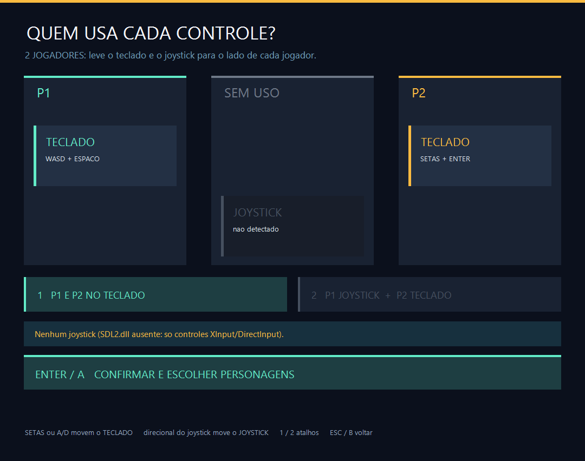
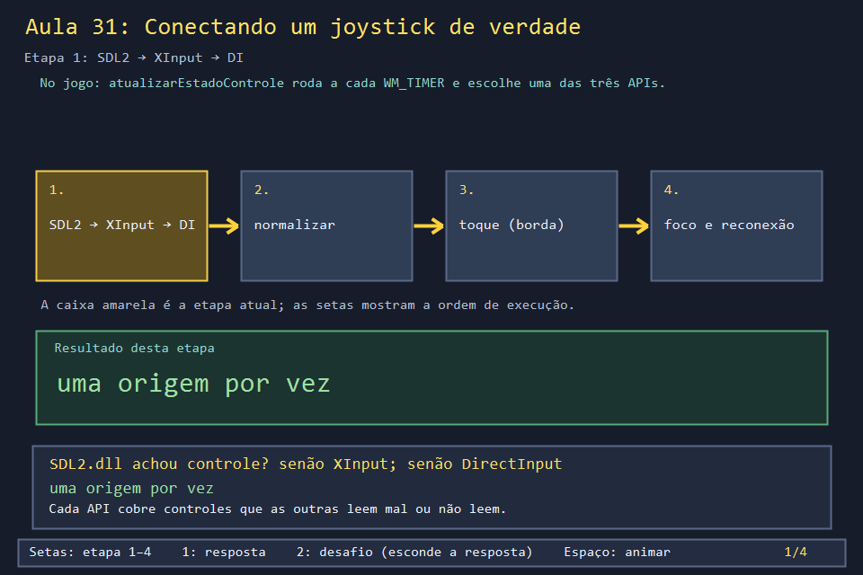
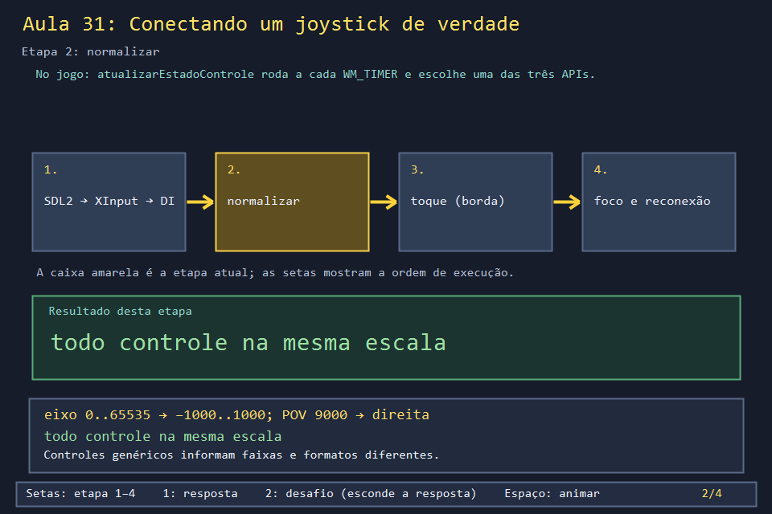
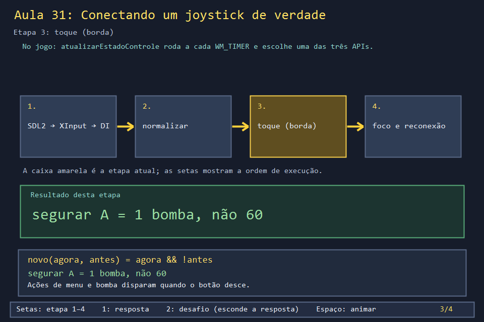
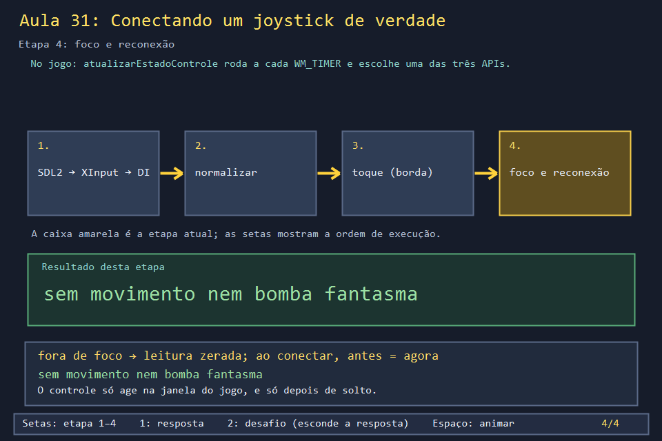

# Aula 31 — Conectando um joystick de verdade

| Trilha | Duração | Antes desta aula | Próxima na trilha |
| --- | --- | --- | --- |
| Entrada e menus (16 → 31 → 33 → 28 → 30) | 2–3 h | [Aula 16](../Aula_16_controle_e_camada_de_entrada/Aula_16_controle_e_camada_de_entrada.md), Aula 29 (seções 5 e 8) | [Aula 33 — Configurando os controles](../Aula_33_configuracao_de_controles/Aula_33_configuracao_de_controles.md) |

| Sem controle | Com um controle conectado |
| --- | --- |
|  |  |

A Aula 16 traduziu um controle Xbox para `EntradaControle`. Um jogo de verdade enfrenta mais problemas: o jogador pode ter um controle de PlayStation ou um Switch Pro; pode conectar o controle com o jogo aberto, ou desconectá-lo no meio da partida; pode deixar outro programa em primeiro plano; e dois jogadores precisam dividir teclado e controle. Esta aula percorre as ~240 linhas de controle do jogo, uma decisão de cada vez.

## O que você vai conseguir fazer

- Explicar por que o jogo usa **três** APIs, e em que ordem.
- Carregar uma DLL em tempo de execução e pegar funções dela com segurança.
- Traduzir um controle genérico do DirectInput (eixos de faixa variável, direcional em graus).
- Detectar o **toque** de um botão e evitar botões e movimentos "fantasmas".
- Dividir teclado e controle entre P1 e P2, como a tela de atribuição faz.

## 1. A ideia

```text
a cada WM_TIMER:
  atualizarEstadoControle(janela)
    SDL2 (SDL2.dll ao lado do .exe)  → Xbox, PlayStation, Switch Pro, 8BitDo...
    senão XInput (xinput1_4.dll)      → Xbox e compatíveis
    senão DirectInput                 → qualquer controle USB genérico
    janela fora de foco? → leitura zerada
    acabou de conectar?  → "antes" = "agora" (sem toque fantasma)
  processarControleNoMenu()           → no menu: vira lerTeclado(VK_UP / VK_RETURN ...)
  processarMovimentoContinuo()        → na partida: moverJogador / colocarBomba
```

| API | Por que existe no jogo | Zona morta |
| --- | --- | --- |
| SDL2 | lê PlayStation e Switch Pro pelo protocolo próprio de cada um | 12000 de 32767 |
| XInput | vem com o Windows; cobre Xbox se a SDL2.dll faltar | 10500 de 32767 |
| DirectInput | controles USB antigos e genéricos | 350 de 1000 (depois de normalizar) |

## 2. O código real

### Carregar uma DLL em tempo de execução

Se o jogo fosse **linkado** com a SDL2, ele nem abriria sem a DLL. Carregando com `LoadLibraryExW`, a DLL ausente vira só "sem SDL2". As funções são pegas uma a uma com `GetProcAddress`; o template da Aula 29 converte cada endereço para o tipo certo:

<!-- trecho simbolo="obterFuncaoSDL" -->
```cpp
// projeto_final/bomberman.cpp, linhas 482–487 (obterFuncaoSDL)
template<class F> bool obterFuncaoSDL(const char* nome,F& funcao){
    FARPROC p=GetProcAddress(sdl.dll,nome);
    static_assert(sizeof(funcao)==sizeof(p));
    memcpy(&funcao,&p,sizeof(funcao));
    return funcao!=nullptr;
}
```

<!-- trecho simbolo="carregarSDL" ate="if(!ok){FreeLibrary(sdl.dll);sdl.dll=nullptr;return;}" -->
```cpp
// projeto_final/bomberman.cpp, linhas 488–507 (carregarSDL)
void carregarSDL(){
    if(sdl.tentou)return;
    sdl.tentou=true;
    wstring caminho=pastaDoExecutavel()+L"\\SDL2.dll";
    sdl.dll=LoadLibraryExW(caminho.c_str(),nullptr,LOAD_WITH_ALTERED_SEARCH_PATH);
    if(!sdl.dll)return;
    bool ok=obterFuncaoSDL("SDL_InitSubSystem",sdl.iniciar) && obterFuncaoSDL("SDL_QuitSubSystem",sdl.encerrar) &&
        obterFuncaoSDL("SDL_SetHint",sdl.setHint) && obterFuncaoSDL("SDL_GameControllerEventState",sdl.eventosControle) &&
        obterFuncaoSDL("SDL_JoystickEventState",sdl.eventosJoystick) && obterFuncaoSDL("SDL_NumJoysticks",sdl.quantidade) &&
        obterFuncaoSDL("SDL_IsGameController",sdl.ehGameController) && obterFuncaoSDL("SDL_GameControllerOpen",sdl.abrir) &&
        obterFuncaoSDL("SDL_GameControllerClose",sdl.fechar) && obterFuncaoSDL("SDL_GameControllerGetAttached",sdl.conectado) &&
        obterFuncaoSDL("SDL_GameControllerName",sdl.nome) && obterFuncaoSDL("SDL_GameControllerUpdate",sdl.atualizar) &&
        obterFuncaoSDL("SDL_GameControllerGetAxis",sdl.eixo) && obterFuncaoSDL("SDL_GameControllerGetButton",sdl.botao);
    const unsigned SDL_INIT_GAMECONTROLLER=0x2000;
    if(ok){
        // O jogo nao tem janela SDL: le o controle sempre e filtra o foco aqui.
        sdl.setHint("SDL_JOYSTICK_ALLOW_BACKGROUND_EVENTS","1");
        ok=sdl.iniciar(SDL_INIT_GAMECONTROLLER)==0;
    }
    if(!ok){FreeLibrary(sdl.dll);sdl.dll=nullptr;return;}
```

O XInput tem três nomes de DLL conforme a versão do Windows; o jogo tenta cada um:

<!-- trecho simbolo="carregarXInput" -->
```cpp
// projeto_final/bomberman.cpp, linhas 551–563 (carregarXInput)
void carregarXInput(){
    if(tentouCarregarXInput)return;
    tentouCarregarXInput=true;
    for(const wchar_t* dll:{L"xinput1_4.dll",L"xinput1_3.dll",L"xinput9_1_0.dll"}){
        HMODULE lib=LoadLibraryW(dll);if(!lib)continue;
        FARPROC procedimento=GetProcAddress(lib,"XInputGetState");
        FuncaoXInputGetState funcao=nullptr;
        static_assert(sizeof(funcao)==sizeof(procedimento));
        memcpy(&funcao,&procedimento,sizeof(funcao));
        if(funcao){bibliotecaXInput=lib;obterEstadoXInput=funcao;break;}
        FreeLibrary(lib);
    }
}
```

### Conectar com o jogo aberto

A SDL2 procura um controle novo a cada 500 ms, e não a cada 16, porque enumerar dispositivos é caro. A leitura usa os índices padrão da SDL (A=0, B=1, ..., direcional 11–14):

<!-- trecho simbolo="lerControleSDL" -->
```cpp
// projeto_final/bomberman.cpp, linhas 512–534 (lerControleSDL)
bool lerControleSDL(EntradaControle& leitura){
    if(!sdl.carregada)return false;
    sdl.atualizar();
    if(sdl.controle && !sdl.conectado(sdl.controle)){sdl.fechar(sdl.controle);sdl.controle=nullptr;}
    if(!sdl.controle && GetTickCount64()>=sdl.proximaBusca){
        sdl.proximaBusca=GetTickCount64()+500;
        for(int i=0;i<sdl.quantidade() && !sdl.controle;++i)
            if(sdl.ehGameController(i))sdl.controle=sdl.abrir(i);
        if(sdl.controle){
            const char* n=sdl.nome(sdl.controle);string utf8=n?n:"Controle";
            int tamanho=MultiByteToWideChar(CP_UTF8,0,utf8.c_str(),-1,nullptr,0);
            nomeControle.assign(max(1,tamanho),L'\0');
            MultiByteToWideChar(CP_UTF8,0,utf8.c_str(),-1,&nomeControle[0],tamanho);
            nomeControle.resize(wcslen(nomeControle.c_str()));
        }
    }
    if(!sdl.controle)return false;
    auto b=[](int i){return sdl.botao(sdl.controle,i)!=0;};
    // Indices SDL_GameControllerButton/Axis: A0 B1 X2 Y3 BACK4 START6 L9 R10 cima11 baixo12 esq13 dir14.
    leitura=montarEntrada(b(11),b(12),b(13),b(14),sdl.eixo(sdl.controle,0),sdl.eixo(sdl.controle,1),12000,
                          b(0),b(1),b(2),b(3),b(9)||b(10),b(6),b(4));
    return true;
}
```

### DirectInput: faixas e graus

Controles genéricos informam a faixa dos eixos de jeitos diferentes. O jogo pede −1000..1000; se o aparelho recusar, guarda a faixa real e normaliza depois:

<!-- trecho simbolo="normalizarEixoControle" -->
```cpp
// projeto_final/bomberman.cpp, linhas 542–546 (normalizarEixoControle)
LONG normalizarEixoControle(LONG valor,const FaixaEixo& faixa){
    if(!faixa.disponivel || faixa.maximo<=faixa.minimo)return 0;
    long long escala=(static_cast<long long>(valor)-faixa.minimo)*2000/(faixa.maximo-faixa.minimo)-1000;
    return static_cast<LONG>(clamp(escala,-1000LL,1000LL));
}
```

<!-- trecho simbolo="traduzirDirectInput" -->
```cpp
// projeto_final/bomberman.cpp, linhas 453–467 (traduzirDirectInput)
EntradaControle traduzirDirectInput(const DIJOYSTATE2& g){
    DWORD pov=g.rgdwPOV[0];
    bool cima=false,baixo=false,esq=false,dir=false;
    if(pov!=0xffffffff){
        if(pov<=4500 || pov>=31500)cima=true;
        else if(pov>=13500 && pov<=22500)baixo=true;
        else if(pov<13500)dir=true;
        else esq=true;
    }
    auto botao=[&](int i){return (g.rgbButtons[i]&0x80)!=0;};
    EntradaControle e=montarEntrada(cima,baixo,esq,dir,int(g.lX),int(g.lY),350,botao(0),botao(1),botao(2),botao(3),
                                    botao(4)||botao(5),botao(9),botao(8));
    if(!e.dl && !e.dc){EntradaControle direita=direcaoDoControle(int(g.lRx),int(g.lRy),350);e.dl=direita.dl;e.dc=direita.dc;}
    return e;
}
```

E o caso especial do Switch Pro, que o DirectInput lê errado (sensores viram eixos e botões fantasmas):

<!-- trecho simbolo="descobrirControleGenerico" ate="return DIENUM_CONTINUE;" -->
```cpp
// projeto_final/bomberman.cpp, linhas 565–572 (descobrirControleGenerico)
BOOL CALLBACK descobrirControleGenerico(const DIDEVICEINSTANCEW* info,void* contexto){
    // O Switch Pro (inclusive o 8BitDo em modo Switch) exige inicializacao
    // propria do protocolo HID. O DirectInput o enumera, mas entrega sensores
    // e contadores como eixos/botoes: movimento e bombas fantasmas. Ele e lido
    // pela SDL2; aqui so marcamos que existe para avisar se a DLL faltar.
    if(LOWORD(info->guidProduct.Data1)==0x057e && HIWORD(info->guidProduct.Data1)==0x2009){
        controleSwitchSemLeitura=true;
        return DIENUM_CONTINUE;
```

### A função que junta tudo

<!-- trecho simbolo="atualizarEstadoControle" -->
```cpp
// projeto_final/bomberman.cpp, linhas 595–623 (atualizarEstadoControle)
void atualizarEstadoControle(HWND janela){
    carregarSDL();EntradaControle leitura;OrigemControle origem=SEM_CONTROLE;
    if(lerControleSDL(leitura)){origem=CONTROLE_SDL;liberarControleDireto();}
    if(origem==SEM_CONTROLE){carregarXInput();
        if(obterEstadoXInput){for(DWORD i=0;i<XUSER_MAX_COUNT;++i){XINPUT_STATE estado{};
            if(obterEstadoXInput(i,&estado)==ERROR_SUCCESS){origem=CONTROLE_XINPUT;leitura=traduzirXInput(estado.Gamepad);nomeControle=L"Controle XInput";break;}}}
    }
    if(origem==SEM_CONTROLE){
        if(!entradaDireta)DirectInput8Create(GetModuleHandleW(nullptr),DIRECTINPUT_VERSION,IID_IDirectInput8W,reinterpret_cast<void**>(&entradaDireta),nullptr);
        if(entradaDireta && !controleDireto && GetTickCount64()>=proximaBuscaControle){
            proximaBuscaControle=GetTickCount64()+1000;
            controleSwitchSemLeitura=false;
            entradaDireta->EnumDevices(DI8DEVCLASS_GAMECTRL,descobrirControleGenerico,janela,DIEDFL_ATTACHEDONLY);
        }
        if(controleDireto){DIJOYSTATE2 estado{};HRESULT resultado=controleDireto->Poll();
            if(FAILED(resultado)){controleDireto->Acquire();resultado=controleDireto->Poll();}
            if(SUCCEEDED(resultado))resultado=controleDireto->GetDeviceState(sizeof(estado),&estado);
            if(SUCCEEDED(resultado)){normalizarEstadoControle(estado);origem=CONTROLE_GENERICO;leitura=traduzirDirectInput(estado);}
            else liberarControleDireto();
        }
    }else controleSwitchSemLeitura=false;
    // Com o jogo fora de foco (ex.: PCSX2 aberto) o controle nao age aqui.
    if(janelaPrincipal && GetForegroundWindow()!=janelaPrincipal)leitura=EntradaControle{};
    bool estavaConectado=controleConectado;
    controleConectado=origem!=SEM_CONTROLE;origemControle=origem;entradaControle=leitura;
    if(!controleConectado)nomeControle.clear();
    // Ao conectar, botoes ja apertados nao contam como novo toque.
    if(!controleConectado || !estavaConectado){botaoBombaControleAnterior=leitura.bomba;controleMenuAnterior=leitura;}
}
```

As duas últimas linhas resolvem dois problemas: com outra janela na frente, a leitura é zerada; e, no instante em que o controle conecta, os valores "anteriores" recebem a leitura atual, para um botão já apertado não contar como toque novo.

### Toque, menu e partida

No menu, o controle não tem regras próprias: ele **imita o teclado** chamando `lerTeclado`. Só o que é toque novo (`novo(agora, antes)`) conta:

<!-- trecho simbolo="processarControleNoMenu" de="EntradaControle e = entradaControle, ant = controleMenuAnterior;" ate="bool direcaoNova" -->
```cpp
// projeto_final/bomberman.cpp, linhas 4207–4211 (processarControleNoMenu)
    EntradaControle e = entradaControle, ant = controleMenuAnterior;
    controleMenuAnterior = e;
    if (!controleConectado) return;
    auto novo = [](bool agora, bool antes) { return agora && !antes; };
    bool direcaoNova = (e.dl || e.dc) && (e.dl != ant.dl || e.dc != ant.dc);
```

<!-- trecho simbolo="processarControleNoMenu" de="if (editandoNome) return;" ate="lerTeclado(telaMenu == MENU_PRINCIPAL ? '1' : VK_RETURN, 0);" -->
```cpp
// projeto_final/bomberman.cpp, linhas 4237–4245 (processarControleNoMenu)
    if (editandoNome) return;
    if (telaMenu == MENU_ATRIBUICAO_CONTROLES && direcaoNova && e.dc) { moverDispositivo(JOYSTICK, e.dc); return; }
    // Voltar antes de confirmar: Start e Select juntos contam como voltar.
    if (direcaoNova) lerTeclado(e.dl < 0 ? VK_UP : e.dl > 0 ? VK_DOWN : e.dc < 0 ? VK_LEFT : VK_RIGHT, 0);
    else if (novo(e.voltar, ant.voltar) || novo(e.select, ant.select)) {
        if (telaMenu != MENU_PRINCIPAL) lerTeclado('M', 0);
    }
    else if ((novo(e.confirmar, ant.confirmar) || novo(e.start, ant.start)) && !e.select)
        lerTeclado(telaMenu == MENU_PRINCIPAL ? '1' : VK_RETURN, 0);
```

### Quem usa o quê

Plugar um controle **nunca** cria jogador: só a escolha na tela de atribuição faz isso. `teclaDoJogador` devolve uma máscara de bits dizendo quais teclas valem para cada jogador:

<!-- trecho simbolo="controleNoJogador" -->
```cpp
// projeto_final/bomberman.cpp, linhas 535–539 (controleNoJogador)
bool controleNoJogador(int jogadorNumero){
    if(!controleConectado || modo!=MANUAL)return false;
    if(jogadorNumero==1)return dispositivoP1==JOYSTICK;
    return doisJogadores && dispositivoP2==JOYSTICK;
}
```

<!-- trecho simbolo="teclaDoJogador" -->
```cpp
// projeto_final/bomberman.cpp, linhas 925–930 (teclaDoJogador)
int teclaDoJogador(bool p2) {
    bool p1Teclado = !controleNoJogador(1);
    bool p2Teclado = segundoJogadorAtivo() && !controleNoJogador(2);
    if (!p2) return !p1Teclado ? 0 : p2Teclado ? TECLAS_WASD : TECLAS_WASD|TECLAS_SETAS;
    return !p2Teclado ? 0 : p1Teclado ? TECLAS_SETAS : TECLAS_WASD|TECLAS_SETAS;
}
```

<!-- trecho simbolo="validarAtribuicao" -->
```cpp
// projeto_final/bomberman.cpp, linhas 976–979 (validarAtribuicao)
void validarAtribuicao() {
    if (!controleConectado) { dispositivoP1 = dispositivoP2 = TECLADO; return; }
    if (doisJogadores && dispositivoP1 == dispositivoP2) dispositivoP2 = dispositivoP1 == TECLADO ? JOYSTICK : TECLADO;
}
```

E, ao fechar, cada recurso é liberado por quem o criou:

<!-- trecho simbolo="encerrarControle" -->
```cpp
// projeto_final/bomberman.cpp, linhas 624–628 (encerrarControle)
void encerrarControle(){liberarControleDireto();if(entradaDireta){entradaDireta->Release();entradaDireta=nullptr;}
    if(bibliotecaXInput){FreeLibrary(bibliotecaXInput);bibliotecaXInput=nullptr;}obterEstadoXInput=nullptr;tentouCarregarXInput=false;
    if(sdl.carregada){if(sdl.controle)sdl.fechar(sdl.controle);sdl.encerrar(0x2000);}
    if(sdl.dll)FreeLibrary(sdl.dll);
    sdl=BibliotecaSDL{};}
```

## 3. A versão desta aula

`Aula_31_joystick_real.cpp` copia as funções de tradução, normalização, Switch Pro, toque e divisão do teclado, e simula as situações que exigiriam um controle físico:

```text
1. qual API atende (SDL2 > XInput > DirectInput)
   controle Xbox, SDL2.dll presente   -> SDL2
   controle Xbox, sem SDL2.dll         -> XInput
   controle USB generico, sem SDL2.dll -> DirectInput
2. DirectInput
   eixo 0..65535: 0 -> -1000, 32767 -> -1, 65535 -> 1000
   POV     0 (  0 graus) -> dl=-1 dc= 0
   POV  9000 ( 90 graus) -> dl= 0 dc= 1
   ...
4. toque: a bomba sai so quando o botao desce
   quadros: [ ] [A!] [A] [A] [ ] [A!]  -> 2 bombas em 6 quadros
5. reconexao com o botao ja apertado
   conectou segurando A: toque=0 (sem bomba fantasma)
...
7. quem usa o que
   2 jogadores, sem joystick    P1: WASD         P2: setas
   2 jogadores, P2 no joystick  P1: WASD e setas P2: joystick
```

## 4. Teste com um controle físico

Os testes acima provam a lógica, mas não provam que **o seu** controle funciona. Para isso, o projeto tem um diagnóstico que usa a mesma detecção do jogo:

```powershell
Set-Location .\projeto_final
g++ -std=c++17 -O2 -static testes/diagnosticar_controle.cpp -o diagnosticar_controle.exe -lgdiplus -lwinmm -ldinput8 -ldxguid -lgdi32
.\diagnosticar_controle.exe --live      # 15 s mostrando eixos, direcional, botões e a tradução
```

Roteiro de teste manual, no jogo (`projeto_final/bomberman.exe`):

- [ ] O rodapé do menu mostra "Joystick conectado: <nome>".
- [ ] Direcional e analógico navegam no menu; A confirma; B volta.
- [ ] Na tela de controles, o direcional do controle move o cartão JOYSTICK.
- [ ] Segurar A na partida planta **uma** bomba.
- [ ] Desconectar no meio da partida: o personagem para, e o teclado volta a valer.
- [ ] Reconectar segurando A: nenhuma bomba aparece até soltar e apertar de novo.
- [ ] Com outra janela em primeiro plano, mexer no controle não faz nada no jogo.

## 5. Laboratório visual

| | |
| --- | --- |
|  |  |
|  |  |

```powershell
.\compilar_aula.ps1 -Numero 31
.\build\Aula_31_joystick_real.exe
.\abrir_aula.ps1 -Numero 31 -Modo Exemplo
```

## 6. Exercícios

1. **Previsão.** Um controle DirectInput informa X na faixa −32768..32767. Qual o valor normalizado de 16384? Ele passa da zona morta de 350? *((16384 + 32768) × 2000 / 65535 − 1000 = 500, por divisão inteira; 500 > 350, então anda.)*
2. **POV na diagonal.** O direcional em 13500 (135°, baixo e direita) vira o quê? *(`baixo`: a faixa de 13500 a 22500 é testada antes de "direita".)* E 13499? *(`direita`.)*
3. **Repetição ao segurar.** No menu, segurar o direcional do controle anda **um** item só. Implemente a repetição: espera de 400 ms e depois um passo a cada 120 ms. *Solução: `solucoes/` — 5 eventos ao segurar por 1 s, contra 1 do jogo.*
4. **Leitura.** Por que `carregarSDL` liga `SDL_JOYSTICK_ALLOW_BACKGROUND_EVENTS`, se o jogo ignora o controle fora de foco? *(O jogo não tem janela SDL. Sem a dica, a SDL só leria o controle com a janela **dela** em foco, ou seja, nunca. O jogo lê sempre e filtra o foco por conta própria.)*
5. **Projeto.** O jogo usa um controle só. O que mudaria para dois controles, um por jogador? *(`EntradaControle entradaControle` viraria um vetor de duas leituras; `sdl.controle` e o XInput precisariam guardar índices por jogador; `controleNoJogador` passaria a perguntar "qual controle", e não só "se há controle".)*

## 7. Erros comuns

- **Linkar a DLL em vez de carregá-la.** Com `-lSDL2`, o jogo nem abre num computador sem `SDL2.dll`. Carregar em tempo de execução permite degradar com elegância.
- **Ação enquanto o botão está apertado.** `if (e.bomba) colocarBomba();` planta 60 bombas por segundo (ou até o limite). Use `novo(agora, antes)`.
- **Esquecer o foco.** Com o jogo em segundo plano (vendo um vídeo, por exemplo), o controle continuaria jogando sozinho.
- **Enumerar dispositivos a cada quadro.** `EnumDevices` e `SDL_NumJoysticks` são lentos. O jogo procura a cada 500 ou 1000 ms.

## 8. Antes de seguir

- [ ] Sei dizer qual API atende cada tipo de controle, e por quê.
- [ ] Previ a saída das sete partes antes de rodar.
- [ ] Rodei o roteiro manual com um controle, ou anotei que não tinha um.

## Referências

- [SDL2 GameController API](https://wiki.libsdl.org/SDL2/CategoryGameController)
- [XInput (Microsoft Learn)](https://learn.microsoft.com/pt-br/windows/win32/xinput/getting-started-with-xinput)
- [Cabeçalho `dinput.h`: DirectInput e `DIJOYSTATE2` (Microsoft Learn)](https://learn.microsoft.com/en-us/windows/win32/api/dinput/)
- [`LoadLibraryExW` (Microsoft Learn)](https://learn.microsoft.com/en-us/windows/win32/api/libloaderapi/nf-libloaderapi-loadlibraryexw)
- [README-SDL2.txt do jogo de referência](https://github.com/diisilva/bomberman-univali-prog-2/blob/bf2fb5ec09d21b05de8ba29b2c91143e0f22b148/README-SDL2.txt): por que a SDL2.dll acompanha o jogo.
