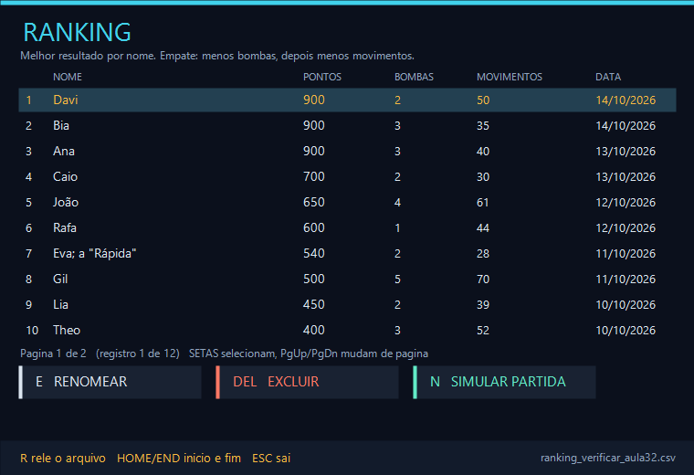
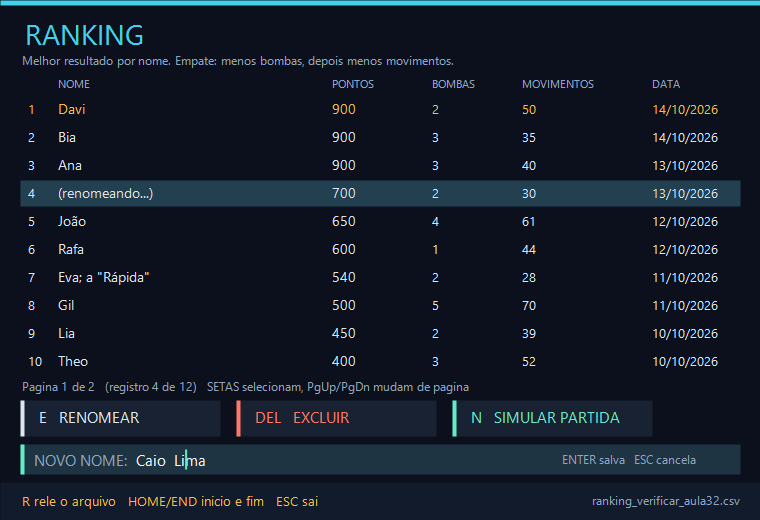
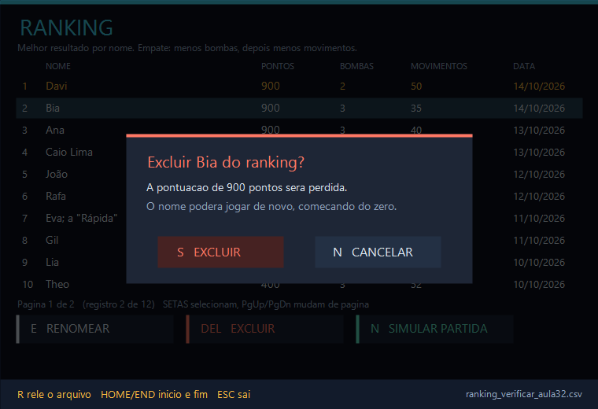
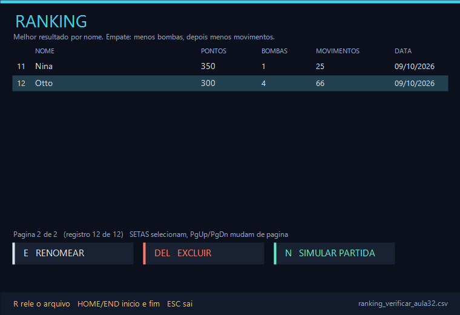
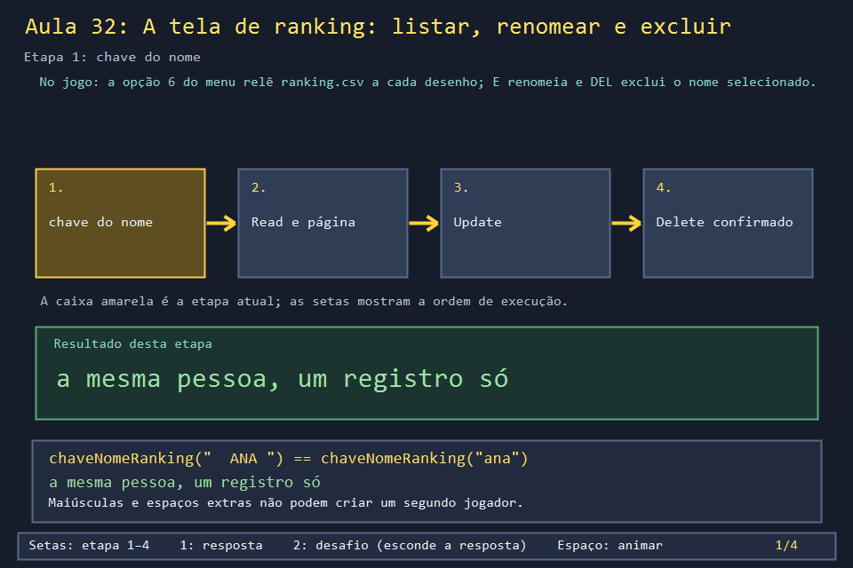
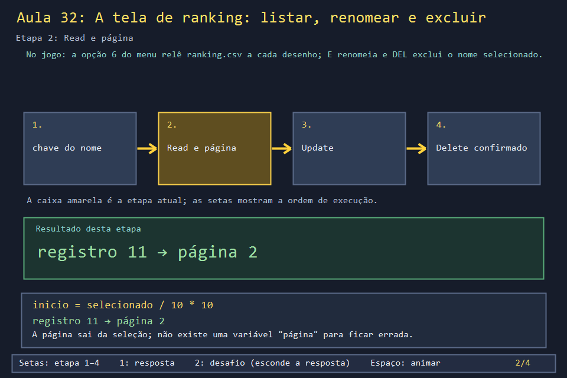
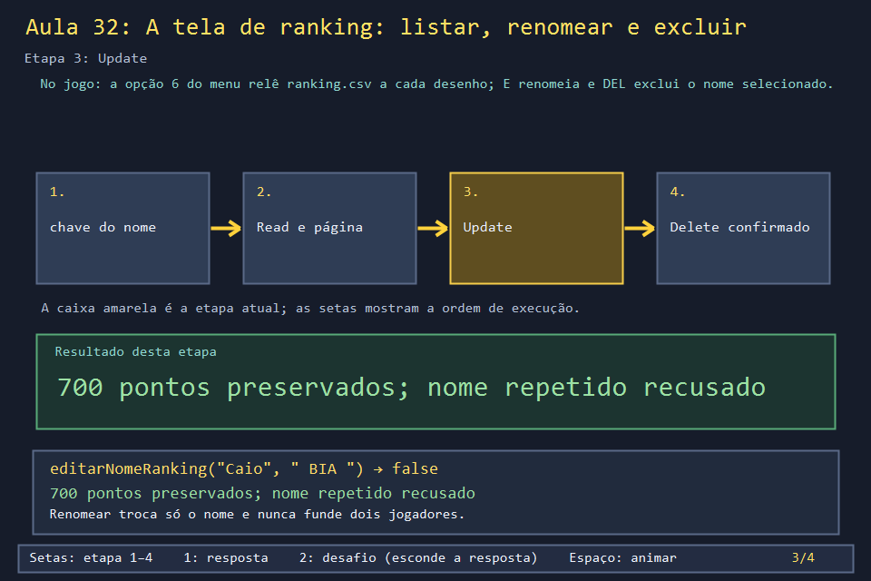
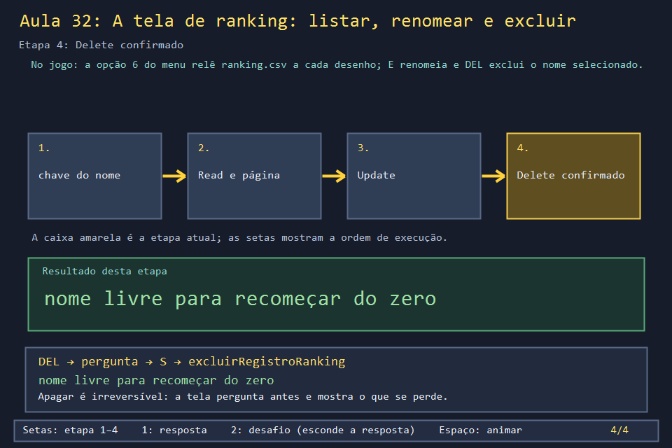

# Aula 32 — A tela de ranking: listar, renomear e excluir

| Trilha | Duração | Antes desta aula | Próxima na trilha |
| --- | --- | --- | --- |
| Ranking e arquivos (13 → 21 → 32) | 90–120 min | [Aula 21](../Aula_21_ranking_csv_completo/Aula_21_ranking_csv_completo.md), [Aula 30](../Aula_30_menu_completo/Aula_30_menu_completo.md) (campo de texto) | fim da trilha; leitura completa na [Aula 17](../Aula_17_leitura_orientada_do_jogo_real/Aula_17_leitura_orientada_do_jogo_real.md) |

| A tela de ranking do jogo real | A tela que você vai usar e modificar |
| --- | --- |
|  |  |

As Aulas 13 e 21 cuidaram do **arquivo**: gravar, ler, proteger o `;`, não perder dados se a gravação parar no meio. Falta a **tela** em que o jogador mexe nesse arquivo. Na opção 6 do menu, o jogo lista todos os resultados em páginas de dez, deixa selecionar uma linha, **renomear** o jogador sem perder os pontos e **excluir** o registro depois de perguntar. Junto com a gravação do fim da partida, isso forma o CRUD completo: *Create, Read, Update, Delete*.

O detalhe que segura tudo é a pergunta "esses dois nomes são a mesma pessoa?". `Ana`, `ANA` e ` ana ` precisam ser um registro só, tanto quando alguém joga quanto quando alguém renomeia.

## O que você vai conseguir fazer

- Explicar por que o ranking compara nomes por uma **chave** e não pelo texto digitado.
- Paginar uma lista a partir só da linha selecionada, sem uma variável de página.
- Implementar renomear e excluir sobre um arquivo, recusando nome vazio ou repetido.
- Desenhar uma confirmação que "trava" a tela, como uma `MessageBoxW`, e saber quando usar cada uma.
- Conferir um CRUD com testes que não abrem janela.

## 1. A ideia

```text
            ranking.csv  ◄──── gravarRanking (.bak, .tmp, MoveFileExA — Aula 21)
                 │                    ▲            ▲              ▲
          lerRanking                  │            │              │
   (descarta linhas ruins,      salvarRegistro  editarNome   excluirRegistro
    1 registro por chave,        Partida (C)    Ranking (U)    Ranking (D)
    ordena por melhorRegistro)       ▲            ▲              ▲
                 │                   │            │              │
                 ▼              fim da partida   E + ENTER    DEL + "Sim"
     desenharRanking (R): página = selecionado / 10
```

Toda operação **relê** o arquivo, muda a lista em memória e **grava tudo de novo**. Nenhuma linha é editada no lugar. Para um TOP com algumas dezenas de nomes, isso é mais simples e mais seguro do que procurar a linha certa no arquivo.

| Operação | Tecla | Regra que não pode quebrar |
| --- | --- | --- |
| Create | fim da partida | um registro por chave; só o melhor resultado fica |
| Read | abrir a tela, setas, PgUp/PgDn | linhas estragadas são puladas, nunca derrubam a tela |
| Update | `E`, digitar, `ENTER` | a pontuação não muda; não pode colidir com outro nome |
| Delete | `DEL`, confirmar | só depois de perguntar e mostrar quantos pontos se perdem |

## 2. O código real

### A identidade de um nome

Antes de comparar, o jogo limpa o nome (sem espaços nas pontas nem repetidos) e passa tudo para minúsculas com `LCMapStringEx`, que também sabe que "Á" minúsculo é "á":

<!-- trecho simbolo="chaveNomeRanking" -->
```cpp
// projeto_final/bomberman.cpp, linhas 675–679 (chaveNomeRanking)
string chaveNomeRanking(const string& nome){
    wstring chave=strParaW(limparNomeRanking(nome)),minuscula(chave.size(),L'\0');
    if(!chave.empty())LCMapStringEx(LOCALE_NAME_INVARIANT,LCMAP_LOWERCASE,chave.data(),int(chave.size()),minuscula.data(),int(minuscula.size()),nullptr,nullptr,0);
    return wparaStr(minuscula);
}
```

Essa chave aparece em todo lugar que pergunta "é o mesmo jogador?". No fim da partida, por exemplo, ela decide se o resultado entra como linha nova, substitui o recorde ou é descartado:

<!-- trecho simbolo="salvarRegistroPartida" -->
```cpp
// projeto_final/bomberman.cpp, linhas 711–719 (salvarRegistroPartida)
bool salvarRegistroPartida(const RegistroPontuacao& registro, const string& caminhoArquivo) {
    RegistroPontuacao novo=registro;novo.jogador=limparNomeRanking(novo.jogador);
    if(novo.jogador.empty())return false;
    auto registros=lerRanking(caminhoArquivo);
    auto existente=find_if(registros.begin(),registros.end(),[&](const RegistroPontuacao& r){return chaveNomeRanking(r.jogador)==chaveNomeRanking(novo.jogador);});
    if(existente==registros.end())registros.push_back(novo);
    else if(melhorRegistro(novo,*existente))*existente=novo;
    return gravarRanking(registros,caminhoArquivo);
}
```

E, antes da partida, a tela de nomes avisa quando o nome digitado já tem recorde, para ninguém "herdar" a pontuação de outra pessoa sem perceber:

<!-- trecho simbolo="confirmarNomeJogador" de="if(verificarExistente" ate="confirmacaoEmEdicao()=chave;" -->
```cpp
// projeto_final/bomberman.cpp, linhas 791–797 (confirmarNomeJogador)
    if(verificarExistente && confirmacaoEmEdicao()!=chave){
        for(const auto& r:lerRanking())if(chaveNomeRanking(r.jogador)==chave){
            wstring mensagem=L"O nome "+strParaW(r.jogador)+L" ja existe no ranking.\nPontuacao: "+to_wstring(r.pontuacao)+L" pontos.\n\nDeseja continuar com esse nome? Seu melhor resultado sera mantido e atualizado se voce supera-lo.";
            if(!janelaPrincipal || MessageBoxW(janelaPrincipal,mensagem.c_str(),L"Nome existente",MB_YESNO|MB_ICONQUESTION|MB_DEFBUTTON2)!=IDYES){avisoNome=L"Escolha outro nome ou gerencie o ranking.";editandoNome=true;selecionarNome=true;return false;}
            break;
        }
        confirmacaoEmEdicao()=chave;
```

### Read: a página vem da seleção

A tela guarda só `rankingSelecionado`. A página é calculada na hora: a divisão inteira por 10 joga a seleção para o início da sua dezena.

<!-- trecho simbolo="desenharRanking" de="int inicio=rankingSelecionado/10*10;" ate="PgUp/PgDn mudam pagina" -->
```cpp
// projeto_final/bomberman.cpp, linhas 3862–3875 (desenharRanking)
        int inicio=rankingSelecionado/10*10;
        desenharTexto(g,L"NOME",65,117,13);desenharTexto(g,L"PONTOS",460,117,13);
        desenharTexto(g,L"BOMBAS",600,117,13);desenharTexto(g,L"MOVIMENTOS",715,117,13);desenharTexto(g,L"DATA",870,117,13);
        for(int i=inicio;i<min(inicio+10,int(registros.size()));++i){
            const auto& r=registros[i];int y=150+(i-inicio)*40;
            if(i==rankingSelecionado)painel(g,20,y-3,1030,36,Gdiplus::Color(255,35,64,81));
            desenharTexto(g,to_wstring(i+1),25,y,15);
            desenharTexto(g,strParaW(r.jogador),65,y,16);
            desenharTexto(g,to_wstring(r.pontuacao),460,y,16);
            desenharTexto(g,to_wstring(r.bombas),600,y,15);
            desenharTexto(g,to_wstring(r.movimentos),715,y,15);
            desenharTexto(g,strParaW(r.data),870,y,15);
        }
        desenharTexto(g,L"Pagina "+to_wstring(inicio/10+1)+L" de "+to_wstring((registros.size()+9)/10)+L"  /  SETAS selecionam, PgUp/PgDn mudam pagina",20,565,14);
```

As setas mexem uma linha; PgUp e PgDn, dez. `E` e `DEL` iniciam as outras operações:

<!-- trecho simbolo="lerTeclado" de="if(telaMenu==MENU_RANKING){" ate="return;" -->
```cpp
// projeto_final/bomberman.cpp, linhas 4081–4090 (lerTeclado)
        if(telaMenu==MENU_RANKING){
            auto r=lerRanking();int total=int(r.size());
            if(tecla==VK_UP)rankingSelecionado=max(0,rankingSelecionado-1);
            else if(tecla==VK_DOWN)rankingSelecionado=min(max(0,total-1),rankingSelecionado+1);
            else if(tecla==VK_PRIOR)rankingSelecionado=max(0,rankingSelecionado-10);
            else if(tecla==VK_NEXT)rankingSelecionado=min(max(0,total-1),rankingSelecionado+10);
            else if(tecla=='E')iniciarRenomeacaoRanking();
            else if(tecla==VK_DELETE)pedirExclusaoRanking();
            else if(tecla=='M' || tecla==VK_ESCAPE)telaMenu=MENU_PRINCIPAL;
            return;
```

O clique numa linha usa a mesma conta ao contrário: a página atual mais a linha clicada.

<!-- trecho simbolo="processarMensagem" de="else if(modo==MENU && telaMenu==MENU_RANKING){" ate="else if(y>=790)lerTeclado('M',0);" -->
```cpp
// projeto_final/bomberman.cpp, linhas 4320–4324 (processarMensagem)
        } else if(modo==MENU && telaMenu==MENU_RANKING){
            if(!editandoNome){
                if(y>=150 && y<550 && x>=20 && x<1050){auto r=lerRanking();int alvo=rankingSelecionado/10*10+(y-150)/40;if(alvo<int(r.size()))rankingSelecionado=alvo;}
                else if(y>=610 && y<654){if(x>=20 && x<300)iniciarRenomeacaoRanking();else if(x>=320 && x<600)pedirExclusaoRanking();}
                else if(y>=790)lerTeclado('M',0);
```

### Update: renomear sem perder pontos

Renomear tem duas metades. A **tela** abre o campo com o nome atual e lembra quem está sendo editado (`nomeOriginalRanking`), porque o texto do campo muda a cada letra:

<!-- trecho simbolo="iniciarRenomeacaoRanking" -->
```cpp
// projeto_final/bomberman.cpp, linhas 827–832 (iniciarRenomeacaoRanking)
void iniciarRenomeacaoRanking(){
    auto registros=lerRanking();if(registros.empty())return;
    rankingSelecionado=clamp(rankingSelecionado,0,int(registros.size())-1);
    nomeOriginalRanking=registros[rankingSelecionado].jogador;nomeAntesEdicaoRanking=nomeJogador;
    nomeJogador=strParaW(nomeOriginalRanking);editandoNome=true;selecionarNome=true;cursorNome=nomeJogador.size();avisoRanking.clear();
}
```

O **arquivo** só muda no `ENTER`. Repare no laço que procura outro registro com a mesma chave: sem ele, renomear "Caio" para "bia" fundiria dois jogadores.

<!-- trecho simbolo="editarNomeRanking" -->
```cpp
// projeto_final/bomberman.cpp, linhas 750–757 (editarNomeRanking)
bool editarNomeRanking(const string& antigo,const string& novo,const string& caminho){
    auto registros=lerRanking(caminho);string limpo=limparNomeRanking(novo);
    if(limpo.empty() || strParaW(limpo).size()>24)return false;
    auto alvo=find_if(registros.begin(),registros.end(),[&](const RegistroPontuacao& r){return chaveNomeRanking(r.jogador)==chaveNomeRanking(antigo);});
    if(alvo==registros.end())return false;
    for(const auto& r:registros)if(&r!=&*alvo && chaveNomeRanking(r.jogador)==chaveNomeRanking(limpo))return false;
    alvo->jogador=limpo;return gravarRanking(registros,caminho);
}
```

Se a gravação falhar, o campo **continua aberto** e o aviso explica; se der certo, o nome do jogador atual também é atualizado quando era ele mesmo que estava sendo renomeado:

<!-- trecho simbolo="terminarRenomeacaoRanking" -->
```cpp
// projeto_final/bomberman.cpp, linhas 833–841 (terminarRenomeacaoRanking)
void terminarRenomeacaoRanking(bool confirmar){
    if(confirmar && !editarNomeRanking(nomeOriginalRanking,wparaStr(nomeJogador),caminhoRankingUtf8())){
        avisoRanking=L"Nome vazio, repetido ou arquivo sem permissao. Escolha outro nome.";return;
    }
    if(!confirmar || chaveNomeRanking(wparaStr(nomeAntesEdicaoRanking))!=chaveNomeRanking(nomeOriginalRanking))nomeJogador=nomeAntesEdicaoRanking;
    else nomeJogador=strParaW(limparNomeRanking(wparaStr(nomeJogador)));
    editandoNome=false;selecionarNome=false;nomeOriginalRanking.clear();nomeConfirmadoRanking.clear();
    avisoRanking=confirmar?L"Nome atualizado. Pontuacao preservada.":L"Edicao cancelada.";
}
```

### Delete: perguntar antes

`excluirRegistroRanking` apaga **pela chave** com o idioma *erase-remove*: `remove_if` empurra os registros que saem para o fim do vetor, e `erase` corta esse fim.

<!-- trecho simbolo="excluirRegistroRanking" -->
```cpp
// projeto_final/bomberman.cpp, linhas 758–762 (excluirRegistroRanking)
bool excluirRegistroRanking(const string& nome,const string& caminho){
    auto registros=lerRanking(caminho);size_t antes=registros.size();
    registros.erase(remove_if(registros.begin(),registros.end(),[&](const RegistroPontuacao& r){return chaveNomeRanking(r.jogador)==chaveNomeRanking(nome);}),registros.end());
    return registros.size()<antes && gravarRanking(registros,caminho);
}
```

A pergunta é uma `MessageBoxW` com `MB_DEFBUTTON2`: o botão padrão é **Não**, então um `ENTER` apressado não apaga nada.

<!-- trecho simbolo="pedirExclusaoRanking" -->
```cpp
// projeto_final/bomberman.cpp, linhas 842–850 (pedirExclusaoRanking)
void pedirExclusaoRanking(){
    auto registros=lerRanking();if(registros.empty() || !janelaPrincipal)return;
    rankingSelecionado=clamp(rankingSelecionado,0,int(registros.size())-1);auto r=registros[rankingSelecionado];
    wstring texto=L"Excluir "+strParaW(r.jogador)+L" do ranking?\n\nA pontuacao de "+to_wstring(r.pontuacao)+L" pontos sera perdida. Voce podera jogar novamente com esse nome, comecando do zero.";
    if(MessageBoxW(janelaPrincipal,texto.c_str(),L"Excluir registro",MB_YESNO|MB_ICONWARNING|MB_DEFBUTTON2)!=IDYES)return;
    bool ok=excluirRegistroRanking(r.jogador,caminhoRankingUtf8());
    avisoRanking=ok?L"Registro excluido. Esse nome pode recomecar do zero.":L"Nao foi possivel excluir o registro.";
    if(ok)nomeConfirmadoRanking.clear();
}
```

## 3. A versão desta aula

`Aula_32_tela_de_ranking_crud.cpp` é a tela de ranking com as mesmas funções e nomes do jogo, gravando em `ranking_aula32.csv` na pasta da aula. Na primeira vez ele cria um ranking de exemplo com **12 nomes** (duas páginas), incluindo `João` e `Eva; a "Rápida"`, para você ver o UTF-8 e o CSV com aspas funcionando.

| Lista (página 1) | Renomeando "Caio" |
| --- | --- |
|  |  |
| **Confirmação de exclusão** | **Página 2** |
|  |  |

| Tecla | Faz |
| --- | --- |
| ↑ ↓, PgUp PgDn, Home End, clique | seleciona |
| `E` | renomeia (ENTER salva, ESC cancela) |
| `DEL` | pergunta e exclui (`S` ou clique em EXCLUIR; `N` ou ESC cancela) |
| `N` | simula o fim de uma partida de um nome sorteado (Ana, "ana ", Caio, Rafa ou Lu) |
| `R` | relê o arquivo (depois de editar no Bloco de Notas) |

As imagens acima foram geradas por [`testes/verificar_aula32.cpp`](../../testes/verificar_aula32.cpp), que percorre a tela chamando as funções diretamente, num CSV temporário, e confere 25 comportamentos:

```text
ok    o exemplo tem 12 registros (duas paginas)
ok    empate em 900: menos bombas, depois menos movimentos
ok    PgDn pula 10 registros e abre a pagina 2
ok    renomear para ' BIA ' e recusado: Bia ja existe (mesma chave)
ok    renomear preserva os 700 pontos e limpa o espaco duplo
ok    com a pergunta aberta, as setas nao mudam a selecao
ok    partida pior de ' ana' nao cria nem substitui
ok    partida melhor de 'ANA' substitui e sobe ao topo
ok    R rele: linhas ruins caem e 'davi' duplicado nao vence Davi
...
Aula 32: ranking verificado
```

Experimente na janela (`.\abrir_aula.ps1 -Numero 32 -Modo Exemplo`):

1. Aperte `N` várias vezes. Observe as três mensagens possíveis: nome novo, recorde superado, recorde mantido. "ana " e "Ana" caem no mesmo registro.
2. Selecione Caio, aperte `E`, apague e digite `bia`. O `ENTER` é recusado e o campo continua aberto. Digite `Caio  Lima` (dois espaços) e confirme: fica `Caio Lima`, com os mesmos 700 pontos.
3. Aperte `DEL` e tente mexer as setas: nada acontece até responder.
4. Abra `aulas/Aula_32_tela_de_ranking_crud/ranking_aula32.csv` no Bloco de Notas, troque uma pontuação por `muito`, salve e aperte `R`. A linha some da tela, e o resto continua.

## 4. O que mudou em relação ao jogo e por quê

| No jogo | Nesta aula | Motivo |
| --- | --- | --- |
| `pedirExclusaoRanking` abre uma `MessageBoxW` | a pergunta é desenhada na tela (`confirmandoExclusao`) | uma caixa modal para o laço de mensagens e não pode ser testada sem um clique de verdade; desenhada, ela é só mais um estado |
| renomeia usando o campo do nome do jogador (`nomeJogador`) e devolve o nome antigo depois | campo próprio (`nomeEmEdicao`) | sem tela de nomes aqui, não há o que preservar |
| `salvarRegistroPartida` regrava o arquivo mesmo quando o resultado é pior | não grava se nada mudou | evita criar o `.bak` à toa; o jogo grava igual e o resultado é o mesmo |
| relê o CSV a cada desenho e a cada tecla | também relê, por fidelidade | exercício 4 discute o custo |
| a seleção não acompanha o nome depois de renomear | acompanha | com empate de pontos, a ordem final é pelo nome e a linha pode mudar de lugar |

## 5. Laboratório visual

| | |
| --- | --- |
|  |  |
|  |  |

```powershell
.\compilar_aula.ps1 -Numero 32
.\build\Aula_32_tela_de_ranking_crud.exe        # diagrama
.\abrir_aula.ps1 -Numero 32 -Modo Exemplo       # a tela de ranking interativa
.\abrir_aula.ps1 -Numero 32 -Modo Solucao       # exercício 3 resolvido, no console
```

## 6. Exercícios

1. **Previsão.** Com 23 registros e o 15º selecionado, o que mostra o rodapé, e qual registro fica selecionado depois de PgDn e de mais um PgDn? *(Página 2 de 3. PgDn: min(22, 14 + 10) = 22, o 23º. O segundo PgDn continua no 23º.)*
2. **A chave.** Quais destes nomes são a mesma pessoa: `Ana Lu`, `ana  lu`, ` ANA LU`, `AnaLu`? *(Os três primeiros. `AnaLu` não tem espaço, e a limpeza só junta espaços repetidos, não os apaga.)*
3. **Desfazer.** Implemente "desfazer a última exclusão": guarde uma cópia do registro antes de apagar, e devolva-o com uma tecla. O que deve acontecer se, entre a exclusão e o desfazer, o mesmo nome jogou e fez menos pontos? *Solução: `solucoes/`. Desfazer chama `salvarRegistroPartida` com a cópia: como a regra é "fica o melhor", os 900 antigos voltam e a partida de 200 some, sem linha repetida. Desfazer só vale uma vez.*
4. **Custo.** A tela do jogo chama `lerRanking()` em `desenharRanking` e em quase toda tecla. Com a tela de ranking aberta e **parada**, quantas vezes por segundo o arquivo é lido? *(Umas 60: o `WM_TIMER` do jogo roda a cada 16 ms e sempre chama `InvalidateRect`, e cada `WM_PAINT` relê o CSV. Segurar ↓ não soma quase nada, porque `lerTeclado` ignora a repetição automática (bit 30). Para 50 linhas, ninguém percebe. Guardar a lista em memória exigiria lembrar de recarregar depois de cada gravação, e de quando o arquivo é editado por fora. Nesta aula a janela só redesenha quando algo muda.)*
5. **Projeto.** Acrescente uma busca: a tecla `F` abre um campo, e a seleção pula para o primeiro nome cuja chave **começa** com a chave digitada.

## 7. Erros comuns

- **Comparar `jogador == nome`.** Funciona até alguém digitar com Caps Lock. Toda comparação de identidade passa pela chave.
- **Guardar a página numa variável separada.** Depois de excluir o último registro da página 2, a página "2" fica vazia. Calculando a página pela seleção (e limitando a seleção ao tamanho da lista), isso não acontece.
- **Excluir pelo índice em vez do nome.** Entre desenhar e excluir, o arquivo pode ter mudado (outra partida terminou, alguém editou à mão). O índice aponta para outra pessoa; a chave, não.
- **Esquecer de recusar o nome que já existe ao renomear.** O arquivo passa a ter duas linhas com a mesma chave, e o próximo `lerRanking` funde as duas em silêncio, apagando uma pontuação.
- **`ENTER` como resposta padrão de "excluir?".** O jogo usa `MB_DEFBUTTON2` (padrão = Não). Uma ação irreversível não deve ser a que acontece "sem querer".

## 8. Antes de seguir

- [ ] Sei dizer qual função faz cada letra do CRUD e qual regra ela protege.
- [ ] Previ o resultado das três mensagens da tecla `N` antes de vê-las.
- [ ] Rodei `verificar_aula32` e li o arquivo CSV antes e depois de uma exclusão.

## Referências

- [`LCMapStringEx` (Microsoft Learn)](https://learn.microsoft.com/en-us/windows/win32/api/winnls/nf-winnls-lcmapstringex)
- [`MessageBoxW` e `MB_DEFBUTTON2` (Microsoft Learn)](https://learn.microsoft.com/en-us/windows/win32/api/winuser/nf-winuser-messageboxw)
- [Idioma *erase-remove*: `std::remove_if` (cppreference)](https://en.cppreference.com/w/cpp/algorithm/remove)
- [Aula 21](../Aula_21_ranking_csv_completo/Aula_21_ranking_csv_completo.md): `campoCsv`, `lerCamposCsv`, `.tmp` e `.bak`.
