# Aula 33 — Configurando os controles: quem joga com o quê

| Trilha | Duração | Antes desta aula | Próxima na trilha |
| --- | --- | --- | --- |
| Entrada e menus (16 → 31 → 33 → 28 → 30) | 90–120 min | [Aula 31](../Aula_31_joystick_real/Aula_31_joystick_real.md), [Aula 12](../Aula_12_fases_dificuldade_e_cooperativo/Aula_12_fases_dificuldade_e_cooperativo.md) | [Aula 28 — Como o menu conduz à partida](../Aula_28_menu_e_transicoes_reais/Aula_28_menu_e_transicoes_reais.md) |

| Quantos vão jogar (jogo real) | Quem usa cada controle (jogo real) |
| --- | --- |
| 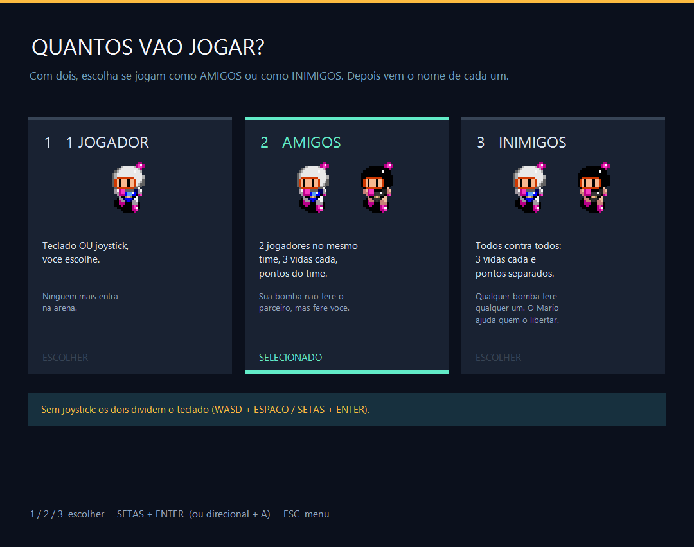 | 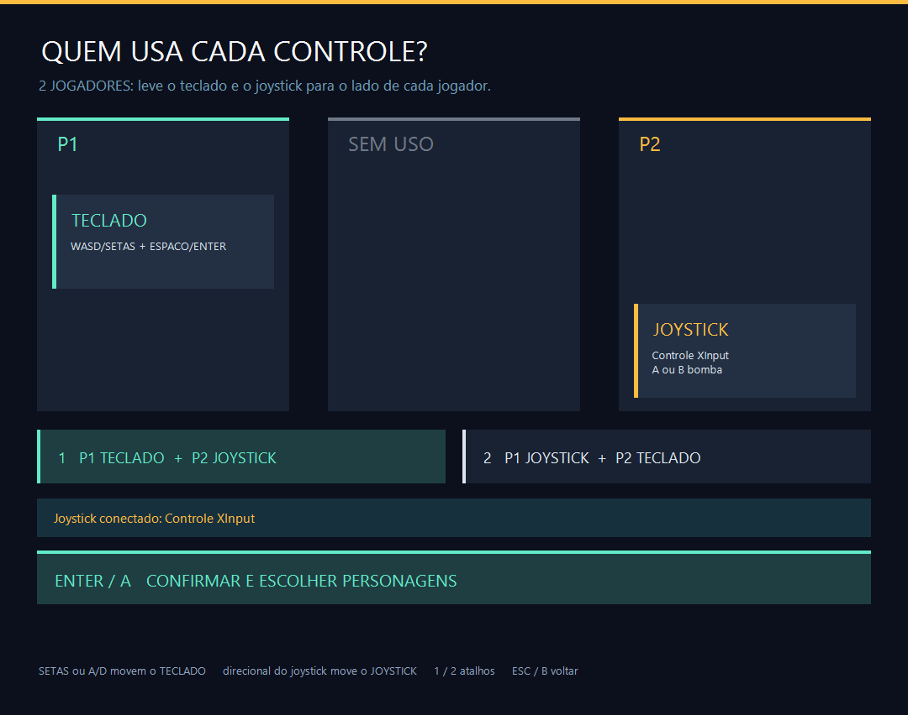 |

A Aula 31 fez o controle **funcionar**: achar a API certa, normalizar eixos, detectar o toque, ignorar o controle fora de foco. Esta aula trata de outra pergunta: **de quem** é cada aparelho. Com um teclado e um joystick, um jogador pode usar qualquer um dos dois; dois jogadores podem dividir o teclado ou ficar um em cada aparelho. O jogo resolve isso com duas telas, no estilo "escolher lados" dos jogos de futebol: os cartões TECLADO e JOYSTICK são levados para a coluna P1, SEM USO ou P2.

A regra mais importante é uma frase só: **plugar um controle nunca cria jogador.** Uma versão antiga do jogo criava o P2 sozinho ao detectar um joystick, e numa partida de um jogador apareciam dois personagens, um deles plantando bombas por conta própria. A separação que esta aula estuda nasceu desse defeito.

## O que você vai conseguir fazer

- Separar o que o jogador **escolhe** (quantos jogam, quem usa o quê) do que o programa **mede** (há controle conectado?).
- Representar "em qual coluna está este cartão" com um número e desenhar a tela só a partir dele.
- Manter um invariante ("dois jogadores nunca dividem o joystick") com uma função de validação chamada nos pontos certos.
- Transformar a escolha numa máscara de bits de teclas por jogador.
- Explicar o que acontece quando o controle desconecta e reconecta no meio do caminho.

## 1. A ideia

```text
ESCOLHIDO pelo jogador                    MEDIDO a cada quadro
  doisJogadores, modoRivais                 controleConectado  (SDL2 / XInput / DirectInput)
  dispositivoP1, dispositivoP2                       │
              │                                      │
              └──────────────┬───────────────────────┘
                             ▼
              controleNoJogador(n) = conectado && dispositivo de n == JOYSTICK
                             ▼
              teclaDoJogador(p2) → máscara: WASD = 1, SETAS = 2, as duas = 3
```

| Situação | P1 | P2 |
| --- | --- | --- |
| 1 jogador, teclado | WASD **e** setas, Espaço **e** Enter | — |
| 1 jogador, joystick | joystick (nenhuma tecla) | — |
| 2 jogadores, sem joystick | WASD + Espaço | setas + Enter |
| 2 jogadores, P1 teclado + P2 joystick | WASD **e** setas | joystick |
| 2 jogadores, P1 joystick + P2 teclado | joystick | WASD **e** setas |

Quem está sozinho no teclado ganha o teclado inteiro. Só quando os dois estão no teclado ele é dividido ao meio.

A rota no jogo é: **JOGAR → quantos vão jogar → nomes → quem usa cada controle → personagens → dificuldade → fase**. A tela de nomes fica no meio porque cada jogador ativo precisa de um nome para o ranking (Aula 32).

## 2. O código real

### Quantos vão jogar

Três opções, e nenhuma delas olha para o controle. `doisJogadores` e `modoRivais` só mudam aqui:

<!-- trecho simbolo="lerTeclado" de="if (telaMenu == MENU_QUANTIDADE_JOGADORES) {" ate="return;" -->
```cpp
// projeto_final/bomberman.cpp, linhas 4104–4114 (lerTeclado)
        if (telaMenu == MENU_QUANTIDADE_JOGADORES) {
            // Tres opcoes: 1 jogador, 2 AMIGOS e 2 INIMIGOS (todos contra todos).
            int escolha=tecla>='1' && tecla<='3' ? int(tecla-'1') : tecla>=VK_NUMPAD1 && tecla<=VK_NUMPAD3 ? int(tecla-VK_NUMPAD1) : -1;
            int atual=!doisJogadores ? 0 : modoRivais ? 2 : 1;
            if(tecla==VK_LEFT || tecla==VK_UP) atual=(atual+2)%3;
            else if(tecla==VK_RIGHT || tecla==VK_DOWN) atual=(atual+1)%3;
            if(escolha>=0) atual=escolha;
            doisJogadores=atual>0; modoRivais=atual==2;
            if(escolha>=0 || tecla==VK_RETURN) abrirTelaNomes(MENU_ATRIBUICAO_CONTROLES);
            else if(tecla=='M' || tecla==VK_ESCAPE) telaMenu=MENU_PRINCIPAL;
            return;
```

### Em qual coluna está cada cartão

A tela de controles não guarda "posição do cartão". Ela guarda **quem usa** cada aparelho, e a coluna é calculada: −1 é P1, 0 é SEM USO, 1 é P2.

<!-- trecho simbolo="ladoDispositivo" -->
```cpp
// projeto_final/bomberman.cpp, linhas 961–965 (ladoDispositivo)
int ladoDispositivo(Dispositivo d) {
    if (dispositivoP1 == d) return -1;
    if (doisJogadores && dispositivoP2 == d) return 1;
    return 0;
}
```

Mover um cartão é dizer para que lado ele vai. O outro aparelho vai para o lado que sobrou: com um jogador, para SEM USO; com dois, para o outro jogador. Sem joystick, não há o que mover e os dois jogadores ficam no teclado.

<!-- trecho simbolo="moverDispositivo" -->
```cpp
// projeto_final/bomberman.cpp, linhas 967–973 (moverDispositivo)
void moverDispositivo(Dispositivo d, int sentido) {
    if (!controleConectado) { dispositivoP1 = dispositivoP2 = TECLADO; return; }
    Dispositivo outro = d == TECLADO ? JOYSTICK : TECLADO;
    if (!doisJogadores) dispositivoP1 = sentido < 0 ? d : outro;
    else if (sentido < 0) { dispositivoP1 = d; dispositivoP2 = outro; }
    else { dispositivoP1 = outro; dispositivoP2 = d; }
}
```

Os atalhos 1 e 2 são só uma forma curta de mover o teclado:

<!-- trecho simbolo="escolherOpcaoControles" -->
```cpp
// projeto_final/bomberman.cpp, linha 975 (escolherOpcaoControles)
void escolherOpcaoControles(int opcao) { moverDispositivo(TECLADO, opcao == 0 ? -1 : 1); }
```

### A regra que nunca pode quebrar

Com dois jogadores e um joystick, os dois não podem ficar com o mesmo aparelho. `validarAtribuicao` conserta qualquer estado inválido, e é chamada ao **abrir** a tela e ao **confirmar**:

<!-- trecho simbolo="validarAtribuicao" -->
```cpp
// projeto_final/bomberman.cpp, linhas 976–979 (validarAtribuicao)
void validarAtribuicao() {
    if (!controleConectado) { dispositivoP1 = dispositivoP2 = TECLADO; return; }
    if (doisJogadores && dispositivoP1 == dispositivoP2) dispositivoP2 = dispositivoP1 == TECLADO ? JOYSTICK : TECLADO;
}
```

<!-- trecho simbolo="abrirAtribuicaoControles" -->
```cpp
// projeto_final/bomberman.cpp, linha 980 (abrirAtribuicaoControles)
void abrirAtribuicaoControles() { validarAtribuicao(); telaMenu = MENU_ATRIBUICAO_CONTROLES; }
```

### Teclado, joystick e mouse movem cartões diferentes

As setas (ou A/D) movem o cartão **TECLADO**. O ESC volta para os nomes, de onde se veio:

<!-- trecho simbolo="lerTeclado" de="if (telaMenu == MENU_ATRIBUICAO_CONTROLES) {" ate="return;" -->
```cpp
// projeto_final/bomberman.cpp, linhas 4122–4131 (lerTeclado)
        if (telaMenu == MENU_ATRIBUICAO_CONTROLES) {
            // Setas/A/D movem o cartao TECLADO; o direcional do joystick move o
            // cartao JOYSTICK (ver processarControleNoMenu).
            if(tecla==VK_LEFT || tecla=='A') moverDispositivo(TECLADO,-1);
            else if(tecla==VK_RIGHT || tecla=='D') moverDispositivo(TECLADO,1);
            else if(tecla=='1' || tecla==VK_NUMPAD1) escolherOpcaoControles(0);
            else if(tecla=='2' || tecla==VK_NUMPAD2) escolherOpcaoControles(1);
            else if(tecla==VK_RETURN){validarAtribuicao();jogadorEmSelecao=1;telaMenu=MENU_PERSONAGENS;}
            else if(tecla=='M' || tecla==VK_ESCAPE) abrirTelaNomes(MENU_ATRIBUICAO_CONTROLES);
            return;
```

O direcional do joystick, nessa tela, move o cartão **JOYSTICK**. É a única tela em que o controle não imita o teclado: cada jogador "carrega" o próprio aparelho para o seu lado.

<!-- trecho simbolo="processarControleNoMenu" de="if (telaMenu == MENU_ATRIBUICAO_CONTROLES && direcaoNova" ate="if (telaMenu == MENU_ATRIBUICAO_CONTROLES && direcaoNova" -->
```cpp
// projeto_final/bomberman.cpp, linha 4238 (processarControleNoMenu)
    if (telaMenu == MENU_ATRIBUICAO_CONTROLES && direcaoNova && e.dc) { moverDispositivo(JOYSTICK, e.dc); return; }
```

E um clique numa coluna leva o teclado para ela:

<!-- trecho simbolo="processarMensagem" de="} else if (modo == MENU && telaMenu == MENU_ATRIBUICAO_CONTROLES) {" ate="else if(y>=780) lerTeclado('M',0);" -->
```cpp
// projeto_final/bomberman.cpp, linhas 4346–4355 (processarMensagem)
        } else if (modo == MENU && telaMenu == MENU_ATRIBUICAO_CONTROLES) {
            if(y>=512 && y<576 && x>=44 && x<1036 && (x-44)%506<486) lerTeclado('1'+(x-44)/506,0);
            else if(y>=656 && y<720 && x>=44 && x<1036) lerTeclado(VK_RETURN,0);
            else if(y>=140 && y<490 && x>=44 && x<1036 && controleConectado) {
                // Clique numa coluna leva o teclado para aquele lado.
                int coluna=(x-44)/346;
                if(coluna==0) moverDispositivo(TECLADO,-1);
                else if(coluna==2 || (coluna==1 && !doisJogadores)) moverDispositivo(TECLADO,1);
            }
            else if(y>=780) lerTeclado('M',0);
```

### O desenho só lê

Os cartões são desenhados na coluna que `ladoDispositivo` devolve. Sem joystick e com dois jogadores, o teclado aparece **duas vezes**, uma metade em cada lado:

<!-- trecho simbolo="desenharAtribuicaoControles" de="bool joystick=controleConectado;" ate="nao detectado" -->
```cpp
// projeto_final/bomberman.cpp, linhas 3767–3779 (desenharAtribuicaoControles)
    bool joystick=controleConectado;
    if(doisJogadores && !joystick) {
        cartao(-1,232,L"TECLADO",L"WASD + ESPACO",true);
        cartao(1,232,L"TECLADO",L"SETAS + ENTER",true);
    } else {
        int lado=ladoDispositivo(TECLADO);
        cartao(lado,232,L"TECLADO",lado==0 ? L"nao sera usado" : teclasDoJogador(lado<0 ? 1 : 2),true);
    }
    if(joystick) {
        int lado=ladoDispositivo(JOYSTICK);
        wstring nome=nomeControle.size()>20 ? nomeControle.substr(0,20)+L"..." : nomeControle;
        cartao(lado,362,L"JOYSTICK",lado==0 ? L"nao sera usado\n"+nome : nome+L"\nA ou B bomba",true);
    } else cartao(0,362,L"JOYSTICK",L"nao detectado",false);
```

### Da escolha às teclas

Na partida, a escolha guardada passa por `controleNoJogador`, que também pergunta se o controle **está conectado agora**. Por isso desconectar não apaga nada: `dispositivoP1` continua `JOYSTICK`, mas `controleNoJogador(1)` passa a dar `false`, e o teclado volta ao P1. Ao reconectar, P1 volta ao joystick sem passar pelo menu.

<!-- trecho simbolo="teclasDoJogador" -->
```cpp
// projeto_final/bomberman.cpp, linhas 935–940 (teclasDoJogador)
wstring teclasDoJogador(int numero) {
    if (joystickDoJogador(numero)) return L"JOYSTICK (A/B bomba)";
    bool outroNoTeclado = doisJogadores && !joystickDoJogador(3 - numero);
    if (!outroNoTeclado) return L"WASD/SETAS + ESPACO/ENTER";
    return numero == 1 ? L"WASD + ESPACO" : L"SETAS + ENTER";
}
```

A máscara de `teclaDoJogador` foi vista na Aula 31; nesta aula você pode vê-la ao vivo na tela de resumo.

## 3. A versão desta aula

`Aula_33_configuracao_de_controles.cpp` tem as duas telas do jogo e uma terceira, de **resumo**, que mostra o que ficou guardado, a máscara de cada jogador e de quem é cada tecla que você aperta. Não precisa de controle físico: a tecla **J** liga um *joystick virtual*, e **K** e **L** são o direcional dele. Com um controle Xbox (XInput), o direcional, A e B também funcionam.

| Quantos vão jogar | Sem joystick (1 jogador) |
| --- | --- |
| 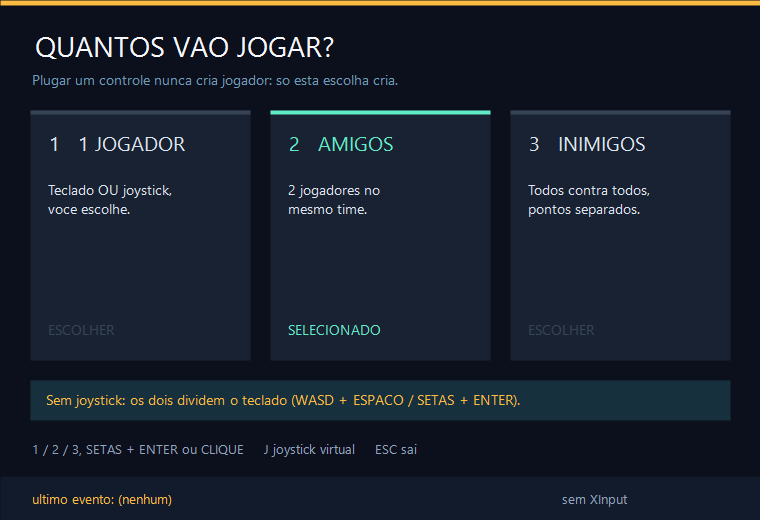 | 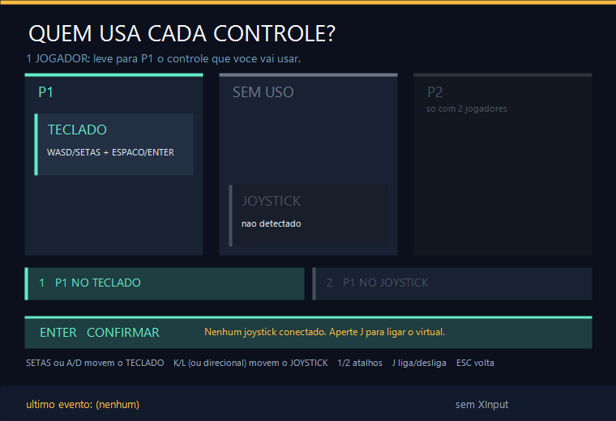 |
| **1 jogador no joystick** | **2 jogadores: P1 joystick + P2 teclado** |
| 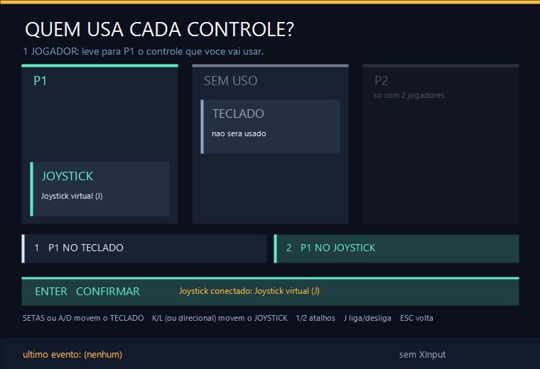 | 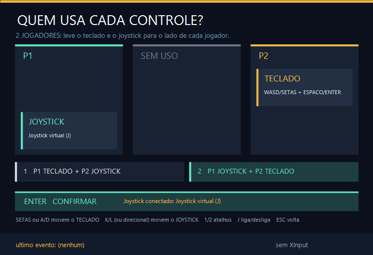 |

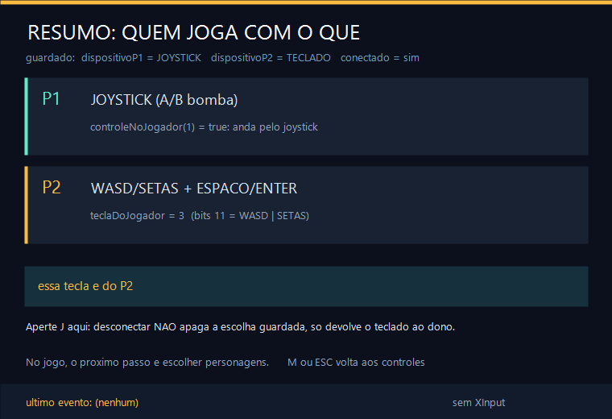

As imagens foram geradas por [`testes/verificar_aula33.cpp`](../../testes/verificar_aula33.cpp), que confere 23 comportamentos sem abrir janela:

```text
ok    conectar o joystick nao cria nem tira jogador
ok    1P: direcional para a esquerda leva o joystick para P1 e o teclado sai
ok    1P no joystick: W e ESPACO nao movem ninguem
ok    2P: mover o teclado para P1 empurra o joystick para P2
ok    2P com joystick: nenhuma tecla deixa os dois no mesmo aparelho
ok    P1 no joystick: P2, sozinho no teclado, fica com W e com ENTER
ok    desconectou: a escolha fica guardada, mas o teclado se divide (P1 WASD, P2 SETAS)
ok    reconectou: P1 volta ao joystick sem escolher de novo
ok    conectar com a tela aberta em 2P ja coloca o joystick em P2
...
Aula 33: controles verificados
```

Experimente (`.\abrir_aula.ps1 -Numero 33 -Modo Exemplo`):

1. Escolha **2 AMIGOS** sem joystick. Os dois cartões são o teclado dividido. Aperte as setas: nada muda.
2. Aperte **J**. O cartão JOYSTICK aparece em P2. Use as setas para levar o teclado para P2: o joystick vai sozinho para P1.
3. Confirme com ENTER. No resumo, aperte W: com P1 no joystick, o W é do P2. Aperte **J** de novo (desconectou) e aperte W: agora é do P1.
4. Volte, escolha **1 JOGADOR**, leve o joystick para SEM USO com **L**. O teclado continua em P1.

## 4. O que mudou em relação ao jogo e por quê

| No jogo | Nesta aula | Motivo |
| --- | --- | --- |
| a tela de nomes fica entre quantidade e controles | vai direto | nomes são a Aula 30 |
| o controle vem de SDL2, XInput ou DirectInput (Aula 31) | XInput 0 ou joystick virtual (J, K, L) | dá para estudar sem controle físico |
| `validarAtribuicao` só roda ao abrir a tela e ao confirmar | também roda quando o controle conecta ou desconecta com a tela aberta | veja abaixo |
| tela de resumo não existe; a escolha aparece em `resumoJogadores` nas telas seguintes | tela de resumo com máscara e teste de teclas | ver a consequência da escolha |

**Uma inconsistência do jogo real.** Abra a tela de controles com **2 jogadores e sem joystick**: `validarAtribuicao` põe os dois no teclado. Agora conecte o controle com a tela aberta. O desenho usa `ladoDispositivo`: o teclado aparece em P1 e o joystick em **SEM USO**, mas o botão marcado diz "P1 TECLADO + P2 JOYSTICK". Ao apertar ENTER, `validarAtribuicao` corrige e P2 recebe o joystick. O resultado da partida está certo, mas a tela mostrou outra coisa por um momento. Esta versão chama `validarAtribuicao` quando a conexão muda, e o teste "conectar com a tela aberta em 2P já coloca o joystick em P2" garante isso. No jogo, a correção seria a mesma linha em `atualizarEstadoControle`, quando `controleConectado` muda.

## 5. Laboratório visual

| | |
| --- | --- |
| 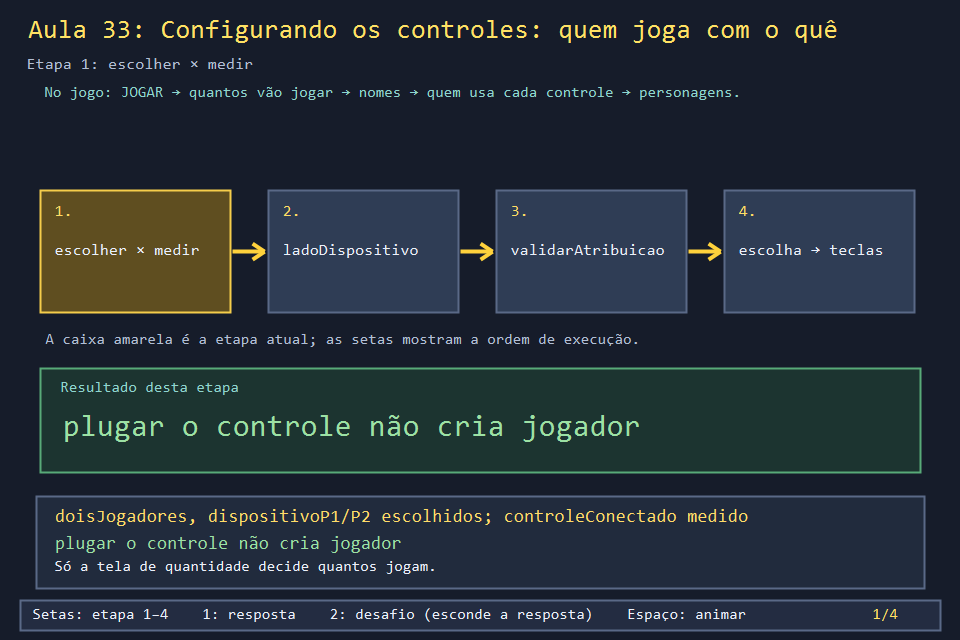 | 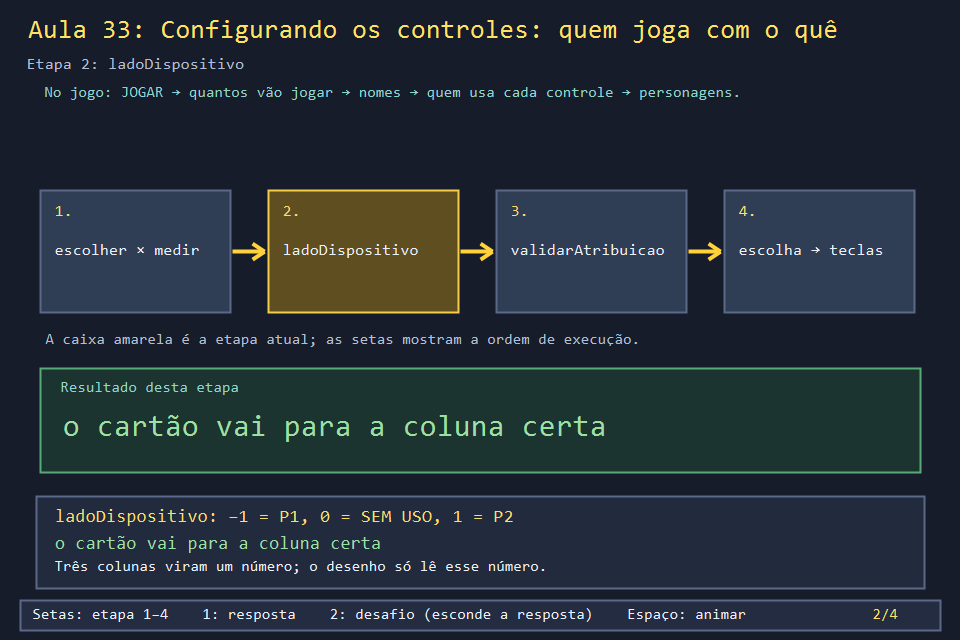 |
| 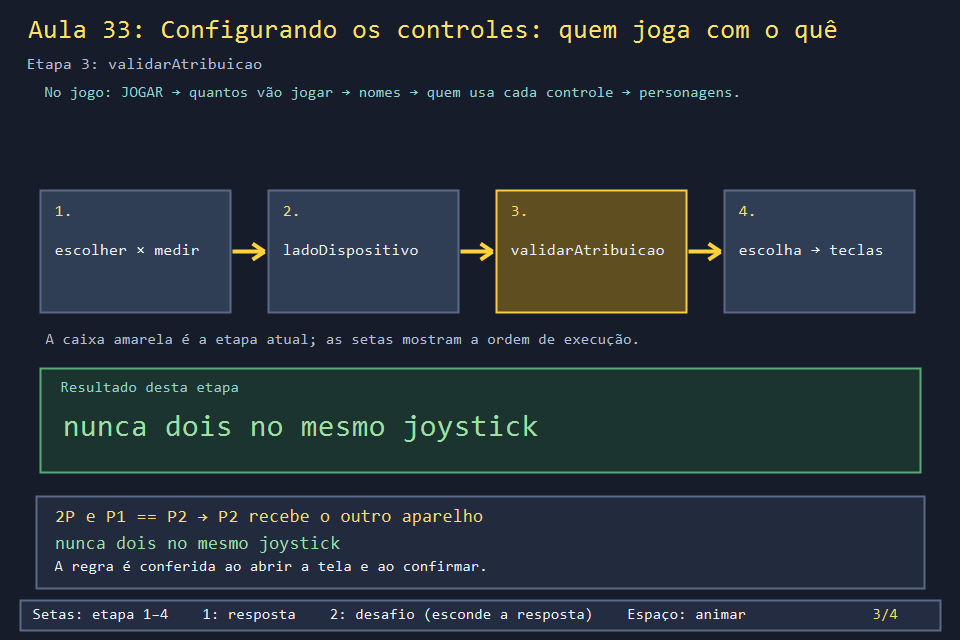 | 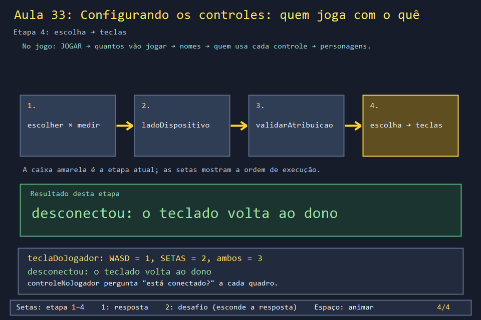 |

```powershell
.\compilar_aula.ps1 -Numero 33
.\build\Aula_33_configuracao_de_controles.exe     # diagrama
.\abrir_aula.ps1 -Numero 33 -Modo Exemplo         # as telas interativas
.\abrir_aula.ps1 -Numero 33 -Modo Solucao         # exercício 3 resolvido, no console
```

## 6. Exercícios

1. **Previsão.** 2 jogadores, joystick conectado, P1 no teclado e P2 no joystick. O que fazem, nessa ordem, a seta → e depois o direcional ← do joystick? *(→ leva o teclado para P2, então o joystick vai para P1. O direcional ← leva o joystick para P1, onde ele já está: nada muda.)*
2. **Máscara.** Quanto vale `teclaDoJogador(false)` em cada linha da tabela da seção 1? *(3, 0, 1, 3, 0.)* E `teclaDoJogador(true)` na linha "2 jogadores, P1 joystick + P2 teclado"? *(3: P2 está sozinho no teclado.)*
3. **Lembrar a configuração.** Grave a escolha num arquivo `controles_aula33.cfg` (`jogadores=amigos`, `p1=joystick`, `p2=teclado`) e leia de volta na próxima vez. O que fazer se o arquivo diz `p1=joystick` mas hoje não há controle? E se diz `p1=joystick` e `p2=joystick`? *Solução: `solucoes/`. A leitura aceita só valores conhecidos (o resto vira `teclado`) e termina com `validarAtribuicao`, que resolve os dois casos: sem controle, os dois vão para o teclado; com os dois no joystick, P2 vai para o teclado.*
4. **Dois joysticks.** O jogo tem um `Dispositivo` com dois valores. O que mudaria para aceitar `JOYSTICK_1` e `JOYSTICK_2`? *(`moverDispositivo` deixaria de poder "empurrar o outro para o lado que sobrou", porque haveria três aparelhos para dois lados mais SEM USO; `validarAtribuicao` precisaria checar cada joystick; e `controleNoJogador` precisaria saber qual controle é de quem, como discute o exercício 5 da Aula 31.)*
5. **Leitura.** Por que `moverDispositivo` começa com `if (!controleConectado) { ... return; }`, se a tela já desenha o joystick como "não detectado"? *(Porque o teclado e o mouse continuam chamando `moverDispositivo`. Sem a guarda, apertar → com um jogador e sem joystick gravaria `dispositivoP1 = JOYSTICK`. Na hora nada quebraria, porque `controleNoJogador` pergunta pela conexão e o teclado continuaria valendo. Mas a tela mostraria o teclado em SEM USO, e quem plugasse um controle no meio da partida passaria a jogar por ele sem nunca ter escolhido isso.)*

## 7. Erros comuns

- **Criar o jogador quando o controle conecta.** Foi o defeito original: P2 aparecia sozinho, e o joystick em repouso de um controle mal lido plantava bombas. Quantidade de jogadores é escolha; conexão é medida.
- **Guardar a coluna do cartão.** Uma variável "posição do cartão TECLADO" e outra do JOYSTICK podem discordar (os dois em P1). Guardando só quem usa cada aparelho, o desenho nunca mostra um estado impossível.
- **Validar só no fim.** Se a tela mostra um estado inválido e só o ENTER corrige, o jogador confirma uma coisa e recebe outra. Valide também quando algo de fora (a conexão) muda.
- **Apagar a escolha ao desconectar.** Um cabo frouxo no meio da partida faria o jogador voltar ao menu para escolher de novo. Guardar a escolha e perguntar pela conexão a cada quadro resolve.

## 8. Antes de seguir

- [ ] Sei dizer quais variáveis são escolhidas e qual é medida.
- [ ] Preenchi a tabela da seção 1 com as máscaras antes de olhar a resposta do exercício 2.
- [ ] Conectei e desconectei o joystick virtual na tela de resumo e entendi por que o W muda de dono.

## Referências

- [Aula 31](../Aula_31_joystick_real/Aula_31_joystick_real.md): de onde vem `controleConectado`.
- [XInput (Microsoft Learn)](https://learn.microsoft.com/pt-br/windows/win32/xinput/getting-started-with-xinput)
- [`imagens_jogo_real/menu_controles_sem_joystick.png`](../../imagens_jogo_real/menu_controles_sem_joystick.png): a mesma tela do jogo sem controle.
