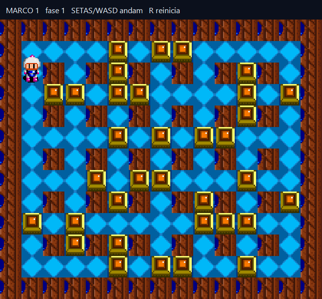
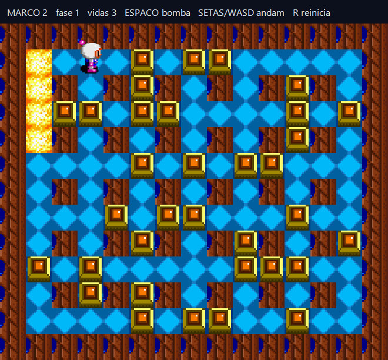
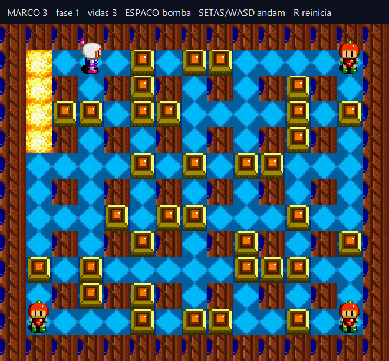

# Três marcos jogáveis

Os marcos são versões jogáveis do Bomberman que crescem junto com o curso. Um único arquivo, [`jogo_incremental.cpp`](jogo_incremental.cpp), gera os três jogos: cada bloco `#if NIVEL >= 2` ou `#if NIVEL >= 3` mostra exatamente o que aquele marco acrescenta. As funções têm os mesmos nomes e regras de `projeto_final/bomberman.cpp`, para você reconhecê-las quando abrir o jogo completo.

| Marco 1 | Marco 2 | Marco 3 |
| --- | --- | --- |
|  |  |  |

```powershell
.\compilar_marcos.ps1          # na raiz do curso
.\build\Marco_1.exe            # depois Marco_2 e Marco_3
```

Rode a partir da raiz do curso ou de `build/`: os tiles e sprites são lidos de `projeto_final/assets/`.

## O que cada marco tem

| Marco | Jogue depois da trilha | O que entra | Funções do jogo real que aparecem |
| --- | --- | --- | --- |
| 1 | Tempo, movimento e animação ([06](../aulas/Aula_06_tempo_entrada_e_animacao/Aula_06_tempo_entrada_e_animacao.md), [07](../aulas/Aula_07_movimento_e_colisao/Aula_07_movimento_e_colisao.md), [18](../aulas/Aula_18_animacao_direcional_gdiplus/Aula_18_animacao_direcional_gdiplus.md)) | arena 13 × 15 com tiles reais, passo fixo de 8 ms, casa lógica e posição desenhada, curva só no centro, animação pela distância | `criarMapa`, `limparArea` (corrigida, Aula 02), `moverJogador`, `podeAndarPara`, `avancarVisual`, `visualNoDestino`, `quadroCaminhada`, `processarMovimentoContinuo` |
| 2 | Bombas e poderes ([08](../aulas/Aula_08_bomba_e_explosao_recursiva/Aula_08_bomba_e_explosao_recursiva.md), [09](../aulas/Aula_09_oito_poderes/Aula_09_oito_poderes.md), [19](../aulas/Aula_19_motor_completo_dos_poderes/Aula_19_motor_completo_dos_poderes.md)) | bomba de 2200 ms, chama recursiva de 650 ms que atravessa caixas, 3 vidas | `colocarBomba`, `atualizarBombas`, `iniciarExplosaoBomba`, `propagarExplosao` |
| 3 | IA e campanha ([10](../aulas/Aula_10_fila_e_bfs/Aula_10_fila_e_bfs.md), [12](../aulas/Aula_12_fases_dificuldade_e_cooperativo/Aula_12_fases_dificuldade_e_cooperativo.md), [27](../aulas/Aula_27_cenarios_tabuleiro_e_tiles/Aula_27_cenarios_tabuleiro_e_tiles.md)) | três inimigos que perseguem pela BFS, portal depois do último inimigo, duas fases | `bfsProximoPasso`, `moverInimigos`, `colocarPortal`, `montarFase`, `reiniciarFase`, `novaPartida` |

## O que ficou de fora, de propósito

| No jogo real | Nos marcos | Onde estudar |
| --- | --- | --- |
| oito itens escondidos em blocos | nenhum item; alcance fixo 2 e uma bomba | Aulas 09 e 19 |
| bot no modo demonstração, inimigos que soltam bomba | só perseguição | Aulas 11 e 20 |
| dez fases, cinco chefes, Mario | duas fases, sem chefe | Aulas 12, 14, 22, 25, 26 |
| menus, nomes, ranking, controle, música | só teclado, direto na partida | Aulas 13, 15, 21, 23, 28, 30, 31 |
| semente aleatória a cada partida | semente fixa por fase (`100 + faseAtual`) | Aula 02 |
| janela redimensionável e DPI | tamanho fixo | Aula 24 |

Completar essas peças é o trabalho do [desafio de reconstrução](../DESAFIO_DE_RECONSTRUCAO.md).

## Verificação

[`testes/verificar_marcos.cpp`](../testes/verificar_marcos.cpp) inclui o mesmo arquivo, simula teclas chamando as funções diretamente (sem janela) e confere, para cada nível: o passo e a chegada do desenho; o limite de uma bomba, a explosão em 2200 ms e o fim da chama em 650 ms; a perda de vida na chama; o portal depois dos inimigos e a troca de fase. As três imagens acima são geradas por esse teste. `validar_aulas.ps1` o roda nos três níveis.

## Experimentos

1. Mude `TAMANHO_CELULA` de 44 para 52 (o tamanho do jogo). Qual será a nova área útil da janela? *(15 × 52 = 780 por 40 + 13 × 52 = 716.)*
2. Mude `ALCANCE_EXPLOSAO` para 4 e jogue o Marco 2. Ainda dá para fugir da própria bomba no corredor de cima? Por quê?
3. No Marco 3, troque o critério da BFS em `moverInimigos` para "andar até a casa vizinha de uma caixa". O que os inimigos passam a fazer?
